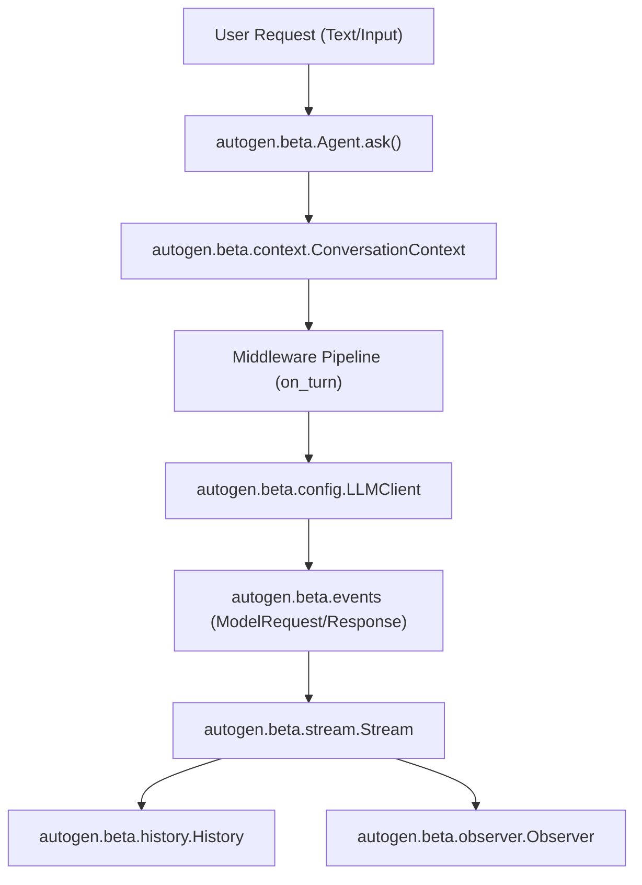
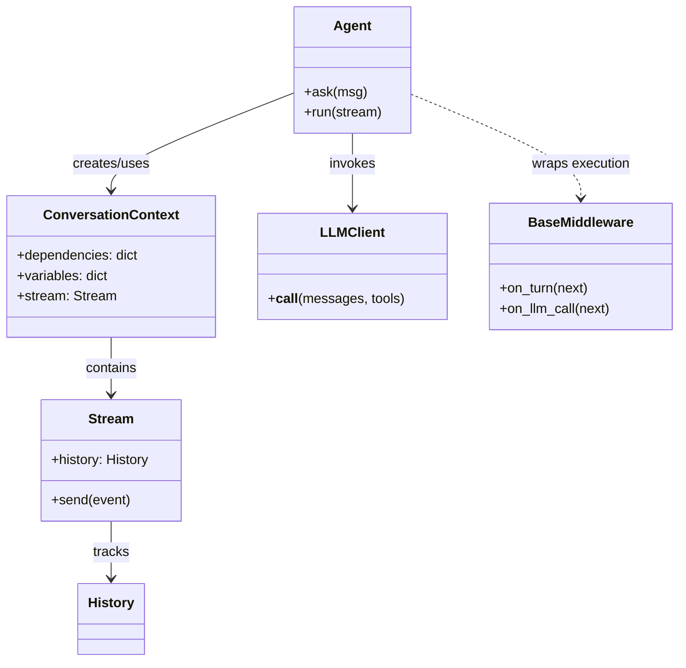

<!-- source: DeepWiki mcp.deepwiki.com · repo ag2ai/ag2 · page 8 Beta Agent Framework · fetched 2026-10-26 -->

# Beta Agent Framework

Relevant source files

The following files were used as context for generating this wiki page:

- [autogen/beta/__init__.py](autogen/beta/__init__.py)
- [autogen/beta/agent.py](autogen/beta/agent.py)
- [autogen/beta/config/anthropic/anthropic_client.py](autogen/beta/config/anthropic/anthropic_client.py)
- [autogen/beta/config/anthropic/mappers.py](autogen/beta/config/anthropic/mappers.py)
- [autogen/beta/config/dashscope/dashscope_client.py](autogen/beta/config/dashscope/dashscope_client.py)
- [autogen/beta/config/gemini/gemini_client.py](autogen/beta/config/gemini/gemini_client.py)
- [autogen/beta/config/gemini/mappers.py](autogen/beta/config/gemini/mappers.py)
- [autogen/beta/config/ollama/ollama_client.py](autogen/beta/config/ollama/ollama_client.py)
- [autogen/beta/config/openai/mappers.py](autogen/beta/config/openai/mappers.py)
- [autogen/beta/config/openai/openai_client.py](autogen/beta/config/openai/openai_client.py)
- [autogen/beta/config/openai/openai_responses_client.py](autogen/beta/config/openai/openai_responses_client.py)
- [autogen/beta/context.py](autogen/beta/context.py)
- [autogen/beta/events/types.py](autogen/beta/events/types.py)
- [autogen/beta/middleware/builtin/telemetry.py](autogen/beta/middleware/builtin/telemetry.py)
- [autogen/beta/observer.py](autogen/beta/observer.py)
- [autogen/beta/stream.py](autogen/beta/stream.py)
- [autogen/beta/tools/__init__.py](autogen/beta/tools/__init__.py)
- [autogen/beta/tools/builtin/__init__.py](autogen/beta/tools/builtin/__init__.py)
- [autogen/tools/experimental/__init__.py](autogen/tools/experimental/__init__.py)
- [pyproject.toml](pyproject.toml)
- [setup_autogen.py](setup_autogen.py)
- [test/beta/agent/test_observer.py](test/beta/agent/test_observer.py)
- [test/beta/middleware/telemetry/test_telemetry.py](test/beta/middleware/telemetry/test_telemetry.py)
- [test/mypy/observer.py](test/mypy/observer.py)
- [website/docs/beta/advanced/observers.mdx](website/docs/beta/advanced/observers.mdx)
- [website/docs/beta/telemetry.mdx](website/docs/beta/telemetry.mdx)
- [website/docs/user-guide/reference-tools/index.mdx](website/docs/user-guide/reference-tools/index.mdx)
- [website/mint-json-template.json.jinja](website/mint-json-template.json.jinja)

The Beta Agent Framework represents the next-generation architecture for AG2. It introduces a highly modular, event-driven system designed to provide granular control over agent execution through middleware, observers, and a robust dependency injection system. Unlike the standard `ConversableAgent` [autogen/user-guide/basic-concepts/conversable-agent](), the Beta framework focuses on a unified pipeline where every interaction is treated as a stream of events.

## Core Architecture

The framework is centered around the `autogen.beta.Agent` class [autogen/beta/agent.py:57-67](). It moves away from monolithic reply functions toward a pipeline-based approach.

### Key Components

| Component | Role | Code Entity |
| :--- | :--- | :--- |
| **Agent** | The primary interface for users to interact with models and tools. | `autogen.beta.Agent` [autogen/beta/agent.py:57]() |
| **Context** | Manages the state, dependencies, and variables for a conversation. | `autogen.beta.context.ConversationContext` [autogen/beta/context.py]() |
| **Stream** | A transport layer for events (messages, tool calls, reasoning). | `autogen.beta.stream.Stream` [autogen/beta/stream.py]() |
| **History** | Maintains the chronological log of events within a stream. | `autogen.beta.history.History` [autogen/beta/history.py]() |
| **Middleware** | Intercepts turns and LLM calls to modify behavior or data. | `autogen.beta.middleware.base.BaseMiddleware` [autogen/beta/agent.py:35]() |

### System Flow: Natural Language to Code Entity
The following diagram illustrates how a natural language request moves through the Beta framework's code entities.

Sources: [autogen/beta/agent.py:57-202](), [autogen/beta/context.py](), [autogen/beta/stream.py](), [autogen/beta/observer.py]()

---

## Framework Subsystems

The Beta framework is divided into several specialized subsystems that handle specific aspects of the agentic lifecycle.

### Beta Agent Core
The core system manages the execution pipeline. It utilizes `fast-depends` [pyproject.toml:89]() for dependency injection, allowing tools and prompts to dynamically access the `Context` or external resources. It also supports `ResponseProto` [autogen/beta/agent.py:38]() for structured output validation and automatic retries if a model fails to meet a schema.
For details, see [Beta Agent Core](#8.1).

### Beta Middleware and Observers
Behavioral modification is handled by two distinct patterns:
*   **Middleware**: Active participants in the pipeline. `BaseMiddleware` [autogen/beta/agent.py:35]() can modify messages before they reach the LLM or process results before they return to the user. This includes Human-In-The-Loop (HITL) hooks and telemetry.
*   **Observers**: Passive listeners. The `@observer` decorator [autogen/beta/observer.py]() allows functions to monitor the stream of events without interfering with the execution logic.
For details, see [Beta Middleware and Observers](#8.2).

### Beta Tools and Toolkits
The tool system in Beta is built around `Toolkit` [autogen/beta/tools/final.py:22]() and `ToolSchema` [autogen/beta/tools/schemas.py:29](). It provides high-level abstractions for common tasks like `WebSearchTool`, `ShellTool`, and `FilesystemToolkit` [autogen/beta/tools/__init__.py:7-24](). It also introduces `MCPServerTool` [autogen/beta/tools/builtin/mcp_server.py]() for native Model Context Protocol support.
For details, see [Beta Tools and Toolkits](#8.3).

### Beta Provider Clients and Streams
Beta uses specialized mappers to translate internal `BaseEvent` [autogen/beta/events/__init__.py]() objects into provider-specific formats (e.g., OpenAI, Anthropic, Gemini). This includes support for advanced features like Anthropic's native `computer_use` or Gemini's `google_search` tool [autogen/beta/config/gemini/mappers.py:78-83]().
For details, see [Beta Provider Clients and Streams](#8.4).

---

## Entity Relationship Diagram
This diagram maps the relationships between the primary classes in the `autogen.beta` namespace.

Sources: [autogen/beta/agent.py:57-202](), [autogen/beta/context.py](), [autogen/beta/stream.py](), [autogen/beta/config/client.py]()

## Installation Requirements
The Beta framework requires Python 3.10+ and specific dependencies for tool execution and dependency injection.
*   `fast-depends[pydantic]`: For dependency injection in tools [pyproject.toml:89]().
*   `anyio`: For asynchronous execution [pyproject.toml:87]().

Sources: [pyproject.toml:51-90]()

---

