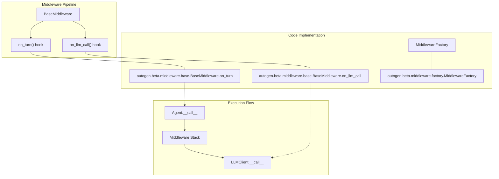
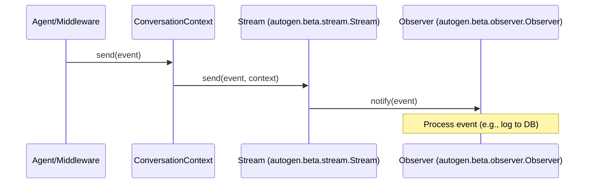

<!-- source: DeepWiki mcp.deepwiki.com · repo ag2ai/ag2 · page 8.2 Beta Middleware and Observers · fetched 2026-10-26 -->

# Beta Middleware and Observers

Relevant source files

The following files were used as context for generating this wiki page:

- [.github/dependabot.yml](.github/dependabot.yml)
- [autogen/beta/__init__.py](autogen/beta/__init__.py)
- [autogen/beta/config/anthropic/anthropic_client.py](autogen/beta/config/anthropic/anthropic_client.py)
- [autogen/beta/config/anthropic/mappers.py](autogen/beta/config/anthropic/mappers.py)
- [autogen/beta/config/dashscope/dashscope_client.py](autogen/beta/config/dashscope/dashscope_client.py)
- [autogen/beta/config/gemini/gemini_client.py](autogen/beta/config/gemini/gemini_client.py)
- [autogen/beta/config/gemini/mappers.py](autogen/beta/config/gemini/mappers.py)
- [autogen/beta/config/ollama/ollama_client.py](autogen/beta/config/ollama/ollama_client.py)
- [autogen/beta/config/openai/mappers.py](autogen/beta/config/openai/mappers.py)
- [autogen/beta/config/openai/openai_client.py](autogen/beta/config/openai/openai_client.py)
- [autogen/beta/config/openai/openai_responses_client.py](autogen/beta/config/openai/openai_responses_client.py)
- [autogen/beta/context.py](autogen/beta/context.py)
- [autogen/beta/events/types.py](autogen/beta/events/types.py)
- [autogen/beta/hitl.py](autogen/beta/hitl.py)
- [autogen/beta/middleware/__init__.py](autogen/beta/middleware/__init__.py)
- [autogen/beta/middleware/base.py](autogen/beta/middleware/base.py)
- [autogen/beta/middleware/builtin/telemetry.py](autogen/beta/middleware/builtin/telemetry.py)
- [autogen/beta/observer.py](autogen/beta/observer.py)
- [autogen/beta/stream.py](autogen/beta/stream.py)
- [autogen/beta/tools/__init__.py](autogen/beta/tools/__init__.py)
- [autogen/beta/tools/builtin/__init__.py](autogen/beta/tools/builtin/__init__.py)
- [test/beta/agent/test_observer.py](test/beta/agent/test_observer.py)
- [test/beta/middleware/builtins/test_approval.py](test/beta/middleware/builtins/test_approval.py)
- [test/beta/middleware/telemetry/test_telemetry.py](test/beta/middleware/telemetry/test_telemetry.py)
- [test/beta/middleware/test_human_input.py](test/beta/middleware/test_human_input.py)
- [test/mypy/observer.py](test/mypy/observer.py)
- [website/docs/beta/advanced/observers.mdx](website/docs/beta/advanced/observers.mdx)
- [website/docs/beta/middleware.mdx](website/docs/beta/middleware.mdx)
- [website/docs/beta/telemetry.mdx](website/docs/beta/telemetry.mdx)

The `autogen.beta` framework introduces a modular pipeline for intercepting and augmenting agent behavior. This system is built on two primary patterns: **Middleware**, which wraps the execution flow to modify requests and responses, and **Observers**, which provide a side-channel for monitoring and reacting to events without altering the core logic.

## Middleware Pipeline

Middleware in AG2 beta functions as a stack of wrappers around an agent's core execution. It allows developers to inject logic before and after key lifecycle events, such as a conversation turn or an LLM call.

### BaseMiddleware and Lifecycle Hooks
All middleware components inherit from `BaseMiddleware` [autogen/beta/middleware/base.py:12-14](). This class defines the interface for intercepting the execution flow through asynchronous hooks:

*   **`on_turn`**: Intercepts the high-level interaction where an agent receives a message and produces a final response.
*   **`on_llm_call`**: Intercepts the specific point where the agent invokes its underlying `LLMClient` [autogen/beta/config/client.py:14-15]().

### Middleware Data Flow
When an agent is executed, the middleware stack is traversed. Each middleware can modify the `ConversationContext` [autogen/beta/context.py:83-84](), inspect the event stream, or even short-circuit the execution (e.g., for Human-in-the-loop approvals).

| Hook | Purpose | Key Parameters |
| :--- | :--- | :--- |
| `on_turn` | Wraps the entire agent "thinking" process. | `agent`, `context`, `next_call` |
| `on_llm_call` | Wraps the raw LLM request/response. | `messages`, `tools`, `response_schema`, `next_call` |

**Sources:** [autogen/beta/middleware/base.py:12-35](), [autogen/beta/context.py:83-102]()

### Middleware to Code Entity Mapping
The following diagram bridges the conceptual middleware pipeline to the specific classes and methods implemented in the codebase.

**Pipeline Entity Mapping**

**Sources:** [autogen/beta/middleware/base.py:12-35](), [autogen/beta/config/client.py:14-15]()

---

## Human-in-the-Loop (HITL) Hooks

The beta framework provides specialized middleware for Human-in-the-loop (HITL) interactions. These hooks allow the system to pause execution and request external approval or input before proceeding with tool execution or LLM calls.

### HumanInputRequest and HumanMessage
The `ConversationContext` provides a built-in `input()` method [autogen/beta/context.py:93-98]() that facilitates HITL by:
1.  Sending a `HumanInputRequest` event [autogen/beta/events/types.py:103-108]().
2.  Waiting for a corresponding `HumanMessage` [autogen/beta/events/types.py:110-115]() on the stream that matches the request ID.

### Approval Middleware
HITL middleware often intercepts `on_llm_call` to check if the model is attempting to call sensitive tools. If a tool requires approval, the middleware sends a request to the `Stream` and blocks until a `HumanMessage` provides the necessary "yes/no" or feedback.

**Sources:** [autogen/beta/context.py:93-98](), [autogen/beta/events/types.py:103-115](), [autogen/beta/hitl.py:1-20]()

---

## Telemetry Middleware

AG2 includes a built-in `TelemetryMiddleware` [autogen/beta/middleware/builtin/telemetry.py:15-18]() designed to capture and export execution data to observability platforms.

### Key Capabilities
*   **Token Usage Tracking**: Normalizes token counts across different providers (OpenAI, Anthropic, Gemini) into a standard `Usage` object [autogen/beta/events/types.py:15-22]().
*   **Event Logging**: Captures `ModelRequest` and `ModelResponse` events to reconstruct the conversation history.
*   **Latency Monitoring**: Measures the time taken for LLM calls and tool executions.

**Sources:** [autogen/beta/middleware/builtin/telemetry.py:15-30](), [autogen/beta/events/types.py:15-31]()

---

## Observer Pattern

Observers provide a non-intrusive way to monitor the `Stream` of events produced by agents and middleware. Unlike middleware, observers cannot modify the data flow; they are strictly for side effects like logging, UI updates, or external triggers.

### The Observer Interface
Observers interact with the `Stream` [autogen/beta/context.py:24-27]() using the `subscribe` method.

**Observer Interaction Flow**

### Event Filtering
Observers use the `where()` method [autogen/beta/context.py:29]() or `Condition` objects [autogen/beta/events/conditions.py:10-15]() to subscribe only to specific types of events, such as `ToolResult` [autogen/beta/events/tool_events.py:5]() or `ModelReasoning` [autogen/beta/events/types.py:38-41]().

**Sources:** [autogen/beta/context.py:24-80](), [autogen/beta/observer.py:10-25](), [autogen/beta/events/types.py:38-41]()

---

## Provider Clients and Event Mapping

Middleware and Observers rely on a unified event system. Provider-specific clients map their raw API responses into these shared beta events.

| Provider | Client Class | Mapper File |
| :--- | :--- | :--- |
| **OpenAI** | `OpenAIClient` [autogen/beta/config/openai/openai_client.py:69]() | `autogen/beta/config/openai/mappers.py` |
| **Anthropic** | `AnthropicClient` [autogen/beta/config/anthropic/anthropic_client.py:57]() | `autogen/beta/config/anthropic/mappers.py` |
| **Gemini** | `GeminiClient` [autogen/beta/config/gemini/gemini_client.py:42]() | `autogen/beta/config/gemini/mappers.py` |

### Mapping Example: Tool Calls
When an LLM triggers a tool, the client converts the vendor-specific format (e.g., Anthropic's `ToolUseBlock` [autogen/beta/config/anthropic/anthropic_client.py:16]()) into a standard `ToolCallEvent` [autogen/beta/events/types.py:27](). This allows middleware to perform validation or HITL approvals regardless of the underlying model provider.

**Sources:** [autogen/beta/config/openai/openai_client.py:151-167](), [autogen/beta/config/anthropic/anthropic_client.py:190-210](), [autogen/beta/config/gemini/gemini_client.py:119-131]()

---

