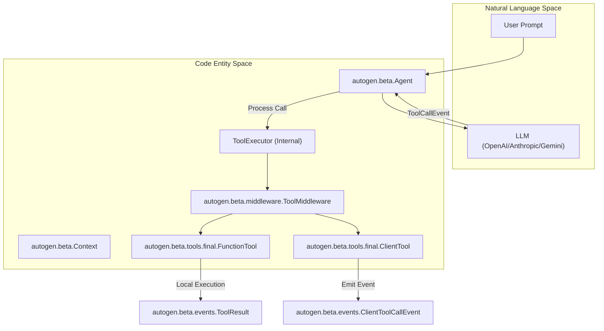
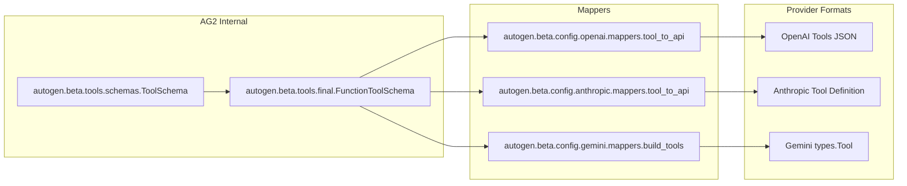

<!-- source: DeepWiki mcp.deepwiki.com · repo ag2ai/ag2 · page 8.3 Beta Tools and Toolkits · fetched 2026-10-26 -->

# Beta Tools and Toolkits

Relevant source files

The following files were used as context for generating this wiki page:

- [autogen/beta/config/anthropic/anthropic_client.py](autogen/beta/config/anthropic/anthropic_client.py)
- [autogen/beta/config/anthropic/mappers.py](autogen/beta/config/anthropic/mappers.py)
- [autogen/beta/config/dashscope/dashscope_client.py](autogen/beta/config/dashscope/dashscope_client.py)
- [autogen/beta/config/gemini/gemini_client.py](autogen/beta/config/gemini/gemini_client.py)
- [autogen/beta/config/gemini/mappers.py](autogen/beta/config/gemini/mappers.py)
- [autogen/beta/config/ollama/ollama_client.py](autogen/beta/config/ollama/ollama_client.py)
- [autogen/beta/config/openai/mappers.py](autogen/beta/config/openai/mappers.py)
- [autogen/beta/config/openai/openai_client.py](autogen/beta/config/openai/openai_client.py)
- [autogen/beta/config/openai/openai_responses_client.py](autogen/beta/config/openai/openai_responses_client.py)
- [autogen/beta/events/types.py](autogen/beta/events/types.py)
- [autogen/beta/exceptions.py](autogen/beta/exceptions.py)
- [autogen/beta/middleware/builtin/telemetry.py](autogen/beta/middleware/builtin/telemetry.py)
- [autogen/beta/plugin.py](autogen/beta/plugin.py)
- [autogen/beta/tools/__init__.py](autogen/beta/tools/__init__.py)
- [autogen/beta/tools/builtin/__init__.py](autogen/beta/tools/builtin/__init__.py)
- [autogen/beta/tools/builtin/shell.py](autogen/beta/tools/builtin/shell.py)
- [autogen/beta/tools/final/client_tool.py](autogen/beta/tools/final/client_tool.py)
- [autogen/beta/tools/final/function_tool.py](autogen/beta/tools/final/function_tool.py)
- [autogen/beta/tools/final/toolkit.py](autogen/beta/tools/final/toolkit.py)
- [autogen/beta/tools/shell/__init__.py](autogen/beta/tools/shell/__init__.py)
- [autogen/beta/tools/shell/environment/__init__.py](autogen/beta/tools/shell/environment/__init__.py)
- [autogen/beta/tools/shell/environment/base.py](autogen/beta/tools/shell/environment/base.py)
- [autogen/beta/tools/shell/environment/local.py](autogen/beta/tools/shell/environment/local.py)
- [autogen/beta/tools/shell/tool.py](autogen/beta/tools/shell/tool.py)
- [autogen/beta/tools/toolkits/__init__.py](autogen/beta/tools/toolkits/__init__.py)
- [autogen/beta/tools/toolkits/filesystem.py](autogen/beta/tools/toolkits/filesystem.py)
- [test/beta/AGENTS.md](test/beta/AGENTS.md)
- [test/beta/config/openai/tools/test_shell.py](test/beta/config/openai/tools/test_shell.py)
- [test/beta/middleware/telemetry/test_telemetry.py](test/beta/middleware/telemetry/test_telemetry.py)
- [test/beta/middleware/test_agent_turns.py](test/beta/middleware/test_agent_turns.py)
- [test/beta/test_plugin/__init__.py](test/beta/test_plugin/__init__.py)
- [test/beta/test_plugin/test_plugin.py](test/beta/test_plugin/test_plugin.py)
- [test/beta/tools/test_client_tool.py](test/beta/tools/test_client_tool.py)
- [test/beta/tools/test_filesystem.py](test/beta/tools/test_filesystem.py)
- [test/beta/tools/test_local_shell.py](test/beta/tools/test_local_shell.py)
- [test/beta/tools/test_skill_search.py](test/beta/tools/test_skill_search.py)
- [test/beta/tools/test_toolkit.py](test/beta/tools/test_toolkit.py)
- [website/docs/beta/telemetry.mdx](website/docs/beta/telemetry.mdx)
- [website/docs/beta/tools/builtin_tools.mdx](website/docs/beta/tools/builtin_tools.mdx)
- [website/docs/beta/tools/common_toolkits.mdx](website/docs/beta/tools/common_toolkits.mdx)
- [website/docs/beta/tools/tool_middleware.mdx](website/docs/beta/tools/tool_middleware.mdx)
- [website/docs/beta/tools/toolkits.mdx](website/docs/beta/tools/toolkits.mdx)

The beta tool system in AG2 provides a redesigned architecture for extending agent capabilities. Unlike the legacy system, beta tools are built on an event-driven foundation, supporting advanced features like tool middleware, provider-native tool integrations (e.g., Anthropic's computer use or Gemini's Google Search), and structured toolsets called Toolkits.

## Core Tool Architecture

The system distinguishes between tools executed locally and tools executed by a client (e.g., a web browser or a specific UI component).

### FunctionTool
`FunctionTool` is the primary mechanism for wrapping Python functions as tools. It uses `pydantic` and `fast_depends` to automatically generate JSON schemas for LLMs and handle dependency injection [autogen/beta/tools/final/function_tool.py:15-16]().

### ClientTool
`ClientTool` represents a tool that the agent "calls," but the execution happens outside the agent's immediate environment (typically in the user's frontend or a remote client). Instead of returning a result immediately, calling a `ClientTool` emits a `ClientToolCallEvent` [test/beta/tools/test_client_tool.py:24-32]().

### Toolkit
A `Toolkit` is a logical grouping of tools that can be registered together. It allows for shared middleware and configuration across multiple functions [autogen/beta/tools/final/toolkit.py:22]().

### Tool Data Flow
The following diagram illustrates how a tool call moves from the LLM through the AG2 beta infrastructure to execution.

**Tool Execution Data Flow**

Sources: [autogen/beta/tools/final/function_tool.py:15-16](), [test/beta/tools/test_client_tool.py:24-32](), [autogen/beta/config/openai/openai_client.py:121-126]()

---

## Builtin Tools

AG2 Beta includes several "native" tools that map directly to provider-specific capabilities or common administrative tasks.

### Shell and Code Execution
The system provides robust environments for executing code.
- **ShellTool**: Executes bash commands. It can run in a `LocalShellEnvironment` or within containerized environments [autogen/beta/tools/shell/tool.py:23](), [autogen/beta/tools/shell/environment/local.py:23]().
- **CodeExecutionTool**: A high-level tool for executing code blocks, often mapped to provider-native features like Gemini's `code_execution` [autogen/beta/config/gemini/mappers.py:87-88]().

### Web Capabilities
- **WebSearchTool**: Maps to native search capabilities (e.g., `google_search` for Gemini or Anthropic's web search beta) [autogen/beta/config/gemini/mappers.py:78-82](), [autogen/beta/config/anthropic/mappers.py:96-115]().
- **WebFetchTool**: Designed for retrieving content from specific URLs, supporting domain allow/block lists and token limits [autogen/beta/config/anthropic/mappers.py:121-133]().

### Specialized Builtins
- **MCPServerTool**: Connects agents to Model Context Protocol (MCP) servers [autogen/beta/tools/builtin/mcp_server.py:7]().
- **MemoryTool**: Maps to Anthropic's native memory/ephemeral context features [autogen/beta/config/anthropic/mappers.py:135-137]().
- **ImageGenerationTool**: Handles DALL-E or similar image generation requests [autogen/beta/config/openai/openai_responses_client.py:189-208]().

Sources: [autogen/beta/tools/__init__.py:7-24](), [autogen/beta/config/anthropic/mappers.py:88-161](), [autogen/beta/config/gemini/mappers.py:63-101]()

---

## Toolkits

Toolkits provide a way to bundle related capabilities with common security boundaries or middleware.

### FilesystemToolkit
The `FilesystemToolkit` exposes local file operations. It includes a path-traversal guard that ensures all operations stay within a specified `base_path` [autogen/beta/tools/toolkits/filesystem.py:18-22]().

| Tool | Functionality |
| :--- | :--- |
| `read_file` | Reads text or base64 binary content [autogen/beta/tools/toolkits/filesystem.py:67-76]() |
| `write_file` | Creates/overwrites files and creates parent directories [autogen/beta/tools/toolkits/filesystem.py:129-136]() |
| `update_file` | Performs exact string replacement (find/replace) [autogen/beta/tools/toolkits/filesystem.py:143-153]() |
| `find_files` | Searches using glob patterns (e.g., `**/*.py`) [autogen/beta/tools/toolkits/filesystem.py:85-92]() |
| `delete_file` | Removes a file from the base directory [autogen/beta/tools/toolkits/filesystem.py:160-166]() |

### SkillsToolkit
The `SkillsToolkit` allows agents to manage and search for "Skills"—reusable Python functions stored as code. This toolkit enables agents to extend their own capabilities at runtime by searching for and loading new skills [autogen/beta/tools/toolkits/skills.py:6-24]().

Sources: [autogen/beta/tools/toolkits/filesystem.py:18-60](), [autogen/beta/tools/toolkits/__init__.py:5-6]()

---

## Provider Integration and Schema Mapping

Beta tools are translated into provider-specific formats by "Mappers." This allows the same `FunctionTool` to work across different LLMs even when they require different JSON schema flavors (e.g., Anthropic's requirement for `additionalProperties: false`).

**Schema Translation Architecture**

### Key Mapping Rules
1.  **Anthropic**: Requires `additionalProperties: false` on all object nodes in the schema [autogen/beta/config/anthropic/mappers.py:32-41]().
2.  **Gemini**: Requires parameterless functions to be normalized to an empty object schema rather than `null` to avoid `INVALID_ARGUMENT` errors [autogen/beta/config/gemini/mappers.py:50-60]().
3.  **OpenAI Responses API**: Reconstructs tool calls into specific `function_call` items in the message history [autogen/beta/config/openai/mappers.py:159-167]().

Sources: [autogen/beta/config/anthropic/mappers.py:32-62](), [autogen/beta/config/gemini/mappers.py:50-101](), [autogen/beta/config/openai/mappers.py:41-110]()

---

