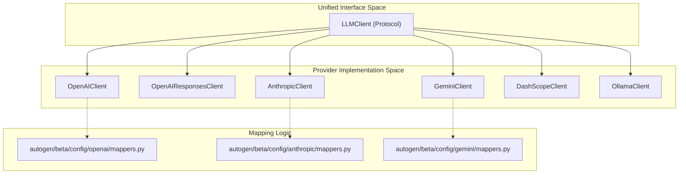
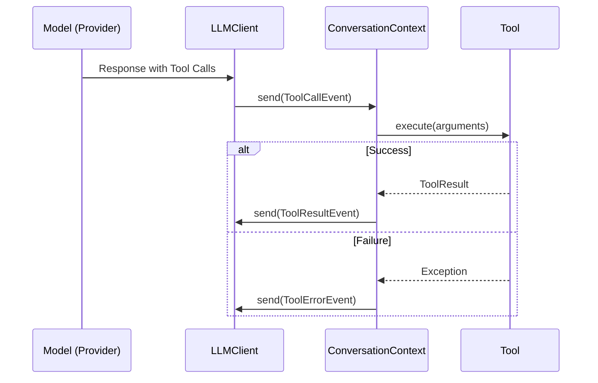

<!-- source: DeepWiki mcp.deepwiki.com · repo ag2ai/ag2 · page 8.4 Beta Provider Clients and Streams · fetched 2026-10-26 -->

# Beta Provider Clients and Streams

Relevant source files

The following files were used as context for generating this wiki page:

- [autogen/beta/config/anthropic/anthropic_client.py](autogen/beta/config/anthropic/anthropic_client.py)
- [autogen/beta/config/anthropic/mappers.py](autogen/beta/config/anthropic/mappers.py)
- [autogen/beta/config/dashscope/dashscope_client.py](autogen/beta/config/dashscope/dashscope_client.py)
- [autogen/beta/config/dashscope/mappers.py](autogen/beta/config/dashscope/mappers.py)
- [autogen/beta/config/gemini/gemini_client.py](autogen/beta/config/gemini/gemini_client.py)
- [autogen/beta/config/gemini/mappers.py](autogen/beta/config/gemini/mappers.py)
- [autogen/beta/config/ollama/mappers.py](autogen/beta/config/ollama/mappers.py)
- [autogen/beta/config/ollama/ollama_client.py](autogen/beta/config/ollama/ollama_client.py)
- [autogen/beta/config/openai/mappers.py](autogen/beta/config/openai/mappers.py)
- [autogen/beta/config/openai/openai_client.py](autogen/beta/config/openai/openai_client.py)
- [autogen/beta/config/openai/openai_responses_client.py](autogen/beta/config/openai/openai_responses_client.py)
- [autogen/beta/events/base.py](autogen/beta/events/base.py)
- [autogen/beta/events/tool_events.py](autogen/beta/events/tool_events.py)
- [autogen/beta/events/types.py](autogen/beta/events/types.py)
- [autogen/beta/middleware/builtin/telemetry.py](autogen/beta/middleware/builtin/telemetry.py)
- [autogen/beta/streams/__init__.py](autogen/beta/streams/__init__.py)
- [autogen/beta/streams/redis/__init__.py](autogen/beta/streams/redis/__init__.py)
- [autogen/beta/streams/redis/serializer.py](autogen/beta/streams/redis/serializer.py)
- [autogen/beta/streams/redis/storage.py](autogen/beta/streams/redis/storage.py)
- [autogen/beta/streams/redis/stream.py](autogen/beta/streams/redis/stream.py)
- [autogen/beta/tools/__init__.py](autogen/beta/tools/__init__.py)
- [autogen/beta/tools/builtin/__init__.py](autogen/beta/tools/builtin/__init__.py)
- [test/beta/config/anthropic/test_convert_messages.py](test/beta/config/anthropic/test_convert_messages.py)
- [test/beta/config/anthropic/tools/test_unsupported.py](test/beta/config/anthropic/tools/test_unsupported.py)
- [test/beta/config/dashscope/tools/test_unsupported.py](test/beta/config/dashscope/tools/test_unsupported.py)
- [test/beta/config/gemini/test_convert_messages.py](test/beta/config/gemini/test_convert_messages.py)
- [test/beta/config/gemini/tools/test_unsupported.py](test/beta/config/gemini/tools/test_unsupported.py)
- [test/beta/config/ollama/test_convert_messages.py](test/beta/config/ollama/test_convert_messages.py)
- [test/beta/config/ollama/tools/test_unsupported.py](test/beta/config/ollama/tools/test_unsupported.py)
- [test/beta/config/openai/test_convert_messages.py](test/beta/config/openai/test_convert_messages.py)
- [test/beta/config/openai/tools/test_unsupported.py](test/beta/config/openai/tools/test_unsupported.py)
- [test/beta/events/test_field.py](test/beta/events/test_field.py)
- [test/beta/events/test_tool_events.py](test/beta/events/test_tool_events.py)
- [test/beta/middleware/telemetry/test_telemetry.py](test/beta/middleware/telemetry/test_telemetry.py)
- [test/beta/tools/test_resolve.py](test/beta/tools/test_resolve.py)
- [website/docs/beta/advanced/stream.mdx](website/docs/beta/advanced/stream.mdx)
- [website/docs/beta/inputs/inputs.mdx](website/docs/beta/inputs/inputs.mdx)
- [website/docs/beta/telemetry.mdx](website/docs/beta/telemetry.mdx)

The `autogen.beta` framework introduces a unified communication layer between agents and Large Language Model (LLM) providers. This system leverages a robust event-driven architecture, provider-specific message mappers, and a standardized response protocol. Additionally, it supports asynchronous event streaming, including persistent backends like Redis.

## Provider Client Architecture

Beta provider clients implement the `LLMClient` protocol, providing a standardized `__call__` interface that accepts a sequence of `BaseEvent` objects and returns a `ModelResponse`. Each client is responsible for translating AG2 internal events into the specific payload format required by the underlying provider (e.g., OpenAI, Anthropic, Gemini).

### Client Implementation Mapping

The following diagram illustrates the relationship between the unified `LLMClient` interface and the specific provider implementations.

**LLM Client Entity Map**

Sources: `[autogen/beta/config/client.py:1-30]()`, `[autogen/beta/config/openai/openai_client.py:69-70]()`, `[autogen/beta/config/anthropic/anthropic_client.py:57-58]()`, `[autogen/beta/config/gemini/gemini_client.py:42-43]()`, `[autogen/beta/config/dashscope/dashscope_client.py:43-44]()`.

### Key Provider Features

| Provider | Client Class | Unique Capabilities |
| :--- | :--- | :--- |
| **OpenAI** | `OpenAIClient` | Supports `response_format` for JSON schemas and `reasoning_effort` for o1/o3 models. `[autogen/beta/config/openai/openai_client.py:36-69]()` |
| **OpenAI (Responses)** | `OpenAIResponsesClient` | Wraps the new OpenAI Responses API, supporting native `WebSearch` and `ImageGeneration` tools. `[autogen/beta/config/openai/openai_responses_client.py:76-114]()` |
| **Anthropic** | `AnthropicClient` | Implements prompt caching (`cache_control`), native MCP server support, and `pause_turn` for multi-step tool use. `[autogen/beta/config/anthropic/anthropic_client.py:57-142]()` |
| **Gemini** | `GeminiClient` | Supports `google_search` and `url_context` native tools via `types.Tool`. `[autogen/beta/config/gemini/mappers.py:63-101]()` |
| **DashScope** | `DashScopeClient` | Integrates Alibaba's DashScope with support for incremental output and reasoning content. `[autogen/beta/config/dashscope/dashscope_client.py:150-196]()` |

## Message Mappers and Event Translation

Mappers are pure functions that convert AG2's `BaseEvent` hierarchy into provider-specific dictionaries or objects.

### Data Flow: Request to Provider
1. **Input**: A sequence of `BaseEvent` (e.g., `ModelRequest`, `TextInput`, `ImageUrlInput`).
2. **Translation**: The client calls `convert_messages`.
   - For OpenAI: `[autogen/beta/config/openai/mappers.py:179-182]()`
   - For Anthropic: `[autogen/beta/config/anthropic/mappers.py:182-185]()`
3. **Tool Schema Mapping**: Internal `ToolSchema` objects are converted to API definitions (e.g., `tool_to_api`). `[autogen/beta/config/openai/mappers.py:321-322]()`.
4. **Output**: Provider-specific payload (e.g., Anthropic `messages` list or Gemini `types.Content`).

### Handling Structured Outputs
Clients use `ResponseProto` to enforce structured JSON outputs. Mappers recursively inject `additionalProperties: false` into schemas to comply with strict mode requirements for OpenAI and Anthropic. `[autogen/beta/config/openai/mappers.py:58-88]()`, `[autogen/beta/config/anthropic/mappers.py:32-62]()`.

## Tool Events and Execution

The framework distinguishes between `ToolCallEvent` (the request from the model) and `ToolResultEvent` (the outcome of execution).

**Tool Execution Event Flow**

Sources: `[autogen/beta/events/tool_events.py:31-196]()`.

### Builtin Tool Support
Specific providers support "native" tools that are not executed locally but by the provider's infrastructure.
- **OpenAI Responses API**: Handles `WEB_SEARCH_TOOL_NAME` and `IMAGE_GENERATION_TOOL_NAME` directly. `[autogen/beta/config/openai/openai_responses_client.py:163-207]()`.
- **Anthropic**: Supports native `bash`, `web_search`, and `mcp_toolset`. `[autogen/beta/config/anthropic/mappers.py:88-163]()`.

## Event Streaming and Redis Support

The beta framework supports real-time event streaming through a `Stream` abstraction. This allows agents to emit partial message chunks (`ModelMessageChunk`) and reasoning steps (`ModelReasoning`) as they occur.

### Redis Stream Implementation
The `RedisStream` (located in `autogen/beta/streams/redis/`) provides a persistent, distributed backend for agent events.

1. **Serialization**: Events are serialized using a specialized `RedisSerializer` that handles Pydantic models and binary data. `[autogen/beta/streams/redis/serializer.py:1-20]()`.
2. **Storage**: The `RedisStorage` class manages the low-level interactions with the Redis instance, including stream appending and consumer group management. `[autogen/beta/streams/redis/storage.py:1-30]()`.
3. **Flow**: When an agent sends an event to the `ConversationContext`, it is pushed to the Redis stream, allowing remote observers or UI components to react to agent activity in real-time.

### Event Types Summary
| Event Class | Purpose |
| :--- | :--- |
| `ModelReasoning` | Captures "thinking" or "chain of thought" content. `[autogen/beta/events/types.py:38-41]()` |
| `ModelMessageChunk` | Represents a partial string from a streaming response. `[autogen/beta/events/types.py:97-100]()` |
| `ToolCallEvent` | Encapsulates a request to invoke a function. `[autogen/beta/events/tool_events.py:53-59]()` |
| `ToolResultEvent` | Encapsulates the successful return value of a tool. `[autogen/beta/events/tool_events.py:104-110]()` |
| `Usage` | Normalized token usage across all providers. `[autogen/beta/events/types.py:14-22]()` |

Sources: `[autogen/beta/events/types.py:1-123]()`, `[autogen/beta/events/tool_events.py:1-196]()`.

---

