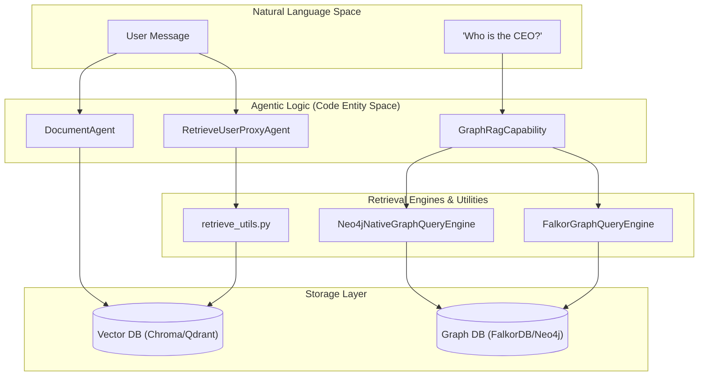
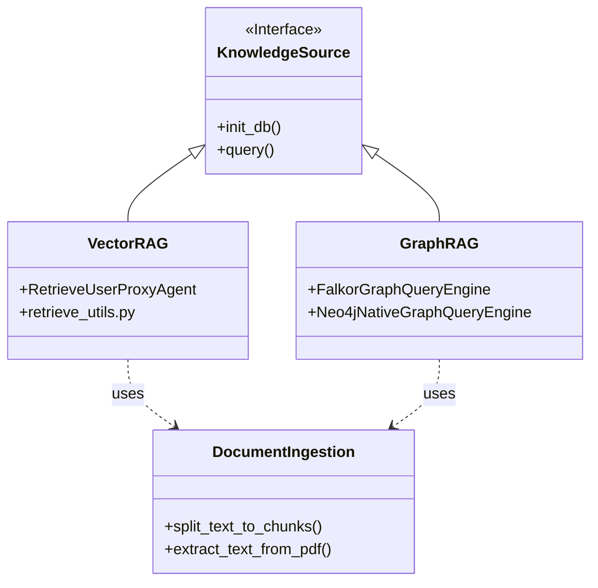

<!-- source: DeepWiki mcp.deepwiki.com · repo ag2ai/ag2 · page 9 RAG and Knowledge Retrieval · fetched 2026-10-26 -->

# RAG and Knowledge Retrieval

Relevant source files

The following files were used as context for generating this wiki page:

- [autogen/agentchat/contrib/captainagent/tool_retriever.py](autogen/agentchat/contrib/captainagent/tool_retriever.py)
- [autogen/agentchat/contrib/graph_rag/falkor_graph_query_engine.py](autogen/agentchat/contrib/graph_rag/falkor_graph_query_engine.py)
- [autogen/agentchat/contrib/graph_rag/falkor_graph_rag_capability.py](autogen/agentchat/contrib/graph_rag/falkor_graph_rag_capability.py)
- [autogen/agentchat/contrib/graph_rag/graph_query_engine.py](autogen/agentchat/contrib/graph_rag/graph_query_engine.py)
- [autogen/agentchat/contrib/graph_rag/graph_rag_capability.py](autogen/agentchat/contrib/graph_rag/graph_rag_capability.py)
- [autogen/agentchat/contrib/graph_rag/neo4j_native_graph_query_engine.py](autogen/agentchat/contrib/graph_rag/neo4j_native_graph_query_engine.py)
- [autogen/agentchat/contrib/graph_rag/neo4j_native_graph_rag_capability.py](autogen/agentchat/contrib/graph_rag/neo4j_native_graph_rag_capability.py)
- [autogen/agentchat/contrib/qdrant_retrieve_user_proxy_agent.py](autogen/agentchat/contrib/qdrant_retrieve_user_proxy_agent.py)
- [autogen/agentchat/contrib/retrieve_assistant_agent.py](autogen/agentchat/contrib/retrieve_assistant_agent.py)
- [autogen/agentchat/contrib/retrieve_user_proxy_agent.py](autogen/agentchat/contrib/retrieve_user_proxy_agent.py)
- [autogen/agentchat/realtime/experimental/realtime_swarm.py](autogen/agentchat/realtime/experimental/realtime_swarm.py)
- [autogen/retrieve_utils.py](autogen/retrieve_utils.py)
- [notebook/agentchat_graph_rag_falkordb.ipynb](notebook/agentchat_graph_rag_falkordb.ipynb)
- [notebook/agentchat_graph_rag_neo4j_native.ipynb](notebook/agentchat_graph_rag_neo4j_native.ipynb)
- [test/agentchat/contrib/graph_rag/Toast_financial_report.pdf](test/agentchat/contrib/graph_rag/Toast_financial_report.pdf)
- [test/agentchat/contrib/graph_rag/test_falkor_graph_rag.py](test/agentchat/contrib/graph_rag/test_falkor_graph_rag.py)
- [test/agentchat/contrib/graph_rag/test_graph_rag_basic.py](test/agentchat/contrib/graph_rag/test_graph_rag_basic.py)
- [test/agentchat/contrib/graph_rag/test_native_neo4j_graph_rag.py](test/agentchat/contrib/graph_rag/test_native_neo4j_graph_rag.py)
- [test/test_retrieve_utils.py](test/test_retrieve_utils.py)

AG2 provides a robust suite of Retrieval-Augmented Generation (RAG) capabilities, enabling agents to interact with external knowledge sources ranging from flat document sets to complex knowledge graphs. These capabilities are primarily delivered through specialized agents and "Capabilities" that can be attached to standard `ConversableAgent` instances.

The framework supports three primary architectural patterns for retrieval:
1.  **Vector-based RAG**: Traditional similarity search using vector databases (ChromaDB, Qdrant, etc.).
2.  **Graph RAG**: Structured retrieval using knowledge graphs (FalkorDB, Neo4j).
3.  **Document Agents**: Experimental high-level agents for complex document parsing and ingestion.

### High-Level Architecture

The following diagram illustrates how natural language queries are transformed into retrieval operations across different storage backends within the AG2 ecosystem.

**Knowledge Retrieval Flow**

Sources: [autogen/agentchat/contrib/retrieve_user_proxy_agent.py:96-100](), [autogen/agentchat/contrib/graph_rag/graph_rag_capability.py:10-20](), [autogen/retrieve_utils.py:17-30]()

---

## RetrieveChat and Vector Databases

The core of AG2's RAG capability is `RetrieveUserProxyAgent` [autogen/agentchat/contrib/retrieve_user_proxy_agent.py:96-100](). This agent automates the process of:
1.  Ingesting documents from local directories or URLs.
2.  Splitting files into chunks using `split_files_to_chunks` [autogen/retrieve_utils.py:161-170]().
3.  Storing embeddings in a vector database.
4.  Retrieving relevant context to augment LLM prompts during conversation.

It supports a wide variety of backends including **ChromaDB**, **Qdrant**, **PGVector**, **MongoDB**, and **Couchbase** via a unified `VectorDB` interface [autogen/agentchat/contrib/vectordb/base.py:27-27]().

For details, see [RetrieveChat and Vector Databases](#9.1).

**Sources:** [autogen/agentchat/contrib/retrieve_user_proxy_agent.py:136-146](), [autogen/retrieve_utils.py:41-58]()

---

## Graph RAG

Graph RAG extends traditional retrieval by utilizing the relationships between entities in a Knowledge Graph (KG). AG2 implements this through the `GraphRagCapability` [autogen/agentchat/contrib/graph_rag/graph_rag_capability.py:10-20](), which can be added to a `ConversableAgent`.

| Feature | FalkorDB Implementation | Neo4j Implementation |
| :--- | :--- | :--- |
| **Query Engine** | `FalkorGraphQueryEngine` | `Neo4jNativeGraphQueryEngine` |
| **SDK** | `graphrag_sdk` | `neo4j-graphrag` |
| **Ontology** | Auto-generated or Manual | Schema-guided triplets |
| **Storage** | Redis-based FalkorDB | Neo4j Property Graph |

This approach is particularly effective for complex queries that require traversing multiple "hops" between related concepts that might be separated in a linear document.

For details, see [Graph RAG](#9.2).

**Sources:** [autogen/agentchat/contrib/graph_rag/falkor_graph_query_engine.py:23-35](), [autogen/agentchat/contrib/graph_rag/neo4j_native_graph_query_engine.py:29-48](), [notebook/agentchat_graph_rag_falkordb.ipynb:122-136]()

---

## Document Agent

The `DocumentAgent` is an experimental component designed for sophisticated document processing. Unlike the standard `RetrieveUserProxyAgent`, it focuses on deep ingestion using tools like `Docling` for multi-format parsing.

**Key Components:**
*   **In-memory & Persistent Engines**: Supports rapid prototyping with in-memory querying or long-term storage in ChromaDB.
*   **Parser Utilities**: Specialized logic for handling complex layouts in PDFs, MDX, and HTML.
*   **Workflow**: Typically involves an ingestion phase followed by a query phase where the agent acts as a specialist over the provided document set.

For details, see [Document Agent](#9.3).

**Sources:** [autogen/retrieve_utils.py:181-189](), [autogen/agentchat/contrib/retrieve_user_proxy_agent.py:147-155]()

---

## Integration Map

The following diagram maps the high-level system concepts to the specific Python classes and utility modules that implement them.

**System Concept to Code Entity Mapping**

Sources: [autogen/agentchat/contrib/graph_rag/graph_query_engine.py:28-32](), [autogen/retrieve_utils.py:80-86](), [autogen/agentchat/contrib/retrieve_user_proxy_agent.py:96-108]()

---

