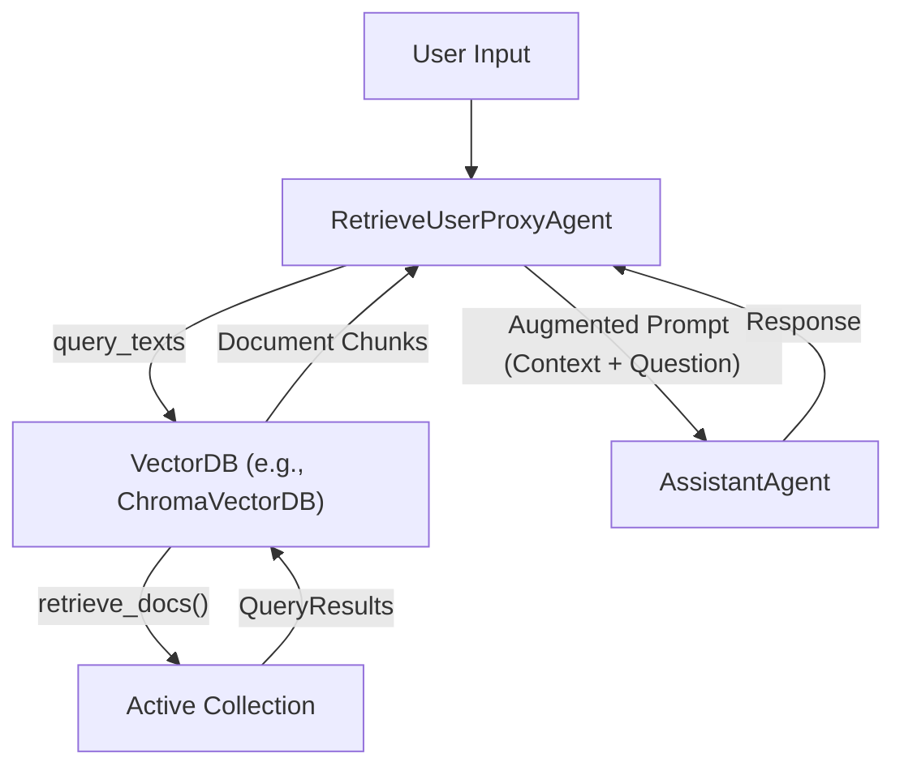
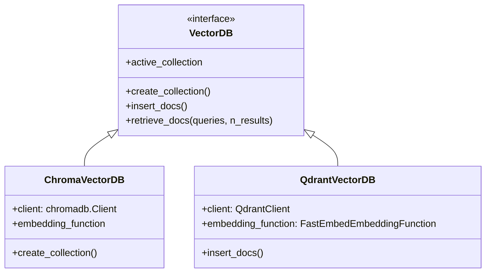
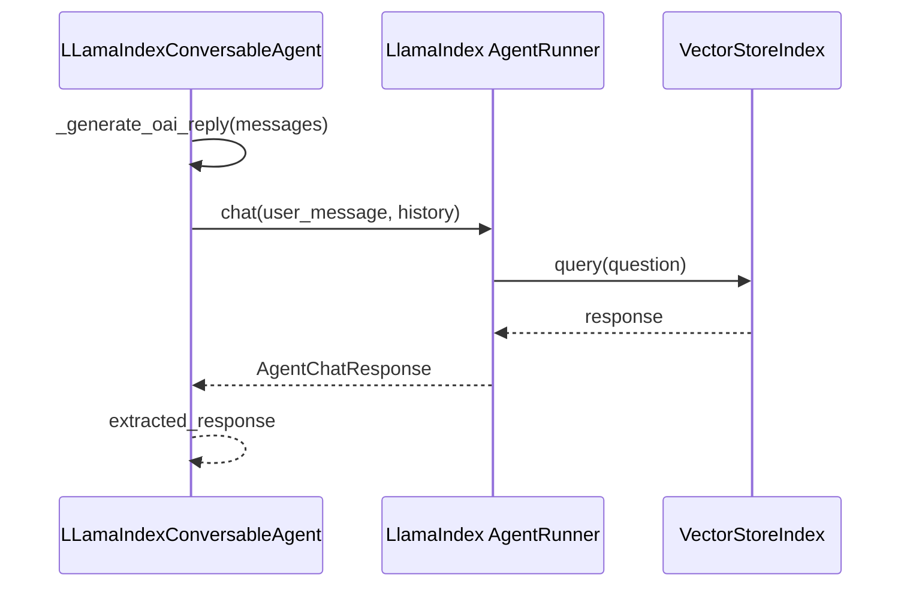

<!-- source: DeepWiki mcp.deepwiki.com · repo ag2ai/ag2 · page 9.1 RetrieveChat and Vector Databases · fetched 2026-10-26 -->

# RetrieveChat and Vector Databases

Relevant source files

The following files were used as context for generating this wiki page:

- [autogen/agentchat/contrib/llamaindex_conversable_agent.py](autogen/agentchat/contrib/llamaindex_conversable_agent.py)
- [autogen/agentchat/contrib/qdrant_retrieve_user_proxy_agent.py](autogen/agentchat/contrib/qdrant_retrieve_user_proxy_agent.py)
- [autogen/agentchat/contrib/rag/chromadb_query_engine.py](autogen/agentchat/contrib/rag/chromadb_query_engine.py)
- [autogen/agentchat/contrib/rag/llamaindex_query_engine.py](autogen/agentchat/contrib/rag/llamaindex_query_engine.py)
- [autogen/agentchat/contrib/retrieve_assistant_agent.py](autogen/agentchat/contrib/retrieve_assistant_agent.py)
- [autogen/agentchat/contrib/retrieve_user_proxy_agent.py](autogen/agentchat/contrib/retrieve_user_proxy_agent.py)
- [autogen/agentchat/contrib/vectordb/base.py](autogen/agentchat/contrib/vectordb/base.py)
- [autogen/agentchat/contrib/vectordb/chromadb.py](autogen/agentchat/contrib/vectordb/chromadb.py)
- [autogen/agentchat/contrib/vectordb/qdrant.py](autogen/agentchat/contrib/vectordb/qdrant.py)
- [autogen/agentchat/contrib/vectordb/utils.py](autogen/agentchat/contrib/vectordb/utils.py)
- [autogen/retrieve_utils.py](autogen/retrieve_utils.py)
- [notebook/agentchat_LlamaIndex_query_engine.ipynb](notebook/agentchat_LlamaIndex_query_engine.ipynb)
- [notebook/agentchat_agents_deep_researcher.ipynb](notebook/agentchat_agents_deep_researcher.ipynb)
- [notebook/agentchat_agents_docagent.ipynb](notebook/agentchat_agents_docagent.ipynb)
- [notebook/agentchat_agents_websurfer.ipynb](notebook/agentchat_agents_websurfer.ipynb)
- [notebook/agentchat_async_human_input.ipynb](notebook/agentchat_async_human_input.ipynb)
- [notebook/agentchat_chromadb_query_engine.ipynb](notebook/agentchat_chromadb_query_engine.ipynb)
- [test/agentchat/contrib/rag/test_chromadb_query_engine.py](test/agentchat/contrib/rag/test_chromadb_query_engine.py)
- [test/agentchat/contrib/rag/test_llamaindex_query_engine.py](test/agentchat/contrib/rag/test_llamaindex_query_engine.py)
- [test/agentchat/contrib/vectordb/test_chromadb.py](test/agentchat/contrib/vectordb/test_chromadb.py)
- [test/agentchat/contrib/vectordb/test_qdrant.py](test/agentchat/contrib/vectordb/test_qdrant.py)
- [test/agentchat/contrib/vectordb/test_vectordb_utils.py](test/agentchat/contrib/vectordb/test_vectordb_utils.py)
- [test/test_retrieve_utils.py](test/test_retrieve_utils.py)

RetrieveChat is a RAG (Retrieval-Augmented Generation) framework within AG2 that enables agents to answer questions or generate code using external knowledge sources. It bridges the gap between Large Language Models and private or domain-specific data stored in vector databases.

## RetrieveUserProxyAgent

The `RetrieveUserProxyAgent` is the primary interface for RAG workflows. It extends `UserProxyAgent` to automate the process of document ingestion, chunking, and similarity-based retrieval [autogen/agentchat/contrib/retrieve_user_proxy_agent.py:96-100]().

### Core Workflow
1.  **Ingestion**: Documents are loaded from local directories, files, or URLs [autogen/agentchat/contrib/retrieve_user_proxy_agent.py:147-152]().
2.  **Chunking**: Files are split into smaller segments based on token size or line counts to fit within LLM context windows [autogen/retrieve_utils.py:161-167]().
3.  **Embedding & Storage**: Chunks are converted into vectors and stored in a supported `VectorDB` [autogen/agentchat/contrib/retrieve_user_proxy_agent.py:328-335]().
4.  **Retrieval**: During a chat, the agent queries the vector database using the user's input and augments the prompt with relevant context [autogen/agentchat/contrib/retrieve_user_proxy_agent.py:596-605]().

### Data Flow Architecture
The following diagram illustrates how a user query triggers retrieval and augmentation.

**RetrieveChat Retrieval Pipeline**

Sources: [autogen/agentchat/contrib/retrieve_user_proxy_agent.py:596-610](), [autogen/agentchat/contrib/vectordb/base.py:142-149]()

## Vector Database Backends

AG2 provides a standardized `VectorDB` protocol, allowing different backends to be used interchangeably via the `VectorDBFactory` [autogen/agentchat/contrib/vectordb/base.py:38-54]().

| Backend | Class | Description |
| :--- | :--- | :--- |
| **ChromaDB** | `ChromaVectorDB` | Default backend. Supports persistent or in-memory storage [autogen/agentchat/contrib/vectordb/chromadb.py:30-34](). |
| **Qdrant** | `QdrantVectorDB` | High-performance vector search engine with `FastEmbed` support [autogen/agentchat/contrib/vectordb/qdrant.py:73-74](). |
| **PGVector** | `PGVectorDB` | PostgreSQL-based vector storage. |
| **MongoDB** | `MongoDBVectorDB` | Integration for MongoDB Atlas Vector Search. |
| **Couchbase** | `CouchbaseVectorDB` | Integration for Couchbase Capella. |

### Code Entity Space: VectorDB Implementations
This diagram maps the abstract protocol to concrete implementations in the codebase.

**VectorDB Hierarchy and Protocol**

Sources: [autogen/agentchat/contrib/vectordb/base.py:38-54](), [autogen/agentchat/contrib/vectordb/chromadb.py:30-34](), [autogen/agentchat/contrib/vectordb/qdrant.py:73-74]()

## Retrieval Utilities (`retrieve_utils`)

The `retrieve_utils.py` module contains the functional logic for handling raw data before it reaches the vector database.

### Key Functions
*   **`split_text_to_chunks`**: Splits strings into lists of strings. It supports `multi_lines` and `one_line` modes and handles token counting to prevent overflow [autogen/retrieve_utils.py:80-86]().
*   **`extract_text_from_pdf`**: Uses `pypdf` to parse PDF documents into plain text [autogen/retrieve_utils.py:139-142]().
*   **`get_files_from_dir`**: Recursively scans directories for supported formats like `.md`, `.pdf`, `.txt`, and `.json` [autogen/retrieve_utils.py:204-208]().
*   **`split_files_to_chunks`**: Orchestrates the reading and splitting of multiple files into a format suitable for `VectorDB.insert_docs` [autogen/retrieve_utils.py:161-167]().

Sources: [autogen/retrieve_utils.py:41-58](), [autogen/retrieve_utils.py:161-167]()

## Integration with LlamaIndex

AG2 supports advanced RAG patterns through `LlamaIndexQueryEngine` and `LLamaIndexConversableAgent`. This allows users to leverage LlamaIndex's complex data connectors and query engines within an AG2 multi-agent conversation.

*   **`LlamaIndexQueryEngine`**: Wraps LlamaIndex's `VectorStoreIndex` to provide a unified `query()` method [autogen/agentchat/contrib/rag/llamaindex_query_engine.py:36-41]().
*   **`LLamaIndexConversableAgent`**: An agent that uses a LlamaIndex `AgentRunner` as its primary reasoning engine, replacing the default `generate_oai_reply` logic [autogen/agentchat/contrib/llamaindex_conversable_agent.py:30-35]().

**LlamaIndex Agent Flow**

Sources: [autogen/agentchat/contrib/llamaindex_conversable_agent.py:66-79](), [autogen/agentchat/contrib/rag/llamaindex_query_engine.py:126-130]()

## Configuration and Customization

The `retrieve_config` dictionary in `RetrieveUserProxyAgent` controls the retrieval behavior:

*   **`task`**: Determines the system prompt (`code`, `qa`, or `default`) [autogen/agentchat/contrib/retrieve_user_proxy_agent.py:132-135]().
*   **`vector_db`**: Specifies the database type or an instance of a class implementing the `VectorDB` protocol [autogen/agentchat/contrib/retrieve_user_proxy_agent.py:136-138]().
*   **`chunk_token_size`**: Maximum tokens per chunk (defaulting to 40% of the model's max tokens) [autogen/agentchat/contrib/retrieve_user_proxy_agent.py:165-166]().
*   **`custom_text_split_function`**: Allows overriding the default chunking logic with a user-defined callable [autogen/agentchat/contrib/retrieve_user_proxy_agent.py:188-190]().

Sources: [autogen/agentchat/contrib/retrieve_user_proxy_agent.py:101-140](), [autogen/agentchat/contrib/retrieve_user_proxy_agent.py:160-195]()

---

