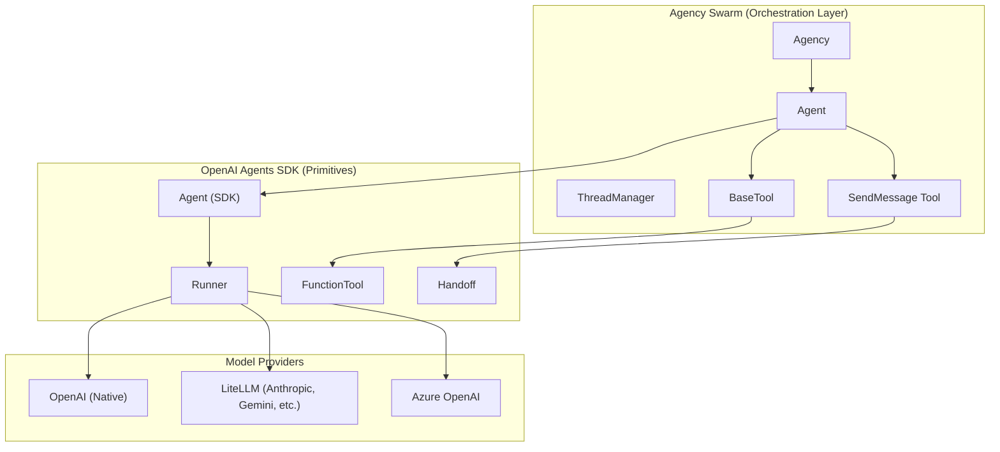
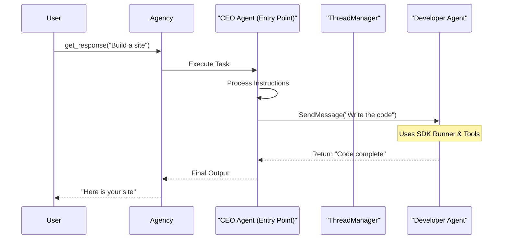

<!-- source: DeepWiki mcp.deepwiki.com · repo VRSEN/agency-swarm · page 1 Overview · fetched 2026-10-26 -->

# Overview

Relevant source files

The following files were used as context for generating this wiki page:

- [README.md](README.md)
- [docs/additional-features/azure-openai.mdx](docs/additional-features/azure-openai.mdx)
- [docs/additional-features/observability.mdx](docs/additional-features/observability.mdx)
- [docs/additional-features/streaming.mdx](docs/additional-features/streaming.mdx)
- [docs/core-framework/tools/custom-tools/step-by-step-guide.mdx](docs/core-framework/tools/custom-tools/step-by-step-guide.mdx)
- [docs/docs.json](docs/docs.json)
- [docs/faq.mdx](docs/faq.mdx)
- [docs/platform/how-credits-work.mdx](docs/platform/how-credits-work.mdx)
- [docs/platform/overview.mdx](docs/platform/overview.mdx)
- [docs/platform/pricing.mdx](docs/platform/pricing.mdx)
- [docs/welcome/ai-agency-vs-other-frameworks.mdx](docs/welcome/ai-agency-vs-other-frameworks.mdx)
- [docs/welcome/getting-started/from-scratch.mdx](docs/welcome/getting-started/from-scratch.mdx)
- [docs/welcome/installation.mdx](docs/welcome/installation.mdx)
- [src/agency_swarm/__init__.py](src/agency_swarm/__init__.py)
- [src/agency_swarm/tools/__init__.py](src/agency_swarm/tools/__init__.py)
- [tests/integration/agency/test_agency_context_sharing.py](tests/integration/agency/test_agency_context_sharing.py)
- [tests/integration/persistence/test_agent_to_agent_persistence.py](tests/integration/persistence/test_agent_to_agent_persistence.py)
- [tests/test_agency_modules/test_package_exports.py](tests/test_agency_modules/test_package_exports.py)

Agency Swarm is a framework for building multi-agent applications, serving as an orchestration layer that leverages and extends the [OpenAI Agents SDK](https://github.com/openai/openai-agents-python). It simplifies the creation of AI agencies by organizing agents into real-world organizational structures with explicit communication flows, specialized roles, and production-ready persistence.

Sources: [README.md:1-9](), [src/agency_swarm/__init__.py:10-49]()

## Framework Architecture

The framework is built on a layered architecture that bridges high-level organizational concepts with the low-level primitives of the OpenAI Agents SDK.

The architecture enables:
- **Organizational Structure**: Defining agencies with an entry point and allowed `communication_flows` [src/agency_swarm/agency/core.py:53-70]().
- **State Management**: Using `ThreadManager` to persist conversation history across sessions via `PersistenceHooks` [src/agency_swarm/utils/thread.py:12-25]().
- **Tooling**: Converting Pydantic-based `BaseTool` classes into SDK-compatible `FunctionTool` instances [src/agency_swarm/tools/base_tool.py:18-35]().

Sources: [src/agency_swarm/agency/core.py:18-40](), [src/agency_swarm/agent/core.py:48-110](), [src/agency_swarm/tools/base_tool.py:18-35](), [src/agency_swarm/__init__.py:10-49]()

## Communication Flow

Communication in Agency Swarm is directional and governed by the `Agency` configuration. Agents do not talk to everyone by default; they use a specialized `SendMessage` tool to initiate dialogues with permitted subordinates.

This flow ensures that agents remain focused on their specific roles while collaborating through a structured hierarchy. For details, see [Architecture](#1.1).

Sources: [src/agency_swarm/agency/core.py:192-230](), [src/agency_swarm/tools/send_message.py:15-45](), [src/agency_swarm/utils/thread.py:40-60]()

## Key Components

### Agency
The `Agency` class is the central entry point. It defines the "Agency Chart" via `communication_flows` and manages the lifecycle of runs. It supports streaming responses and integration with FastAPI for web deployments [src/agency_swarm/agency/core.py:340-360]().

### Agent
The `Agent` class extends the SDK's agent capabilities. It handles role-specific instructions, tool management from local folders (`tools_folder`), and specialized reminders like `AfterEveryUserMessage` [src/agency_swarm/agent/core.py:48-110]().

### Tool System
The framework provides a `BaseTool` for Pydantic-based tool creation and a `ToolFactory` to import tools from OpenAPI schemas, LangChain, or MCP (Model Context Protocol) servers [src/agency_swarm/tools/tool_factory.py:15-40]().

### Persistence and Threads
The `ThreadManager` coordinates with `PersistenceHooks` to ensure that even if a server restarts, the `chat_id` and thread states are preserved [src/agency_swarm/utils/thread.py:12-25]().

Sources: [src/agency_swarm/agency/core.py:18-40](), [src/agency_swarm/agent/core.py:48-110](), [src/agency_swarm/tools/base_tool.py:18-35](), [src/agency_swarm/utils/thread.py:12-25]()

## Key Features

- **Multi-Model Support**: Native support for OpenAI, and extended support for Anthropic, Gemini, and others via `LitellmModel` [src/agency_swarm/__init__.py:232-245]().
- **Observability**: Integration with Langfuse, AgentOps, and native OpenAI tracing for cost and performance tracking [docs/additional-features/observability.mdx:43-57]().
- **Realtime & Voice**: Support for WebSocket-based voice agents via `run_realtime` [src/agency_swarm/integrations/realtime.py:10-30]().
- **FastAPI Ready**: Built-in production server that handles file uploads, streaming, and OAuth for tools [src/agency_swarm/integrations/fastapi.py:15-40]().

Sources: [README.md:20-29](), [docs/additional-features/observability.mdx:7-25](), [src/agency_swarm/__init__.py:71-74]()

## Exploration Guide

For deeper technical details, refer to the following child pages:

- [Architecture](#1.1) — Detailed mapping between Agency Swarm and OpenAI Agents SDK.
- [Key Concepts](#1.2) — Deep dive into `MasterContext`, `SendMessage`, and `Guardrails`.
- [Agency Class](#2.1) — Configuration, initialization, and orchestration logic.
- [Agent Class](#2.2) — Role definition, tool folders, and model settings.
- [Thread System](#2.3) — State persistence and thread management.
- [BaseTool Class](#2.4) — Creating custom tools with Pydantic validation.
- [Tool System](#3) — Tool discovery, `ToolFactory`, and MCP integration.
- [Agent Communication](#4) — `SendMessage` protocols and communication flows.
- [FastAPI Integration](#7) — Deploying agencies as production APIs.
- [Observability](#6.1) — Tracking costs, tokens, and agent traces.

Sources: [docs/docs.json:11-158]()

---

