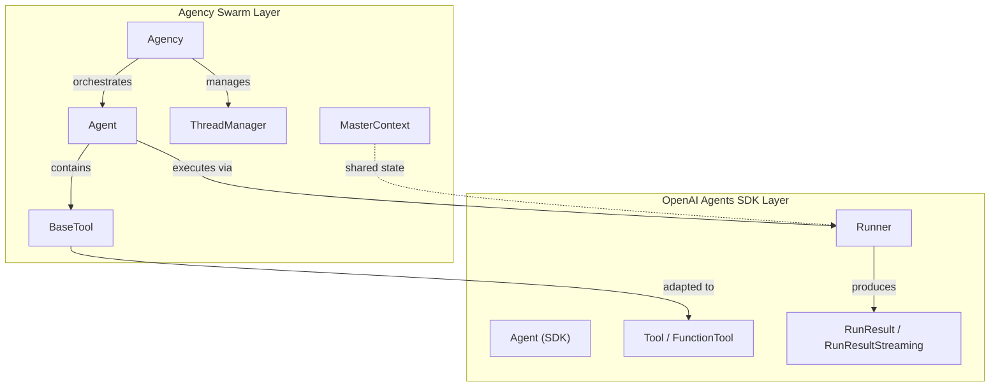
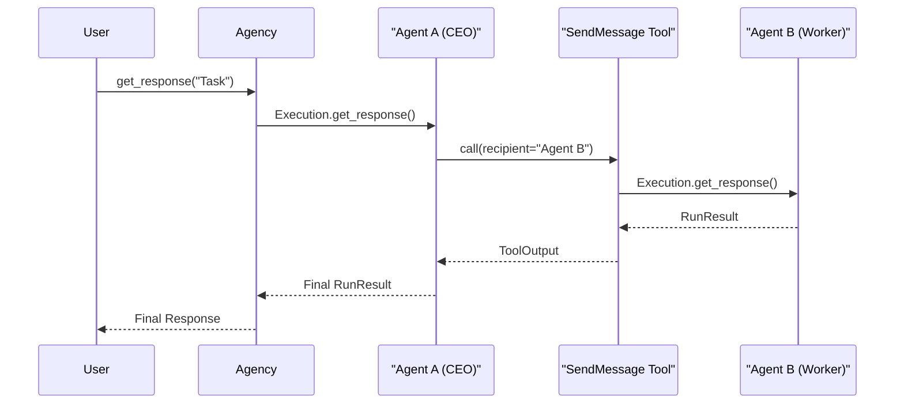
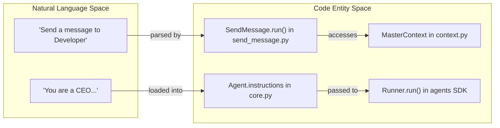

<!-- source: DeepWiki mcp.deepwiki.com · repo VRSEN/agency-swarm · page 1.1 Architecture · fetched 2026-10-26 -->

# Architecture

Relevant source files

The following files were used as context for generating this wiki page:

- [README.md](README.md)
- [docs/additional-features/azure-openai.mdx](docs/additional-features/azure-openai.mdx)
- [docs/additional-features/observability.mdx](docs/additional-features/observability.mdx)
- [docs/core-framework/tools/custom-tools/step-by-step-guide.mdx](docs/core-framework/tools/custom-tools/step-by-step-guide.mdx)
- [docs/welcome/getting-started/from-scratch.mdx](docs/welcome/getting-started/from-scratch.mdx)
- [src/agency_swarm/__init__.py](src/agency_swarm/__init__.py)
- [src/agency_swarm/agency/core.py](src/agency_swarm/agency/core.py)
- [src/agency_swarm/agent/conversation_starters_cache.py](src/agency_swarm/agent/conversation_starters_cache.py)
- [src/agency_swarm/agent/conversation_starters_streaming.py](src/agency_swarm/agent/conversation_starters_streaming.py)
- [src/agency_swarm/agent/execution.py](src/agency_swarm/agent/execution.py)
- [src/agency_swarm/agent/execution_helpers.py](src/agency_swarm/agent/execution_helpers.py)
- [src/agency_swarm/agent/execution_streaming.py](src/agency_swarm/agent/execution_streaming.py)
- [src/agency_swarm/context.py](src/agency_swarm/context.py)
- [src/agency_swarm/tools/__init__.py](src/agency_swarm/tools/__init__.py)
- [src/agency_swarm/tools/send_message.py](src/agency_swarm/tools/send_message.py)
- [tests/test_agency_modules/test_agency_initialization.py](tests/test_agency_modules/test_agency_initialization.py)
- [tests/test_agency_modules/test_agent_flow_integration.py](tests/test_agency_modules/test_agent_flow_integration.py)
- [tests/test_agency_modules/test_package_exports.py](tests/test_agency_modules/test_package_exports.py)
- [tests/test_agent_modules/test_conversation_starters_cache.py](tests/test_agent_modules/test_conversation_starters_cache.py)
- [tests/test_agent_modules/test_conversation_starters_streaming.py](tests/test_agent_modules/test_conversation_starters_streaming.py)

This document provides a comprehensive overview of the Agency Swarm system architecture, explaining the core components, their relationships, and how they map to the underlying OpenAI Agents SDK. Agency Swarm serves as a structured orchestration layer on top of the OpenAI Agents SDK, facilitating complex multi-agent collaborations.

## Core Framework Architecture

The system is designed as a layered architecture where high-level abstractions like `Agency` and `Agent` manage low-level SDK primitives such as `Runner`, `Model`, and `FunctionTool`.

### System Hierarchy

Sources:
- [src/agency_swarm/agency/core.py:70-107]()
- [src/agency_swarm/agent/core.py:100-165]()
- [src/agency_swarm/agent/execution.py:68-84]()
- [src/agency_swarm/__init__.py:10-49]()

## Component Architecture

### The Agency Class
The `Agency` class [src/agency_swarm/agency/core.py:70-87]() is the central orchestration component. It defines the "swarm" by registering agents and their allowed communication pathways.

*   **Registration**: Agents are registered during `__init__` and assigned entry point status [src/agency_swarm/agency/core.py:108-125]().
*   **Communication Flows**: It uses `communication_flows` to define which agents can talk to whom, automatically injecting the `SendMessage` tool into the appropriate agents [src/agency_swarm/agency/core.py:111-118]().
*   **Persistence**: Integrates with `ThreadManager` and `PersistenceHooks` to save and load conversation states [src/agency_swarm/agency/core.py:119-120]().

### The Agent Class
The `Agent` class [src/agency_swarm/agent/core.py:100-146]() extends the SDK's capabilities by adding framework-specific features:
*   **Initialization Pipeline**: Handles loading instructions from files, processing tool folders, and setting up MCP servers [src/agency_swarm/agent/core.py:200-250]().
*   **Execution Engine**: Uses the `Execution` class to wrap the SDK `Runner`. It manages the conversion of user messages into `TResponseInputItem` formats [src/agency_swarm/agent/execution.py:115-117]().
*   **Guardrails**: Implements `input_guardrail` and `output_guardrail` logic that can trigger retries or branch pruning in the message history [src/agency_swarm/agent/execution_helpers.py:95-110]().

### Thread & Message Management
Unlike a simple chat, Agency Swarm uses a `ThreadManager` to maintain state across complex multi-agent handoffs.

Sources:
- [src/agency_swarm/tools/send_message.py:38-49]()
- [src/agency_swarm/agent/execution.py:72-102]()
- [src/agency_swarm/utils/thread.py:10-50]()

## Execution Data Flow

When a request is made via `Agency.get_response`, the system follows a strict execution path to bridge natural language inputs to code-level tool calls.

### get_response Pipeline

| Step | Component | Action |
| :--- | :--- | :--- |
| 1 | `Agency` | Locates the entry point agent and initializes `AgencyContext`. |
| 2 | `Execution` | Calls `setup_execution` to prepare system reminders and instructions [src/agency_swarm/agent/execution.py:106-108](). |
| 3 | `MessageFormatter` | Converts message history into `TResponseInputItem` list for the SDK [src/agency_swarm/agent/execution.py:132-141](). |
| 4 | `Runner` | (SDK) Executes the model loop, handling tool calls and handoffs [src/agency_swarm/agent/execution_helpers.py:81-88](). |
| 5 | `BaseTool` | If a tool is called, the adapted `run()` method executes [src/agency_swarm/tools/base_tool.py:35-50](). |
| 6 | `Execution` | Validates output against guardrails; retries if `OutputGuardrailTripwireTriggered` [src/agency_swarm/agent/execution_helpers.py:124-135](). |

### Mapping Natural Language to Code Entities

This diagram illustrates how user-facing concepts map to specific classes and functions in the codebase.

Sources:
- [src/agency_swarm/tools/send_message.py:175-200]()
- [src/agency_swarm/agent/core.py:115-125]()
- [src/agency_swarm/context.py:10-30]()

## Advanced Execution Features

### Streaming and Guardrails
The `execution_streaming.py` module handles real-time event emission. It uses a `StreamIdNormalizer` to ensure that IDs across different agent turns remain consistent for the UI [src/agency_swarm/agent/execution_streaming.py:25-26]().

If an input guardrail trips during a stream, the framework performs **history pruning** via `prune_guardrail_messages`. This removes the branch of messages that led to the violation, preserving a "clean" history for the next user attempt [src/agency_swarm/agent/execution_streaming.py:64-106]().

### Observability Integration
The framework captures usage data (tokens, costs) at the `Execution` level. It extracts model names using `get_usage_tracking_model_name` and aggregates results into the `usage` field of the response [src/agency_swarm/agent/execution.py:52](). It also supports external tracing via `OpenAIChatCompletionsModel` and SDK-level `trace` hooks [src/agency_swarm/__init__.py:48]().

Sources:
- [src/agency_swarm/agent/execution_streaming.py:145-161]()
- [src/agency_swarm/agent/execution.py:103-141]()
- [docs/additional-features/observability.mdx:9-36]()

---

