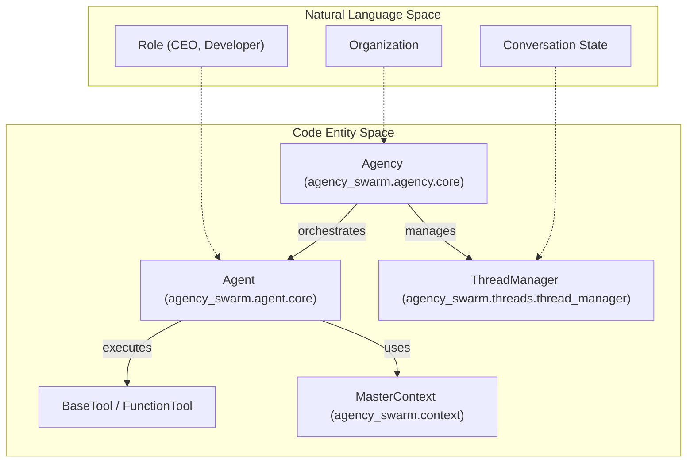
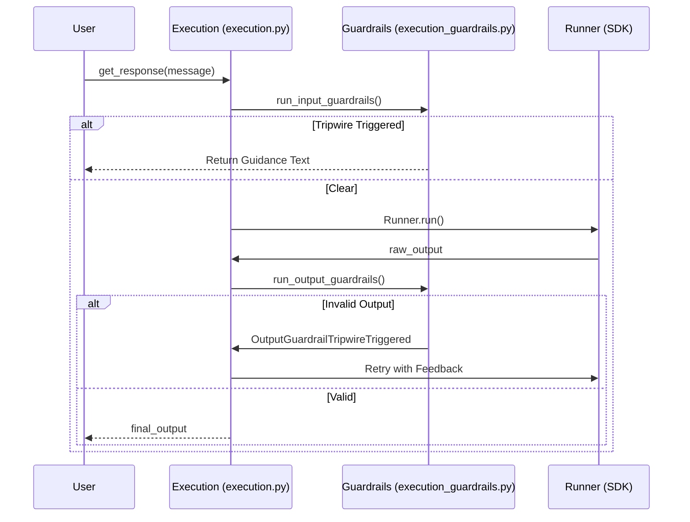

<!-- source: DeepWiki mcp.deepwiki.com · repo VRSEN/agency-swarm · page 1.2 Key Concepts · fetched 2026-10-26 -->

# Key Concepts

Relevant source files

The following files were used as context for generating this wiki page:

- [.claude/agents/agent-creator.md](.claude/agents/agent-creator.md)
- [.claude/agents/tools-creator.md](.claude/agents/tools-creator.md)
- [README.md](README.md)
- [docs/additional-features/agency-context.mdx](docs/additional-features/agency-context.mdx)
- [docs/additional-features/azure-openai.mdx](docs/additional-features/azure-openai.mdx)
- [docs/additional-features/custom-communication-flows/common-use-cases.mdx](docs/additional-features/custom-communication-flows/common-use-cases.mdx)
- [docs/additional-features/custom-communication-flows/overview.mdx](docs/additional-features/custom-communication-flows/overview.mdx)
- [docs/additional-features/fastapi-integration.mdx](docs/additional-features/fastapi-integration.mdx)
- [docs/additional-features/observability.mdx](docs/additional-features/observability.mdx)
- [docs/core-framework/agents/advanced-configuration.mdx](docs/core-framework/agents/advanced-configuration.mdx)
- [docs/core-framework/agents/overview.mdx](docs/core-framework/agents/overview.mdx)
- [docs/core-framework/tools/custom-tools/best-practices.mdx](docs/core-framework/tools/custom-tools/best-practices.mdx)
- [docs/core-framework/tools/custom-tools/configuration.mdx](docs/core-framework/tools/custom-tools/configuration.mdx)
- [docs/core-framework/tools/custom-tools/step-by-step-guide.mdx](docs/core-framework/tools/custom-tools/step-by-step-guide.mdx)
- [docs/core-framework/tools/mcp-integration.mdx](docs/core-framework/tools/mcp-integration.mdx)
- [docs/core-framework/tools/mcp-oauth.mdx](docs/core-framework/tools/mcp-oauth.mdx)
- [docs/references/api.mdx](docs/references/api.mdx)
- [docs/welcome/getting-started/from-scratch.mdx](docs/welcome/getting-started/from-scratch.mdx)
- [examples/custom_send_message.py](examples/custom_send_message.py)
- [src/agency_swarm/agent/execution.py](src/agency_swarm/agent/execution.py)
- [src/agency_swarm/agent/execution_helpers.py](src/agency_swarm/agent/execution_helpers.py)
- [src/agency_swarm/agent/execution_streaming.py](src/agency_swarm/agent/execution_streaming.py)
- [src/agency_swarm/context.py](src/agency_swarm/context.py)
- [src/agency_swarm/tools/send_message.py](src/agency_swarm/tools/send_message.py)
- [tests/integration/agency/test_agent_handoffs.py](tests/integration/agency/test_agent_handoffs.py)

This page defines the fundamental concepts and terminology used in the `agency-swarm` framework. Built on top of the OpenAI Agents SDK, the framework introduces a structured orchestration layer for multi-agent collaboration.

## Core Entities

The framework is organized around three primary code entities: the `Agency`, the `Agent`, and the `ThreadManager`.

Sources: [src/agency_swarm/agency/core.py:14-31](), [src/agency_swarm/agent/core.py:51-133](), [src/agency_swarm/context.py:1-20]()

### Agency
The `Agency` class is the root orchestrator. It defines the "organizational chart" through `communication_flows` and provides the primary entry points for users via `get_response` and `get_response_stream`.
- **Entry Points**: Specific agents designated to receive initial user input [docs/references/api.mdx:36-37]().
- **Communication Flows**: Explicit directional paths (e.g., `CEO > Developer`) that determine which agents can talk to whom [src/agency_swarm/tools/send_message.py:25-30]().

### Agent
An `Agent` represents a specialized AI persona. Unlike raw LLM calls, an `Agent` in this framework encapsulates:
- **Instructions**: System prompts (often loaded from `instructions.md`) [docs/core-framework/agents/overview.mdx:58-59]().
- **Tools**: A collection of `BaseTool` or `@function_tool` capabilities [src/agency_swarm/agent/core.py:62-63]().
- **Guardrails**: Input and output validation logic [src/agency_swarm/agent/execution_guardrails.py:1-10]().
- **Model Settings**: Configuration for specific LLM backends (OpenAI, LiteLLM, etc.) [docs/core-framework/agents/overview.mdx:60-61]().

### Thread Management
Thread management is handled by the `ThreadManager`. It persists conversation history and ensures that when an agent is invoked, it has the relevant context from previous turns.
- **Persistence**: Supports `load_threads_callback` and `save_threads_callback` for DB integration [README.md:26-27]().
- **State Isolation**: Manages unique thread IDs for different agent-to-agent pairings within a single user session [src/agency_swarm/agent/execution.py:124-141]().

## Communication Concepts

### SendMessage and Handoffs
Communication between agents is facilitated by the `SendMessage` tool.
- **Synchronous Delegation**: When Agent A calls `SendMessage` to Agent B, Agent A waits for Agent B's response before continuing its own execution loop [src/agency_swarm/tools/send_message.py:40-49]().
- **Handoff**: A specialized tool for transferring control entirely to another agent [src/agency_swarm/tools/send_message.py:36-37]().

### MasterContext
The `MasterContext` is a shared data structure passed through the execution stack. It allows tools to access:
- **User Context**: Data provided at the start of the agency run [src/agency_swarm/context.py:20-25]().
- **Agency Context**: References to the running agency instance and thread manager [src/agency_swarm/agent/execution.py:145-150]().
- **Tool Access**: Tools can access this context via the `RunContextWrapper` [docs/core-framework/tools/custom-tools/step-by-step-guide.mdx:191-193]().

## Execution and Guardrails

The execution flow bridges natural language instructions with code-level validation.

Sources: [src/agency_swarm/agent/execution.py:72-102](), [src/agency_swarm/agent/execution_helpers.py:95-123](), [src/agency_swarm/agent/execution_streaming.py:145-162]()

### Guardrails
Guardrails are safety and quality checks that run alongside the agent.
- **Input Guardrails**: Evaluated *before* the model is called to filter malicious or out-of-scope prompts [docs/core-framework/agents/overview.mdx:66-67]().
- **Output Guardrails**: Evaluated *after* the model generates a response. If a tripwire is triggered, the framework can automatically perform a "self-correction" retry by passing the error back to the model [src/agency_swarm/agent/execution_helpers.py:124-148]().

### System Reminders
`SystemReminders` are transient instructions injected into the model's prompt at specific intervals (e.g., `EveryNToolCalls`) to maintain focus during long execution chains. Unlike instructions, these are not persisted in the permanent thread history [docs/core-framework/agents/advanced-configuration.mdx:46-77]().

## Tooling Primitives

### BaseTool
The `BaseTool` class (based on Pydantic) is the primary way to define agent capabilities.
- **`run()` method**: The core logic executed by the tool [docs/core-framework/tools/custom-tools/step-by-step-guide.mdx:65-76]().
- **Schema Generation**: The class docstring and field descriptions are automatically converted into the JSON schema required by OpenAI [src/agency_swarm/tools/send_message.py:91-119]().

### Model Context Protocol (MCP)
The framework supports **MCP**, allowing agents to use tools hosted on external servers.
- **MCP Servers**: Can be attached to agents to provide dynamic tool discovery [docs/core-framework/agents/overview.mdx:65-66]().
- **MCP Manager**: Handles the lifecycle of connections to these servers during an agent's execution [src/agency_swarm/agent/execution_helpers.py:71-78]().

Sources:
- Agency & Agent Core: [src/agency_swarm/agency/core.py](), [src/agency_swarm/agent/core.py]()
- Execution Logic: [src/agency_swarm/agent/execution.py](), [src/agency_swarm/agent/execution_helpers.py](), [src/agency_swarm/agent/execution_streaming.py]()
- Communication: [src/agency_swarm/tools/send_message.py]()
- Documentation: [docs/core-framework/agents/overview.mdx](), [docs/core-framework/agents/advanced-configuration.mdx]()

---

