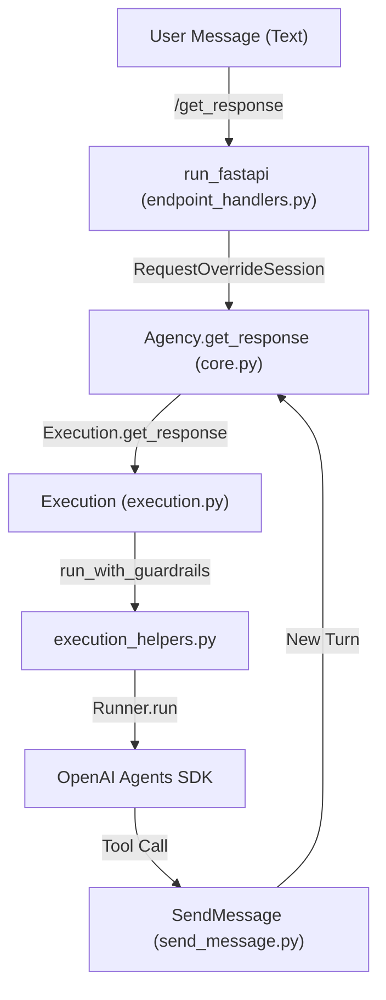
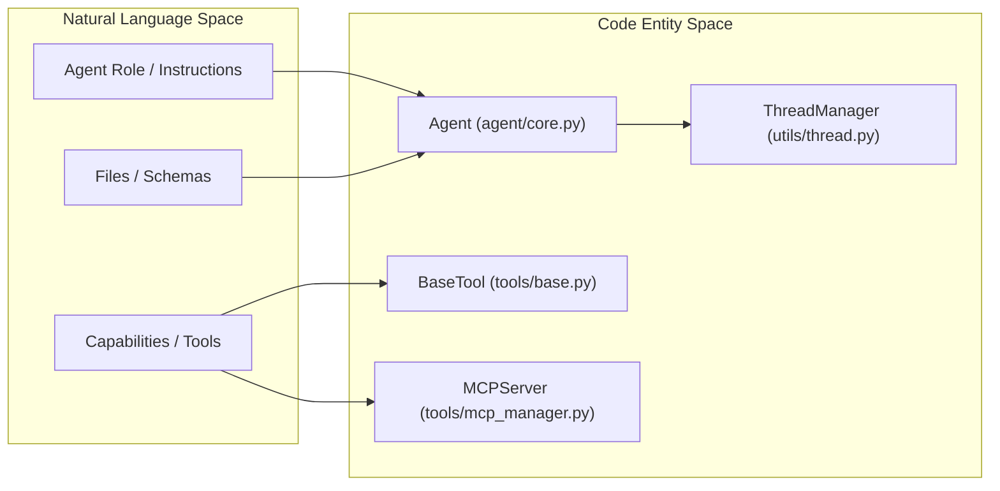

<!-- source: DeepWiki mcp.deepwiki.com · repo VRSEN/agency-swarm · page 10 Glossary · fetched 2026-10-26 -->

# Glossary

Relevant source files

The following files were used as context for generating this wiki page:

- [.cursor/rules/writing-docs.mdc](.cursor/rules/writing-docs.mdc)
- [README.md](README.md)
- [docs/additional-features/azure-openai.mdx](docs/additional-features/azure-openai.mdx)
- [docs/additional-features/observability.mdx](docs/additional-features/observability.mdx)
- [docs/core-framework/tools/custom-tools/step-by-step-guide.mdx](docs/core-framework/tools/custom-tools/step-by-step-guide.mdx)
- [docs/images/platform/openclaw-persistent-storage.png](docs/images/platform/openclaw-persistent-storage.png)
- [docs/platform/integrations/openclaw-integration.mdx](docs/platform/integrations/openclaw-integration.mdx)
- [docs/platform/marketplace/openclaw.mdx](docs/platform/marketplace/openclaw.mdx)
- [docs/welcome/getting-started/from-scratch.mdx](docs/welcome/getting-started/from-scratch.mdx)
- [src/agency_swarm/agency/core.py](src/agency_swarm/agency/core.py)
- [src/agency_swarm/agent/conversation_starters_cache.py](src/agency_swarm/agent/conversation_starters_cache.py)
- [src/agency_swarm/agent/conversation_starters_streaming.py](src/agency_swarm/agent/conversation_starters_streaming.py)
- [src/agency_swarm/agent/execution.py](src/agency_swarm/agent/execution.py)
- [src/agency_swarm/agent/execution_helpers.py](src/agency_swarm/agent/execution_helpers.py)
- [src/agency_swarm/agent/execution_streaming.py](src/agency_swarm/agent/execution_streaming.py)
- [src/agency_swarm/agents/openclaw.py](src/agency_swarm/agents/openclaw.py)
- [src/agency_swarm/context.py](src/agency_swarm/context.py)
- [src/agency_swarm/data/model_prices_and_context_window.json](src/agency_swarm/data/model_prices_and_context_window.json)
- [src/agency_swarm/integrations/README.md](src/agency_swarm/integrations/README.md)
- [src/agency_swarm/integrations/fastapi.py](src/agency_swarm/integrations/fastapi.py)
- [src/agency_swarm/integrations/fastapi_utils/endpoint_handlers.py](src/agency_swarm/integrations/fastapi_utils/endpoint_handlers.py)
- [src/agency_swarm/integrations/fastapi_utils/request_models.py](src/agency_swarm/integrations/fastapi_utils/request_models.py)
- [src/agency_swarm/integrations/openclaw.py](src/agency_swarm/integrations/openclaw.py)
- [src/agency_swarm/integrations/openclaw_model.py](src/agency_swarm/integrations/openclaw_model.py)
- [src/agency_swarm/tools/mcp_manager.py](src/agency_swarm/tools/mcp_manager.py)
- [src/agency_swarm/tools/send_message.py](src/agency_swarm/tools/send_message.py)
- [src/agency_swarm/ui/demos/compact.py](src/agency_swarm/ui/demos/compact.py)
- [src/agency_swarm/utils/usage_tracking.py](src/agency_swarm/utils/usage_tracking.py)
- [tests/integration/fastapi/test_fastapi_client_config.py](tests/integration/fastapi/test_fastapi_client_config.py)
- [tests/integration/ui/test_compact_client_passthrough.py](tests/integration/ui/test_compact_client_passthrough.py)
- [tests/test_agency_modules/test_agency_initialization.py](tests/test_agency_modules/test_agency_initialization.py)
- [tests/test_agency_modules/test_agent_flow_integration.py](tests/test_agency_modules/test_agent_flow_integration.py)
- [tests/test_agent_modules/test_conversation_starters_cache.py](tests/test_agent_modules/test_conversation_starters_cache.py)
- [tests/test_agent_modules/test_conversation_starters_streaming.py](tests/test_agent_modules/test_conversation_starters_streaming.py)
- [tests/test_agent_modules/test_default_model_contract.py](tests/test_agent_modules/test_default_model_contract.py)
- [tests/test_agent_modules/test_mcp_manager.py](tests/test_agent_modules/test_mcp_manager.py)
- [tests/test_agent_modules/test_mcp_oauth.py](tests/test_agent_modules/test_mcp_oauth.py)
- [tests/test_agent_modules/test_openclaw_agent.py](tests/test_agent_modules/test_openclaw_agent.py)
- [tests/test_fastapi_utils_modules/test_oauth_support.py](tests/test_fastapi_utils_modules/test_oauth_support.py)
- [tests/test_fastapi_utils_modules/test_openai_client_config_models.py](tests/test_fastapi_utils_modules/test_openai_client_config_models.py)
- [tests/test_fastapi_utils_modules/test_openai_client_config_request_state.py](tests/test_fastapi_utils_modules/test_openai_client_config_request_state.py)
- [tests/test_utils_modules/test_usage_tracking_costs.py](tests/test_utils_modules/test_usage_tracking_costs.py)

This glossary provides definitions for codebase-specific terms, jargon, and domain concepts used within the `agency-swarm` framework. It serves as a technical reference for engineers to understand how conceptual terms map to specific implementation entities.

## Core Concepts

### Agency
The high-level orchestrator that manages a collection of `Agent` instances and their communication pathways. It acts as the primary entry point for external interactions.
*   **Implementation**: Defined in the `Agency` class [src/agency_swarm/agency/core.py:70-106]().
*   **Data Flow**: It initializes the `ThreadManager` [src/agency_swarm/agency/core.py:130-132]() and configures `communication_flows` [src/agency_swarm/agency/core.py:136-143]() to determine how agents interact.

### Agent
A specialized AI entity with a specific role, instructions, and set of tools. Agents in `agency-swarm` extend the capabilities of the underlying OpenAI Agents SDK.
*   **Implementation**: Defined in the `Agent` class [src/agency_swarm/agent/core.py:15-15]().
*   **Capabilities**: Includes support for `MCP` servers, custom `BaseTool` instances, and model settings [src/agency_swarm/agency/core.py:121-132]().

### Communication Flow
A directed graph defining which agents are allowed to communicate with each other. This prevents arbitrary "hallucinated" delegations and ensures structured multi-agent workflows.
*   **Implementation**: Processed via `parse_agent_flows` and `register_all_agents_and_set_entry_points` during Agency initialization [src/agency_swarm/agency/core.py:37-39]().
*   **Mechanism**: Facilitated by the `SendMessage` tool [src/agency_swarm/tools/send_message.py:38-56]().

---

## Technical Terminology

### MasterContext
A shared context object passed through the execution chain, allowing agents and tools to access agency-level state, user context, and thread information.
*   **Implementation**: Defined in `MasterContext` [src/agency_swarm/context.py:1-1]().
*   **Usage**: Prepared during execution setup [src/agency_swarm/agent/execution_helpers.py:40-40]() and wrapped for tool access via `RunContextWrapper` [src/agency_swarm/agent/execution_helpers.py:165-165]().

### SendMessage & Handoff
Specialized tools that enable agent-to-agent interaction. `SendMessage` is for synchronous requests where the sender waits for a response, while `Handoff` transfers control.
*   **SendMessage**: [src/agency_swarm/tools/send_message.py:38-56]()
*   **Handoff**: [src/agency_swarm/tools/send_message.py:36-36]()

### Guardrail (Input/Output)
Safety and validation mechanisms that intercept messages before they are processed (Input) or after they are generated (Output).
*   **Tripwire**: An exception like `OutputGuardrailTripwireTriggered` [src/agency_swarm/agent/execution_helpers.py:124-124]() is raised when a guardrail is violated.
*   **Retry Logic**: The system can perform multiple `validation_attempts` to correct outputs based on guardrail feedback [src/agency_swarm/agent/execution_helpers.py:112-148]().

### MCP (Model Context Protocol)
A protocol used to integrate external tools and services. The `MCPManager` handles the lifecycle of these connections.
*   **Manager**: `default_mcp_manager` [src/agency_swarm/tools/mcp_manager.py:35-35]().
*   **Lifecycle**: Handled via `AsyncExitStack` in the execution primitive [src/agency_swarm/agent/execution_helpers.py:71-79]().

### OpenClaw
An integration layer that allows `agency-swarm` to run with specialized runtimes and proxy settings, often used for browser-based or local tool execution.
*   **Integration**: Managed via `OpenClawIntegrationConfig` [src/agency_swarm/integrations/openclaw.py:187-204]().
*   **Model**: Refers to `openclaw:main` as a default model alias [src/agency_swarm/integrations/openclaw_model.py:13-13]().

---

## Diagrams

### Execution Data Flow: Natural Language to Code Entities
This diagram illustrates how a user's natural language request moves through the system's code entities.

**Sources**: [src/agency_swarm/integrations/fastapi.py:27-45](), [src/agency_swarm/agency/core.py:70-106](), [src/agency_swarm/agent/execution.py:72-102](), [src/agency_swarm/agent/execution_helpers.py:95-110](), [src/agency_swarm/tools/send_message.py:38-56]().

### Agent Initialization & Components
Mapping of agent configuration concepts to the underlying code classes.

**Sources**: [src/agency_swarm/agent/core.py:15-15](), [src/agency_swarm/agency/core.py:89-106](), [src/agency_swarm/tools/mcp_manager.py:20-24](), [src/agency_swarm/utils/thread.py:26-26]().

---

## Technical Abbreviations

| Abbreviation | Full Term | Context in Code |
| :--- | :--- | :--- |
| **AG-UI** | Agency Swarm UI | The protocol bridge for frontend communication [src/agency_swarm/integrations/fastapi_utils/endpoint_handlers.py:18-35](). |
| **MCP** | Model Context Protocol | Used in `shared_mcp_servers` and `MCPServerOAuth` [src/agency_swarm/agency/core.py:97-98](). |
| **SSE** | Server-Sent Events | Used for streaming responses in FastAPI [src/agency_swarm/integrations/fastapi_utils/endpoint_handlers.py:154-155](). |
| **TUI** | Terminal User Interface | Used in `agency_swarm_tui_bridge` for local testing [tests/test_fastapi_utils_modules/test_openai_client_config_models.py:90-92](). |

**Sources**: [src/agency_swarm/integrations/fastapi_utils/endpoint_handlers.py:18-35](), [src/agency_swarm/agency/core.py:97-98](), [tests/test_fastapi_utils_modules/test_openai_client_config_models.py:90-92]().