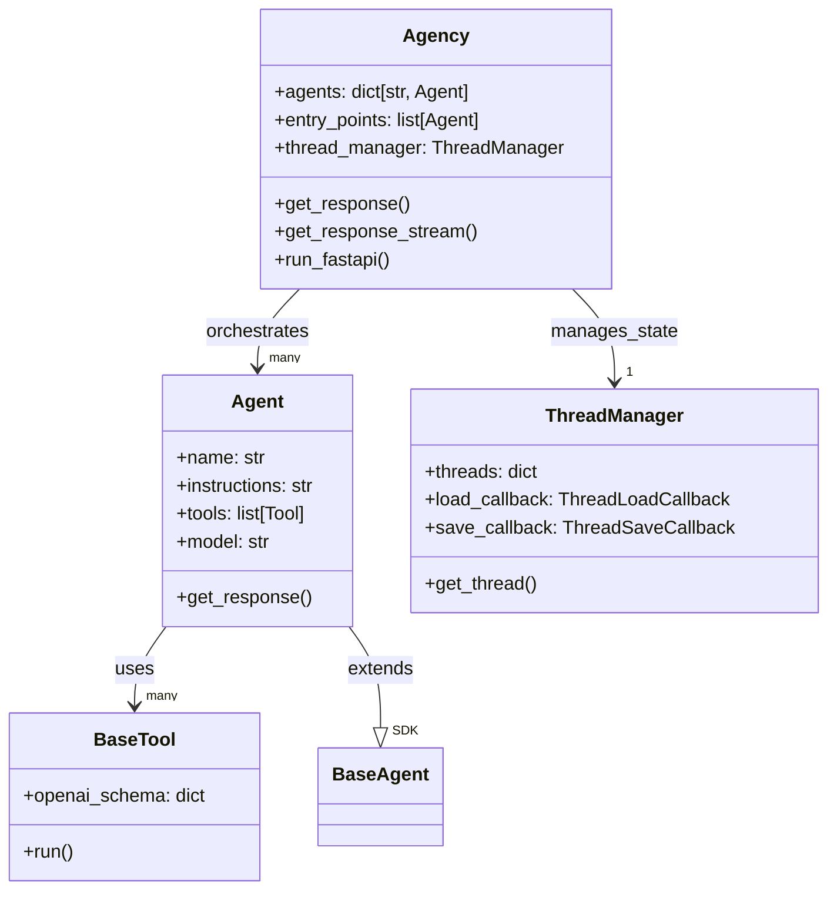
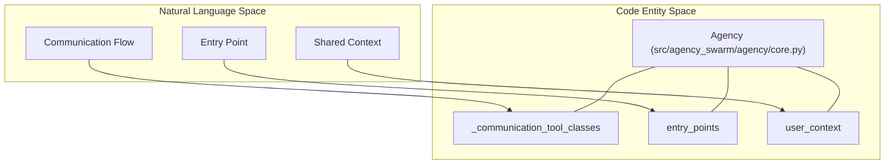
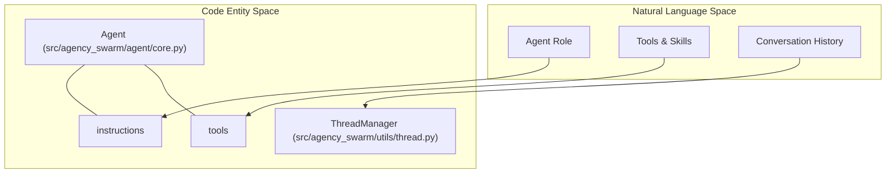
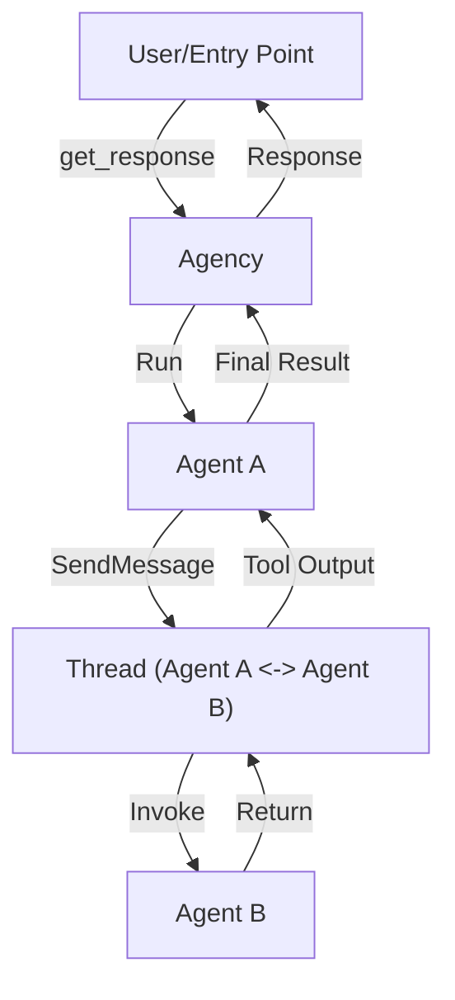

<!-- source: DeepWiki mcp.deepwiki.com · repo VRSEN/agency-swarm · page 2 Core Framework · fetched 2026-10-26 -->

# Core Framework

Relevant source files

The following files were used as context for generating this wiki page:

- [src/agency_swarm/agency/core.py](src/agency_swarm/agency/core.py)
- [src/agency_swarm/agency/helpers.py](src/agency_swarm/agency/helpers.py)
- [src/agency_swarm/agency/setup.py](src/agency_swarm/agency/setup.py)
- [src/agency_swarm/agent/constants.py](src/agency_swarm/agent/constants.py)
- [src/agency_swarm/agent/conversation_starters_cache.py](src/agency_swarm/agent/conversation_starters_cache.py)
- [src/agency_swarm/agent/conversation_starters_streaming.py](src/agency_swarm/agent/conversation_starters_streaming.py)
- [src/agency_swarm/agent/core.py](src/agency_swarm/agent/core.py)
- [src/agency_swarm/agent/initialization.py](src/agency_swarm/agent/initialization.py)
- [tests/integration/agency/test_shared_resources.py](tests/integration/agency/test_shared_resources.py)
- [tests/test_agency_modules/test_agency_helpers.py](tests/test_agency_modules/test_agency_helpers.py)
- [tests/test_agency_modules/test_agency_initialization.py](tests/test_agency_modules/test_agency_initialization.py)
- [tests/test_agency_modules/test_agent_flow_integration.py](tests/test_agency_modules/test_agent_flow_integration.py)
- [tests/test_agent_modules/test_agent_initialization.py](tests/test_agent_modules/test_agent_initialization.py)
- [tests/test_agent_modules/test_conversation_starters_cache.py](tests/test_agent_modules/test_conversation_starters_cache.py)
- [tests/test_agent_modules/test_conversation_starters_streaming.py](tests/test_agent_modules/test_conversation_starters_streaming.py)

The Core Framework provides the foundational architecture of the agency-swarm system, enabling AI agents to work together in structured workflows. It defines the key abstractions and mechanisms for creating, configuring, and orchestrating multiple AI agents that can communicate with each other and perform specialized tasks.

For details on specific components like the Agency Class, Agent Class, Thread System, or BaseTool Class, see their dedicated pages ([Agency Class](#2.1), [Agent Class](#2.2), [Thread System](#2.3), and [BaseTool Class](#2.4)). For information about the tool system that extends these core components, see [Tool System](#3).

## Architecture Overview

The agency-swarm Core Framework is built around four primary components that work together to create a flexible multi-agent system. This framework extends the underlying `agents` SDK to provide high-level orchestration.

Sources: [src/agency_swarm/agency/core.py:70-106](), [src/agency_swarm/agent/core.py:92-132](), [src/agency_swarm/utils/thread.py:16-105](), [src/agency_swarm/tools/base_tool.py:18-85]()

## Natural Language to Code Mapping

The following diagrams bridge the gap between high-level concepts and the actual code entities within the framework.

### Agency Orchestration Space

Sources: [src/agency_swarm/agency/core.py:89-106](), [src/agency_swarm/agency/setup.py:82-93]()

### Agent Capability Space

Sources: [src/agency_swarm/agent/core.py:107-122](), [src/agency_swarm/utils/thread.py:91-105]()

## Components in Detail

### Agency
The `Agency` class is the central coordinator. It manages agent registration, sets up communication pathways (flows), and provides the main entry points for external interaction via `get_response` or `run_fastapi`.

Key responsibilities:
- Orchestrating `Agent` instances based on `communication_flows` [src/agency_swarm/agency/core.py:72-76]().
- Managing conversation persistence through `ThreadManager` and `PersistenceHooks` [src/agency_swarm/agency/core.py:80-82]().
- Applying `shared_instructions` across all agents in the agency [src/agency_swarm/agency/core.py:93-93]().
- Providing a FastAPI integration layer for web deployment [src/agency_swarm/agency/helpers.py:64-75]().

For details, see [Agency Class](#2.1).

### Agent
The `Agent` class extends the base SDK `Agent` with multi-agent collaboration capabilities. It is designed to be stateless, receiving its operational context (like thread managers and subagent mappings) at runtime via `AgencyContext`.

Key features:
- Automatic tool discovery from a `tools_folder` [src/agency_swarm/agent/core.py:108-108]().
- Support for OpenAPI schemas via `schemas_folder` [src/agency_swarm/agent/core.py:145-146]().
- Conversation starters and quick replies caching for performance [src/agency_swarm/agent/core.py:110-112]().
- Guardrail support for input/output validation [src/agency_swarm/agent/core.py:117-117]().

For details, see [Agent Class](#2.2).

### Thread System
The thread system, managed by `ThreadManager`, handles conversation state between agents and users. It allows for complex multi-agent interactions where history is preserved and shared according to the agency's communication chart.

Key aspects:
- Support for custom `load_threads_callback` and `save_threads_callback` for persistence [src/agency_swarm/utils/thread.py:23-24]().
- Shared thread management across different agent pairs within an agency [src/agency_swarm/agency/core.py:108-125]().

For details, see [Thread System](#2.3).

### BaseTool
`BaseTool` is the primary class for extending agent capabilities. It uses Pydantic for schema definition, which is automatically converted into OpenAI-compatible function definitions.

Key features:
- Pydantic-based field validation for tool arguments [src/agency_swarm/tools/base_tool.py:18-25]().
- The `@function_tool` decorator for adapting simple functions into the framework [src/agency_swarm/agent/core.py:17-17]().
- Access to `MasterContext` for tools that need to interact with the broader agency state [src/agency_swarm/agent/core.py:56-56]().

For details, see [BaseTool Class](#2.4).

## Data Flow and Communication

The framework facilitates communication between agents using specialized tools like `SendMessage` and `Handoff`. When an agent needs to collaborate, it invokes these tools, which are dynamically wired by the `Agency` during initialization.

Sources: [src/agency_swarm/agency/setup.py:82-93](), [src/agency_swarm/agency/core.py:108-125]()

## Initialization Pipeline

When an `Agency` is instantiated, it performs a complex initialization sequence to wire agents together:

1.  **Agent Registration**: All agents provided in entry points and flows are registered [src/agency_swarm/agency/setup.py:38-39]().
2.  **Flow Parsing**: The `communication_flows` are parsed to identify which agents can talk to each other and what tools (e.g., `SendMessage`) they need [src/agency_swarm/agency/setup.py:82-93]().
3.  **Resource Application**: Shared instructions, tools, and files are distributed to all agents [src/agency_swarm/agency/setup.py:33-35]().
4.  **Runtime State Setup**: `AgentRuntimeState` is initialized for each agent to hold its subagent mappings and active tools [src/agency_swarm/agency/setup.py:36-36]().

Sources: [src/agency_swarm/agency/core.py:108-125](), [src/agency_swarm/agency/setup.py:1-40]()

---

