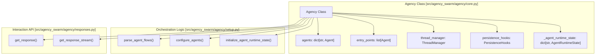
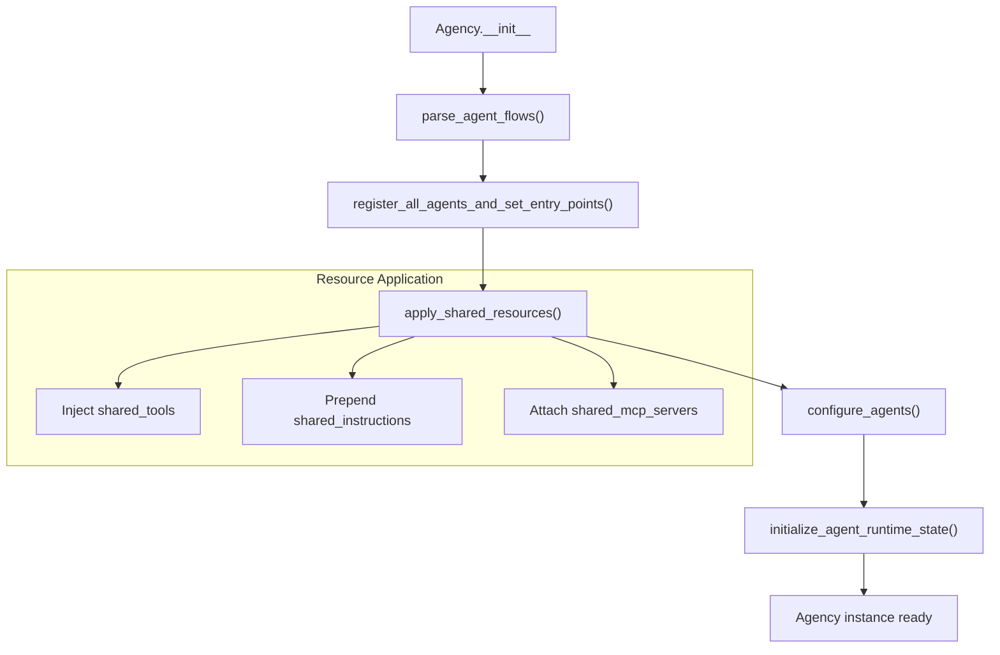

<!-- source: DeepWiki mcp.deepwiki.com · repo VRSEN/agency-swarm · page 2.1 Agency Class · fetched 2026-10-26 -->

# Agency Class

<details>
<summary>Relevant source files</summary>

The following files were used as context for generating this wiki page:

- [docs/additional-features/deployment-to-production.mdx](docs/additional-features/deployment-to-production.mdx)
- [docs/core-framework/agencies/communication-flows.mdx](docs/core-framework/agencies/communication-flows.mdx)
- [src/agency_swarm/agency/core.py](src/agency_swarm/agency/core.py)
- [src/agency_swarm/agency/helpers.py](src/agency_swarm/agency/helpers.py)
- [src/agency_swarm/agency/responses.py](src/agency_swarm/agency/responses.py)
- [src/agency_swarm/agency/setup.py](src/agency_swarm/agency/setup.py)
- [src/agency_swarm/agent/conversation_starters_cache.py](src/agency_swarm/agent/conversation_starters_cache.py)
- [src/agency_swarm/agent/conversation_starters_streaming.py](src/agency_swarm/agent/conversation_starters_streaming.py)
- [tests/integration/agency/test_shared_resources.py](tests/integration/agency/test_shared_resources.py)
- [tests/test_agency_modules/_response_test_helpers.py](tests/test_agency_modules/_response_test_helpers.py)
- [tests/test_agency_modules/test_agency_helpers.py](tests/test_agency_modules/test_agency_helpers.py)
- [tests/test_agency_modules/test_agency_initialization.py](tests/test_agency_modules/test_agency_initialization.py)
- [tests/test_agency_modules/test_agency_responses.py](tests/test_agency_modules/test_agency_responses.py)
- [tests/test_agency_modules/test_agency_responses_recipient_reminders.py](tests/test_agency_modules/test_agency_responses_recipient_reminders.py)
- [tests/test_agency_modules/test_agent_flow_integration.py](tests/test_agency_modules/test_agent_flow_integration.py)
- [tests/test_agent_modules/test_conversation_starters_cache.py](tests/test_agent_modules/test_conversation_starters_cache.py)
- [tests/test_agent_modules/test_conversation_starters_streaming.py](tests/test_agent_modules/test_conversation_starters_streaming.py)

</details>


The `Agency` class is the primary orchestration component in the `agency-swarm` framework. It serves as the central hub for managing a collection of `Agent` instances, establishing communication pathways (flows) between them, and providing methods for user interaction with the multi-agent system. It handles the initialization pipeline, including agent registration, shared resource distribution, and persistence hook configuration.

For details about individual agents, see [Agent Class](2.2). For information about the thread communication system, see [Thread System](2.3). For tools that agents can use, see [BaseTool Class](2.4).

## Architecture Overview

The `Agency` class orchestrates `Agent` instances based on a communication flow. It manages agent registration, sets up communication pathways via `SendMessage` or `Handoff` tools, and provides entries for external interaction.

### Code Entity Mapping

The following diagram associates the natural language concepts of the agency system with their corresponding code entities and attributes within the `Agency` class.

**Agency Entity Mapping**


Sources:
- [src/agency_swarm/agency/core.py:70-107]()
- [src/agency_swarm/agency/setup.py:82-153]()
- [src/agency_swarm/agency/responses.py:171-182]()

## Initialization and Setup

### Constructor Parameters

The `Agency` constructor (`__init__`) accepts parameters to define the multi-agent structure and shared environment:

| Parameter | Type | Description |
|-----------|------|-------------|
| `*entry_point_agents` | `Agent` | Positional arguments identifying agents that can receive direct user messages. [src/agency_swarm/agency/core.py:135-135]() |
| `communication_flows` | `list[CommunicationFlowEntry]` | Defines allowed communication paths (e.g., `agent1 > agent2`). [src/agency_swarm/agency/core.py:136-143]() |
| `shared_instructions` | `str` | Instructions prepended to every agent's system prompt. [src/agency_swarm/agency/core.py:145-147]() |
| `shared_tools` | `list[Tool \| type[BaseTool]]` | Tools automatically added to every agent in the agency. [src/agency_swarm/agency/core.py:94-94]() |
| `shared_mcp_servers` | `list[Any]` | MCP servers accessible by all agents. [src/agency_swarm/agency/core.py:97-97]() |
| `load_threads_callback` | `ThreadLoadCallback` | Callback for loading conversation history. [src/agency_swarm/agency/core.py:119-119]() |
| `save_threads_callback` | `ThreadSaveCallback` | Callback for persisting conversation state. [src/agency_swarm/agency/core.py:120-120]() |
| `user_context` | `dict[str, Any]` | Shared data available in `MasterContext` during runs. [src/agency_swarm/agency/core.py:121-121]() |

Sources:
- [src/agency_swarm/agency/core.py:108-125]()
- [src/agency_swarm/agency/core.py:89-100]()

### Initialization Pipeline

When an `Agency` is instantiated, it executes a setup pipeline defined in `src/agency_swarm/agency/setup.py`.

**Initialization Data Flow**


1.  **Flow Parsing**: `parse_agent_flows` processes the `communication_flows` list, resolving `AgentFlow` chains (e.g., `agent1 > agent2 > agent3`) into basic sender-receiver pairs. [src/agency_swarm/agency/setup.py:82-153]()
2.  **Resource Application**: `apply_shared_resources` distributes `shared_instructions`, `shared_tools`, and `shared_mcp_servers` to all registered agents. [src/agency_swarm/agency/setup.py:34-39]()
3.  **Agent Configuration**: `configure_agents` validates agent settings and prepares them for the specific agency context. [src/agency_swarm/agency/setup.py:35-35]()
4.  **Runtime State**: `initialize_agent_runtime_state` wires the `SendMessage` and `Handoff` tools into each agent's runtime based on the parsed flows. [src/agency_swarm/agency/setup.py:36-36]()

Sources:
- [src/agency_swarm/agency/core.py:168-185]()
- [src/agency_swarm/agency/setup.py:82-153]()

## Communication Methods

The `Agency` class provides high-level methods to initiate interactions with agents.

### get_response

```python
async def get_response(
    self,
    message: str | list[TResponseInputItem],
    recipient_agent: str | Agent | None = None,
    context_override: dict[str, Any] | None = None,
    hooks_override: RunHooks | None = None,
    **kwargs: Any,
) -> RunResult
```

This method resolves the `recipient_agent` (defaulting to the first entry point), determines the effective `RunHooks` (combining persistence hooks and any overrides), and calls the target agent's `get_response` method. [src/agency_swarm/agency/responses.py:171-210]()

### get_response_stream

```python
def get_response_stream(
    self,
    message: str | list[TResponseInputItem],
    recipient_agent: str | Agent | None = None,
    hooks_override: RunHooks | None = None,
    **kwargs: Any,
) -> StreamingRunResponse
```

Returns an async iterator (`StreamingRunResponse`) that yields events from the agent execution. It utilizes `EventStreamMerger` to handle complex multi-agent message streams. [src/agency_swarm/agency/responses.py:270-305]()

### Recipient Reminders

If a user switches the `recipient_agent` within the same thread, the agency automatically prepends a `recipient_reminder` system message. This informs the new agent that the user has switched context and provides the agent's name and role to ensure continuity. [src/agency_swarm/agency/responses.py:61-105]()

Sources:
- [src/agency_swarm/agency/responses.py:171-210]()
- [src/agency_swarm/agency/responses.py:270-305]()
- [src/agency_swarm/agency/responses.py:108-134]()

## Persistence and Hooks

The `Agency` manages conversation state through `PersistenceHooks` and the `ThreadManager`.

- **Callbacks**: If `load_threads_callback` and `save_threads_callback` are provided, the agency initializes `PersistenceHooks`. [src/agency_swarm/agency/core.py:170-176]()
- **Thread Management**: The `ThreadManager` uses these hooks to load existing history when a run starts and save the updated history (as immutable snapshots) when a run completes. [src/agency_swarm/utils/thread.py:26-26]()
- **Composite Hooks**: If a user provides `hooks_override` during a call, the agency uses `CompositeRunHooks` to ensure both internal persistence logic and user-provided logic are executed. [src/agency_swarm/agency/responses.py:159-168]()

Sources:
- [src/agency_swarm/agency/core.py:170-176]()
- [src/agency_swarm/agency/responses.py:159-168]()
- [tests/test_agency_modules/test_agency_responses.py:86-104]()

## FastAPI Integration

The `run_fastapi` method exposes the agency as a web service.

```python
def run_fastapi(
    self,
    host: str = "0.0.0.0",
    port: int = 8000,
    app_token_env: str = "APP_TOKEN",
    **kwargs: Any,
) -> None
```

This method calls the `run_fastapi` helper in `src/agency_swarm/agency/helpers.py`, which:
1.  **Normalizes Paths**: Converts relative `shared_tools_folder` or `shared_files_folder` paths to absolute paths to ensure stability across the FastAPI lifecycle. [src/agency_swarm/agency/helpers.py:112-122]()
2.  **Builds Factories**: Creates an `agency_factory` that can reconstruct the `Agency` instance (with all its flows and settings) for each incoming request. [src/agency_swarm/agency/helpers.py:124-154]()
3.  **Starts Server**: Launches the FastAPI server with endpoints like `/get_response` and `/get_response_stream`. [src/agency_swarm/agency/helpers.py:92-105]()

Sources:
- [src/agency_swarm/agency/helpers.py:64-105]()
- [src/agency_swarm/agency/helpers.py:108-154]()

## Visualization

The `visualize` method (accessible via `Agency.visualize()`) generates a visual representation of the agency's communication structure. It uses the `agency_chart` and `communication_flows` to map out relationships between agents.

Sources:
- [src/agency_swarm/agency/core.py:214-220]()
- [src/agency_swarm/agency/helpers.py:108-154]()

---

