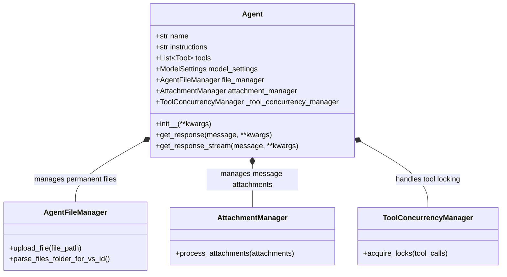
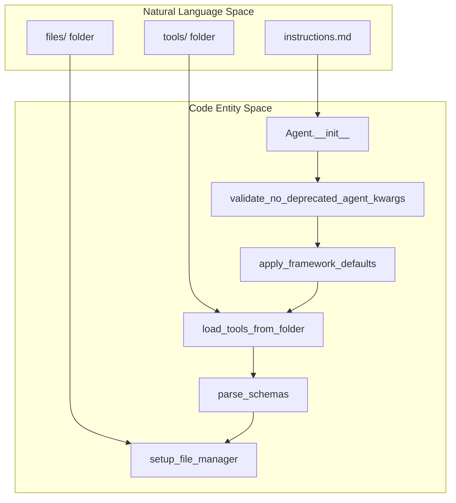
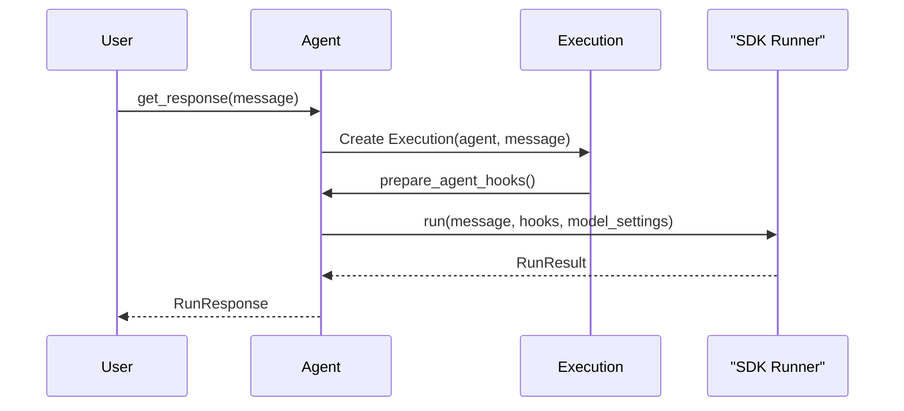

<!-- source: DeepWiki mcp.deepwiki.com · repo VRSEN/agency-swarm · page 2.2 Agent Class · fetched 2026-10-26 -->

# Agent Class

Relevant source files

The following files were used as context for generating this wiki page:

- [src/agency_swarm/agent/__init__.py](src/agency_swarm/agent/__init__.py)
- [src/agency_swarm/agent/constants.py](src/agency_swarm/agent/constants.py)
- [src/agency_swarm/agent/core.py](src/agency_swarm/agent/core.py)
- [src/agency_swarm/agent/file_manager.py](src/agency_swarm/agent/file_manager.py)
- [src/agency_swarm/agent/file_sync.py](src/agency_swarm/agent/file_sync.py)
- [src/agency_swarm/agent/initialization.py](src/agency_swarm/agent/initialization.py)
- [src/agency_swarm/agent/subagents.py](src/agency_swarm/agent/subagents.py)
- [src/agency_swarm/agent/tools.py](src/agency_swarm/agent/tools.py)
- [src/agency_swarm/cli/main.py](src/agency_swarm/cli/main.py)
- [src/agency_swarm/utils/create_agent_template.py](src/agency_swarm/utils/create_agent_template.py)
- [src/agency_swarm/utils/model_utils.py](src/agency_swarm/utils/model_utils.py)
- [tests/integration/cli/test_create_agent_template_integration.py](tests/integration/cli/test_create_agent_template_integration.py)
- [tests/integration/files/test_file_handling.py](tests/integration/files/test_file_handling.py)
- [tests/test_agent_modules/test_agent_capabilities.py](tests/test_agent_modules/test_agent_capabilities.py)
- [tests/test_agent_modules/test_agent_file_manager.py](tests/test_agent_modules/test_agent_file_manager.py)
- [tests/test_agent_modules/test_agent_initialization.py](tests/test_agent_modules/test_agent_initialization.py)
- [tests/test_agent_modules/test_agent_tools.py](tests/test_agent_modules/test_agent_tools.py)
- [tests/test_agent_modules/test_file_sync.py](tests/test_agent_modules/test_file_sync.py)
- [tests/test_agent_modules/test_tools_utils.py](tests/test_agent_modules/test_tools_utils.py)
- [tests/test_utils_modules/test_create_agent_template.py](tests/test_utils_modules/test_create_agent_template.py)

The `Agent` class is the fundamental building block of the Agency Swarm framework. It extends the `agents.Agent` base class from the underlying SDK to provide high-level capabilities for multi-agent collaboration, automatic tool discovery, file management, and framework-specific features like guardrails and system reminders.

In Agency Swarm, Agents are designed to be **stateless** configuration entities. Runtime state, such as thread management and communication flows, is provided by the `Agency` context during execution.

## Agent Class Architecture

The `Agent` class acts as a coordinator for several specialized managers that handle files, tools, and execution logic.

Sources: [src/agency_swarm/agent/core.py:92-133](), [src/agency_swarm/agent/file_manager.py:49-54](), [src/agency_swarm/agent/attachment_manager.py:1-10]()

## Initialization Pipeline

When an `Agent` is instantiated, it undergoes a multi-step initialization pipeline that normalizes parameters, loads local resources, and configures the underlying SDK model.

### Framework Defaults
Agency Swarm applies specific defaults to ensure stable multi-agent behavior. For example, it overrides the SDK's default model to `gpt-5.6-luna` to prevent infinite tool-call loops in complex handoff workflows.

| Setting | Default Value | Source |
| :--- | :--- | :--- |
| `model` | `gpt-5.6-luna` | [src/agency_swarm/agent/constants.py:7-7]() |
| `truncation` | `auto` | [src/agency_swarm/agent/initialization.py:37-37]() |
| `include_usage` | `True` | [src/agency_swarm/agent/initialization.py:37-37]() |

Sources: [src/agency_swarm/agent/core.py:134-210](), [src/agency_swarm/agent/initialization.py:118-127](), [src/agency_swarm/agent/initialization.py:153-166]()

## Capabilities and Configuration

### Tool Discovery
Agents can automatically load tools from a specified `tools_folder`. The framework supports `BaseTool` subclasses, `@function_tool` decorated functions, and OpenAPI schemas.

- **`tools_folder`**: Scans the directory for `.py` files and adapts classes/functions into SDK-compatible tools. [src/agency_swarm/agent/tools.py:60-105]()
- **`schemas_folder`**: Parses OpenAPI JSON/YAML files into tools using `ToolFactory.from_openapi_schema`. [src/agency_swarm/agent/tools.py:106-160]()
- **MCP Servers**: Agents can be configured with `mcp_servers`, which are converted into tools at runtime. [src/agency_swarm/agent/core.py:236-242]()

### File Management
The `AgentFileManager` handles the synchronization of local files with OpenAI's backend.
- **Vector Stores**: If a `files_folder` is named with the pattern `*_vs_<vector_store_id>`, the agent automatically associates with that Vector Store. [src/agency_swarm/agent/core.py:142-144]()
- **Auto-Detection**: The framework inspects file extensions to automatically enable `FileSearchTool` (for `.pdf`, `.md`, etc.) or `CodeInterpreterTool` (for `.py`, `.csv`, etc.). [src/agency_swarm/agent/file_manager.py:22-47]()

### Guardrails and Reminders
- **Input Guardrails**: Agents can be wrapped with input guardrails that intercept user messages before processing. The parameter `raise_input_guardrail_error` determines if violations trigger exceptions or system messages. [src/agency_swarm/agent/core.py:117-117](), [src/agency_swarm/agent/initialization.py:90-116]()
- **System Reminders**: `SystemReminder` objects can be attached to agents. These are injected into the run via hooks to provide persistent context or constraints during execution. [src/agency_swarm/agent/core.py:121-121](), [src/agency_swarm/agent/system_reminders.py:50-54]()

## Execution Data Flow

When `get_response` is called, the Agent prepares an `Execution` context and invokes the underlying SDK `Runner`.

Sources: [src/agency_swarm/agent/core.py:284-332](), [src/agency_swarm/agent/execution.py:8-15]()

## Deprecated Parameters
Agency Swarm v1.x removes several parameters that were previously part of the constructor in favor of explicit SDK objects or framework-managed state.

| Deprecated Parameter | Replacement |
| :--- | :--- |
| `temperature`, `top_p` | `model_settings=ModelSettings(...)` |
| `max_prompt_tokens` | `model_settings=ModelSettings(max_tokens=...)` |
| `response_validator` | `input_guardrails` or `output_guardrails` |
| `file_ids`, `file_search` | Managed via `files_folder` and `AgentFileManager` |
| `id`, `refresh_from_id` | Use Agency persistence hooks |

Sources: [src/agency_swarm/agent/initialization.py:68-87](), [tests/test_agent_modules/test_agent_initialization.py:80-123]()

## Technical Reference: Capability Detection
The framework provides a utility `get_agent_capabilities(agent)` that inspects an agent's configuration to return a list of active features such as `"tools"`, `"reasoning"`, `"code_interpreter"`, and `"file_search"`. This is used primarily for UI visualization and metadata endpoints.

Sources: [src/agency_swarm/utils/model_utils.py:109-170]()

---

