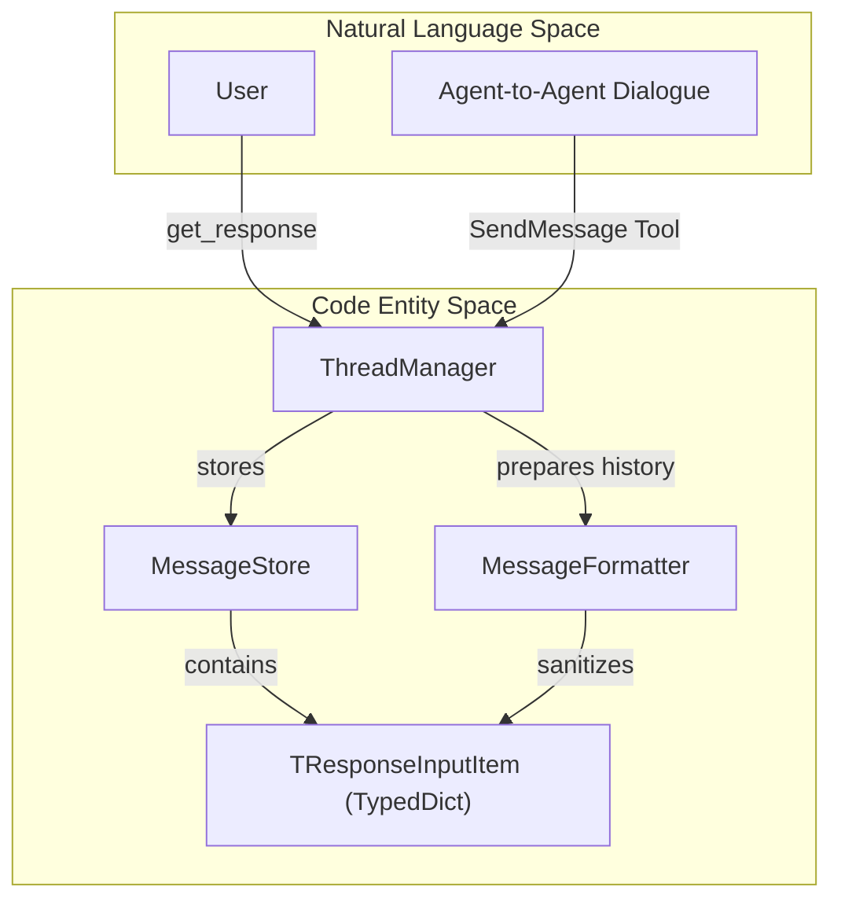
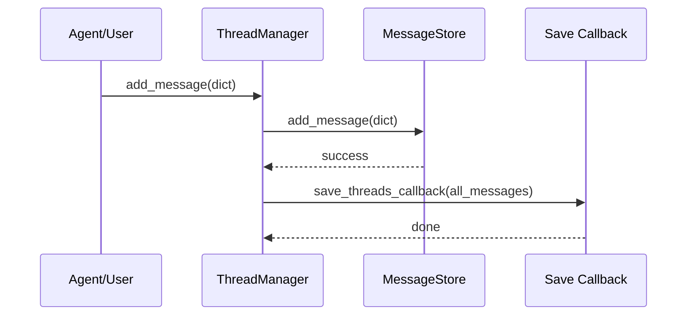

<!-- source: DeepWiki mcp.deepwiki.com · repo VRSEN/agency-swarm · page 2.3 Thread System · fetched 2026-10-26 -->

# Thread System

Relevant source files

The following files were used as context for generating this wiki page:

- [examples/agency_context.py](examples/agency_context.py)
- [examples/custom_persistence.py](examples/custom_persistence.py)
- [examples/fastapi_integration/client.py](examples/fastapi_integration/client.py)
- [examples/handoffs.py](examples/handoffs.py)
- [examples/interactive/hybrid_communication_flows.py](examples/interactive/hybrid_communication_flows.py)
- [examples/multi_agent_workflow.py](examples/multi_agent_workflow.py)
- [examples/streaming.py](examples/streaming.py)
- [src/agency_swarm/messages/message_formatter.py](src/agency_swarm/messages/message_formatter.py)
- [src/agency_swarm/utils/thread.py](src/agency_swarm/utils/thread.py)
- [tests/integration/communication/test_streaming_order_consistency.py](tests/integration/communication/test_streaming_order_consistency.py)
- [tests/integration/litellm_integration/test_litellm_anthropic_message_ordering.py](tests/integration/litellm_integration/test_litellm_anthropic_message_ordering.py)
- [tests/integration/litellm_integration/test_litellm_anthropic_nonstreaming.py](tests/integration/litellm_integration/test_litellm_anthropic_nonstreaming.py)
- [tests/integration/litellm_integration/test_litellm_models.py](tests/integration/litellm_integration/test_litellm_models.py)
- [tests/integration/litellm_integration/test_litellm_openai_responses_history_switch.py](tests/integration/litellm_integration/test_litellm_openai_responses_history_switch.py)
- [tests/integration/litellm_integration/test_litellm_placeholder_ids_integration.py](tests/integration/litellm_integration/test_litellm_placeholder_ids_integration.py)
- [tests/integration/litellm_integration/test_litellm_visualization.py](tests/integration/litellm_integration/test_litellm_visualization.py)
- [tests/test_agent_modules/test_constants.py](tests/test_agent_modules/test_constants.py)
- [tests/test_agent_modules/test_hosted_tool_results.py](tests/test_agent_modules/test_hosted_tool_results.py)
- [tests/test_agent_modules/test_thread_manager.py](tests/test_agent_modules/test_thread_manager.py)
- [tests/test_messages_modules/test_message_formatter_history_protocol.py](tests/test_messages_modules/test_message_formatter_history_protocol.py)

The Thread System in the Agency Swarm framework manages conversation state and communication between agents. Unlike previous versions that relied on OpenAI Assistants API primitives, the current system uses a **flat message storage** architecture managed by the `ThreadManager`. This system serves as the communication backbone for multi-agent workflows, ensuring history persistence and consistency across agent interactions.

## Overview

The Thread System is centered around the `ThreadManager` and `MessageStore`. It replaces isolated thread objects with a unified repository of messages where each entry is tagged with metadata identifying the sender (`callerAgent`) and recipient (`agent`). This allows for seamless context sharing and easier persistence.

### Architecture and Data Flow

The following diagram illustrates how the Thread System bridges the gap between high-level Agency interactions and the underlying data structures.

**Thread System Entity Mapping**

Sources: [src/agency_swarm/utils/thread.py:121-149](), [src/agency_swarm/messages/message_formatter.py:44-61]()

## Core Components

### ThreadManager
The `ThreadManager` is the primary orchestrator for conversation state. It handles the lifecycle of messages, including addition, retrieval, and persistence via callbacks.

- **Persistence Hooks**: Supports `load_threads_callback` and `save_threads_callback` to integrate with external databases or file systems [src/agency_swarm/utils/thread.py:134-148]().
- **Conversation Retrieval**: Provides `get_conversation_history(agent, caller_agent)` to extract specific interaction legs. Notably, it ensures that all entry-point agents share the same "user thread" by treating any message with `callerAgent: None` as part of the shared user context [src/agency_swarm/utils/thread.py:177-195]().

### MessageStore
A specialized container that holds a flat list of `TResponseInputItem` objects.
- **Flat Storage**: Replaces hierarchical threads with a single list [src/agency_swarm/utils/thread.py:12-21]().
- **Metadata Tagging**: Every message includes `agent` (recipient), `callerAgent` (sender), and `timestamp` [src/agency_swarm/utils/thread.py:37-40]().
- **Filtering**: Supports retrieving messages for specific pairs (e.g., `get_conversation_between("CEO", "Worker")`) [src/agency_swarm/utils/thread.py:80-100]().

### MessageFormatter
The `MessageFormatter` acts as a translation layer between the stored history and the model-specific requirements.
- **Protocol Detection**: Detects if history follows "responses" (OpenAI Agents SDK style) or "chat_completions" protocols [src/agency_swarm/messages/message_formatter.py:156-172]().
- **History Preparation**: The `prepare_history_for_runner` method filters the flat store for messages relevant to the current agent and ensures they are compatible with the agent's model [src/agency_swarm/messages/message_formatter.py:216-248]().

Sources: [src/agency_swarm/utils/thread.py:12-114](), [src/agency_swarm/messages/message_formatter.py:44-105]()

## Thread Lifecycle and Persistence

### Initialization and Loading
When an `Agency` is instantiated, the `ThreadManager` is initialized. If a `load_threads_callback` is provided, it populates the `MessageStore` from the external source [src/agency_swarm/utils/thread.py:134-149]().

### Message Addition and Saving
Whenever a new message is generated (either from a user or an agent tool call), it is passed to `ThreadManager.add_message()`. This method appends the message to the store and immediately triggers the `save_threads_callback` to ensure persistence [src/agency_swarm/utils/thread.py:151-159]().

**Persistence Sequence**

Sources: [src/agency_swarm/utils/thread.py:151-167](), [examples/custom_persistence.py:32-51]()

## History Protocols and Compatibility

The system supports multiple history protocols to allow different models (OpenAI, Anthropic via LiteLLM, etc.) to interact within the same agency.

| Protocol | Description | Usage |
|----------|-------------|-------|
| `responses` | OpenAI Agents SDK style items (tool_call_item, message_output_item) | Default for most agents [src/agency_swarm/messages/message_formatter.py:47](). |
| `chat_completions` | Standard OpenAI Chat Completion roles (user, assistant, tool) | Used for legacy integrations [src/agency_swarm/messages/message_formatter.py:48](). |
| `mixed` | A combination of both protocols in one history | Usually results in a compatibility error [src/agency_swarm/messages/message_formatter.py:185-190](). |

### Ephemeral Content
To prevent internal "thought" processes or temporary tool hints from polluting the long-term history, the system uses the `_agency_swarm_ephemeral` flag. Messages or content parts with this flag are passed to the model for the current run but are stripped before being saved to the `MessageStore` [src/agency_swarm/messages/message_formatter.py:62](), [tests/test_messages_modules/test_message_formatter_history_protocol.py:124-154]().

## Multi-Agent Interaction Handling

When an agent (e.g., `CEO`) uses the `SendMessage` tool to talk to another agent (e.g., `Worker`), the following occurs:
1. The `CEO` generates a tool call.
2. The `ThreadManager` records this tool call.
3. A new interaction leg is started where the `Worker` becomes the `agent` and `CEO` becomes the `callerAgent`.
4. `MessageFormatter` fetches only the history where `(agent=Worker, callerAgent=CEO)` or `(agent=CEO, callerAgent=Worker)` to provide context to the `Worker` [src/agency_swarm/utils/thread.py:80-100]().

This isolation ensures that agents only see the parts of the conversation relevant to them, while the `ThreadManager` maintains the global state for the entire `Agency`.

Sources: [src/agency_swarm/utils/thread.py:80-100](), [src/agency_swarm/messages/message_formatter.py:216-248](), [tests/integration/communication/test_streaming_order_consistency.py:100-109]()

---

