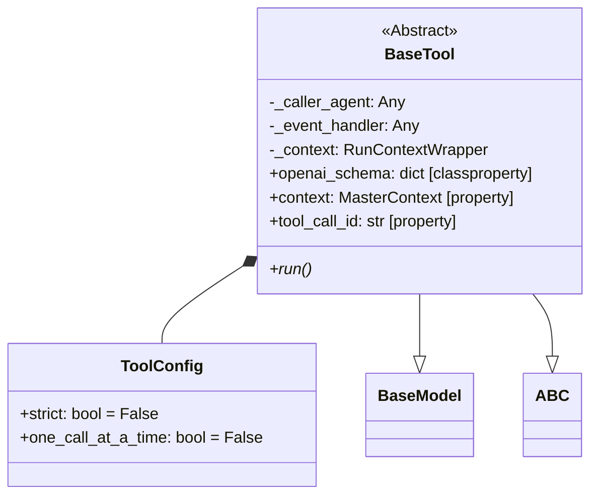
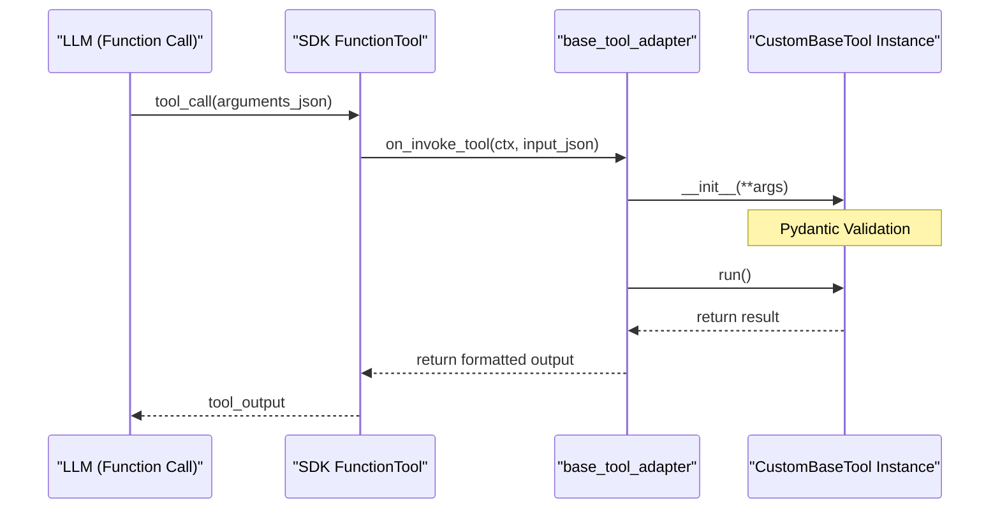

<!-- source: DeepWiki mcp.deepwiki.com · repo VRSEN/agency-swarm · page 2.4 BaseTool Class · fetched 2026-10-26 -->

# BaseTool Class

<details>
<summary>Relevant source files</summary>

The following files were used as context for generating this wiki page:

- [docs/core-framework/tools/built-in-tools.mdx](docs/core-framework/tools/built-in-tools.mdx)
- [docs/core-framework/tools/custom-tools/multimodal-outputs.mdx](docs/core-framework/tools/custom-tools/multimodal-outputs.mdx)
- [docs/core-framework/tools/overview.mdx](docs/core-framework/tools/overview.mdx)
- [examples/data/daily_revenue.png](examples/data/daily_revenue.png)
- [examples/data/daily_revenue_report.pdf](examples/data/daily_revenue_report.pdf)
- [examples/multimodal_outputs.py](examples/multimodal_outputs.py)
- [src/agency_swarm/tools/base_tool.py](src/agency_swarm/tools/base_tool.py)
- [src/agency_swarm/tools/tool_factory_utils/base_tool_adapter.py](src/agency_swarm/tools/tool_factory_utils/base_tool_adapter.py)
- [src/agency_swarm/tools/utils.py](src/agency_swarm/tools/utils.py)
- [src/agency_swarm/utils/dry_run.py](src/agency_swarm/utils/dry_run.py)
- [tests/integration/communication/test_send_message_extra_params.py](tests/integration/communication/test_send_message_extra_params.py)
- [tests/integration/fastapi/test_fastapi_dry_run.py](tests/integration/fastapi/test_fastapi_dry_run.py)
- [tests/test_agent_modules/send_message/test_deprecated_reminder_override.py](tests/test_agent_modules/send_message/test_deprecated_reminder_override.py)
- [tests/test_agent_modules/send_message/test_extra_params.py](tests/test_agent_modules/send_message/test_extra_params.py)
- [tests/test_agent_modules/test_base_tool.py](tests/test_agent_modules/test_base_tool.py)
- [tests/test_tools_modules/test_tool_system.py](tests/test_tools_modules/test_tool_system.py)
- [tests/test_tools_modules/test_utils.py](tests/test_tools_modules/test_utils.py)

</details>


The `BaseTool` class is the foundational abstract base for creating Pydantic-based tools within the `agency-swarm` framework. It provides a structured way to define tool parameters, validation logic, and execution routines while ensuring compatibility with the OpenAI Function Calling API and the underlying SDK.

## Overview

`BaseTool` inherits from Pydantic's `BaseModel` and Python's `ABC` (Abstract Base Class). It offers an alternative to the `@function_tool` decorator by providing explicit field definitions, model validators, and access to the `MasterContext` for shared state management [src/agency_swarm/tools/base_tool.py:1-7]().

### Core Class Structure



Sources: [src/agency_swarm/tools/base_tool.py:72-171]()

## Key Components

### Pydantic Field Definitions
Tools define their inputs as Pydantic fields. These fields are automatically parsed into the JSON schema sent to the LLM. Field descriptions are extracted to provide the model with context on how to use each parameter [src/agency_swarm/tools/base_tool.py:119-127]().

### The ToolConfig Class
A nested `ToolConfig` class allows developers to tune tool execution behavior:

| Option | Type | Default | Description |
| :--- | :--- | :--- | :--- |
| `strict` | `bool` | `False` | Enables OpenAI "Strict Mode," enforcing `additionalProperties: false` in the JSON schema [src/agency_swarm/tools/base_tool.py:142-151](). |
| `one_call_at_a_time` | `bool` | `False` | A concurrency policy that prevents an agent from executing this tool multiple times simultaneously [src/agency_swarm/tools/base_tool.py:105-105](). |

Sources: [src/agency_swarm/tools/base_tool.py:101-105]()

### MasterContext Access
Tools can access the `MasterContext` via the `self.context` property. This provides a clean interface to shared agent state, the `ThreadManager`, and user-specific context [src/agency_swarm/tools/base_tool.py:154-158]().

## Implementation Flow: From Code to SDK

When a `BaseTool` is provided to an `Agent`, it is adapted into a `FunctionTool` instance compatible with the SDK. This process involves converting Pydantic fields into a JSON schema and wrapping the `run()` method in an execution handler.



Sources: [src/agency_swarm/tools/tool_factory_utils/base_tool_adapter.py:21-72]()

### Adaptation Details
The `adapt_base_tool` function performs the following:
1.  **Schema Extraction**: Calls `model_json_schema()` and resolves references [src/agency_swarm/tools/tool_factory_utils/base_tool_adapter.py:32-35]().
2.  **Execution Wrapping**: Creates an `on_invoke_tool` closure that instantiates the tool, injects the `RunContextWrapper`, and executes `run()` [src/agency_swarm/tools/tool_factory_utils/base_tool_adapter.py:38-49]().
3.  **Threading**: If `run()` is synchronous, it is automatically executed via `asyncio.to_thread` to prevent blocking the event loop [src/agency_swarm/tools/tool_factory_utils/base_tool_adapter.py:49-49]().

## Multimodal Outputs

Tools can return rich media types instead of plain strings. This is achieved by returning specific wrapper classes from the `run()` method.

| Output Class | Purpose | Source |
| :--- | :--- | :--- |
| `ToolOutputImage` | Returns images (PNG/JPG) via URL, Data URL, or OpenAI File ID. | [docs/core-framework/tools/custom-tools/multimodal-outputs.mdx:34-40]() |
| `ToolOutputFileContent` | Returns PDF files for agent analysis or user download. | [docs/core-framework/tools/custom-tools/multimodal-outputs.mdx:76-82]() |
| `ToolOutputText` | Explicitly returns text, often used in a `list` of multiple outputs. | [docs/core-framework/tools/custom-tools/multimodal-outputs.mdx:127-142]() |

### Multimodal Utilities
The framework provides helper functions in `agency_swarm.tools.utils` to simplify multimodal returns:
*   `tool_output_image_from_path(path, detail)`: Converts a local image to a base64 data URL [src/agency_swarm/tools/utils.py:177-195]().
*   `tool_output_file_from_url(url)`: Handles remote PDF fetching with size limits and safety checks [src/agency_swarm/tools/utils.py:214-230]().

Sources: [src/agency_swarm/tools/utils.py:177-230](), [docs/core-framework/tools/custom-tools/multimodal-outputs.mdx:32-142]()

## Extending BaseTool

To create a custom tool, extend `BaseTool` and implement the `run` method.

```python
from agency_swarm import BaseTool
from pydantic import Field

class MyCustomTool(BaseTool):
    """
    Docstring serves as the tool description for the LLM.
    """
    param1: str = Field(..., description="Description for param1")

    class ToolConfig:
        strict = True

    def run(self):
        # Access context if needed
        # user_data = self.context.user_context
        return f"Processed {self.param1}"
```

Sources: [src/agency_swarm/tools/base_tool.py:72-171](), [tests/test_tools_modules/test_tool_system.py:134-143]()

## Advanced Usage: Extra Params in SendMessage
The `SendMessage` tool (a subclass of `BaseTool`) supports an `extra_params_model` or a nested `ExtraParams` class. This allows developers to inject custom metadata fields into the communication tool, which are then validated and included in the tool's JSON schema [tests/test_agent_modules/send_message/test_extra_params.py:32-58]().

Sources: [tests/test_agent_modules/send_message/test_extra_params.py:72-106](), [tests/integration/communication/test_send_message_extra_params.py:13-26]()

---

