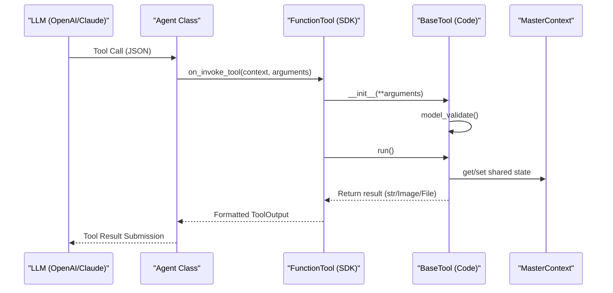

<!-- source: DeepWiki mcp.deepwiki.com · repo VRSEN/agency-swarm · page 3 Tool System · fetched 2026-10-26 -->

# Tool System

<details>
<summary>Relevant source files</summary>

The following files were used as context for generating this wiki page:

- [examples/fastapi_integration/print_openapi_schema.py](examples/fastapi_integration/print_openapi_schema.py)
- [src/agency_swarm/cli/import_tool.py](src/agency_swarm/cli/import_tool.py)
- [src/agency_swarm/tools/built_in/IPythonInterpreter.py](src/agency_swarm/tools/built_in/IPythonInterpreter.py)
- [src/agency_swarm/tools/built_in/LoadFileAttachment.py](src/agency_swarm/tools/built_in/LoadFileAttachment.py)
- [src/agency_swarm/tools/built_in/PersistentShellTool.py](src/agency_swarm/tools/built_in/PersistentShellTool.py)
- [src/agency_swarm/tools/built_in/PresentFiles.py](src/agency_swarm/tools/built_in/PresentFiles.py)
- [src/agency_swarm/tools/built_in/__init__.py](src/agency_swarm/tools/built_in/__init__.py)
- [src/agency_swarm/tools/mcp_manager.py](src/agency_swarm/tools/mcp_manager.py)
- [src/agency_swarm/tools/tool_factory.py](src/agency_swarm/tools/tool_factory.py)
- [tests/integration/tools/test_present_files_tool.py](tests/integration/tools/test_present_files_tool.py)
- [tests/test_agent_modules/test_mcp_manager.py](tests/test_agent_modules/test_mcp_manager.py)
- [tests/test_agent_modules/test_mcp_oauth.py](tests/test_agent_modules/test_mcp_oauth.py)
- [tests/test_agent_modules/test_tool_factory_core.py](tests/test_agent_modules/test_tool_factory_core.py)
- [tests/test_cli_modules/test_import_tool.py](tests/test_cli_modules/test_import_tool.py)
- [tests/test_fastapi_utils_modules/test_oauth_support.py](tests/test_fastapi_utils_modules/test_oauth_support.py)
- [tests/test_tools_modules/test_tool_factory_openapi.py](tests/test_tools_modules/test_tool_factory_openapi.py)

</details>


The Tool System in Agency Swarm enables agents to perform actions and interact with external systems. This page documents the architecture, components, and orchestration of tools within the framework.

## Tool System Architecture

The Tool System bridges the gap between agent reasoning and external execution. It handles schema generation, parameter validation via Pydantic, and execution environments ranging from local shells to remote MCP servers.

```mermaid
graph TD
    subgraph "Tool Foundation"
        [BaseTool] --> [ToolConfig]
        [BaseTool] --> [ToolContext]
    end
    
    subgraph "Tool Creation"
        [ToolFactory] -->|"from_file()"| [BaseTool]
        [ToolFactory] -->|"from_langchain()"| [BaseTool]
        [ToolFactory] -->|"from_openapi_schema()"| [BaseTool]
        [ToolFactory] -->|"from_mcp()"| [BaseTool]
    end
    
    subgraph "Execution Layer"
        [Agent] -->|"manages"| [mcp_manager]
        [Agent] -->|"invokes"| [FunctionTool]
        [FunctionTool] -->|"runs"| [BaseTool]
    end
    
    subgraph "Built-in Ecosystem"
        [IPythonInterpreter]
        [PersistentShellTool]
        [PresentFiles]
        [LoadFileAttachment]
    end
```

Sources: [src/agency_swarm/tools/base_tool.py:19-106](), [src/agency_swarm/tools/tool_factory_utils.py:21-514](), [src/agency_swarm/tools/mcp_manager.py:66-121]().

## BaseTool Class

The `BaseTool` class is the primary interface for defining custom capabilities. It leverages Pydantic for robust input validation and provides a standardized `run()` method for execution.

### Key Features
1.  **Schema Generation**: Automatically generates OpenAI-compatible function schemas from class attributes and docstrings [src/agency_swarm/tools/base_tool.py:75-80]().
2.  **Context Awareness**: Tools can access the `MasterContext` (via `self.context`) to retrieve shared state or information about the calling agent [src/agency_swarm/tools/base_tool.py:40-45]().
3.  **Structured Outputs**: Supports returning complex types like `ToolOutputImage` or `ToolOutputFile` which are handled specifically by the UI and SDK [tests/test_agent_modules/test_tool_factory_core.py:185-200]().
4.  **Configuration**: The `ToolConfig` inner class controls execution behavior:
    *   `strict`: Enforces strict schema validation for OpenAI models.
    *   `one_call_at_a_time`: Synchronizes access to sensitive tools.
    *   `output_as_result`: Directly returns the tool's output to the user as the final message.

Sources: [src/agency_swarm/tools/base_tool.py:19-106]().

## ToolFactory

The `ToolFactory` acts as a universal adapter, converting various external definitions into the `BaseTool` format.

*   **OpenAPI Integration**: Dynamically creates tools from Swagger/OpenAPI specs using `from_openapi_schema`.
*   **MCP Support**: Materializes tools from Model Context Protocol servers at runtime.
*   **File Loading**: The `from_file()` method allows for dynamic loading of tools from an agent's `tools/` directory.

For detailed implementation details, see [ToolFactory](#3.1).

Sources: [src/agency_swarm/tools/tool_factory.py:1-6](), [src/agency_swarm/tools/tool_factory_utils.py:110-150]().

## Built-in Tools

The framework provides a set of pre-configured tools for common developer tasks:
*   **IPythonInterpreter**: Isolated Jupyter kernel execution for data science and visualization [src/agency_swarm/tools/built_in/IPythonInterpreter.py:41-68]().
*   **PersistentShellTool**: A shell interface that maintains the working directory across multiple turns [src/agency_swarm/tools/built_in/PersistentShellTool.py:11-20]().
*   **PresentFiles**: Moves files to a persistent `/mnt` directory for display in the Chat UI [src/agency_swarm/tools/built_in/PresentFiles.py:117-130]().
*   **LoadFileAttachment**: Handles multimodal inputs, determining if a file should be treated as an image or a document [src/agency_swarm/tools/built_in/LoadFileAttachment.py:9-19]().

For the full list and usage guides, see [Built-in Tools](#3.2).

Sources: [src/agency_swarm/tools/built_in/__init__.py:1-10]().

## MCP Integration

Model Context Protocol (MCP) support allows agents to connect to a growing ecosystem of external servers.
*   **Persistence**: The `PersistentMCPServerManager` ensures that server connections (stdio or SSE) are maintained across multiple requests [src/agency_swarm/tools/mcp_manager.py:56-60]().
*   **Security**: Includes an OAuth bridge for handling third-party authentication (e.g., Google, GitHub) within the agentic flow [src/agency_swarm/tools/mcp_manager.py:30-55]().
*   **Proxying**: Uses `LoopAffineAsyncProxy` to ensure async MCP calls remain pinned to the correct event loop, preventing threading conflicts [src/agency_swarm/tools/mcp_manager.py:29-29]().

For details on configuration and OAuth flows, see [MCP Integration](#3.3).

Sources: [src/agency_swarm/tools/mcp_manager.py:69-121](), [tests/test_agent_modules/test_mcp_manager.py:125-138]().

## Tool Execution Lifecycle

When an agent decides to use a tool, the framework orchestrates the transition from "Natural Language Space" to "Code Entity Space."



Sources: [src/agency_swarm/tools/base_tool.py:19-106](), [tests/test_agent_modules/test_tool_factory_core.py:128-144](), [src/agency_swarm/tools/built_in/PersistentShellTool.py:37-43]().

---

