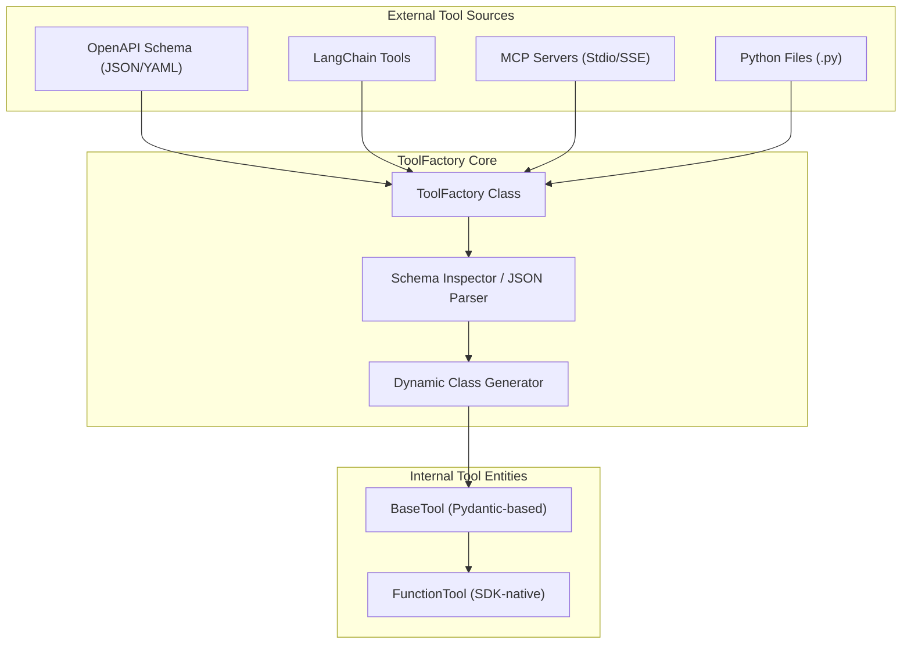
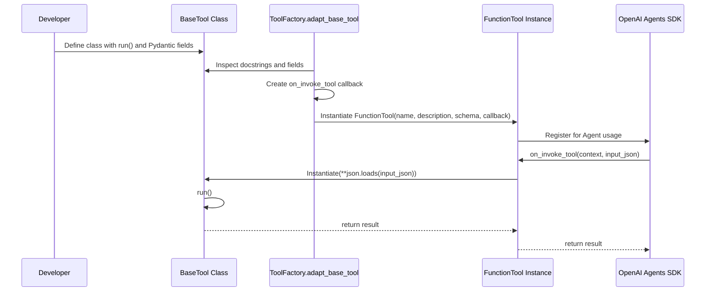
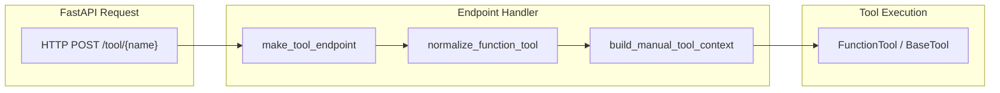

<!-- source: DeepWiki mcp.deepwiki.com · repo VRSEN/agency-swarm · page 3.1 ToolFactory · fetched 2026-10-26 -->

# ToolFactory

Relevant source files

The following files were used as context for generating this wiki page:

- [examples/fastapi_integration/print_openapi_schema.py](examples/fastapi_integration/print_openapi_schema.py)
- [src/agency_swarm/integrations/fastapi_utils/logging_middleware.py](src/agency_swarm/integrations/fastapi_utils/logging_middleware.py)
- [src/agency_swarm/integrations/fastapi_utils/tool_endpoints.py](src/agency_swarm/integrations/fastapi_utils/tool_endpoints.py)
- [src/agency_swarm/integrations/fastapi_utils/tool_request_models.py](src/agency_swarm/integrations/fastapi_utils/tool_request_models.py)
- [src/agency_swarm/tools/function_tool_compat.py](src/agency_swarm/tools/function_tool_compat.py)
- [src/agency_swarm/tools/tool_factory.py](src/agency_swarm/tools/tool_factory.py)
- [src/agency_swarm/tools/tool_factory_utils/__init__.py](src/agency_swarm/tools/tool_factory_utils/__init__.py)
- [src/agency_swarm/tools/tool_factory_utils/factory.py](src/agency_swarm/tools/tool_factory_utils/factory.py)
- [src/agency_swarm/tools/tool_factory_utils/file_loader.py](src/agency_swarm/tools/tool_factory_utils/file_loader.py)
- [src/agency_swarm/tools/tool_factory_utils/langchain.py](src/agency_swarm/tools/tool_factory_utils/langchain.py)
- [src/agency_swarm/tools/tool_factory_utils/mcp.py](src/agency_swarm/tools/tool_factory_utils/mcp.py)
- [src/agency_swarm/tools/tool_factory_utils/openapi_exporter.py](src/agency_swarm/tools/tool_factory_utils/openapi_exporter.py)
- [src/agency_swarm/tools/tool_factory_utils/openapi_importer.py](src/agency_swarm/tools/tool_factory_utils/openapi_importer.py)
- [src/agency_swarm/tools/tool_factory_utils/schema_inspector.py](src/agency_swarm/tools/tool_factory_utils/schema_inspector.py)
- [tests/data/tools/sample_tool.py](tests/data/tools/sample_tool.py)
- [tests/integration/communication/test_communication.py](tests/integration/communication/test_communication.py)
- [tests/integration/fastapi/test_logging_middleware.py](tests/integration/fastapi/test_logging_middleware.py)
- [tests/test_agent_modules/test_tool_factory_core.py](tests/test_agent_modules/test_tool_factory_core.py)
- [tests/test_agent_modules/test_tool_factory_langchain.py](tests/test_agent_modules/test_tool_factory_langchain.py)
- [tests/test_example_modules/test_observability_example.py](tests/test_example_modules/test_observability_example.py)
- [tests/test_fastapi_utils_modules/__init__.py](tests/test_fastapi_utils_modules/__init__.py)
- [tests/test_fastapi_utils_modules/test_tool_endpoints.py](tests/test_fastapi_utils_modules/test_tool_endpoints.py)
- [tests/test_tools_modules/test_function_tool_compat.py](tests/test_tools_modules/test_function_tool_compat.py)
- [tests/test_tools_modules/test_tool_factory_openapi.py](tests/test_tools_modules/test_tool_factory_openapi.py)

## Purpose and Scope

The `ToolFactory` is a central utility class in the `agency-swarm` framework designed to bridge external tool definitions with the internal `BaseTool` and `FunctionTool` systems. It enables agents to ingest capabilities from a diverse range of sources: OpenAPI specifications, LangChain tools, Model Context Protocol (MCP) servers, and local Python files.

By standardizing these various formats into a common execution interface, `ToolFactory` ensures that agents can interact with external APIs and services without requiring manual wrapper code for every integration.

## Overview

The `ToolFactory` acts as a conversion layer. It takes structured metadata (schemas) and logic (callbacks or remote endpoints) and materializes them as Python classes or instances that the OpenAI Agents SDK can execute.

### Tool Factory Architecture

Sources: [src/agency_swarm/tools/tool_factory_utils/factory.py:1-10](), [src/agency_swarm/tools/tool_factory.py:1-6]()

## Tool Creation Methods

The `ToolFactory` provides several static methods for importing and adapting tools.

| Method | Source | Logic |
| :--- | :--- | :--- |
| `from_openapi_schema` | OpenAPI 3.0/3.1 JSON/YAML | Generates tools for each endpoint with HTTP callbacks. |
| `from_langchain_tool` | `langchain.tools.BaseTool` | Wraps LangChain tools into the `FunctionTool` interface. |
| `from_mcp` | MCP Server (Stdio/SSE) | Discovers tools via MCP protocol and creates local proxies. |
| `from_file` | Local `.py` file | Dynamically imports classes inheriting from `BaseTool`. |
| `adapt_base_tool` | `BaseTool` Class | Converts a `BaseTool` class into an SDK-compatible `FunctionTool`. |

Sources: [src/agency_swarm/tools/tool_factory_utils/factory.py:15-120](), [src/agency_swarm/tools/tool_factory_utils/openapi_importer.py:10-50]()

## Adaptation and Compatibility

A critical function of the `ToolFactory` is the `adapt_base_tool` method. This method transforms a standard `agency-swarm` `BaseTool` (which uses Pydantic for validation) into a `FunctionTool` required by the underlying Agents SDK.

### Data Flow: BaseTool to FunctionTool

Sources: [tests/test_agent_modules/test_tool_factory_core.py:85-101](), [src/agency_swarm/tools/function_tool_compat.py:90-121]()

### Context Preservation
When tools are adapted, the framework ensures that `ToolContext` is preserved or rebuilt. The `normalize_function_tool` function in `function_tool_compat.py` ensures that manual tool calls (e.g., via FastAPI or direct testing) correctly bind a `ToolContext` even if one wasn't provided by the SDK's runtime.

Sources: [src/agency_swarm/tools/function_tool_compat.py:90-110](), [src/agency_swarm/tools/function_tool_compat.py:52-87]()

## Specialized Importers

### OpenAPI Integration
The `from_openapi_schema` method parses an OpenAPI specification and creates a tool for every operation found in the `paths` object.
- **Data Flow**: It creates an internal `generic_handler` that uses `httpx` to forward agent calls to the actual API endpoints.
- **Validation**: It uses the schema definitions in the OpenAPI spec to build the tool's input parameters.

Sources: [src/agency_swarm/tools/tool_factory_utils/openapi_importer.py:15-60](), [tests/test_tools_modules/test_tool_factory_openapi.py:14-43]()

### MCP Integration
The `from_mcp` method leverages the `mcp_converter` to transform tools hosted on a Model Context Protocol server into local `FunctionTool` instances.
- **Discovery**: It queries the MCP server for its tool list.
- **Proxying**: Every generated tool acts as a proxy, sending the `call_tool` request back to the MCP server over the established transport (Stdio or SSE).

Sources: [src/agency_swarm/tools/tool_factory_utils/mcp.py:1-6](), [src/agency_swarm/tools/mcp_converter.py:5-25]()

### LangChain Integration
`ToolFactory.from_langchain_tool` allows for seamless migration of existing LangChain tools.
- It extracts the `name`, `description`, and `args_schema` from the LangChain tool.
- It wraps the LangChain `_run` (or `_arun`) method into an `on_invoke_tool` callback.

Sources: [src/agency_swarm/tools/tool_factory_utils/langchain.py:10-40](), [tests/test_agent_modules/test_tool_factory_langchain.py:43-63]()

## Tool Factory Utilities

The `tool_factory_utils` sub-package contains the underlying logic for schema manipulation:
- **`SchemaInspector`**: Analyzes Python function signatures and Pydantic models to generate OpenAI-compatible JSON schemas.
- **`FileLoader`**: Handles the dynamic loading of Python modules from strings or paths, specifically looking for `BaseTool` subclasses.
- **`OpenAPIExporter`**: The inverse of the importer; it takes a list of `BaseTool` or `FunctionTool` objects and generates a valid OpenAPI 3.1.0 specification. This is used by `Agency.run_fastapi()` to expose tools via a web API.

Sources: [src/agency_swarm/tools/tool_factory_utils/openapi_exporter.py:10-80](), [src/agency_swarm/tools/tool_factory_utils/file_loader.py:5-30](), [src/agency_swarm/integrations/fastapi_utils/tool_endpoints.py:66-79]()

## Integration with FastAPI

When an Agency is served via FastAPI, the `ToolFactory` logic is used to generate endpoints. The `make_tool_endpoint` function utilizes `normalize_function_tool` to ensure that tools invoked via HTTP requests have access to a properly formed `ToolContext`.

Sources: [src/agency_swarm/integrations/fastapi_utils/tool_endpoints.py:16-47](), [src/agency_swarm/integrations/fastapi_utils/tool_endpoints.py:83-99]()

---

