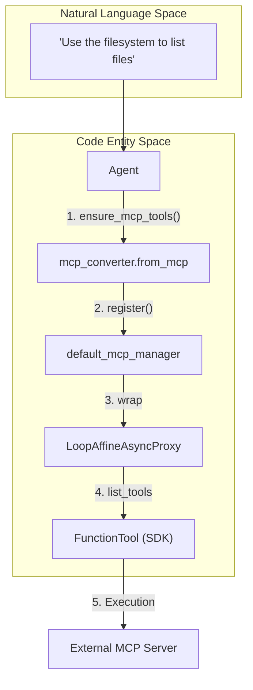
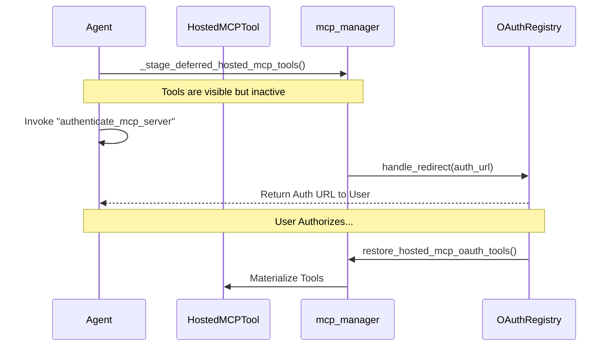

<!-- source: DeepWiki mcp.deepwiki.com · repo VRSEN/agency-swarm · page 3.3 MCP Integration · fetched 2026-10-26 -->

# MCP Integration

Relevant source files

The following files were used as context for generating this wiki page:

- [docs/additional-features/mcp-tools-server.mdx](docs/additional-features/mcp-tools-server.mdx)
- [examples/mcp_servers.py](examples/mcp_servers.py)
- [examples/utils/sse_mcp_server.py](examples/utils/sse_mcp_server.py)
- [examples/utils/stdio_mcp_server.py](examples/utils/stdio_mcp_server.py)
- [src/agency_swarm/integrations/mcp_server.py](src/agency_swarm/integrations/mcp_server.py)
- [src/agency_swarm/mcp/oauth_flow.py](src/agency_swarm/mcp/oauth_flow.py)
- [src/agency_swarm/tools/hosted_mcp_activation.py](src/agency_swarm/tools/hosted_mcp_activation.py)
- [src/agency_swarm/tools/mcp_converter.py](src/agency_swarm/tools/mcp_converter.py)
- [src/agency_swarm/tools/mcp_loop_proxy.py](src/agency_swarm/tools/mcp_loop_proxy.py)
- [src/agency_swarm/tools/mcp_manager.py](src/agency_swarm/tools/mcp_manager.py)
- [src/agency_swarm/tools/mcp_oauth_bridge.py](src/agency_swarm/tools/mcp_oauth_bridge.py)
- [src/agency_swarm/tools/mcp_persistence.py](src/agency_swarm/tools/mcp_persistence.py)
- [tests/integration/mcp/test_mcp_server.py](tests/integration/mcp/test_mcp_server.py)
- [tests/test_agent_modules/test_from_mcp_method.py](tests/test_agent_modules/test_from_mcp_method.py)
- [tests/test_agent_modules/test_mcp_manager.py](tests/test_agent_modules/test_mcp_manager.py)
- [tests/test_agent_modules/test_mcp_oauth.py](tests/test_agent_modules/test_mcp_oauth.py)
- [tests/test_fastapi_utils_modules/test_oauth_support.py](tests/test_fastapi_utils_modules/test_oauth_support.py)
- [tests/test_tools_modules/test_mcp_config_strict_mode.py](tests/test_tools_modules/test_mcp_config_strict_mode.py)

The Model Context Protocol (MCP) integration enables Agency Swarm agents to interact with external tools and services through a standardized JSON-RPC interface. This allows for seamless connection to both local command-line utilities and remote web services without requiring manual tool wrappers for every external capability.

## Overview and Architecture

MCP integration is facilitated by the `ToolFactory` and a persistent management layer that ensures connections are maintained across agent execution cycles. The framework supports three primary transport mechanisms: `MCPServerStdio` for local processes, `MCPServerSse` for server-sent events, and `MCPServerStreamableHttp` for stateless HTTP interactions.

### Data Flow and Materialization

When an `Agent` is configured with `mcp_servers`, the framework materializes these servers into `FunctionTool` instances at runtime. This process involves connecting to the server, fetching the tool definitions via `MCPUtil.get_function_tools`, and wrapping them in error-handling logic.

Sources: [src/agency_swarm/tools/mcp_converter.py:75-92](), [src/agency_swarm/tools/mcp_manager.py:69-88]()

## Key Components

### PersistentMCPServerManager
The `PersistentMCPServerManager` (aliased as `default_mcp_manager`) acts as a singleton registry for all active MCP connections. It handles the lifecycle of "drivers"—the underlying connection objects—and ensures that multiple agents can share the same server instance if they use the same persistence key.

Key methods include:
- `register(server, key)`: Adds a server to the registry [src/agency_swarm/tools/mcp_persistence.py:65-79]().
- `ensure_connected(server)`: Lazily initializes the connection driver if it doesn't exist [src/agency_swarm/tools/mcp_persistence.py:90-112]().
- `shutdown()`: Gracefully closes all active drivers [src/agency_swarm/tools/mcp_persistence.py:166-189]().

### LoopAffineAsyncProxy
Since MCP drivers often require a persistent event loop, the `LoopAffineAsyncProxy` wraps server instances. It ensures that all asynchronous calls (like `connect`, `cleanup`, or `call_tool`) are executed on the specific background loop managed by the `PersistentMCPServerManager`, preventing "cross-loop" errors in multi-threaded environments like FastAPI.
Sources: [src/agency_swarm/tools/mcp_loop_proxy.py:25-45]() (inferred from imports in [src/agency_swarm/tools/mcp_manager.py:29-29]()).

### mcp_converter
The `from_mcp` function in `mcp_converter.py` is the primary entry point for turning `MCPServer` definitions into executable tools. It fetches tool schemas from the server and applies `_with_error_handling` to ensure that server-side exceptions are returned to the agent as strings rather than crashing the execution thread.
Sources: [src/agency_swarm/tools/mcp_converter.py:75-120](), [src/agency_swarm/tools/mcp_converter.py:32-49]()

## Server Transports

| Class | Transport | Use Case |
|-------|-----------|----------|
| `MCPServerStdio` | Stdio | Local CLI tools (e.g., `npx`, `python` scripts). |
| `MCPServerSse` | HTTP + SSE | Long-lived web connections with push updates. |
| `MCPServerStreamableHttp` | HTTP | Stateless request/response for hosted tools. |

Sources: [tests/integration/mcp/test_mcp_server.py:24-29]()

## Hosted MCP Tools

For tools hosted behind a remote endpoint, Agency Swarm provides `HostedMCPTool`. Unlike standard MCP servers that are connected at initialization, hosted tools can be "deferred." The `authenticate_mcp_server` tool allows agents to dynamically activate these tools, often triggering an OAuth flow if the server requires user authorization.

Sources: [src/agency_swarm/tools/mcp_manager.py:16-24](), [src/agency_swarm/tools/hosted_mcp_activation.py:20-50]() (inferred from imports).

## Serving Tools via MCP

Agency Swarm also allows you to *act* as an MCP server using `run_mcp`. This function takes a list of `BaseTool` or `FunctionTool` classes and exposes them via `FastMCP`.

- **Transport Support**: Supports `stdio`, `sse`, and `streamable-http` [src/agency_swarm/integrations/mcp_server.py:75-77]().
- **Authentication**: Can be secured via `APP_TOKEN` environment variables using `StaticBearer` middleware [src/agency_swarm/integrations/mcp_server.py:117-135]().
- **Conversion**: Automatically adapts `BaseTool` classes into `FunctionTool` instances before serving [src/agency_swarm/integrations/mcp_server.py:153-155]().

Sources: [src/agency_swarm/integrations/mcp_server.py:68-91](), [src/agency_swarm/integrations/mcp_server.py:106-115]()

## OAuth and Persistence Keys

To support multi-user environments, MCP connections are keyed by a combination of the server configuration and the `oauth_user_id`. 
- `_build_persistence_key`: Generates a unique string identifying the connection [src/agency_swarm/tools/mcp_manager.py:100-102]().
- `FileTokenStorage`: Persists OAuth tokens in a secure directory (defaulting to `~/.agency-swarm/mcp/tokens/`) [src/agency_swarm/mcp/oauth.py:14-27]() (inferred from [tests/test_agent_modules/test_mcp_oauth.py:32-41]()).

Sources: [src/agency_swarm/tools/mcp_manager.py:83-83](), [src/agency_swarm/tools/mcp_manager.py:100-102]()

---

