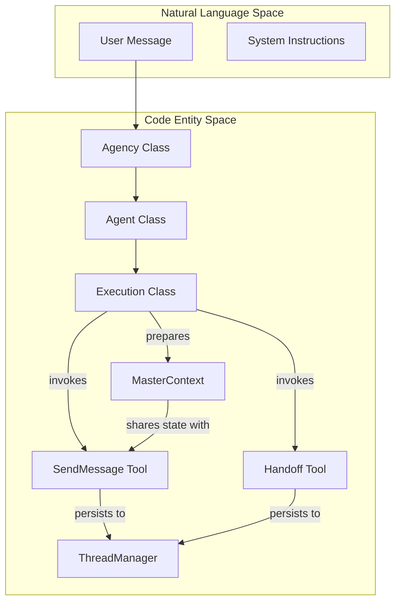
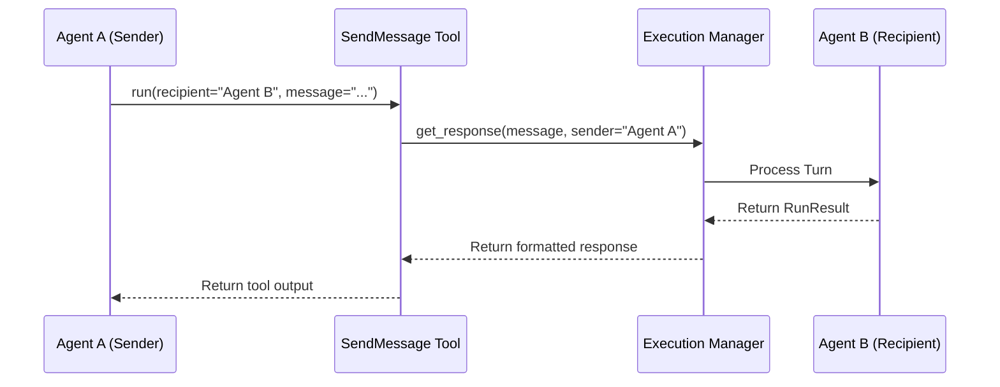

<!-- source: DeepWiki mcp.deepwiki.com · repo VRSEN/agency-swarm · page 4 Agent Communication · fetched 2026-10-26 -->

# Agent Communication

Relevant source files

The following files were used as context for generating this wiki page:

- [.claude/agents/agent-creator.md](.claude/agents/agent-creator.md)
- [.claude/agents/tools-creator.md](.claude/agents/tools-creator.md)
- [docs/additional-features/agency-context.mdx](docs/additional-features/agency-context.mdx)
- [docs/additional-features/custom-communication-flows/common-use-cases.mdx](docs/additional-features/custom-communication-flows/common-use-cases.mdx)
- [docs/additional-features/custom-communication-flows/overview.mdx](docs/additional-features/custom-communication-flows/overview.mdx)
- [docs/core-framework/tools/custom-tools/best-practices.mdx](docs/core-framework/tools/custom-tools/best-practices.mdx)
- [docs/core-framework/tools/custom-tools/configuration.mdx](docs/core-framework/tools/custom-tools/configuration.mdx)
- [examples/custom_send_message.py](examples/custom_send_message.py)
- [src/agency_swarm/agent/execution.py](src/agency_swarm/agent/execution.py)
- [src/agency_swarm/agent/execution_helpers.py](src/agency_swarm/agent/execution_helpers.py)
- [src/agency_swarm/agent/execution_streaming.py](src/agency_swarm/agent/execution_streaming.py)
- [src/agency_swarm/context.py](src/agency_swarm/context.py)
- [src/agency_swarm/tools/send_message.py](src/agency_swarm/tools/send_message.py)
- [tests/integration/agency/test_agent_handoffs.py](tests/integration/agency/test_agent_handoffs.py)

This document provides a high-level overview of how agents communicate within the `agency-swarm` framework. It describes the mechanisms that enable multi-agent collaboration, the specialized tools used for delegation, and how shared state is maintained across these interactions.

## Communication Architecture

Communication in `agency-swarm` is built upon the `agents.Runner` and orchestrated by the `Agency` class. It bridges natural language intent with code-level execution using specialized tools and a centralized context.

Sources: [src/agency_swarm/agent/execution.py:68-84](), [src/agency_swarm/context.py:25-45](), [src/agency_swarm/tools/send_message.py:38-52]()

## Core Communication Tools

Agents do not communicate through hidden internal APIs; instead, they use standard tools that are automatically injected into their runtime environment based on the `communication_flows` defined in the `Agency`.

### SendMessage Tool
The `SendMessage` tool facilitates synchronous communication. The sender agent waits for the recipient agent to complete its task before continuing its own execution.
*   **Synchronous Delegation**: The sender invokes the tool and receives a response from the recipient [src/agency_swarm/tools/send_message.py:38-49]().
*   **Dynamic Configuration**: The tool is dynamically built with a `recipient_agent` enum based on the agency's topology [src/agency_swarm/tools/send_message.py:87-99]().
*   **Customizable**: Developers can extend `SendMessage` to add extra fields like `key_moments` or `decisions` to provide better context during delegation [examples/custom_send_message.py:34-56]().

### Handoff Tool
The `Handoff` tool enables a unidirectional transfer of control.
*   **Control Transfer**: Unlike `SendMessage`, once a `Handoff` occurs, the receiving agent takes over the interaction with the user entirely [docs/additional-features/custom-communication-flows/overview.mdx:16-16]().
*   **Guidance Persistence**: It can be configured to add a "handoff reminder" system message to the recipient's context to reduce confusion [docs/additional-features/custom-communication-flows/overview.mdx:84-86]().

For detailed implementation and configuration, see [Communication Flows](#4.2).

## The Message System and Context

The communication system ensures that all interactions are tracked and that agents have access to the necessary state to perform their tasks.

### MasterContext and Shared State
The `MasterContext` is a centralized data store passed during agent runs. It allows agents and tools to share data without passing large payloads in message strings.
*   **State Access**: Tools use `ctx.context.get()` and `ctx.context.set()` to interact with the shared state [docs/additional-features/agency-context.mdx:79-81]().
*   **Execution Tracking**: It tracks `current_agent_name`, `_current_agent_run_id`, and `_parent_run_id` to maintain a clear execution trace [src/agency_swarm/context.py:36-39]().

### Message Formatting and Persistence
All interactions are formatted and persisted via the `MessageFormatter` and `ThreadManager`.
*   **History Preparation**: The `MessageFormatter` prepares the conversation history for the OpenAI SDK, ensuring that agent-to-agent messages are correctly attributed [src/agency_swarm/agent/execution.py:132-141]().
*   **Pruning**: During streaming or guardrail trips, the system can "prune" message branches to maintain a clean history [src/agency_swarm/agent/execution_streaming.py:64-70]().

For details on how messages are formatted, filtered, and persisted, see [Message System](#4.1).

## Communication Lifecycle

Sources: [src/agency_swarm/agent/execution.py:72-102](), [src/agency_swarm/tools/send_message.py:38-49]()

## Sub-pages
- **[Message System](#4.1)**: Deep dive into `MessageFormatter`, history protocols, `StreamIdNormalizer`, and `ThreadManager` persistence.
- **[Communication Flows](#4.2)**: Detailed guide on defining `communication_flows`, customizing `SendMessage` tools, and implementing `Handoff` patterns.

---

