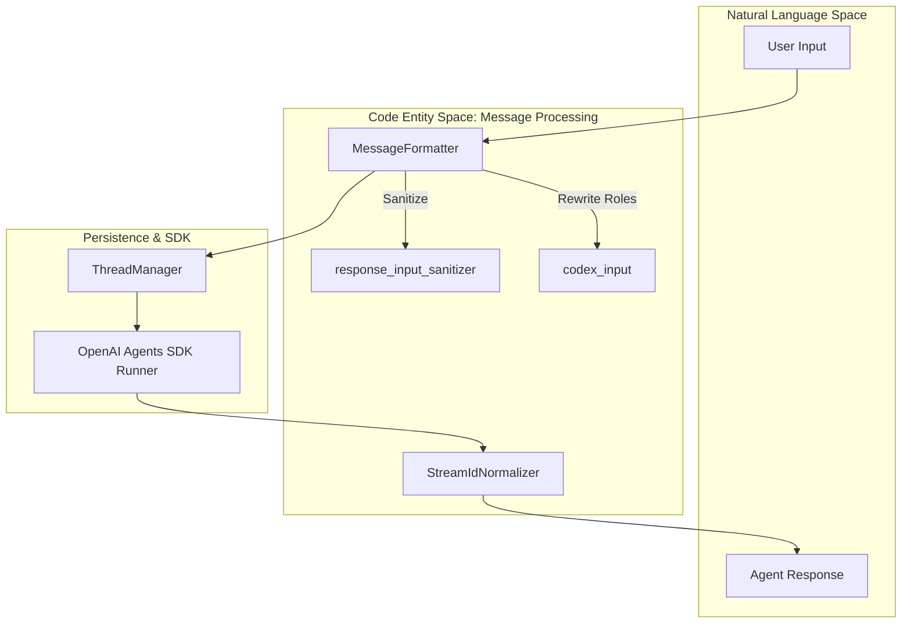
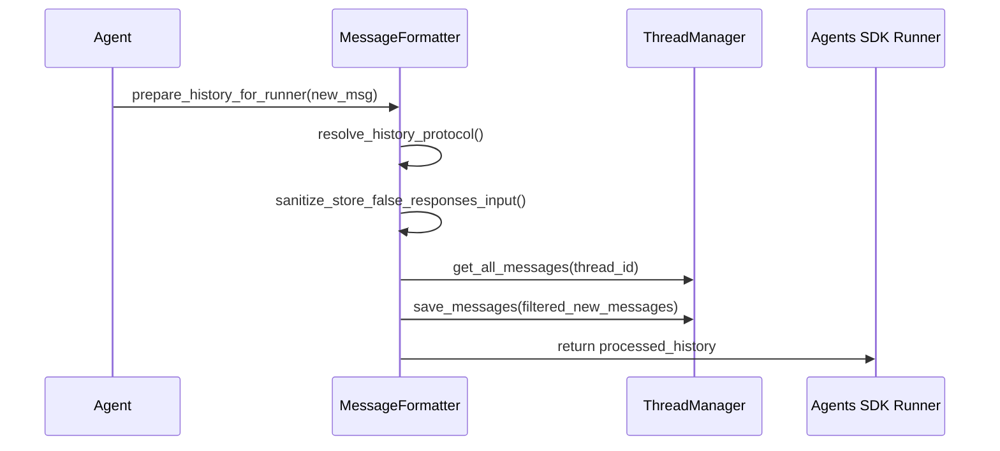

<!-- source: DeepWiki mcp.deepwiki.com · repo VRSEN/agency-swarm · page 4.1 Message System · fetched 2026-10-26 -->

# Message System

Relevant source files

The following files were used as context for generating this wiki page:

- [src/agency_swarm/messages/__init__.py](src/agency_swarm/messages/__init__.py)
- [src/agency_swarm/messages/codex_input.py](src/agency_swarm/messages/codex_input.py)
- [src/agency_swarm/messages/message_formatter.py](src/agency_swarm/messages/message_formatter.py)
- [src/agency_swarm/streaming/id_normalizer.py](src/agency_swarm/streaming/id_normalizer.py)
- [tests/test_agent_modules/test_hosted_tool_results.py](tests/test_agent_modules/test_hosted_tool_results.py)
- [tests/test_agent_modules/test_stream_id_normalization.py](tests/test_agent_modules/test_stream_id_normalization.py)
- [tests/test_fastapi_utils_modules/_codex_input_role_boundary_helpers.py](tests/test_fastapi_utils_modules/_codex_input_role_boundary_helpers.py)
- [tests/test_fastapi_utils_modules/test_codex_endpoint_role_boundary.py](tests/test_fastapi_utils_modules/test_codex_endpoint_role_boundary.py)
- [tests/test_fastapi_utils_modules/test_codex_input_role_boundary.py](tests/test_fastapi_utils_modules/test_codex_input_role_boundary.py)
- [tests/test_messages_modules/test_message_formatter_history_protocol.py](tests/test_messages_modules/test_message_formatter_history_protocol.py)

The Message System in `agency-swarm` provides the technical infrastructure for exchanging information between agents and persisting conversation state. It bridges the gap between the underlying OpenAI Agents SDK (which uses "Responses" and "Chat Completions" protocols) and the high-level multi-agent orchestration provided by the Agency Swarm framework.

## Overview

The system manages the transformation of raw model outputs into structured history, handles protocol normalization across different LLM providers, and ensures that messages are correctly persisted to the `ThreadManager`.

Sources: [src/agency_swarm/messages/message_formatter.py:44-61](), [src/agency_swarm/messages/codex_input.py:46-54](), [src/agency_swarm/streaming/id_normalizer.py:12-22]()

## MessageFormatter

The `MessageFormatter` class is the central utility for preparing chat history before it is sent to an agent's model and for processing outputs before they are stored.

### History Protocols
The framework supports three history protocols to maintain compatibility across various model providers:
*   **`responses`**: The default protocol used by the OpenAI Agents SDK [src/agency_swarm/messages/message_formatter.py:47]().
*   **`chat_completions`**: Used for standard Chat Completion API structures [src/agency_swarm/messages/message_formatter.py:48]().
*   **`mixed`**: A state where history contains elements of both, which triggers compatibility checks [src/agency_swarm/messages/message_formatter.py:49]().

### Key Functions
| Function | Purpose |
| :--- | :--- |
| `resolve_history_protocol` | Determines the protocol based on the `Agent.model` type (e.g., `OpenAIChatCompletionsModel`) [src/agency_swarm/messages/message_formatter.py:65-68](). |
| `prepare_history_for_runner` | The primary entry point for loading history from `ThreadManager`, stripping internal metadata, and applying filters [src/agency_swarm/messages/message_formatter.py:194-225](). |
| `extract_hosted_tool_results` | Synthesizes user messages from `FileSearch` or `WebSearch` tool calls so subsequent agents can "see" the results in their context [src/agency_swarm/messages/message_formatter.py:346-355](). |

Sources: [src/agency_swarm/messages/message_formatter.py:44-106](), [src/agency_swarm/messages/message_formatter.py:194-250]()

## Codex Input Handling

When agents use the "Codex" backend (e.g., via `https://chatgpt.com/backend-api/codex`), the message system must perform role rewriting. Codex requires that `system` messages be represented as `developer` messages to function correctly.

*   **Detection**: `agent_uses_codex_browser_auth` checks the agent's model `base_url` or environment variables to see if it matches `CODEX_BASE_URL` [src/agency_swarm/messages/codex_input.py:20-43]().
*   **Rewriting**: `rewrite_system_input_roles_for_codex` iterates through the message list and converts all items with `role: "system"` to `role: "developer"` [src/agency_swarm/messages/codex_input.py:46-54]().

Sources: [src/agency_swarm/messages/codex_input.py:11-54](), [tests/test_fastapi_utils_modules/test_codex_input_role_boundary.py:38-44]()

## Stream ID Normalization

When using non-native "Responses" models (like LiteLLM or standard Chat Completions), the Agents SDK often generates placeholder IDs (defined as `FAKE_RESPONSES_ID` or `"__fake_id__"`). This causes issues for UI clients and persistence layers that require stable, unique identifiers.

The `StreamIdNormalizer` resolves this by:
1.  **Tracking Sequences**: It maintains a sequence counter per `agent_run_id` [src/agency_swarm/streaming/id_normalizer.py:25]().
2.  **Stable Mapping**: It maps `output_index` to a generated stable ID, ensuring that multiple deltas for the same message share the same ID [src/agency_swarm/streaming/id_normalizer.py:65-73]().
3.  **Tool Correlation**: It uses the model's `call_id` as the stable ID for tool-related events, ensuring arguments and outputs are correctly linked [src/agency_swarm/streaming/id_normalizer.py:60-63]().

Sources: [src/agency_swarm/streaming/id_normalizer.py:12-82](), [tests/test_agent_modules/test_stream_id_normalization.py:19-48]()

## Data Flow and Persistence

Messages are persisted to the `ThreadManager` during the `prepare_history_for_runner` lifecycle.

### Filtering and Sanitization
*   **Ephemeral Content**: Content parts marked with `_agency_swarm_ephemeral: True` are included in the immediate model prompt but are stripped before the message is saved to the `ThreadManager` [src/agency_swarm/messages/message_formatter.py:245-249]().
*   **Reasoning Content**: If `store: false` is configured in the model settings, `sanitize_store_false_responses_input` removes reasoning tokens from the history to comply with privacy or token-limit requirements [src/agency_swarm/messages/response_input_sanitizer.py:28-30]().

Sources: [src/agency_swarm/messages/message_formatter.py:230-250](), [tests/test_messages_modules/test_message_formatter_history_protocol.py:124-154](), [src/agency_swarm/messages/response_input_sanitizer.py:26-30]()

---

