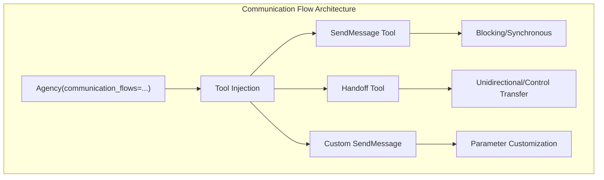
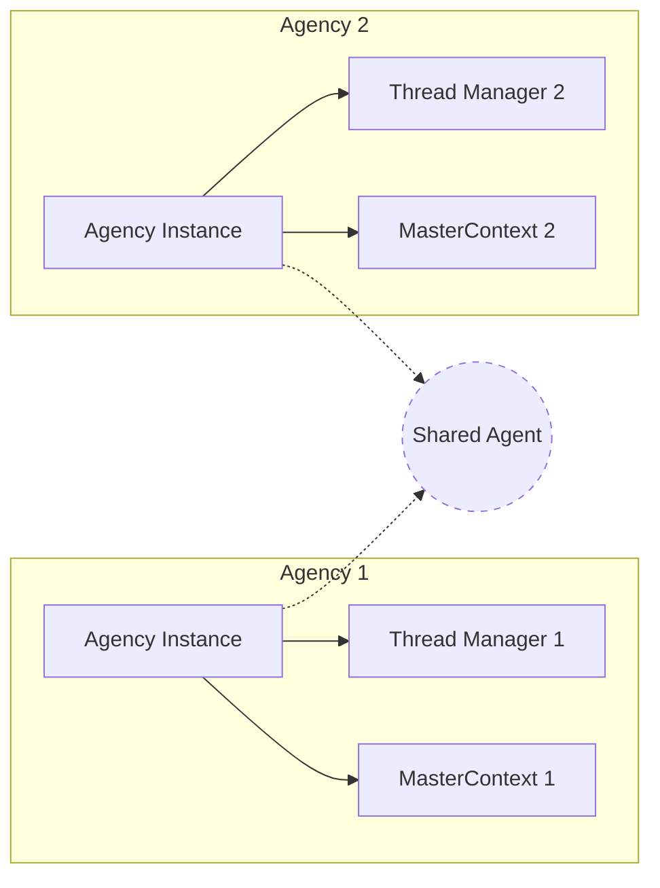

<!-- source: DeepWiki mcp.deepwiki.com · repo VRSEN/agency-swarm · page 4.2 Communication Flows · fetched 2026-10-26 -->

# Communication Flows

<details>
<summary>Relevant source files</summary>

The following files were used as context for generating this wiki page:

- [.claude/agents/agent-creator.md](.claude/agents/agent-creator.md)
- [.claude/agents/tools-creator.md](.claude/agents/tools-creator.md)
- [docs/additional-features/agency-context.mdx](docs/additional-features/agency-context.mdx)
- [docs/additional-features/custom-communication-flows/common-use-cases.mdx](docs/additional-features/custom-communication-flows/common-use-cases.mdx)
- [docs/additional-features/custom-communication-flows/overview.mdx](docs/additional-features/custom-communication-flows/overview.mdx)
- [docs/additional-features/deployment-to-production.mdx](docs/additional-features/deployment-to-production.mdx)
- [docs/core-framework/agencies/communication-flows.mdx](docs/core-framework/agencies/communication-flows.mdx)
- [docs/core-framework/tools/custom-tools/best-practices.mdx](docs/core-framework/tools/custom-tools/best-practices.mdx)
- [docs/core-framework/tools/custom-tools/configuration.mdx](docs/core-framework/tools/custom-tools/configuration.mdx)
- [examples/custom_send_message.py](examples/custom_send_message.py)
- [src/agency_swarm/integrations/fastapi_utils/tool_endpoints.py](src/agency_swarm/integrations/fastapi_utils/tool_endpoints.py)
- [src/agency_swarm/tools/function_tool_compat.py](src/agency_swarm/tools/function_tool_compat.py)
- [src/agency_swarm/tools/tool_factory_utils/file_loader.py](src/agency_swarm/tools/tool_factory_utils/file_loader.py)
- [tests/integration/agency/test_agent_handoffs.py](tests/integration/agency/test_agent_handoffs.py)
- [tests/integration/agency/test_multi_agency_support.py](tests/integration/agency/test_multi_agency_support.py)
- [tests/integration/agency/test_parent_run_id_tracking.py](tests/integration/agency/test_parent_run_id_tracking.py)
- [tests/integration/communication/test_communication.py](tests/integration/communication/test_communication.py)
- [tests/integration/communication/test_send_message_blocking.py](tests/integration/communication/test_send_message_blocking.py)
- [tests/integration/files/test_multimodal_outputs.py](tests/integration/files/test_multimodal_outputs.py)
- [tests/integration/tools/test_openapi_schema_agent.py](tests/integration/tools/test_openapi_schema_agent.py)
- [tests/integration/tools/test_responses_api_tools.py](tests/integration/tools/test_responses_api_tools.py)
- [tests/test_example_modules/test_observability_example.py](tests/test_example_modules/test_observability_example.py)
- [tests/test_fastapi_utils_modules/__init__.py](tests/test_fastapi_utils_modules/__init__.py)
- [tests/test_fastapi_utils_modules/test_tool_endpoints.py](tests/test_fastapi_utils_modules/test_tool_endpoints.py)
- [tests/test_tools_modules/test_function_tool_compat.py](tests/test_tools_modules/test_function_tool_compat.py)
- [tests/test_utils_modules/test_files.py](tests/test_utils_modules/test_files.py)
- [tests/test_utils_modules/test_model_utils.py](tests/test_utils_modules/test_model_utils.py)

</details>


This page documents how to define and manage communication flows between agents in an `agency-swarm` system. Communication flows determine how agents interact with each other, enabling complex multi-agent systems to coordinate effectively. For information about the underlying message system infrastructure, see [Message System](#4.1).

## Key Concepts in Agent Communication

Communication flows in `agency-swarm` define the pathways through which agents can exchange information. The framework utilizes a specialized tool-based approach where communication capabilities are injected into agents as tools based on the `communication_flows` configuration.



Sources: [src/agency_swarm/agency/agency.py:55-85](), [docs/additional-features/custom-communication-flows/overview.mdx:7-18]()

## Defining Communication Flows

Communication flows are defined using tuples in the `communication_flows` parameter of the `Agency` constructor. These flows determine which agents can see each other as valid recipients.

### Orchestration Patterns

| Pattern | Description | Implementation |
|---------|-------------|----------------|
| **Orchestrator-Worker** | One agent assigns tasks and compiles responses. Control returns to the orchestrator. | Default `SendMessage` tool |
| **Handoff** | Control transfers completely to another agent who continues the conversation. | `Handoff` tool |

### Syntax and Configuration

The `communication_flows` parameter accepts a list of tuples. You can use the `>` operator for readability:

```python
from agency_swarm import Agency, Agent, Handoff

# Flow Definitions
agency = Agency(
    ceo, 
    communication_flows=[
        (ceo, worker),           # CEO can delegate to worker (SendMessage)
        ceo > researcher,        # CEO can delegate to researcher (SendMessage)
        (triage > specialist, Handoff) # Triage transfers user to specialist
    ]
)
```

Sources: [docs/core-framework/agencies/communication-flows.mdx:11-61](), [docs/core-framework/agencies/communication-flows.mdx:103-119]()

## The SendMessage Tool

The `SendMessage` tool is the backbone of inter-agent communication. When a flow is defined, the framework dynamically creates `SendMessage` tool instances for the sender, populated with the allowed recipients.

### Blocking and Concurrency Behavior
Inter-agent communication is synchronous by default. The `SendMessage` tool implements a "pending-recipient guard" to prevent race conditions within a single thread:
- **Same Recipient**: An agent cannot send a second message to a recipient while a previous message to that same recipient is still being processed [tests/integration/communication/test_send_message_blocking.py:17-61]().
- **Different Recipients**: An agent **can** send messages to different recipients concurrently (e.g., using a tool-call batch) [tests/integration/communication/test_send_message_blocking.py:64-131]().

### Custom SendMessage Configurations
You can extend the `SendMessage` class to add custom fields that agents must fill out when communicating. This is useful for enforcing "Chain of Thought" or passing structured metadata.

```python
from pydantic import Field
from agency_swarm import SendMessage

class SendMessageWithContext(SendMessage):
    """Custom tool for delegating with specific context."""
    key_moments: str = Field(description="Critical decision points")
    decisions: str = Field(description="Specific decisions made")

# Apply to specific flow
agency = Agency(ceo, worker, communication_flows=[(ceo > worker, SendMessageWithContext)])
```

Sources: [docs/additional-features/custom-communication-flows/overview.mdx:47-64](), [examples/custom_send_message.py:34-56]()

## The Handoff Mechanism

The `Handoff` tool enables a unidirectional transfer of control. Unlike `SendMessage`, where the caller waits for a return value to continue its own execution, a `Handoff` terminates the caller's current turn and makes the recipient the active agent for the user.

### Handoff Reminders
To reduce hallucinations after a transfer, the framework can inject a `handoff_reminder` into the recipient's context.
- **Customization**: Set `handoff_reminder` on the `Agent` instance [docs/additional-features/custom-communication-flows/overview.mdx:103-117]().
- **Disabling**: Create a custom `Handoff` subclass with `add_reminder = False` [docs/additional-features/custom-communication-flows/overview.mdx:88-101]().

Sources: [docs/additional-features/custom-communication-flows/overview.mdx:82-87](), [src/agency_swarm/tools/send_message.py:16-17]()

## Data Flow and Context Isolation

Agents can be shared across multiple agencies. The framework ensures that communication state (threads) and data state (`MasterContext`) remain isolated per agency instance.



### Agency Context
The `MasterContext` allows agents to share data across tool calls without passing it through message strings. Tools access this via `self.context` (BaseTool) or `ctx.context` (FunctionTool).
- **Setting**: `self.context.set("key", value)`
- **Getting**: `self.context.get("key")`

Sources: [docs/additional-features/agency-context.mdx:7-27](), [tests/integration/agency/test_multi_agency_support.py:98-162]()

## Implementation Details

### Tool Compatibility and Normalization
The framework uses `normalize_function_tool` to ensure that tools (including communication tools) correctly receive the `MasterContext` even when invoked through different execution paths (e.g., FastAPI endpoints or direct SDK calls).

Key functions:
- `build_manual_tool_context`: Creates a `ToolContext` for manual tool invocations [src/agency_swarm/tools/function_tool_compat.py:52-87]().
- `normalize_function_tool`: Wraps `FunctionTool` instances to inject context handling [src/agency_swarm/tools/function_tool_compat.py:90-121]().

Sources: [src/agency_swarm/tools/function_tool_compat.py:1-121](), [src/agency_swarm/integrations/fastapi_utils/tool_endpoints.py:16-47]()

---

