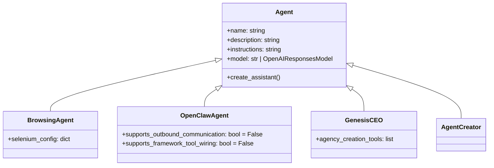
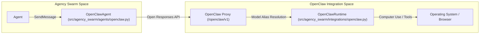

<!-- source: DeepWiki mcp.deepwiki.com · repo VRSEN/agency-swarm · page 5 Specialized Agents · fetched 2026-10-26 -->

# Specialized Agents

Relevant source files

The following files were used as context for generating this wiki page:

- [.cursor/rules/writing-docs.mdc](.cursor/rules/writing-docs.mdc)
- [docs/images/platform/openclaw-persistent-storage.png](docs/images/platform/openclaw-persistent-storage.png)
- [docs/platform/integrations/openclaw-integration.mdx](docs/platform/integrations/openclaw-integration.mdx)
- [docs/platform/marketplace/openclaw.mdx](docs/platform/marketplace/openclaw.mdx)
- [src/agency_swarm/agents/openclaw.py](src/agency_swarm/agents/openclaw.py)
- [src/agency_swarm/integrations/README.md](src/agency_swarm/integrations/README.md)
- [src/agency_swarm/integrations/openclaw.py](src/agency_swarm/integrations/openclaw.py)
- [src/agency_swarm/integrations/openclaw_model.py](src/agency_swarm/integrations/openclaw_model.py)
- [tests/test_agent_modules/test_openclaw_agent.py](tests/test_agent_modules/test_openclaw_agent.py)

Specialized Agents in the `agency-swarm` framework are purpose-built agent implementations that extend the base `Agent` class with domain-specific capabilities. These agents provide ready-to-use functionality for common tasks, such as web automation or autonomous system generation, allowing developers to implement complex behaviors without building from scratch.

For information about the base `Agent` class that these specialized agents extend, see [Agent Class](#2.2).

## Overview of Specialized Agents

Specialized agents build upon the core `Agent` architecture but implement additional capabilities through specialized tools, custom configurations, and purpose-specific instructions.

Sources: [src/agency_swarm/agent/core.py:12-25](), [src/agency_swarm/agents/openclaw.py:14-17]()

## BrowsingAgent

The `BrowsingAgent` is a specialized agent capable of interacting with web browsers through Selenium WebDriver. It enables agencies to perform web automation tasks, including browsing websites, clicking elements, filling forms, and extracting data.

For details, see [BrowsingAgent](#5.1).

### Capabilities
The `BrowsingAgent` includes specialized tools for:
1. **Web navigation**: Opening URLs, going back/forward.
2. **Element interaction**: Clicking, typing, selecting.
3. **Content extraction**: Reading text, scraping data.
4. **Visual Verification**: Taking screenshots for visual context.

Sources: [notebooks/web_browser_agent.ipynb:208-215](), [notebooks/web_browser_agent.ipynb:763-768]()

## Genesis Agency

The Genesis Agency is a specialized set of agents designed to generate and manage other agencies and agents. It serves as a meta-system for agent creation and configuration, often used via the CLI to bootstrap new projects.

For details, see [Genesis Agency](#5.2).

### Components
The Genesis system consists of several specialized agents:
*   **GenesisCEO**: Coordinates the creation process and management.
*   **AgentCreator**: Generates agent templates and directory structures.
*   **ToolCreator**: Creates custom tools using the `BaseTool` pattern.

Sources: [src/agency_swarm/util/create_agent_template.py:1-10]()

## OpenClaw Agent

The `OpenClawAgent` is a specialized wrapper that integrates the OpenClaw runtime into `agency-swarm`. It is designed to act as a **receive-only** worker that can handle complex browser-based tasks or computer use via the OpenClaw gateway.

For details, see [OpenClaw Agent](#5.3).

### Key Constraints
Unlike standard agents, the `OpenClawAgent` has specific architectural limitations to maintain compatibility with the OpenClaw runtime:
*   **No Outbound Communication**: It cannot initiate `SendMessage` or `Handoff` actions [src/agency_swarm/agents/openclaw.py:17-17]().
*   **No Framework Tool Wiring**: It does not accept `tools` or `tools_folder` parameters; extensions must be handled via OpenClaw plugins or MCP [src/agency_swarm/agents/openclaw.py:109-127]().
*   **Model Aliasing**: It uses the `openclaw:main` alias, which is resolved to a provider model (e.g., `openai/gpt-5.4`) by the `OpenClawRuntime` [src/agency_swarm/integrations/openclaw_model.py:13-15]().

### Integration Architecture

Sources: [src/agency_swarm/agents/openclaw.py:14-29](), [src/agency_swarm/integrations/openclaw.py:188-204](), [src/agency_swarm/integrations/openclaw_model.py:41-56]()

## Comparison of Specialized Agents

| Agent Type | Primary Purpose | Tool Integration | Communication |
| :--- | :--- | :--- | :--- |
| **BrowsingAgent** | Web Automation | Selenium-based Python Tools | Full (Bidirectional) |
| **Genesis Agents** | Meta-Programming | File/Directory Creation Tools | Full (Bidirectional) |
| **OpenClawAgent** | Computer Use Worker | OpenClaw Plugins / MCP | Receive-Only |

Sources: [src/agency_swarm/agents/openclaw.py:17-18](), [src/agency_swarm/integrations/README.md:20-41]()

---

