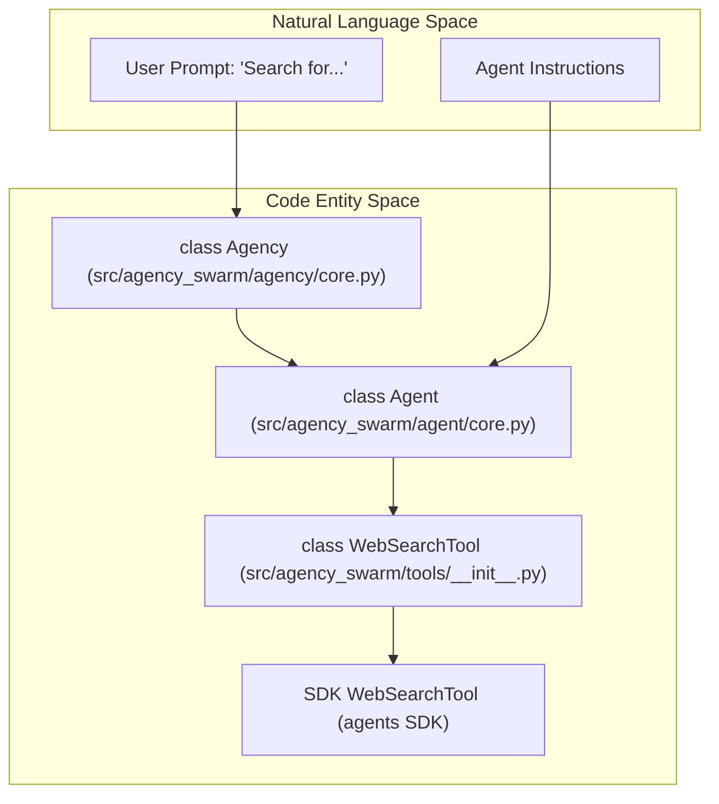
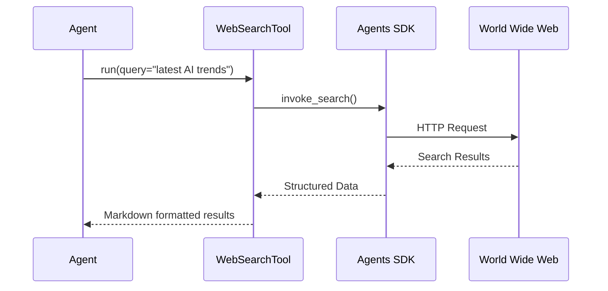

<!-- source: DeepWiki mcp.deepwiki.com · repo VRSEN/agency-swarm · page 5.1 BrowsingAgent · fetched 2026-10-26 -->

# BrowsingAgent

<details>
<summary>Relevant source files</summary>

The following files were used as context for generating this wiki page:

- [docs/additional-features/guardrails/input-guardrails.mdx](docs/additional-features/guardrails/input-guardrails.mdx)
- [docs/additional-features/guardrails/output-guardrails.mdx](docs/additional-features/guardrails/output-guardrails.mdx)
- [docs/core-framework/agents/built-in-tools.mdx](docs/core-framework/agents/built-in-tools.mdx)
- [docs/platform/marketplace/onboarding.mdx](docs/platform/marketplace/onboarding.mdx)
- [examples/README.md](examples/README.md)
- [examples/guardrails_input.py](examples/guardrails_input.py)
- [examples/interactive/third_party_models.py](examples/interactive/third_party_models.py)
- [examples/interactive/tui.py](examples/interactive/tui.py)
- [examples/observability.py](examples/observability.py)
- [src/agency_swarm/__init__.py](src/agency_swarm/__init__.py)
- [src/agency_swarm/tools/__init__.py](src/agency_swarm/tools/__init__.py)
- [tests/test_agency_modules/test_package_exports.py](tests/test_agency_modules/test_package_exports.py)

</details>


The `BrowsingAgent` is a specialized agent in the `agency-swarm` framework designed for web browsing and interaction. It provides automated web navigation, content extraction, and browser-based operations. In the current version of the framework, the `BrowsingAgent` capabilities are primarily surfaced through the `WebSearchTool` and `ComputerTool` integrated from the underlying SDK.

## Architecture Overview

The `BrowsingAgent` extends the core `Agent` class [src/agency_swarm/agent/core.py:61-122](). It integrates web interaction capabilities that allow it to retrieve real-time information and interact with remote content.


Sources:
- [src/agency_swarm/agent/core.py:61-122]()
- [src/agency_swarm/tools/__init__.py:21-21]()
- [src/agency_swarm/tools/__init__.py:74-74]()

## Core Capabilities

The `BrowsingAgent` leverages built-in tools to perform the following operations:

1.  **Web Search**: Real-time information retrieval and current events processing via `WebSearchTool` [src/agency_swarm/tools/__init__.py:103-103]().
2.  **Remote Content Retrieval**: Fetching data from specific URLs to enrich agent knowledge.
3.  **Source Extraction**: Capability to include or exclude source URLs in search results using `include_web_search_sources` [docs/core-framework/agents/built-in-tools.mdx:52-52]().
4.  **UI Automation**: Performing browser-based tasks via `ComputerTool` [src/agency_swarm/tools/__init__.py:67-67]().

Sources:
- [docs/core-framework/agents/built-in-tools.mdx:14-17]()
- [src/agency_swarm/tools/__init__.py:66-74]()

## Tool Integration

The `BrowsingAgent` utilizes tools re-exported from the `agents` SDK. These tools are accessible through the `agency_swarm.tools` namespace.

| Tool Name | Implementation Role | Source |
| :--- | :--- | :--- |
| `WebSearchTool` | Performs searches and returns snippets/URLs | [src/agency_swarm/tools/__init__.py:74]() |
| `ComputerTool` | Automates computer use and UI interactions | [src/agency_swarm/tools/__init__.py:67]() |
| `FileSearchTool` | Queries vector stores for document retrieval | [src/agency_swarm/tools/__init__.py:68]() |


Sources:
- [src/agency_swarm/tools/__init__.py:1-23]()
- [docs/core-framework/agents/built-in-tools.mdx:42-50]()

## Configuration

A `BrowsingAgent` is typically configured by instantiating the `Agent` class with the `WebSearchTool`.

```python
from agency_swarm import Agent, WebSearchTool

research_agent = Agent(
    name="ResearchAgent",
    instructions="Search the web and summarize the best sources.",
    tools=[WebSearchTool(include_web_search_sources=True)],
    model="gpt-4o"
)
```
Sources:
- [docs/core-framework/agents/built-in-tools.mdx:42-50]()
- [examples/interactive/tui.py:75-76]()

## Integration with Communication Flows

The `BrowsingAgent` functions within an `Agency` by responding to messages from other agents (like a `Manager` or `CEO`) or the user. It can be restricted to specific domains or topics via `instructions` [src/agency_swarm/agent/core.py:70-70]().

In multi-agent workflows, the `BrowsingAgent` often serves as a "worker" that provides data to a "coordinator" agent.

```python
agency = Agency(
    [ceo, [ceo, browsing_agent]],
    shared_instructions="Coordinate web research tasks."
)
```
Sources:
- [src/agency_swarm/agency/core.py:46-75]()
- [examples/interactive/tui.py:95-101]()

## Implementation Details

### Model Settings and Reasoning
When performing complex browsing or research, the agent can be configured with specific `ModelSettings` to enable reasoning capabilities, which helps in planning multi-step search strategies.

```python
from agency_swarm import ModelSettings, Reasoning

model_settings = ModelSettings(
    reasoning=Reasoning(effort="low", summary="auto")
)
```
Sources:
- [src/agency_swarm/__init__.py:25-25]()
- [examples/interactive/tui.py:77-77]()

### Handling Results
The `WebSearchTool` returns structured text. If source URLs are required for verification, `include_web_search_sources` must be set to `True` [docs/core-framework/agents/built-in-tools.mdx:52-52]().

Sources:
- [src/agency_swarm/tools/__init__.py:42-49]()
- [docs/core-framework/agents/built-in-tools.mdx:40-54]()

---

