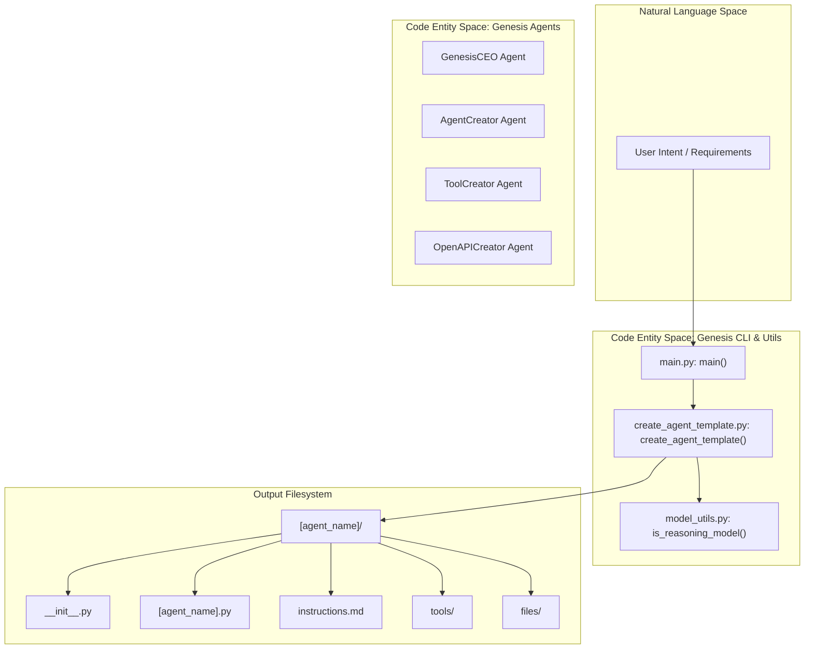
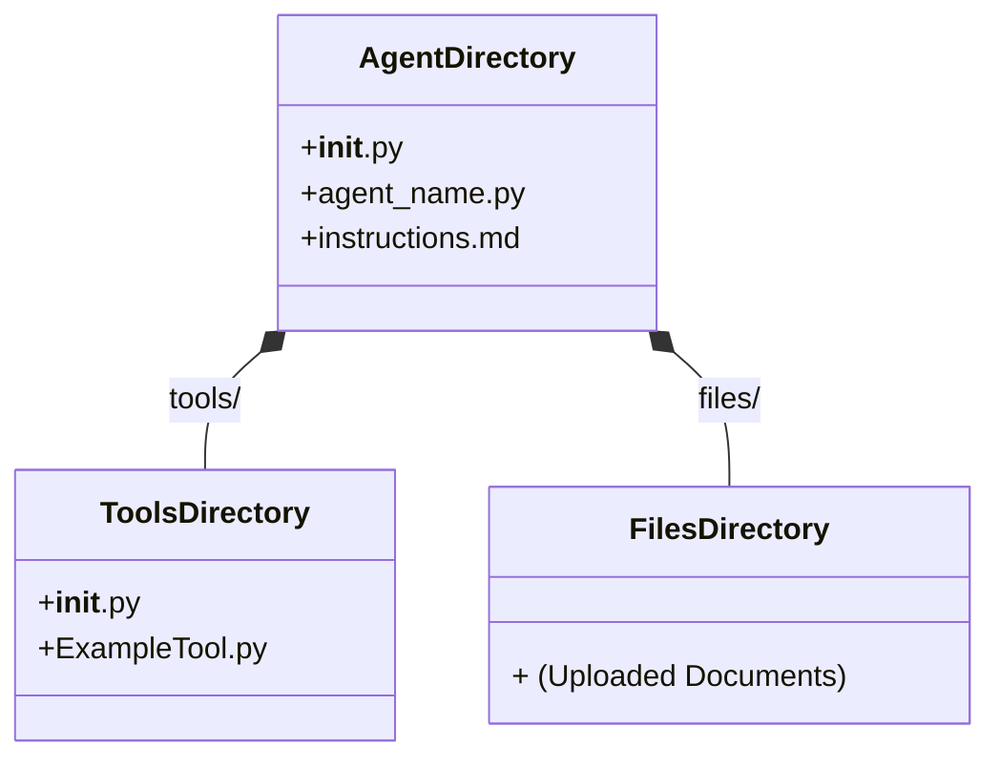

<!-- source: DeepWiki mcp.deepwiki.com · repo VRSEN/agency-swarm · page 5.2 Genesis Agency · fetched 2026-10-26 -->

# Genesis Agency

Relevant source files

The following files were used as context for generating this wiki page:

- [.pre-commit-config.yaml](.pre-commit-config.yaml)
- [CONTRIBUTING.md](CONTRIBUTING.md)
- [docs/contributing/contributing.mdx](docs/contributing/contributing.mdx)
- [package.json](package.json)
- [src/agency_swarm/cli/__init__.py](src/agency_swarm/cli/__init__.py)
- [src/agency_swarm/cli/main.py](src/agency_swarm/cli/main.py)
- [src/agency_swarm/cli/migrate_agent.py](src/agency_swarm/cli/migrate_agent.py)
- [src/agency_swarm/cli/utils/__init__.py](src/agency_swarm/cli/utils/__init__.py)
- [src/agency_swarm/cli/utils/generate-agent-from-settings.ts](src/agency_swarm/cli/utils/generate-agent-from-settings.ts)
- [src/agency_swarm/hooks.py](src/agency_swarm/hooks.py)
- [src/agency_swarm/utils/create_agent_template.py](src/agency_swarm/utils/create_agent_template.py)
- [src/agency_swarm/utils/model_utils.py](src/agency_swarm/utils/model_utils.py)
- [tests/integration/cli/test_create_agent_template_integration.py](tests/integration/cli/test_create_agent_template_integration.py)
- [tests/test_agent_modules/test_agent_capabilities.py](tests/test_agent_modules/test_agent_capabilities.py)
- [tests/test_cli_modules/__init__.py](tests/test_cli_modules/__init__.py)
- [tests/test_cli_modules/test_migrate_agent.py](tests/test_cli_modules/test_migrate_agent.py)
- [tests/test_utils_modules/test_create_agent_template.py](tests/test_utils_modules/test_create_agent_template.py)
- [tsconfig.json](tsconfig.json)

The Genesis Agency is a specialized agency within the `agency-swarm` framework designed to bootstrap the creation of other agencies and agents. It provides a programmatic and command-line interface (CLI) for agency creation, making it easier to define new agent teams with their specific roles, tools, and communication patterns. 

## Architecture Overview

The Genesis Agency consists of several specialized agents that work together to create new agencies. In the v1.x architecture, the creation logic is also exposed via a robust CLI and utility functions.

Sources:
- [src/agency_swarm/cli/main.py:12-118]()
- [src/agency_swarm/utils/create_agent_template.py:9-169]()
- [src/agency_swarm/utils/model_utils.py:73-106]()

## CLI Agent Creation Workflow

The `agency-swarm` CLI provides the `create-agent-template` command to generate the standard folder structure for a new agent.

### Command Execution
The `main` function in the CLI [src/agency_swarm/cli/main.py:12-118]() parses arguments and invokes the underlying utility.

| Argument | Description | Default |
| :--- | :--- | :--- |
| `name` | Name of the agent (e.g., 'Data Analyst') | Required |
| `--description` | Role and responsibilities | None |
| `--model` | OpenAI model identifier | `gpt-5.4` |
| `--reasoning` | Effort level (`low`, `medium`, `high`) | None |
| `--temperature` | Model temperature | `0.3` (non-reasoning) |
| `--path` | Output directory | `./` |

### The `create_agent_template` Utility
The core logic resides in `create_agent_template` [src/agency_swarm/utils/create_agent_template.py:9-169]().

1.  **Validation**: It validates the agent name for invalid characters [src/agency_swarm/utils/create_agent_template.py:172-181]() and checks temperature ranges [src/agency_swarm/utils/create_agent_template.py:183-189]().
2.  **Model Compatibility**: It uses `is_reasoning_model` to determine if parameters like `temperature` should be ignored (e.g., for `o1` or `gpt-5` series) [src/agency_swarm/utils/create_agent_template.py:41-55]().
3.  **Normalization**: Agent names are normalized to lowercase underscores for folder names (e.g., "Data Analyst" -> `data_analyst`) [src/agency_swarm/utils/create_agent_template.py:59-61]().
4.  **Scaffolding**: It creates a directory structure including `tools/` and `files/` folders [src/agency_swarm/utils/create_agent_template.py:154-155]().
5.  **Template Injection**: It populates `[agent_name].py` using a predefined `agent_template` string that includes `ModelSettings` [src/agency_swarm/utils/create_agent_template.py:192-204]().

Sources:
- [src/agency_swarm/utils/create_agent_template.py:9-169]()
- [src/agency_swarm/cli/main.py:22-44]()

## Agent Template Structure

When the Genesis system creates an agent, it follows a strict directory layout to ensure compatibility with the framework's auto-loading features.

- **Agent Class File**: Located at `[folder_name]/[folder_name].py`, it instantiates the `Agent` class with `ModelSettings` [src/agency_swarm/utils/create_agent_template.py:192-204]().
- **Instructions**: By default, a structured `instructions.md` is created with sections for Role, Goals, Process, Output Format, and Additional Notes [src/agency_swarm/utils/create_agent_template.py:127-151]().
- **Tools**: An `ExampleTool.py` is included by default to provide a starting point for custom tool development [src/agency_swarm/utils/create_agent_template.py:161-163]().

Sources:
- [src/agency_swarm/utils/create_agent_template.py:96-163]()
- [tests/test_utils_modules/test_create_agent_template.py:14-36]()

## Migration Utility

The Genesis system also supports migrating existing OpenAI Assistant settings into the Agency Swarm format via `migrate-agent`.

- **TypeScript Bridge**: This feature utilizes a TypeScript helper script `generate-agent-from-settings.ts` [src/agency_swarm/cli/migrate_agent.py:10-30]().
- **Dependency Check**: The Python wrapper checks for Node.js and a runner like `tsx` or `ts-node` before executing the migration [src/agency_swarm/cli/migrate_agent.py:33-56]().
- **Process Execution**: It runs the migration as a subprocess, converting `settings.json` files into the standard Agent folder structure [src/agency_swarm/cli/migrate_agent.py:59-131]().

Sources:
- [src/agency_swarm/cli/migrate_agent.py:1-131]()
- [src/agency_swarm/cli/main.py:46-60]()

## Model Capability Detection

The Genesis Agency uses `model_utils.py` to ensure that generated agents have the correct capabilities based on their configuration.

- **Reasoning Detection**: `is_reasoning_model` checks for prefixes like `gpt-5`, `o1`, `o3`, and `o4-mini` [src/agency_swarm/utils/model_utils.py:22](), [src/agency_swarm/utils/model_utils.py:73-106]().
- **Capability Mapping**: The function `get_agent_capabilities` analyzes an agent's tools and model to return a list of features such as `tools`, `reasoning`, `code_interpreter`, and `file_search` [src/agency_swarm/utils/model_utils.py:109-169]().

Sources:
- [src/agency_swarm/utils/model_utils.py:73-169]()
- [tests/test_agent_modules/test_agent_capabilities.py:31-74]()

---

