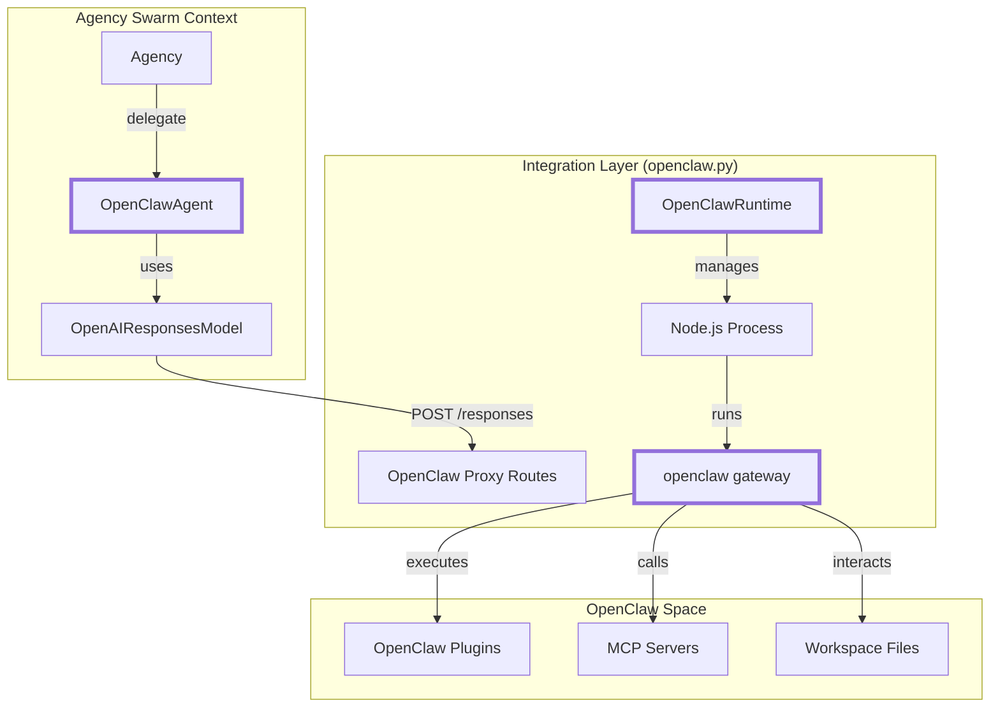
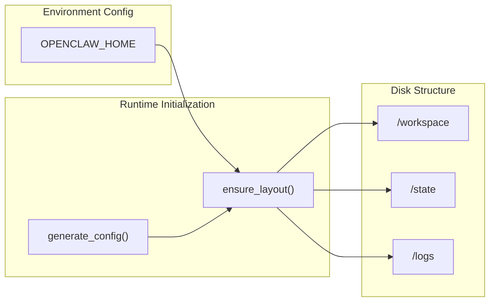

<!-- source: DeepWiki mcp.deepwiki.com · repo VRSEN/agency-swarm · page 5.3 OpenClaw Agent · fetched 2026-10-26 -->

# OpenClaw Agent

Relevant source files

The following files were used as context for generating this wiki page:

- [.cursor/rules/writing-docs.mdc](.cursor/rules/writing-docs.mdc)
- [docs/core-framework/third-party-agents/openclaw-agent.mdx](docs/core-framework/third-party-agents/openclaw-agent.mdx)
- [docs/images/platform/openclaw-persistent-storage.png](docs/images/platform/openclaw-persistent-storage.png)
- [docs/platform/integrations/openclaw-integration.mdx](docs/platform/integrations/openclaw-integration.mdx)
- [docs/platform/marketplace/openclaw.mdx](docs/platform/marketplace/openclaw.mdx)
- [src/agency_swarm/agents/__init__.py](src/agency_swarm/agents/__init__.py)
- [src/agency_swarm/agents/openclaw.py](src/agency_swarm/agents/openclaw.py)
- [src/agency_swarm/integrations/README.md](src/agency_swarm/integrations/README.md)
- [src/agency_swarm/integrations/openclaw.py](src/agency_swarm/integrations/openclaw.py)
- [src/agency_swarm/integrations/openclaw_model.py](src/agency_swarm/integrations/openclaw_model.py)
- [tests/integration/fastapi/_openclaw_test_support.py](tests/integration/fastapi/_openclaw_test_support.py)
- [tests/integration/fastapi/test_openclaw_current_app_defaults.py](tests/integration/fastapi/test_openclaw_current_app_defaults.py)
- [tests/integration/fastapi/test_openclaw_layout.py](tests/integration/fastapi/test_openclaw_layout.py)
- [tests/integration/fastapi/test_openclaw_model_auth.py](tests/integration/fastapi/test_openclaw_model_auth.py)
- [tests/integration/fastapi/test_openclaw_proxy_requests.py](tests/integration/fastapi/test_openclaw_proxy_requests.py)
- [tests/integration/fastapi/test_openclaw_proxy_streaming.py](tests/integration/fastapi/test_openclaw_proxy_streaming.py)
- [tests/integration/fastapi/test_openclaw_runtime_process.py](tests/integration/fastapi/test_openclaw_runtime_process.py)
- [tests/integration/fastapi/test_openclaw_runtime_startup.py](tests/integration/fastapi/test_openclaw_runtime_startup.py)
- [tests/integration/fastapi/test_openclaw_tool_mode.py](tests/integration/fastapi/test_openclaw_tool_mode.py)
- [tests/integration/test_package_init_lazy_openclaw.py](tests/integration/test_package_init_lazy_openclaw.py)
- [tests/test_agent_modules/test_openclaw_agent.py](tests/test_agent_modules/test_openclaw_agent.py)

The `OpenClawAgent` and its associated runtime integration provide a bridge between the Agency Swarm framework and [OpenClaw](https://openclaw.ai), a personal AI assistant. This integration allows developers to delegate specialized tasks to an OpenClaw worker within a multi-agent agency while maintaining Agency Swarm's orchestration and communication protocols.

## Architecture and Data Flow

The integration consists of three main layers: the `OpenClawAgent` class (the Agency Swarm interface), the `OpenClawRuntime` (managing the Node.js gateway process), and the `Open Responses` proxy (handling protocol translation and model aliasing).

### System Integration Map

The following diagram illustrates how natural language requests move from the Agency Swarm `Agency` through the `OpenClawAgent` to the underlying OpenClaw gateway.

"Natural Language Space to Code Entity Space"

**Sources:** [src/agency_swarm/agents/openclaw.py:14-44](), [src/agency_swarm/integrations/openclaw.py:228-250](), [src/agency_swarm/integrations/README.md:9-18]()

## OpenClawAgent Class

The `OpenClawAgent` inherits from the base `Agent` class but imposes specific constraints to ensure compatibility with the OpenClaw architecture.

### Key Constraints
*   **Receive-Only:** `supports_outbound_communication` is set to `False` [src/agency_swarm/agents/openclaw.py:17](). It can receive delegated work but cannot initiate handoffs or send messages to other agents within the framework [src/agency_swarm/agents/openclaw.py:98-101]().
*   **Tooling Boundary:** It does not accept standard Agency Swarm `BaseTool` objects, `files_folder`, or `mcp_servers` via the constructor [src/agency_swarm/agents/openclaw.py:109-127](). Instead, it relies on OpenClaw's native plugin system and MCP integration [src/agency_swarm/integrations/README.md:107-117]().
*   **Model Aliasing:** It defaults to the `openclaw:main` model alias, which the proxy translates to the actual provider model [src/agency_swarm/integrations/openclaw_model.py:13-15]().

### Configuration Parameters
| Parameter | Type | Description |
| :--- | :--- | :--- |
| `base_url` | `str` | Explicit URL for the OpenClaw gateway (e.g., `http://127.0.0.1:18789/v1`) [src/agency_swarm/agents/openclaw.py:23](). |
| `host` | `str` | Host for the local proxy (default: `127.0.0.1`) [src/agency_swarm/agents/openclaw.py:24](). |
| `port` | `int` | Port for the local proxy (default: `8000` or `OPENCLAW_PROXY_PORT`) [src/agency_swarm/agents/openclaw.py:25](). |
| `api_path` | `str` | Endpoint path (default: `/openclaw/v1`) [src/agency_swarm/agents/openclaw.py:26](). |

**Sources:** [src/agency_swarm/agents/openclaw.py:14-128](), [src/agency_swarm/integrations/openclaw_model.py:13-64]()

## OpenClawRuntime and Lifecycle

The `OpenClawRuntime` class manages the lifecycle of the underlying OpenClaw gateway process. When integrated with FastAPI via `attach_openclaw_to_fastapi`, the framework handles process startup and shutdown automatically.

### Lifecycle Management
1.  **Start (`start`):** Locates a compatible Node.js binary (min version 22.12.0), ensures the workspace layout exists, generates `openclaw.json` configuration, and spawns the `openclaw gateway` process [src/agency_swarm/integrations/openclaw.py:160-184](), [src/agency_swarm/integrations/openclaw.py:228-250]().
2.  **Ensure Layout (`ensure_layout`):** Derived from `OPENCLAW_HOME`, it creates directories for `state`, `logs`, and the `workspace` [src/agency_swarm/integrations/openclaw.py:215-227]().
3.  **Stop (`stop`):** Sends `SIGTERM` to the gateway process and waits for graceful exit [src/agency_swarm/integrations/openclaw.py:313-335]().

"Process Lifecycle and File Mapping"

**Sources:** [src/agency_swarm/integrations/openclaw.py:188-227](), [src/agency_swarm/integrations/openclaw.py:228-250](), [src/agency_swarm/integrations/README.md:55-68]()

## Model Aliasing and Proxy

OpenClaw does not use standard OpenAI model strings. To maintain compatibility with the `OpenAIResponsesModel` client, the integration uses a proxy and aliasing system.

*   **Alias (`openclaw:main`):** The stable model string used by Agency Swarm agents [src/agency_swarm/integrations/openclaw_model.py:13]().
*   **Provider Model:** The actual LLM (e.g., `openai/gpt-5.4`) configured via `OPENCLAW_PROVIDER_MODEL` [src/agency_swarm/integrations/openclaw_model.py:15]().
*   **Proxy Logic:** When the proxy receives a request for `openclaw:main`, it rewrites the `model` field in the JSON payload to the `provider_model` before forwarding it to the OpenClaw gateway [src/agency_swarm/integrations/README.md:43-53]().

**Sources:** [src/agency_swarm/integrations/openclaw_model.py:41-64](), [src/agency_swarm/integrations/README.md:43-53]()

## Tool Modes: Full vs. Worker

The integration supports two operational modes configured via the `OPENCLAW_TOOL_MODE` environment variable:

1.  **Full Mode (default):** Enables all OpenClaw features, including its native messaging and session tools.
2.  **Worker Mode:** Optimized for delegation. It disables OpenClaw's internal messaging endpoints (`message`, `sessions_send`, `sessions_spawn`) to prevent conflicts with Agency Swarm's own communication flows [src/agency_swarm/integrations/README.md:78-88]().

**Sources:** [src/agency_swarm/integrations/openclaw.py:204](), [src/agency_swarm/integrations/README.md:78-88]()

## Environment Configuration

| Variable | Default | Description |
| :--- | :--- | :--- |
| `OPENCLAW_HOME` | `/mnt/openclaw` | Root directory for all OpenClaw data [src/agency_swarm/integrations/openclaw.py:226](). |
| `OPENCLAW_PROVIDER_MODEL` | `openai/gpt-5.4` | The actual model OpenClaw calls [src/agency_swarm/integrations/openclaw_model.py:15](). |
| `OPENCLAW_PROXY_PORT` | `8000` | Port for the FastAPI proxy [src/agency_swarm/agents/openclaw.py:72](). |
| `OPENCLAW_NODE_BIN` | `None` | Path to specific Node.js binary [src/agency_swarm/integrations/openclaw.py:162](). |
| `OPENCLAW_TOOL_MODE` | `full` | Set to `worker` for delegated agents [src/agency_swarm/integrations/openclaw.py:204](). |

**Sources:** [src/agency_swarm/integrations/openclaw.py:188-227](), [src/agency_swarm/integrations/openclaw_model.py:13-17](), [src/agency_swarm/agents/openclaw.py:70-80]()

---

