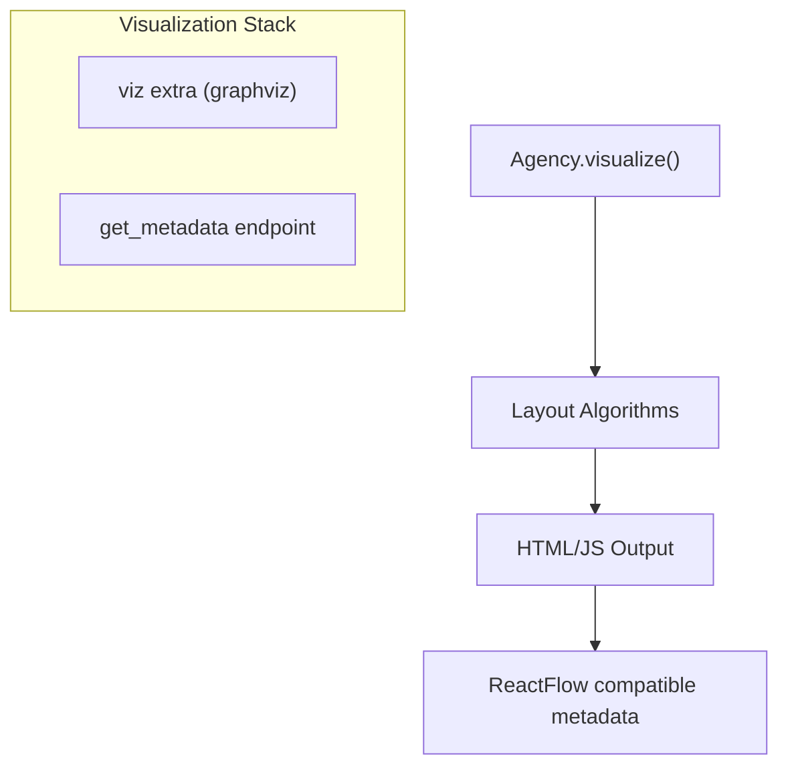

<!-- source: DeepWiki mcp.deepwiki.com · repo VRSEN/agency-swarm · page 6 Advanced Features · fetched 2026-10-26 -->

# Advanced Features

Relevant source files

The following files were used as context for generating this wiki page:

- [docs/additional-features/third-party-models.mdx](docs/additional-features/third-party-models.mdx)
- [docs/core-framework/agencies/agent-swarm-cli.mdx](docs/core-framework/agencies/agent-swarm-cli.mdx)
- [docs/core-framework/agencies/running-agency.mdx](docs/core-framework/agencies/running-agency.mdx)
- [docs/images/agent-swarm-cli-preview.png](docs/images/agent-swarm-cli-preview.png)
- [src/agency_swarm/data/model_prices_and_context_window.json](src/agency_swarm/data/model_prices_and_context_window.json)
- [src/agency_swarm/ui/demos/compact.py](src/agency_swarm/ui/demos/compact.py)
- [src/agency_swarm/utils/usage_tracking.py](src/agency_swarm/utils/usage_tracking.py)
- [tests/integration/ui/test_compact_client_passthrough.py](tests/integration/ui/test_compact_client_passthrough.py)
- [tests/test_agent_modules/test_default_model_contract.py](tests/test_agent_modules/test_default_model_contract.py)
- [tests/test_utils_modules/test_usage_tracking_costs.py](tests/test_utils_modules/test_usage_tracking_costs.py)

This page provides an overview of the advanced features and capabilities of the `agency-swarm` framework. These features extend the core agent orchestration by providing deep observability, high-performance asynchronous processing, a powerful command-line interface, realtime voice capabilities, and structural visualization.

## Observability

Agency Swarm provides a comprehensive observability suite to track, analyze, and price agent behavior. It supports integration with external platforms like Langfuse and AgentOps, as well as native OpenAI tracing.

### Usage and Cost Tracking
The framework includes a sophisticated usage tracking system that maps token counts to real-world costs using model pricing data.
*   **UsageStats**: Aggregates token counts (input, output, cached, reasoning, audio) and calculates total cost [src/agency_swarm/utils/usage_tracking.py:72-84]().
*   **Pricing Data**: Managed via a centralized JSON database containing per-token costs, tiered pricing for long contexts, and provider-specific metadata [src/agency_swarm/data/model_prices_and_context_window.json:1-41]().
*   **Tiered Pricing**: The `calculate_usage_with_cost` function handles complex pricing tiers (e.g., costs changing after 272k tokens) to ensure billing accuracy [src/agency_swarm/utils/usage_tracking.py:207-250]().

For details, see [Observability](#6.1).

Sources: [src/agency_swarm/utils/usage_tracking.py:72-135](), [src/agency_swarm/data/model_prices_and_context_window.json:1-41](), [docs/core-framework/agencies/running-agency.mdx:77-88]()

---

## Asynchronous Processing

To handle high-concurrency environments and improve responsiveness, `agency-swarm` supports asynchronous execution and streaming.

*   **Streaming Responses**: The `get_response_stream` method allows for realtime output, supporting `StreamingRunResponse` and guardrail handling within the stream [docs/core-framework/agencies/running-agency.mdx:32-58]().
*   **Event Merging**: The `EventStreamMerger` (and related normalization utilities) ensures that streams from multiple sub-agents are merged into a coherent flow for the end-user.
*   **Sync/Async Bridge**: A `run_async_sync` helper facilitates calling asynchronous framework methods from synchronous environments [src/agency_swarm/util/helpers/sync_async.py:1-20]().

For details, see [Asynchronous Processing](#6.2).

Sources: [docs/core-framework/agencies/running-agency.mdx:32-58](), [src/agency_swarm/util/helpers/sync_async.py:1-20]()

---

## CLI Interface

The framework provides a Terminal User Interface (TUI) and a command-line entrypoint for rapid development and testing.

| Command | Description |
| :--- | :--- |
| `npx @vrsen/agentswarm` | The main launch path for the TUI, handling setup and agency selection [docs/core-framework/agencies/agent-swarm-cli.mdx:13-19](). |
| `/agents` | TUI command to switch between **Plan**, **Build**, and **Run** modes [docs/core-framework/agencies/agent-swarm-cli.mdx:70-81](). |
| `/compact` | Summarizes the current conversation thread to save context space [src/agency_swarm/ui/demos/compact.py:93-121](). |
| `/cost` | Displays the current session usage and cost breakdown [docs/core-framework/agencies/running-agency.mdx:77-81](). |

For details, see [CLI Interface](#6.3).

Sources: [docs/core-framework/agencies/agent-swarm-cli.mdx:1-82](), [src/agency_swarm/ui/demos/compact.py:10-41](), [docs/core-framework/agencies/running-agency.mdx:89-102]()

---

## Voice Agents and Realtime

Agency Swarm supports low-latency voice interactions through the OpenAI and xAI Realtime APIs.

*   **RealtimeAgency**: Orchestrates agents specifically for voice-to-voice or text-to-voice interactions.
*   **WebSocket Integration**: The framework provides endpoints to bridge WebSockets to the underlying Realtime API providers.
*   **Telephony**: Built-in support for Twilio allows agencies to be deployed as functional phone agents.

For details, see [Voice Agents and Realtime](#6.4).

Sources: [docs/additional-features/third-party-models.mdx:173-182]()

---

## Visualization

Understanding the communication hierarchy in complex agencies is simplified through automated visualization.

*   **Agency.visualize()**: Generates an interactive graph of the agency structure, showing agents as nodes and communication flows as edges.
*   **ReactFlow Metadata**: The `get_metadata` endpoint provides structural data compatible with modern frontend flow libraries.

For details, see [Visualization](#6.5).

Sources: [docs/core-framework/agencies/running-agency.mdx:87-88]()

---

## Summary of Advanced Entities

The following table bridges Natural Language concepts to specific Code Entities used in advanced features:

| Feature Concept | Code Entity | File Path |
| :--- | :--- | :--- |
| **Usage Calculation** | `calculate_usage_with_cost` | [src/agency_swarm/utils/usage_tracking.py:207]() |
| **Thread Summarization** | `compact_thread` | [src/agency_swarm/ui/demos/compact.py:93]() |
| **Pricing Database** | `PRICING_FILE_PATH` | [src/agency_swarm/utils/usage_tracking.py:18]() |
| **TUI Launcher** | `TerminalDemoLauncher` | [tests/integration/ui/test_compact_client_passthrough.py:4]() |
| **Async Bridge** | `run_async_sync` | [src/agency_swarm/util/helpers/sync_async.py:6]() |

Sources: [src/agency_swarm/utils/usage_tracking.py:1-40](), [src/agency_swarm/ui/demos/compact.py:1-121](), [src/agency_swarm/util/helpers/sync_async.py:1-20]()

---

