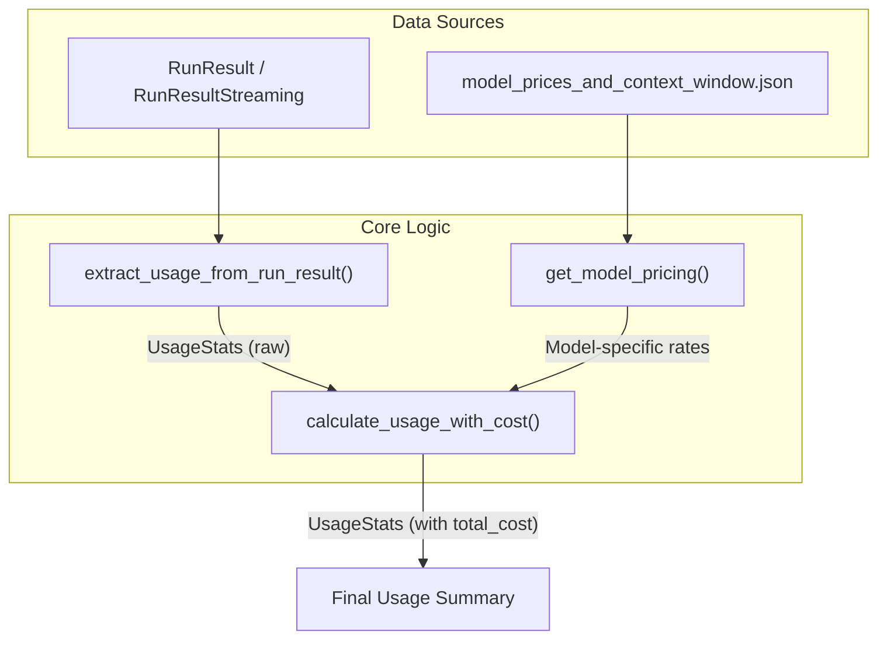
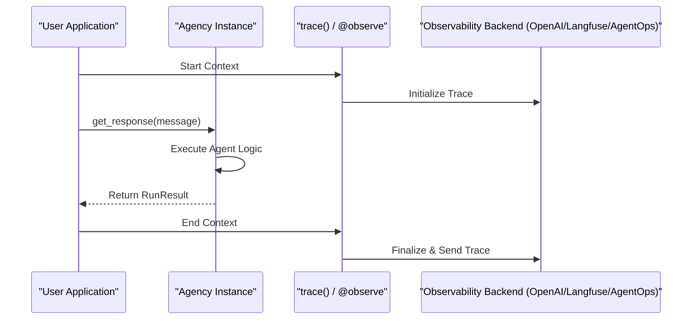
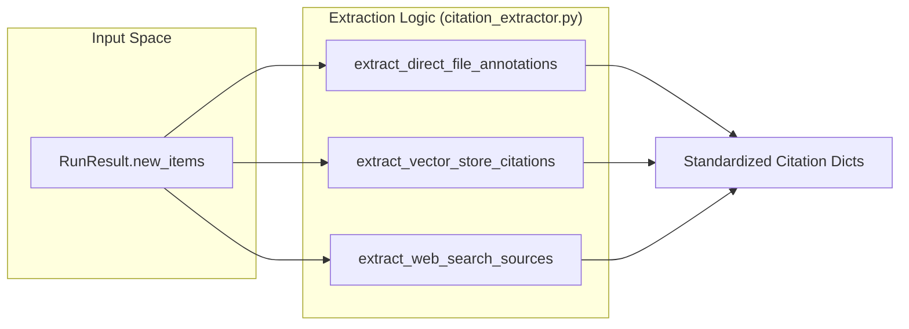

<!-- source: DeepWiki mcp.deepwiki.com · repo VRSEN/agency-swarm · page 6.1 Observability · fetched 2026-10-26 -->

# Observability

Relevant source files

The following files were used as context for generating this wiki page:

- [docs/additional-features/guardrails/input-guardrails.mdx](docs/additional-features/guardrails/input-guardrails.mdx)
- [docs/additional-features/guardrails/output-guardrails.mdx](docs/additional-features/guardrails/output-guardrails.mdx)
- [docs/core-framework/agents/built-in-tools.mdx](docs/core-framework/agents/built-in-tools.mdx)
- [docs/platform/marketplace/onboarding.mdx](docs/platform/marketplace/onboarding.mdx)
- [examples/README.md](examples/README.md)
- [examples/guardrails_input.py](examples/guardrails_input.py)
- [examples/interactive/third_party_models.py](examples/interactive/third_party_models.py)
- [examples/interactive/tui.py](examples/interactive/tui.py)
- [examples/observability.py](examples/observability.py)
- [examples/web_search.py](examples/web_search.py)
- [src/agency_swarm/data/model_prices_and_context_window.json](src/agency_swarm/data/model_prices_and_context_window.json)
- [src/agency_swarm/ui/demos/compact.py](src/agency_swarm/ui/demos/compact.py)
- [src/agency_swarm/utils/citation_extractor.py](src/agency_swarm/utils/citation_extractor.py)
- [src/agency_swarm/utils/usage_tracking.py](src/agency_swarm/utils/usage_tracking.py)
- [tests/integration/fastapi/test_fastapi_user_context.py](tests/integration/fastapi/test_fastapi_user_context.py)
- [tests/integration/ui/test_compact_client_passthrough.py](tests/integration/ui/test_compact_client_passthrough.py)
- [tests/integration/ui/test_persistence_helpers.py](tests/integration/ui/test_persistence_helpers.py)
- [tests/test_agent_modules/test_agent_flow.py](tests/test_agent_modules/test_agent_flow.py)
- [tests/test_agent_modules/test_agui_adapter.py](tests/test_agent_modules/test_agui_adapter.py)
- [tests/test_agent_modules/test_citation_extractor.py](tests/test_agent_modules/test_citation_extractor.py)
- [tests/test_agent_modules/test_default_model_contract.py](tests/test_agent_modules/test_default_model_contract.py)
- [tests/test_cli_modules/test_main.py](tests/test_cli_modules/test_main.py)
- [tests/test_utils_modules/test_usage_tracking.py](tests/test_utils_modules/test_usage_tracking.py)
- [tests/test_utils_modules/test_usage_tracking_costs.py](tests/test_utils_modules/test_usage_tracking_costs.py)

This document covers the Agency Swarm observability system, which enables tracking and analysis of agent behavior, token usage, costs, and performance. The system integrates with third-party monitoring tools like Langfuse and AgentOps, utilizes OpenAI's native tracing, and provides built-in utilities for usage aggregation and citation extraction.

## Usage Tracking and Cost Calculation

Agency Swarm tracks token consumption across all agent interactions, including sub-agent calls and tool executions. This data is aggregated into structured formats for reporting and analysis.

### Usage Data Structures

The framework uses several classes and TypedDicts to represent usage data:

*   **`UsageStats`**: A dataclass that aggregates request counts, token types (input, output, cached, reasoning, audio), and total cost [src/agency_swarm/utils/usage_tracking.py:71-84]().
*   **`RequestUsageStats`**: A frozen dataclass representing usage for a single API request [src/agency_swarm/utils/usage_tracking.py:62-69]().
*   **`UsageStatsDict`**: A `TypedDict` for JSON-serializable usage summaries [src/agency_swarm/utils/usage_tracking.py:34-44]().

### Pricing Engine

Costs are calculated based on a local pricing database located at `src/agency_swarm/data/model_prices_and_context_window.json` [src/agency_swarm/utils/usage_tracking.py:18-18]().

**Usage and Cost Calculation Flow**

Sources: [src/agency_swarm/utils/usage_tracking.py:141-176](), [src/agency_swarm/utils/usage_tracking.py:307-356](), [src/agency_swarm/utils/usage_tracking.py:363-404]()

The engine supports:
*   **Cached Token Pricing**: Differentiates between standard input and cache hits (e.g., `cache_read_input_token_cost`) [src/agency_swarm/utils/usage_tracking.py:27-27]().
*   **Reasoning Tokens**: Specifically prices reasoning output for models like OpenAI's o1 series [src/agency_swarm/utils/usage_tracking.py:29-29]().
*   **Model Aliasing**: Automatically resolves model names and versions (e.g., stripping dates or provider prefixes) to match pricing data [src/agency_swarm/utils/usage_tracking.py:179-203]().

## Tracing Integrations

Agency Swarm provides native support for several observability backends to visualize agent execution traces.

### Native Tracing
The `trace` context manager is used to wrap execution blocks for OpenAI native tracing [examples/observability.py:92-96](). Results are visible in the OpenAI Dashboard.

### Langfuse and AgentOps
Third-party integrations are typically implemented using decorators or initialization calls:
*   **Langfuse**: Uses the `@observe()` decorator from the `langfuse` package to wrap `agency.get_response()` [examples/observability.py:99-114]().
*   **AgentOps**: Initialized via `agentops.init()` and managed through `start_trace()`/`end_trace()` blocks [examples/observability.py:117-131]().

**Tracing Integration Sequence**

Sources: [examples/observability.py:92-131](), [examples/README.md:40-41]()

## Citation Extraction

When agents use tools like `FileSearch` or `WebSearch`, or refer to direct file uploads, the `citation_extractor` module parses the results into a standardized format.

### Supported Citation Types

| Method | Source Entity | Implementation Function |
| :--- | :--- | :--- |
| **Direct File** | Message Annotations (`AnnotationFileCitation`) | `extract_direct_file_annotations` [src/agency_swarm/utils/citation_extractor.py:21-59]() |
| **Vector Store** | `FileSearch` tool results (`ResponseFileSearchToolCall`) | `extract_vector_store_citations` [src/agency_swarm/utils/citation_extractor.py:62-88]() |
| **Web Search** | `WebSearch` tool sources (`ResponseFunctionWebSearch`) | `extract_web_search_sources` [src/agency_swarm/utils/citation_extractor.py:91-114]() |

### Data Flow for Citations
Citations are extracted from the `RunResult.new_items` list, which contains `MessageOutputItem` and `ToolCallItem` objects [src/agency_swarm/utils/citation_extractor.py:66-72]().

**Citation Extraction Pipeline**

Sources: [src/agency_swarm/utils/citation_extractor.py:21-114](), [tests/test_agent_modules/test_citation_extractor.py:27-182]()

## Thread Compaction

For long-running conversations, the `/compact` command (implemented in `compact_thread`) provides a form of observability-driven context management. It summarizes the current thread history into a concise system message to keep the context window focused while preserving essential state [src/agency_swarm/ui/demos/compact.py:93-120]().

*   **Process**: It retrieves all messages via `thread_manager.get_all_messages()`, sanitizes metadata keys (like `run_id`, `tool_call_id`), and uses an LLM to generate an objective summary [src/agency_swarm/ui/demos/compact.py:65-75]().
*   **Output**: A system message with `message_origin="thread_summary"` [src/agency_swarm/ui/demos/compact.py:116-119]().

Sources: [src/agency_swarm/ui/demos/compact.py:10-41](), [src/agency_swarm/ui/demos/compact.py:93-121]()

---

