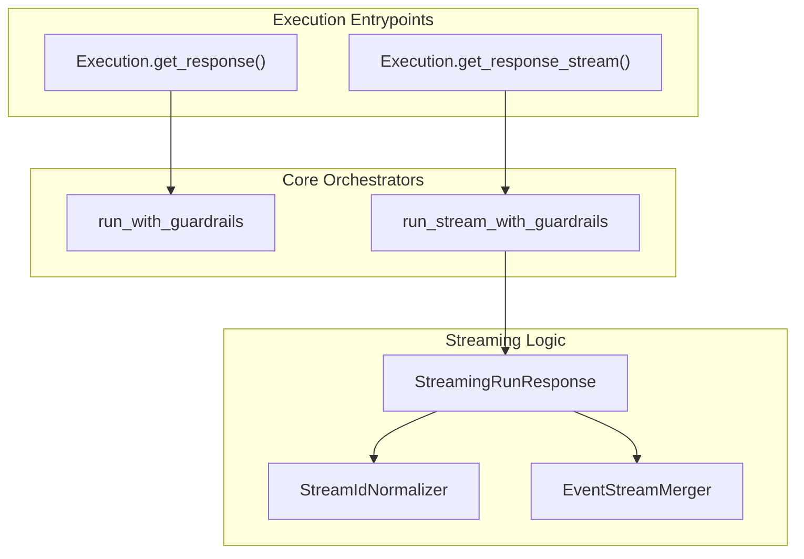
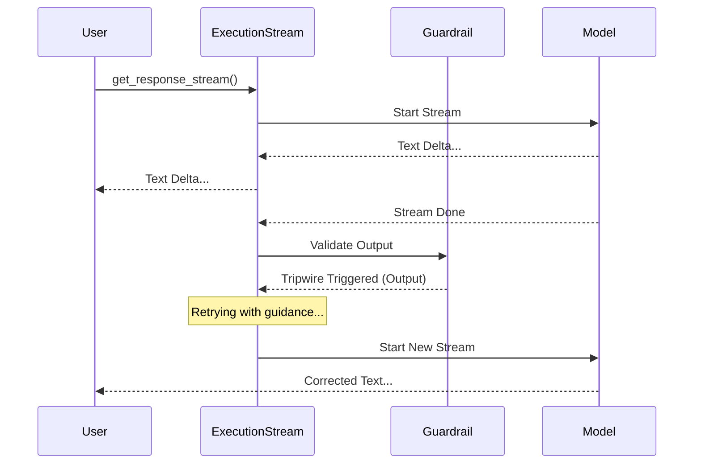

<!-- source: DeepWiki mcp.deepwiki.com · repo VRSEN/agency-swarm · page 6.2 Asynchronous Processing · fetched 2026-10-26 -->

# Asynchronous Processing

Relevant source files

The following files were used as context for generating this wiki page:

- [examples/fastapi_integration/README.md](examples/fastapi_integration/README.md)
- [src/agency_swarm/agent/execution.py](src/agency_swarm/agent/execution.py)
- [src/agency_swarm/agent/execution_guardrails.py](src/agency_swarm/agent/execution_guardrails.py)
- [src/agency_swarm/agent/execution_helpers.py](src/agency_swarm/agent/execution_helpers.py)
- [src/agency_swarm/agent/execution_stream_persistence.py](src/agency_swarm/agent/execution_stream_persistence.py)
- [src/agency_swarm/agent/execution_stream_response.py](src/agency_swarm/agent/execution_stream_response.py)
- [src/agency_swarm/agent/execution_streaming.py](src/agency_swarm/agent/execution_streaming.py)
- [src/agency_swarm/context.py](src/agency_swarm/context.py)
- [src/agency_swarm/messages/message_filter.py](src/agency_swarm/messages/message_filter.py)
- [src/agency_swarm/streaming/__init__.py](src/agency_swarm/streaming/__init__.py)
- [src/agency_swarm/streaming/utils.py](src/agency_swarm/streaming/utils.py)
- [src/agency_swarm/tools/send_message.py](src/agency_swarm/tools/send_message.py)
- [src/agency_swarm/ui/core/agui_adapter.py](src/agency_swarm/ui/core/agui_adapter.py)
- [tests/integration/communication/test_streaming_order_consistency.py](tests/integration/communication/test_streaming_order_consistency.py)
- [tests/integration/fastapi/test_fastapi_stream_cancellation.py](tests/integration/fastapi/test_fastapi_stream_cancellation.py)
- [tests/integration/guardrails/test_guardrails_integration.py](tests/integration/guardrails/test_guardrails_integration.py)
- [tests/integration/litellm_integration/test_litellm_anthropic_message_ordering.py](tests/integration/litellm_integration/test_litellm_anthropic_message_ordering.py)
- [tests/integration/litellm_integration/test_litellm_anthropic_nonstreaming.py](tests/integration/litellm_integration/test_litellm_anthropic_nonstreaming.py)
- [tests/integration/litellm_integration/test_litellm_models.py](tests/integration/litellm_integration/test_litellm_models.py)
- [tests/integration/litellm_integration/test_litellm_openai_responses_history_switch.py](tests/integration/litellm_integration/test_litellm_openai_responses_history_switch.py)
- [tests/integration/litellm_integration/test_litellm_placeholder_ids_integration.py](tests/integration/litellm_integration/test_litellm_placeholder_ids_integration.py)
- [tests/integration/litellm_integration/test_litellm_visualization.py](tests/integration/litellm_integration/test_litellm_visualization.py)
- [tests/test_agent_modules/test_agui_adapter_fake_id.py](tests/test_agent_modules/test_agui_adapter_fake_id.py)
- [tests/test_agent_modules/test_constants.py](tests/test_agent_modules/test_constants.py)
- [tests/test_agent_modules/test_execution_stream_persistence_fake_id.py](tests/test_agent_modules/test_execution_stream_persistence_fake_id.py)
- [tests/test_agent_modules/test_execution_streaming.py](tests/test_agent_modules/test_execution_streaming.py)
- [tests/test_agent_modules/test_guardrail_validation.py](tests/test_agent_modules/test_guardrail_validation.py)
- [tests/test_agent_modules/test_message_filter_fake_id.py](tests/test_agent_modules/test_message_filter_fake_id.py)
- [tests/test_agent_modules/test_streaming_utils.py](tests/test_agent_modules/test_streaming_utils.py)
- [tests/test_fastapi_utils_modules/test_openai_client_config_streaming.py](tests/test_fastapi_utils_modules/test_openai_client_config_streaming.py)

This page documents the asynchronous processing capabilities in the `agency-swarm` framework, explaining how to leverage streaming execution, parallel tool handling, and guardrail orchestration for improved performance and responsiveness.

## Overview

Agency Swarm utilizes an asynchronous-first execution model powered by the `agents` SDK. The framework supports two primary forms of asynchronous processing:

1.  **Streaming Execution**: Real-time event emission during agent runs via `get_response_stream` and the `StreamingRunResponse` wrapper.
2.  **Asynchronous Tool & Communication Orchestration**: Handling complex multi-agent flows where guardrails and handoffs occur within an asynchronous loop.

Sources: [src/agency_swarm/agent/execution.py:72-84](), [src/agency_swarm/agent/execution.py:280-292](), [src/agency_swarm/agent/execution_streaming.py:145-161]().

## Streaming Execution

Streaming is the recommended way to interact with agents in production environments. It provides immediate feedback to users by emitting events as they occur (e.g., text deltas, tool call starts).

### StreamingRunResponse and EventStreamMerger

The `StreamingRunResponse` class acts as an asynchronous iterator that wraps the raw event stream from the underlying `Runner`. It handles:
*   **Stream ID Normalization**: Mapping internal SDK IDs to stable, user-facing IDs via `StreamIdNormalizer` [src/agency_swarm/streaming/id_normalizer.py:1-50]().
*   **Event Merging**: Consolidating fragmented events (like tool arguments) into coherent structures.
*   **Persistence**: Ensuring that even during a stream, messages are correctly saved to the `ThreadManager` [src/agency_swarm/agent/execution_stream_persistence.py:158-182]().

### Key Functions

| Function | Role |
| :--- | :--- |
| `get_response_stream` | The main entry point for starting a streamed run [src/agency_swarm/agent/execution.py:280-330](). |
| `run_stream_with_guardrails` | Orchestrates the stream, including retry logic if an output guardrail trips [src/agency_swarm/agent/execution_streaming.py:145-200](). |
| `perform_streamed_run` | The low-level primitive that calls `Runner.run_streamed` [src/agency_swarm/agent/execution_streaming.py:124-142](). |

Sources: [src/agency_swarm/agent/execution.py:280-330](), [src/agency_swarm/agent/execution_streaming.py:124-200]().

## Guardrail Handling in Streams

Guardrails introduce complexity to asynchronous streams because a "trip" might occur after some content has already been streamed to the user.

### Input Guardrails
If an input guardrail trips, the execution is halted before reaching the model. The framework persists a guidance message and may prune the history to prevent "leaking" the invalid branch into future turns [src/agency_swarm/agent/execution_streaming.py:64-106]().

### Output Guardrails
If an output guardrail trips during a stream:
1.  The current stream is terminated.
2.  Guidance feedback is appended to the history [src/agency_swarm/agent/execution_guardrails.py:74-110]().
3.  A new stream is initiated (up to `validation_attempts`) to allow the model to correct its output [src/agency_swarm/agent/execution_streaming.py:175-195]().

Sources: [src/agency_swarm/agent/execution_streaming.py:145-200](), [src/agency_swarm/agent/execution_guardrails.py:74-110]().

## Execution Stream Persistence

Because streaming is non-blocking, the framework must carefully track which items have been emitted and which need to be persisted to the `ThreadManager`.

*   **StreamMetadataStore**: Stores metadata (agent name, run ID, timestamps) for items as they appear in the stream [src/agency_swarm/agent/execution_stream_persistence.py:41-50]().
*   **Content Hashing**: Uses `_compute_content_hash` to match items when unique IDs are missing (common with certain LiteLLM providers) [src/agency_swarm/agent/execution_stream_persistence.py:53-103]().
*   **Final Sync**: After the stream completes, `_persist_streamed_items` performs a final pass to ensure the `ThreadManager` state matches the emitted content [src/agency_swarm/agent/execution_stream_persistence.py:214-250]().

Sources: [src/agency_swarm/agent/execution_stream_persistence.py:41-103](), [src/agency_swarm/agent/execution_stream_persistence.py:214-250]().

## Message Filtering and ID Normalization

During asynchronous processing, various internal "control" messages (like tool discovery or reasoning steps) may be emitted.

### MessageFilter
The `MessageFilter` class is used to strip unwanted message types (e.g., `mcp_list_tools`) and remove "orphaned" messages where a tool call lacks a corresponding output [src/agency_swarm/messages/message_filter.py:11-50]().

### StreamIdNormalizer
In multi-agent handoffs, multiple internal OpenAI `run_id`s might be generated. The `StreamIdNormalizer` ensures that the consumer sees a consistent `stream_id` for the duration of the user's request, even if the underlying agent changes [src/agency_swarm/streaming/id_normalizer.py:1-50]().

Sources: [src/agency_swarm/messages/message_filter.py:11-50](), [src/agency_swarm/streaming/id_normalizer.py:1-50]().

## Deterministic Ordering

Asynchronous execution can lead to race conditions in message ordering. The framework enforces strict ordering rules:
1.  **Tool Call Sequencing**: Tool calls are emitted as soon as the model finalizes the item, typically before the assistant's own message output [tests/integration/communication/test_streaming_order_consistency.py:93-109]().
2.  **Handoff Persistence**: When a handoff occurs, the `current_agent_run_id` is updated, and the new agent's name is injected into the event stream via `add_agent_name_to_event` [src/agency_swarm/streaming/utils.py:1-20]().

Sources: [tests/integration/communication/test_streaming_order_consistency.py:93-109](), [src/agency_swarm/streaming/utils.py:1-20]().

---

