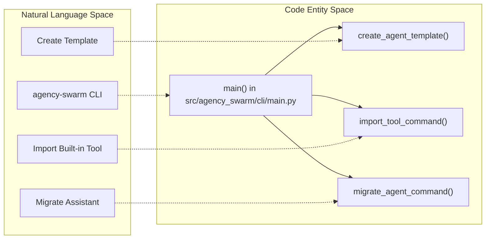
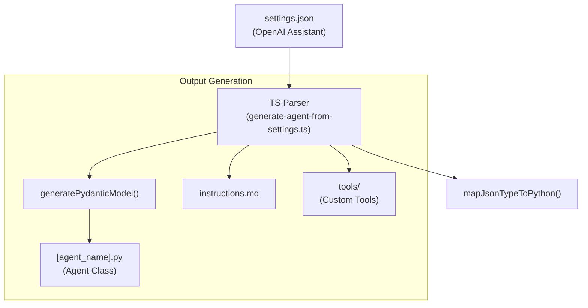

<!-- source: DeepWiki mcp.deepwiki.com · repo VRSEN/agency-swarm · page 6.3 CLI Interface · fetched 2026-10-26 -->

# CLI Interface

<details>
<summary>Relevant source files</summary>

The following files were used as context for generating this wiki page:

- [docs/additional-features/third-party-models.mdx](docs/additional-features/third-party-models.mdx)
- [docs/core-framework/agencies/agent-swarm-cli.mdx](docs/core-framework/agencies/agent-swarm-cli.mdx)
- [docs/core-framework/agencies/running-agency.mdx](docs/core-framework/agencies/running-agency.mdx)
- [docs/images/agent-swarm-cli-preview.png](docs/images/agent-swarm-cli-preview.png)
- [src/agency_swarm/cli/__init__.py](src/agency_swarm/cli/__init__.py)
- [src/agency_swarm/cli/main.py](src/agency_swarm/cli/main.py)
- [src/agency_swarm/cli/migrate_agent.py](src/agency_swarm/cli/migrate_agent.py)
- [src/agency_swarm/cli/utils/__init__.py](src/agency_swarm/cli/utils/__init__.py)
- [src/agency_swarm/cli/utils/generate-agent-from-settings.ts](src/agency_swarm/cli/utils/generate-agent-from-settings.ts)
- [src/agency_swarm/utils/create_agent_template.py](src/agency_swarm/utils/create_agent_template.py)
- [src/agency_swarm/utils/model_utils.py](src/agency_swarm/utils/model_utils.py)
- [tests/integration/cli/test_create_agent_template_integration.py](tests/integration/cli/test_create_agent_template_integration.py)
- [tests/test_agent_modules/test_agent_capabilities.py](tests/test_agent_modules/test_agent_capabilities.py)
- [tests/test_cli_modules/__init__.py](tests/test_cli_modules/__init__.py)
- [tests/test_cli_modules/test_migrate_agent.py](tests/test_cli_modules/test_migrate_agent.py)
- [tests/test_utils_modules/test_create_agent_template.py](tests/test_utils_modules/test_create_agent_template.py)

</details>


The `agency-swarm` command-line interface (CLI) provides technical utilities for agent scaffolding, migration from OpenAI Assistant settings, and tool management. It serves as the primary entry point for developers to manage the directory-based structure required by the framework.

## Overview of CLI Commands

The CLI is implemented using `argparse` in [src/agency_swarm/cli/main.py:12-118](). It provides three primary sub-commands:

1.  `create-agent-template`: Scaffolds a new agent directory with standard v1.x boilerplate.
2.  `import-tool`: Imports built-in framework tools (like `IPythonInterpreter`) into a project's local directory.
3.  `migrate-agent`: Converts OpenAI `settings.json` files into `agency-swarm` agent folders using a TypeScript utility.

### Code to Entity Mapping: CLI Entrypoint

The following diagram maps the CLI commands to their respective implementation functions and utility modules.


Sources: [src/agency_swarm/cli/main.py:12-118](), [src/agency_swarm/utils/create_agent_template.py:9-20]()

## Command Details

### create-agent-template
This command generates the standardized folder structure for a v1.x agent, including `instructions.md`, a `tools/` folder, and a `files/` folder [src/agency_swarm/utils/create_agent_template.py:63-70]().

**Key Features:**
*   **Model Intelligence**: Automatically detects if the target model is a "reasoning" model (e.g., `o1`, `gpt-5`). If so, it disables the `temperature` parameter and enables `reasoning_effort` [src/agency_swarm/utils/create_agent_template.py:41-55]().
*   **Boilerplate Generation**: Writes a Python file defining the `Agent` class and a structured `instructions.md` template [src/agency_swarm/utils/create_agent_template.py:96-151]().
*   **Naming Normalization**: Converts human-readable names (e.g., "Data Analyst") into Python-safe module names (e.g., `data_analyst`) [src/agency_swarm/utils/create_agent_template.py:59-61]().

**Usage:**
```bash
agency-swarm create-agent-template "Data Analyst" --description "Analyzes CSV files" --model "gpt-4o" --temperature 0.2
```

Sources: [src/agency_swarm/cli/main.py:22-44](), [src/agency_swarm/utils/create_agent_template.py:9-169]()

### import-tool
Allows developers to copy built-in framework tools into their local `tools/` directory for customization.

**Usage:**
```bash
agency-swarm import-tool IPythonInterpreter --directory ./my_agent/tools
```
Sources: [src/agency_swarm/cli/main.py:62-82]()

### migrate-agent
This command facilitates the transition from the legacy OpenAI Assistants API to the Agency Swarm v1.x directory structure. It acts as a Python wrapper for a TypeScript-based generation utility [src/agency_swarm/cli/migrate_agent.py:59-64]().

**Technical Requirements:**
*   **Node.js**: Required to run the generator [src/agency_swarm/cli/migrate_agent.py:41-43]().
*   **TypeScript Runner**: The command searches for `tsx` or `ts-node` to execute the underlying script [src/agency_swarm/cli/migrate_agent.py:45-56]().

**Execution Flow:**
1.  Locates `generate-agent-from-settings.ts` within the package [src/agency_swarm/cli/migrate_agent.py:10-30]().
2.  Validates the existence of the input `settings.json` [src/agency_swarm/cli/migrate_agent.py:69-72]().
3.  Spawns a subprocess to run the TypeScript generator [src/agency_swarm/cli/migrate_agent.py:102-108]().

Sources: [src/agency_swarm/cli/migrate_agent.py:1-132](), [src/agency_swarm/cli/main.py:46-60]()

## TypeScript Migration Utility
The core logic for converting OpenAI settings to Agency Swarm code resides in `generate-agent-from-settings.ts`.

**Key Transformations:**
*   **Type Mapping**: Maps JSON schema types (string, integer, etc.) to Python types (str, int) for Pydantic models [src/agency_swarm/cli/utils/generate-agent-from-settings.ts:44-54]().
*   **Pydantic Model Generation**: Dynamically constructs Python `BaseModel` classes from JSON schema tool definitions [src/agency_swarm/cli/utils/generate-agent-from-settings.ts:59-107]().
*   **Tool Configuration**: Maps OpenAI tool types (`file_search`, `code_interpreter`) to framework-specific classes like `FileSearchTool` [src/agency_swarm/cli/utils/generate-agent-from-settings.ts:209-225]().

### Data Flow: Migration Utility


Sources: [src/agency_swarm/cli/utils/generate-agent-from-settings.ts:1-203]()

## Terminal User Interface (TUI)
While the `agency-swarm` CLI provides scaffolding tools, the primary interaction mode for running agencies is the **Agent Swarm TUI**.

**Entrypoints:**
*   **Node-based**: `npx @vrsen/agentswarm` (Recommended for most users) [docs/core-framework/agencies/agent-swarm-cli.mdx:16-19]().
*   **Python-based**: `agency.tui()` called within a script [docs/core-framework/agencies/running-agency.mdx:104-108]().

**Capabilities:**
*   **Mode Switching**: Toggle between `Plan` (designing changes), `Build` (implementing files), and `Run` (live execution) [docs/core-framework/agencies/agent-swarm-cli.mdx:70-81]().
*   **Mentions**: Use `@AgentName` to route messages to specific agents [docs/core-framework/agencies/running-agency.mdx:116-117]().
*   **Observability**: Run `/cost` to view session token usage and pricing [docs/core-framework/agencies/running-agency.mdx:79-81]().

Sources: [docs/core-framework/agencies/agent-swarm-cli.mdx:7-81](), [docs/core-framework/agencies/running-agency.mdx:89-120]()

---

