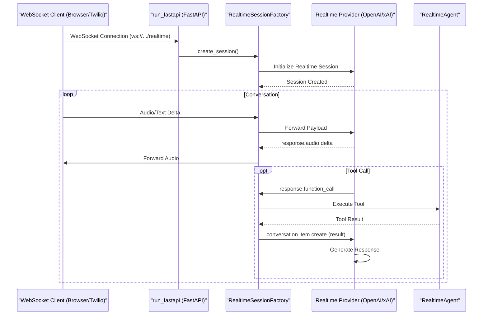
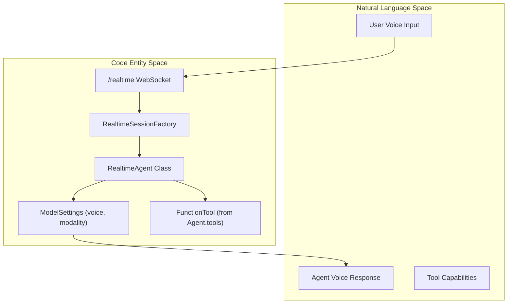

<!-- source: DeepWiki mcp.deepwiki.com · repo VRSEN/agency-swarm · page 6.4 Voice Agents and Realtime · fetched 2026-10-26 -->

# Voice Agents and Realtime

Relevant source files

The following files were used as context for generating this wiki page:

- [docs/additional-features/guardrails/input-guardrails.mdx](docs/additional-features/guardrails/input-guardrails.mdx)
- [docs/additional-features/guardrails/output-guardrails.mdx](docs/additional-features/guardrails/output-guardrails.mdx)
- [docs/additional-features/voice-agents/deployment.mdx](docs/additional-features/voice-agents/deployment.mdx)
- [docs/additional-features/voice-agents/overview.mdx](docs/additional-features/voice-agents/overview.mdx)
- [docs/core-framework/agents/built-in-tools.mdx](docs/core-framework/agents/built-in-tools.mdx)
- [docs/platform/marketplace/onboarding.mdx](docs/platform/marketplace/onboarding.mdx)
- [examples/README.md](examples/README.md)
- [examples/guardrails_input.py](examples/guardrails_input.py)
- [examples/interactive/third_party_models.py](examples/interactive/third_party_models.py)
- [examples/interactive/tui.py](examples/interactive/tui.py)
- [examples/observability.py](examples/observability.py)
- [src/agency_swarm/integrations/fastapi.py](src/agency_swarm/integrations/fastapi.py)
- [src/agency_swarm/integrations/fastapi_utils/endpoint_handlers.py](src/agency_swarm/integrations/fastapi_utils/endpoint_handlers.py)
- [src/agency_swarm/integrations/fastapi_utils/request_models.py](src/agency_swarm/integrations/fastapi_utils/request_models.py)
- [tests/integration/fastapi/test_fastapi_client_config.py](tests/integration/fastapi/test_fastapi_client_config.py)
- [tests/test_fastapi_utils_modules/test_openai_client_config_models.py](tests/test_fastapi_utils_modules/test_openai_client_config_models.py)
- [tests/test_fastapi_utils_modules/test_openai_client_config_request_state.py](tests/test_fastapi_utils_modules/test_openai_client_config_request_state.py)

The `agency-swarm` framework provides a high-performance realtime voice and data orchestration layer, enabling low-latency, multimodal interactions between users and agents. This system leverages WebSockets and the OpenAI Realtime API (or compatible providers like xAI) to facilitate fluid voice conversations, tool execution, and state management in a single session.

## Realtime Architecture

The realtime system is built on a session-based architecture where a `RealtimeAgent` acts as the multimodal interface within a `RealtimeAgency`. The integration bridges standard WebSocket events to the underlying provider's realtime protocols.

### Data Flow and Lifecycle

The following diagram illustrates the lifecycle of a voice session, from the initial WebSocket connection to tool execution and audio response.

**Realtime Session Data Flow**

Sources: [src/agency_swarm/integrations/fastapi.py:14-19](), [src/agency_swarm/integrations/fastapi.py:73-76](), [src/agency_swarm/integrations/fastapi.py:101-115]()

## Key Classes and Entities

The realtime capabilities are encapsulated in specialized classes that extend the core framework's functionality into the streaming and multimodal space.

### RealtimeAgency and RealtimeAgent
While a standard `Agency` manages threads and communication flows between text-based agents, the realtime integration utilizes a `RealtimeAgent` which is specifically configured for voice-first interactions.

| Entity | Role |
| :--- | :--- |
| `RealtimeAgent` | A specialized `Agent` variant configured with voice settings (e.g., `alloy`, `shimmer`), modalities (`text`, `audio`), and specific instructions for low-latency response. |
| `RealtimeAgency` | The orchestrator that wraps one or more `RealtimeAgent` instances, providing the context and toolsets required for the session. |
| `RealtimeSessionFactory` | Responsible for creating and managing the lifecycle of individual provider sessions (OpenAI/xAI). |

Sources: [src/agency_swarm/integrations/fastapi.py:14-19](), [src/agency_swarm/integrations/fastapi.py:40-41]()

### Code Entity Mapping
This diagram maps the natural language concepts of a "Voice Session" to the specific code entities in the `agency-swarm` integration layer.

**Voice Session Entity Mapping**

Sources: [src/agency_swarm/integrations/fastapi.py:14-19](), [src/agency_swarm/integrations/fastapi.py:105-115](), [src/agency_swarm/integrations/fastapi_utils/endpoint_handlers.py:38-41]()

## Configuration and Deployment

Realtime agents are typically deployed via the `run_fastapi` entry point, which automatically handles the WebSocket routing and session state.

### WebSocket Endpoint Configuration
To enable realtime capabilities, the `enable_realtime` flag must be set to `True` in the `run_fastapi` function.

*   **Endpoint**: The server exposes a WebSocket endpoint at `ws://<host>:<port>/<agency_name>/realtime`.
*   **Provider Support**: Supports OpenAI Realtime API and xAI. The provider is determined by the `model` string or explicit `realtime_options`.
*   **Voice Settings**: Configurable via `realtime_options` or the `Agent`'s `ModelSettings`.

Sources: [src/agency_swarm/integrations/fastapi.py:40-41](), [src/agency_swarm/integrations/fastapi.py:73-76](), [src/agency_swarm/integrations/fastapi.py:152-155]()

### Twilio Integration
The framework supports telephony integration via Twilio. This allows users to call a phone number and interact with an agency via voice.
1.  **Media Streams**: Twilio connects to the `agency-swarm` WebSocket via `<Stream>` instructions in TwiML.
2.  **Audio Format**: The system handles the `g711` (mulaw) audio encoding common in telephony and converts it for the Realtime Provider.

Sources: [src/agency_swarm/integrations/fastapi.py:40-45](), [src/agency_swarm/integrations/fastapi_utils/endpoint_handlers.py:18-27]()

## Implementation Details

### Session Management
The `RealtimeSessionFactory` handles the underlying `AsyncOpenAI` or provider client. It manages:
*   **Event Forwarding**: `_forward_session_events` routes provider events (like `audio_delta` or `function_call`) back to the client.
*   **Payload Handling**: `_handle_client_payload` processes incoming client events (like `user_audio_append` or `interrupt`).
*   **Tool Execution**: When a `function_call` event is received from the provider, the factory resolves the tool from the `RealtimeAgent`'s toolset and executes it within the `RunContextWrapper`.

Sources: [src/agency_swarm/integrations/fastapi.py:14-19](), [src/agency_swarm/integrations/fastapi_utils/endpoint_handlers.py:67-69]()

### Request Scoped Overrides
Just like standard text requests, realtime sessions support `ClientConfig` overrides. This allows a client to request a specific voice or model at the start of the WebSocket handshake.

| Parameter | Description |
| :--- | :--- |
| `model` | Overrides the agent's default model for the session. |
| `voice` | Selects the output voice (e.g., `alloy`, `echo`, `shimmer`). |
| `instructions` | Appends or overrides system instructions for the realtime session. |

Sources: [src/agency_swarm/integrations/fastapi_utils/request_models.py:41-80](), [src/agency_swarm/integrations/fastapi_utils/endpoint_handlers.py:87]()

---

