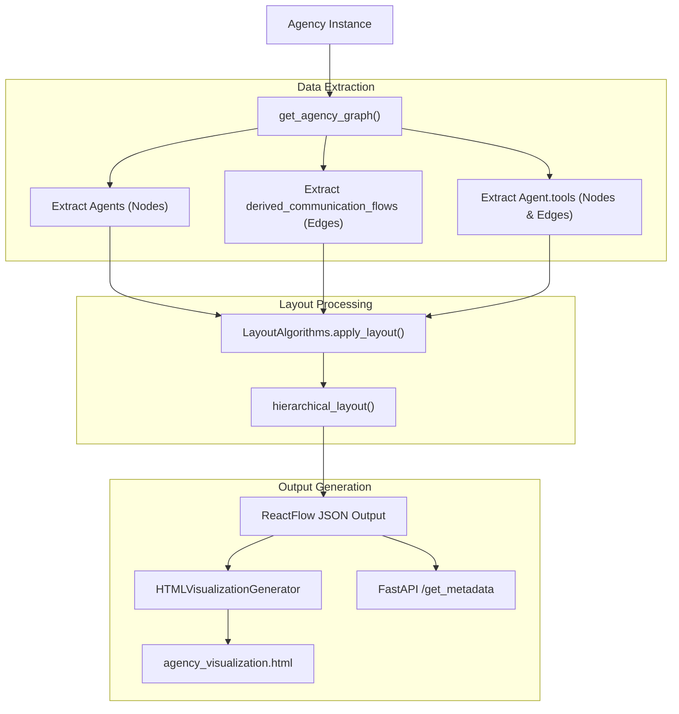
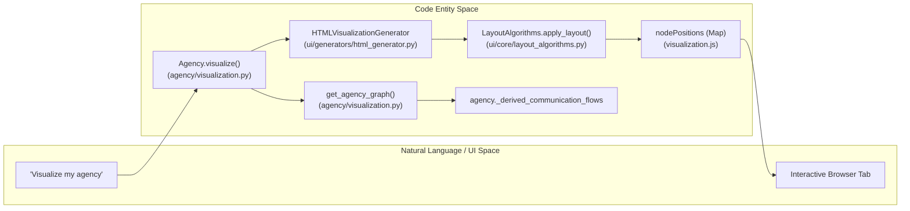

<!-- source: DeepWiki mcp.deepwiki.com · repo VRSEN/agency-swarm · page 6.5 Visualization · fetched 2026-10-26 -->

# Visualization

Relevant source files

The following files were used as context for generating this wiki page:

- [docs/core-framework/agencies/visualization.mdx](docs/core-framework/agencies/visualization.mdx)
- [src/agency_swarm/agency/visualization.py](src/agency_swarm/agency/visualization.py)
- [src/agency_swarm/ui/core/layout_algorithms.py](src/agency_swarm/ui/core/layout_algorithms.py)
- [src/agency_swarm/ui/demos/copilot.py](src/agency_swarm/ui/demos/copilot.py)
- [src/agency_swarm/ui/demos/copilot/app/api/copilotkit/route.ts](src/agency_swarm/ui/demos/copilot/app/api/copilotkit/route.ts)
- [src/agency_swarm/ui/demos/copilot/package.json](src/agency_swarm/ui/demos/copilot/package.json)
- [src/agency_swarm/ui/generators/html_generator.py](src/agency_swarm/ui/generators/html_generator.py)
- [src/agency_swarm/ui/templates/html/visualization.js](src/agency_swarm/ui/templates/html/visualization.js)
- [src/agency_swarm/utils/serialization.py](src/agency_swarm/utils/serialization.py)
- [tests/test_agency_modules/test_ui.py](tests/test_agency_modules/test_ui.py)

The `agency-swarm` framework provides a robust visualization suite for inspecting the architecture of an `Agency`. This system allows developers to visualize agent hierarchies, communication flows, and tool assignments through interactive HTML exports or ReactFlow-compatible metadata.

## Overview of Visualization Methods

Visualization is primarily handled through the `Agency` class and the `agency_swarm.ui` package. There are two main programmatic entry points for visualization:

1.  **`visualize()`**: Generates a self-contained, interactive HTML file using SVG and embedded JavaScript [src/agency_swarm/agency/visualization.py:148-170]().
2.  **`get_agency_graph()`**: Returns a raw JSON structure containing nodes and edges, optimized for frontend libraries like ReactFlow [src/agency_swarm/agency/visualization.py:21-128]().

### Data Flow for Agency Visualization

The following diagram illustrates how the Python `Agency` instance is transformed into a visual graph.

**Graph Generation Pipeline**

Sources: [src/agency_swarm/agency/visualization.py:21-128](), [src/agency_swarm/ui/generators/html_generator.py:159-187]()

---

## Layout Algorithms

The framework uses a specialized `LayoutAlgorithms` class to calculate coordinates for nodes. This ensures that the visualization is readable regardless of the number of agents [src/agency_swarm/ui/core/layout_algorithms.py:8-11]().

### Hierarchical Layout
The `hierarchical_layout` method positions nodes based on their roles and communication directions [src/agency_swarm/ui/core/layout_algorithms.py:14-20]():

*   **Entry Points**: Agents defined in `agency.entry_points` are placed at the top (Layer 0) [src/agency_swarm/ui/core/layout_algorithms.py:49-51]().
*   **BFS Layering**: A Breadth-First Search (BFS) traverses the communication flows to assign subsequent layers [src/agency_swarm/ui/core/layout_algorithms.py:54-71]().
*   **Agent Positioning**: Agents within the same layer are spread horizontally to prevent overlap [src/agency_swarm/ui/core/layout_algorithms.py:108-111]().
*   **Smart Tool Positioning**: Tools are positioned relative to their parent agents. 
    *   **Managers**: Tools are placed to the right if the agent has children [src/agency_swarm/ui/core/layout_algorithms.py:155-166]().
    *   **Leaf Agents**: Tools are placed below the agent [src/agency_swarm/ui/core/layout_algorithms.py:168]().

Sources: [src/agency_swarm/ui/core/layout_algorithms.py:14-168](), [tests/test_agency_modules/test_ui.py:61-94]()

---

## Interactive HTML Generator

The `HTMLVisualizationGenerator` creates standalone files by embedding CSS and JS directly into the HTML template [src/agency_swarm/ui/generators/html_generator.py:14-18]().

### Implementation Details
*   **Template Path**: Templates are stored in `agency_swarm/ui/templates/html/` [src/agency_swarm/ui/generators/html_generator.py:21]().
*   **Placeholders**: The generator replaces `{AGENCY_DATA_PLACEHOLDER}` with the JSON string from `get_agency_graph()` [src/agency_swarm/ui/generators/html_generator.py:60]().
*   **SVG Rendering**: The client-side script (`visualization.js`) uses the SVG DOM API to draw curved paths (`path` elements with quadratic Bézier curves) for edges and `rect` elements for nodes [src/agency_swarm/ui/templates/html/visualization.js:138-157]().

### Browser Interaction
When `visualize()` is called with `open_browser=True`, the framework uses the standard `webbrowser` library to open the file locally using the `file://` protocol [src/agency_swarm/ui/generators/html_generator.py:150-156]().

Sources: [src/agency_swarm/ui/generators/html_generator.py:23-79](), [src/agency_swarm/ui/templates/html/visualization.js:66-136]()

---

## Metadata and ReactFlow Integration

For custom frontends (like the `ag-ui` protocol), the framework provides `get_metadata()`, which combines the graph data with summary statistics [src/agency_swarm/agency/visualization.py:131-135]().

### Node and Edge Schema
The output follows a strict schema compatible with ReactFlow:

| Entity | Type | Metadata Fields |
| :--- | :--- | :--- |
| **Agent Node** | `agent` | `label`, `isEntryPoint`, `instructions`, `model`, `capabilities` |
| **Tool Node** | `tool` | `label`, `description`, `parentAgent`, `type` |
| **Communication Edge** | `communication` | `source` (Sender), `target` (Receiver), `bidirectional` |
| **Ownership Edge** | `owns` | `source` (Agent), `target` (Tool) |

Sources: [src/agency_swarm/agency/visualization.py:40-123](), [docs/core-framework/agencies/visualization.mdx:85-118]()

---

## Technical Architecture Diagram

This diagram maps the high-level visualization concepts to the specific code entities responsible for their execution.

**Visualization Code Mapping**

Sources: [src/agency_swarm/agency/visualization.py:148-170](), [src/agency_swarm/ui/generators/html_generator.py:159-187](), [src/agency_swarm/ui/templates/html/visualization.js:52-62]()

---

## Specialized Visualizers

### Terminal UI (TUI)
The `tui()` method (aliased as `terminal_demo`) launches a terminal-based interface for interacting with the agency, which includes its own live execution visualization [src/agency_swarm/agency/visualization.py:173-189]().

### Copilot Demo
The `copilot_demo()` method utilizes the `CopilotDemoLauncher` to spin up a Next.js frontend (located in `src/agency_swarm/ui/demos/copilot`) that communicates with a FastAPI backend via the `AG-UI` protocol [src/agency_swarm/ui/demos/copilot.py:11-20](). This demo requires `npm` to be installed and handles dependency installation automatically [src/agency_swarm/ui/demos/copilot.py:23-44]().

Sources: [src/agency_swarm/agency/visualization.py:173-207](), [src/agency_swarm/ui/demos/copilot.py:11-70]()

---

