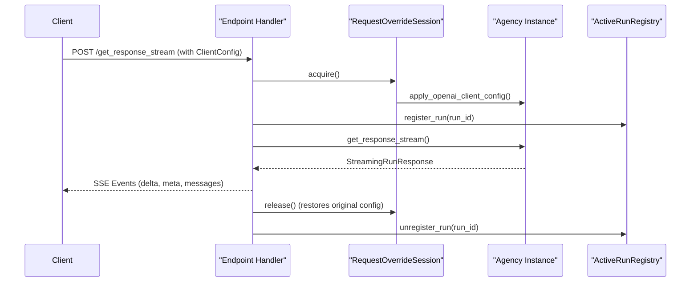

<!-- source: DeepWiki mcp.deepwiki.com · repo VRSEN/agency-swarm · page 7 FastAPI Integration · fetched 2026-10-26 -->

# FastAPI Integration

<details>
<summary>Relevant source files</summary>

The following files were used as context for generating this wiki page:

- [docs/additional-features/fastapi-integration.mdx](docs/additional-features/fastapi-integration.mdx)
- [docs/core-framework/agents/advanced-configuration.mdx](docs/core-framework/agents/advanced-configuration.mdx)
- [docs/core-framework/agents/overview.mdx](docs/core-framework/agents/overview.mdx)
- [docs/core-framework/tools/mcp-integration.mdx](docs/core-framework/tools/mcp-integration.mdx)
- [docs/core-framework/tools/mcp-oauth.mdx](docs/core-framework/tools/mcp-oauth.mdx)
- [docs/references/api.mdx](docs/references/api.mdx)
- [src/agency_swarm/integrations/fastapi.py](src/agency_swarm/integrations/fastapi.py)
- [src/agency_swarm/integrations/fastapi_utils/endpoint_handlers.py](src/agency_swarm/integrations/fastapi_utils/endpoint_handlers.py)
- [src/agency_swarm/integrations/fastapi_utils/request_models.py](src/agency_swarm/integrations/fastapi_utils/request_models.py)
- [tests/integration/fastapi/test_fastapi_client_config.py](tests/integration/fastapi/test_fastapi_client_config.py)
- [tests/test_fastapi_utils_modules/test_openai_client_config_models.py](tests/test_fastapi_utils_modules/test_openai_client_config_models.py)
- [tests/test_fastapi_utils_modules/test_openai_client_config_request_state.py](tests/test_fastapi_utils_modules/test_openai_client_config_request_state.py)

</details>


The FastAPI integration layer in `agency-swarm` allows you to expose your agencies and tools as production-ready HTTP services. This layer bridges the gap between the core framework's natural language capabilities and the web, providing standard REST endpoints, streaming Server-Sent Events (SSE), and WebSocket support for realtime interactions.

## Architecture Overview

The integration is built on top of FastAPI and leverages the `ag-ui-protocol` for structured message exchange. It handles complex orchestration tasks such as per-request client configuration overrides, thread persistence, and multi-agent streaming synchronization.

### Natural Language to Code Entity Mapping

The following diagram illustrates how web-space requests are mapped to framework-space code entities.

**Request Routing and Entity Mapping**
```mermaid
graph TD
    subgraph "Web Space (HTTP/WS)"
        "POST /:agency/get_response"["POST /:agency/get_response"]
        "POST /:agency/get_response_stream"["POST /:agency/get_response_stream"]
        "WS /:agency/realtime"["WS /:agency/realtime"]
    end

    subgraph "Integration Layer (FastAPI)"
        "run_fastapi()"["run_fastapi()"]
        "make_response_endpoint()"["make_response_endpoint()"]
        "make_stream_endpoint()"["make_stream_endpoint()"]
        "RealtimeSessionFactory"["RealtimeSessionFactory"]
    end

    subgraph "Core Framework (Code Space)"
        "Agency"["Agency Class"]
        "Agent"["Agent Class"]
        "ThreadManager"["ThreadManager"]
    end

    "POST /:agency/get_response" --> "make_response_endpoint()"
    "POST /:agency/get_response_stream" --> "make_stream_endpoint()"
    "WS /:agency/realtime" --> "RealtimeSessionFactory"
    
    "make_response_endpoint()" --> "Agency"
    "make_stream_endpoint()" --> "Agency"
    "Agency" --> "Agent"
    "Agency" --> "ThreadManager"
```
Sources: [src/agency_swarm/integrations/fastapi.py:27-45](), [src/agency_swarm/integrations/fastapi_utils/endpoint_handlers.py:105-115]()

## Core Components

### 7.1 Server Setup and Endpoints
The primary entry point for deploying an agency is the `run_fastapi()` function. This function dynamically generates a FastAPI application (or modifies an existing one) to include routes for your agencies. It handles:
*   **Authentication**: Bearer token validation via `app_token_env`.
*   **CORS**: Configurable cross-origin resource sharing.
*   **Metadata**: Exposing agency structure (agents, tools, communication flows) via `/get_metadata` for UI visualization.
*   **Logging**: Middleware for tracking request lifecycles and performance.

For details, see [Server Setup and Endpoints](#7.1).
Sources: [src/agency_swarm/integrations/fastapi.py:27-92](), [docs/additional-features/fastapi-integration.mdx:17-68]()

### 7.2 Request Lifecycle and Client Config
Every request to a FastAPI endpoint can include a `ClientConfig` object. This allows the client to override agent settings for a single run, such as:
*   **Model Swapping**: Temporarily switching from the default model to a specific one (e.g., `gpt-4o` or a LiteLLM-supported provider).
*   **API Keys**: Providing user-specific API keys for OpenAI or other providers.
*   **Concurrency**: Managing state via the `AgencyRequestLease` and `RequestOverrideSession` to ensure that per-request overrides do not leak into other concurrent executions.

For details, see [Request Lifecycle and Client Config](#7.2).
Sources: [src/agency_swarm/integrations/fastapi_utils/request_models.py:41-81](), [src/agency_swarm/integrations/fastapi_utils/endpoint_handlers.py:197-220]()

### 7.3 File Handling
The FastAPI integration provides a robust pipeline for handling file attachments. It supports:
*   **Remote Downloads**: Fetching files from URLs provided in the request.
*   **Local Access**: Accessing local files via an `allowed_local_file_dirs` allowlist for security.
*   **OpenAI Integration**: Automatic upload and processing of files to the OpenAI platform for use with `FileSearch` or `CodeInterpreter`.

For details, see [File Handling](#7.3).
Sources: [src/agency_swarm/integrations/fastapi_utils/request_models.py:119-127](), [docs/additional-features/fastapi-integration.mdx:48-48]()

### 7.4 MCP OAuth in FastAPI
For agencies utilizing Model Context Protocol (MCP) servers, the FastAPI layer supports complex OAuth flows. It implements a deferred authentication strategy where the user is only prompted to authorize a service (like Gmail or GitHub) when an agent explicitly attempts to use a tool from that server.

For details, see [MCP OAuth in FastAPI](#7.4).
Sources: [src/agency_swarm/integrations/fastapi_utils/oauth_support.py:1-20](), [docs/core-framework/tools/mcp-oauth.mdx:23-39]()

## Request Flow Diagram

The following diagram demonstrates the internal processing of a streaming request with configuration overrides.

**Streaming Request Lifecycle**

Sources: [src/agency_swarm/integrations/fastapi_utils/endpoint_handlers.py:197-230](), [src/agency_swarm/integrations/fastapi_utils/endpoint_handlers.py:410-450]()

---

