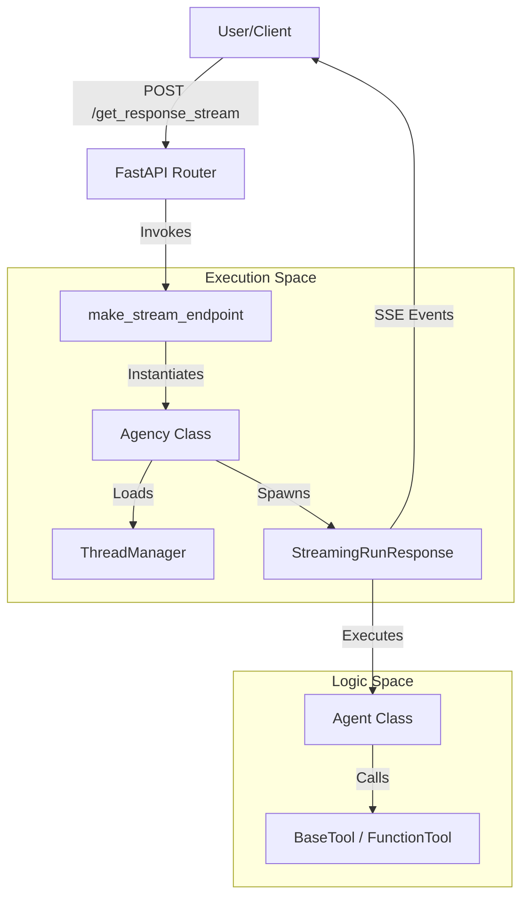
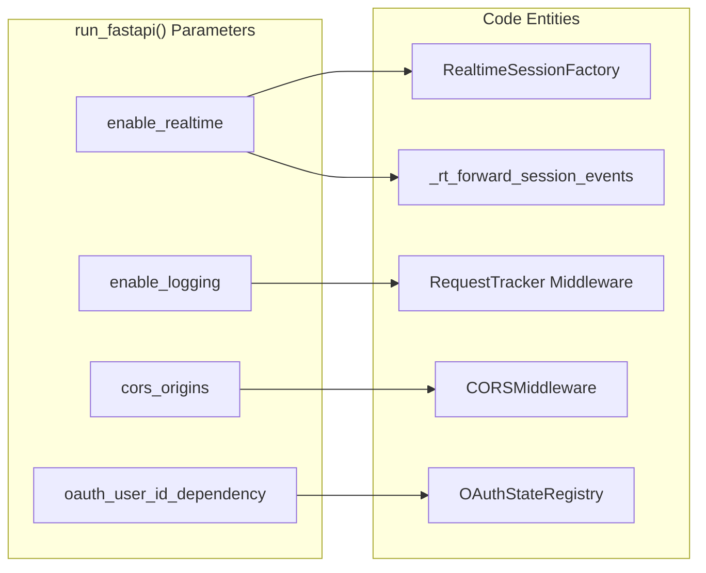

<!-- source: DeepWiki mcp.deepwiki.com · repo VRSEN/agency-swarm · page 7.1 Server Setup and Endpoints · fetched 2026-10-26 -->

# Server Setup and Endpoints

Relevant source files

The following files were used as context for generating this wiki page:

- [docs/additional-features/fastapi-integration.mdx](docs/additional-features/fastapi-integration.mdx)
- [docs/core-framework/agents/advanced-configuration.mdx](docs/core-framework/agents/advanced-configuration.mdx)
- [docs/core-framework/agents/overview.mdx](docs/core-framework/agents/overview.mdx)
- [docs/core-framework/tools/mcp-integration.mdx](docs/core-framework/tools/mcp-integration.mdx)
- [docs/core-framework/tools/mcp-oauth.mdx](docs/core-framework/tools/mcp-oauth.mdx)
- [docs/references/api.mdx](docs/references/api.mdx)
- [src/agency_swarm/integrations/fastapi.py](src/agency_swarm/integrations/fastapi.py)
- [src/agency_swarm/integrations/fastapi_utils/endpoint_handlers.py](src/agency_swarm/integrations/fastapi_utils/endpoint_handlers.py)
- [src/agency_swarm/integrations/fastapi_utils/logging_middleware.py](src/agency_swarm/integrations/fastapi_utils/logging_middleware.py)
- [src/agency_swarm/integrations/fastapi_utils/override_policy.py](src/agency_swarm/integrations/fastapi_utils/override_policy.py)
- [src/agency_swarm/integrations/fastapi_utils/request_models.py](src/agency_swarm/integrations/fastapi_utils/request_models.py)
- [src/agency_swarm/ui/demos/agentswarm_cli.py](src/agency_swarm/ui/demos/agentswarm_cli.py)
- [tests/data/tools/sample_tool.py](tests/data/tools/sample_tool.py)
- [tests/integration/fastapi/test_fastapi_client_config.py](tests/integration/fastapi/test_fastapi_client_config.py)
- [tests/integration/fastapi/test_fastapi_metadata.py](tests/integration/fastapi/test_fastapi_metadata.py)
- [tests/integration/fastapi/test_logging_middleware.py](tests/integration/fastapi/test_logging_middleware.py)
- [tests/test_agency_modules/test_agentswarm_cli_tui.py](tests/test_agency_modules/test_agentswarm_cli_tui.py)
- [tests/test_agent_modules/test_tool_factory_langchain.py](tests/test_agent_modules/test_tool_factory_langchain.py)
- [tests/test_fastapi_utils_modules/test_cors_config.py](tests/test_fastapi_utils_modules/test_cors_config.py)
- [tests/test_fastapi_utils_modules/test_openai_client_config_models.py](tests/test_fastapi_utils_modules/test_openai_client_config_models.py)
- [tests/test_fastapi_utils_modules/test_openai_client_config_request_state.py](tests/test_fastapi_utils_modules/test_openai_client_config_request_state.py)
- [tests/test_fastapi_utils_modules/test_override_policy.py](tests/test_fastapi_utils_modules/test_override_policy.py)

The `agency-swarm` framework provides a high-level integration with **FastAPI** to expose multi-agent agencies and individual tools as production-ready HTTP APIs. This layer handles complex orchestration tasks such as per-request model overrides, thread persistence, file attachment processing, and streaming response normalization.

## Core Server Initialization

The primary entry point for deploying a server is the `run_fastapi()` function. It automates the registration of REST and WebSocket endpoints for one or more agencies.

### The `run_fastapi()` Function
`run_fastapi()` accepts a mapping of agency factories. This factory-based approach ensures that each request can receive a fresh `Agency` instance with conversation history preloaded via `load_threads_callback` [src/agency_swarm/integrations/fastapi.py:27-45]().

| Parameter | Description |
| :--- | :--- |
| `agencies` | Mapping of URL slugs to `Agency` factory functions [src/agency_swarm/integrations/fastapi.py:50-54](). |
| `tools` | List of `FunctionTool` classes to expose under `/tool/` [src/agency_swarm/integrations/fastapi.py:55-56](). |
| `app_token_env` | Env var for Bearer Token auth (default: `APP_TOKEN`) [src/agency_swarm/integrations/fastapi.py:138-141](). |
| `enable_realtime` | Mounts WebSocket routes for Voice/Realtime interaction [src/agency_swarm/integrations/fastapi.py:73-74](). |
| `enable_logging` | Enables the `RequestTracker` middleware and `/get_logs` endpoint [src/agency_swarm/integrations/fastapi.py:157-159](). |

Sources: [src/agency_swarm/integrations/fastapi.py:27-92](), [docs/additional-features/fastapi-integration.mdx:36-53]()

## Generated Endpoints

For every agency registered in the `agencies` mapping, the following endpoints are generated:

### 1. Response Endpoints
*   **`POST /{agency_name}/get_response`**: A standard blocking endpoint that returns the final `RunResult` [docs/additional-features/fastapi-integration.mdx:59]().
*   **`POST /{agency_name}/get_response_stream`**: A Server-Sent Events (SSE) endpoint. It utilizes `StreamingRunResponse` to yield deltas, metadata, and a final `messages` snapshot [docs/additional-features/fastapi-integration.mdx:60](), [src/agency_swarm/agent/execution_stream_response.py:1-10]().
*   **`POST /{agency_name}/cancel_response_stream`**: Allows interrupting an active run. It uses the `ActiveRunRegistry` to locate the specific execution thread/task [src/agency_swarm/integrations/fastapi.py:110]().

### 2. Metadata and Realtime
*   **`GET /{agency_name}/get_metadata`**: Returns a JSON representation of the agency's structure, including agent capabilities (e.g., `file_search`, `code_interpreter`), communication edges, and tool schemas [tests/integration/fastapi/test_fastapi_metadata.py:76-159]().
*   **`WS /{agency_name}/realtime`**: If `enable_realtime=True`, this mounts a WebSocket for the `RealtimeAgency` protocol [src/agency_swarm/integrations/fastapi.py:40-41]().

### 3. Tool and Auth Endpoints
*   **`POST /tool/{tool_name}`**: Direct execution of a specific tool [src/agency_swarm/integrations/fastapi.py:133]().
*   **`/auth/callback`**: Handles OAuth redirects for MCP (Model Context Protocol) servers that require user authorization [src/agency_swarm/integrations/fastapi_utils/endpoint_handlers.py:74-80]().

Sources: [docs/additional-features/fastapi-integration.mdx:56-68](), [src/agency_swarm/integrations/fastapi.py:105-133]()

## System Architecture: Natural Language to Code Bridge

The following diagrams illustrate how the FastAPI layer bridges high-level agency concepts to specific code entities.

### Request Flow and Entity Mapping
This diagram shows how an incoming HTTP request is transformed into an orchestrated agent execution.

Sources: [src/agency_swarm/integrations/fastapi.py:114](), [src/agency_swarm/integrations/fastapi_utils/endpoint_handlers.py:109-115](), [src/agency_swarm/agent/execution_stream_response.py:1-10]()

### Server Component Relationships
This diagram maps server configuration parameters to the underlying implementation classes.

Sources: [src/agency_swarm/integrations/fastapi.py:14-19](), [src/agency_swarm/integrations/fastapi.py:157-160](), [src/agency_swarm/integrations/fastapi.py:183-195]()

## Middleware and Security

### CORS Configuration
The server implements `CORSMiddleware`. A critical security detail: if `cors_origins` is set to `["*"]`, `allow_credentials` is automatically set to `False` to prevent CSRF vulnerabilities and comply with browser standards [src/agency_swarm/integrations/fastapi.py:167-172]().

### Logging Middleware
When `enable_logging=True` is passed to `run_fastapi()`:
1.  The `setup_enhanced_logging` function is called to initialize file-based logging in the `logs_dir` [src/agency_swarm/integrations/fastapi.py:157-158]().
2.  `RequestTracker` middleware is added to the FastAPI app. This middleware tracks the lifecycle of every request and supports conditional logging based on the `x-agency-log-id` header [src/agency_swarm/integrations/fastapi.py:159](), [src/agency_swarm/integrations/fastapi_utils/logging_middleware.py:116-120]().

### ag-ui Protocol Bridge
The server supports the `ag-ui` protocol for seamless integration with specialized AI frontends.
*   **`AguiAdapter`**: This class adapts standard OpenAI-style messages into the `ag-ui` protocol format [src/agency_swarm/integrations/fastapi_utils/endpoint_handlers.py:104]().
*   **TUI Bridge**: When running via `agency.tui()`, the server sets `app.state.agency_swarm_tui_bridge = True`. This flag triggers special handling for `ClientConfig`, such as stripping local bridge base URLs from model settings to prevent circular routing [src/agency_swarm/ui/demos/agentswarm_cli.py:181](), [tests/test_fastapi_utils_modules/test_openai_client_config_models.py:103-121]().

Sources: [src/agency_swarm/integrations/fastapi.py:157-172](), [src/agency_swarm/ui/demos/agentswarm_cli.py:169-182](), [src/agency_swarm/integrations/fastapi_utils/logging_middleware.py:1-20]()

---

