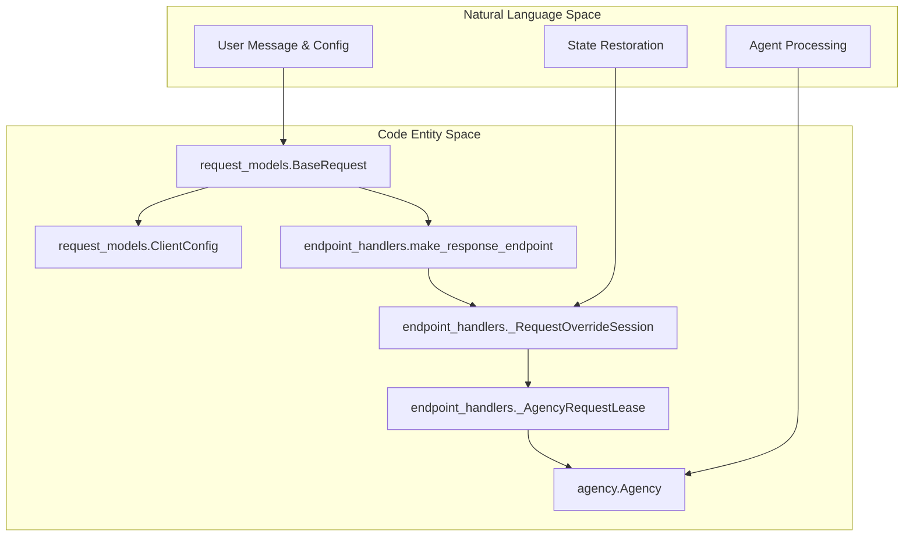
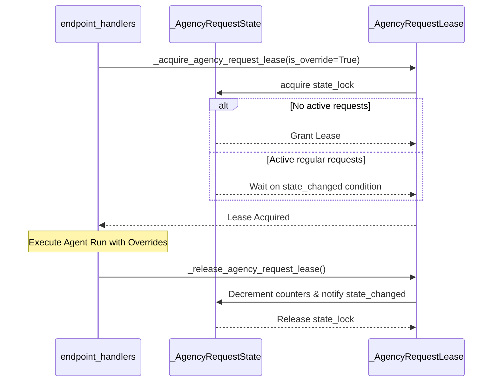

<!-- source: DeepWiki mcp.deepwiki.com · repo VRSEN/agency-swarm · page 7.2 Request Lifecycle and Client Config · fetched 2026-10-26 -->

# Request Lifecycle and Client Config

Relevant source files

The following files were used as context for generating this wiki page:

- [src/agency_swarm/integrations/fastapi.py](src/agency_swarm/integrations/fastapi.py)
- [src/agency_swarm/integrations/fastapi_utils/endpoint_handlers.py](src/agency_swarm/integrations/fastapi_utils/endpoint_handlers.py)
- [src/agency_swarm/integrations/fastapi_utils/override_policy.py](src/agency_swarm/integrations/fastapi_utils/override_policy.py)
- [src/agency_swarm/integrations/fastapi_utils/request_models.py](src/agency_swarm/integrations/fastapi_utils/request_models.py)
- [src/agency_swarm/ui/demos/agentswarm_cli.py](src/agency_swarm/ui/demos/agentswarm_cli.py)
- [tests/integration/fastapi/test_fastapi_client_config.py](tests/integration/fastapi/test_fastapi_client_config.py)
- [tests/integration/fastapi/test_fastapi_metadata.py](tests/integration/fastapi/test_fastapi_metadata.py)
- [tests/test_agency_modules/test_agentswarm_cli_tui.py](tests/test_agency_modules/test_agentswarm_cli_tui.py)
- [tests/test_fastapi_utils_modules/test_openai_client_config_models.py](tests/test_fastapi_utils_modules/test_openai_client_config_models.py)
- [tests/test_fastapi_utils_modules/test_openai_client_config_request_state.py](tests/test_fastapi_utils_modules/test_openai_client_config_request_state.py)
- [tests/test_fastapi_utils_modules/test_openai_client_config_response_overrides.py](tests/test_fastapi_utils_modules/test_openai_client_config_response_overrides.py)
- [tests/test_fastapi_utils_modules/test_override_policy.py](tests/test_fastapi_utils_modules/test_override_policy.py)

The `agency-swarm` FastAPI integration manages a sophisticated per-request lifecycle that allows for dynamic client configuration, multi-agent coordination, and safe execution state management. This system ensures that request-scoped overrides (like custom API keys or models) do not leak between concurrent requests while maintaining a robust locking strategy for shared agency resources.

## Overview of the Request Lifecycle

Every request to an `agency-swarm` FastAPI endpoint (such as `get_response` or `get_response_stream`) follows a structured pipeline:
1.  **Validation**: Incoming payloads are validated against Pydantic models (e.g., `BaseRequest`, `RunAgentInputCustom`).
2.  **Agency Instantiation**: The agency factory is invoked to provide a fresh or pooled `Agency` instance [src/agency_swarm/integrations/fastapi.py:50-54]().
3.  **Lease Acquisition**: The system acquires an `AgencyRequestLease` to coordinate access to the agency's state [src/agency_swarm/integrations/fastapi_utils/endpoint_handlers.py:209-212]().
4.  **Override Application**: If `ClientConfig` is provided, the agents' underlying OpenAI clients and model settings are temporarily modified [src/agency_swarm/integrations/fastapi_utils/endpoint_handlers.py:215-218]().
5.  **Execution**: The agency processes the message (including file uploads and tool materialization).
6.  **Cleanup**: The `RequestOverrideSession` restores the original agent states and releases the lease [src/agency_swarm/integrations/fastapi_utils/endpoint_handlers.py:231-235]().

### Request Entity Mapping
The following diagram bridges the natural language concepts of a request to the specific code entities that handle them.

**Diagram: Request to Code Entity Mapping**

Sources: [src/agency_swarm/integrations/fastapi_utils/endpoint_handlers.py:197-207](), [src/agency_swarm/integrations/fastapi_utils/request_models.py:41-81](), [src/agency_swarm/integrations/fastapi.py:105-115]()

---

## ClientConfig Overrides

The `ClientConfig` class allows users to override the behavior of an entire agency for a single request [src/agency_swarm/integrations/fastapi_utils/request_models.py:41-42]().

| Field | Description | Implementation Detail |
| :--- | :--- | :--- |
| `base_url` | OpenAI-compatible API base URL | Injected into `AsyncOpenAI` and `OpenAI` clients [src/agency_swarm/integrations/fastapi_utils/endpoint_handlers.py:343-345](). |
| `api_key` | OpenAI API key | Overrides default environment variables for the request duration [src/agency_swarm/integrations/fastapi_utils/endpoint_handlers.py:341-342](). |
| `model` | Global model swap | If set, every agent in the agency uses this model for the run [src/agency_swarm/integrations/fastapi_utils/request_models.py:68-74](). |
| `litellm_keys` | Provider API keys | Routing for Anthropic, Gemini, etc., via LiteLLM [src/agency_swarm/integrations/fastapi_utils/request_models.py:59-67](). |
| `default_headers` | Custom HTTP headers | Merged with existing client headers; request-level values win [tests/integration/fastapi/test_fastapi_client_config.py:137-138](). |

### Model Swap Logic
The framework handles three primary model categories during a swap:
1.  **OpenAI**: Standard models (e.g., `gpt-4o`) use the `OpenAIChatCompletionsModel` or `OpenAIResponsesModel`.
2.  **OpenRouter**: Models prefixed with `openrouter/` are routed through the OpenRouter base URL [src/agency_swarm/integrations/fastapi_utils/endpoint_handlers.py:107-113]().
3.  **LiteLLM**: If the `[litellm]` extra is installed, models prefixed with `litellm/` enable multi-provider support [src/agency_swarm/integrations/fastapi_utils/endpoint_handlers.py:49-55]().

Sources: [src/agency_swarm/integrations/fastapi_utils/request_models.py:41-81](), [src/agency_swarm/integrations/fastapi_utils/endpoint_handlers.py:321-338]()

---

## Request Coordination and Locking

To prevent race conditions when multiple requests target the same `Agency` instance (especially when overrides are active), `agency-swarm` implements a Reader-Writer locking strategy via `_AgencyRequestState` [src/agency_swarm/integrations/fastapi_utils/endpoint_handlers.py:177-189]().

### Locking Strategy
-   **Regular Requests (Readers)**: Multiple concurrent requests can proceed if they do not have overrides.
-   **Override Requests (Writers)**: If a request contains a `ClientConfig`, it requires exclusive access to the agency to prevent its temporary state from affecting other requests.
-   **Lease Mechanism**: The `_AgencyRequestLease` manages the acquisition and release of these states [src/agency_swarm/integrations/fastapi_utils/endpoint_handlers.py:191-194]().

**Diagram: Request Coordination Flow**

Sources: [src/agency_swarm/integrations/fastapi_utils/endpoint_handlers.py:177-189](), [src/agency_swarm/integrations/fastapi_utils/endpoint_handlers.py:209-212](), [src/agency_swarm/integrations/fastapi_utils/endpoint_handlers.py:270-280]()

---

## ActiveRunRegistry and Stream Cancellation

For long-running streaming responses, the `ActiveRunRegistry` tracks every ongoing `StreamingRunResponse` [src/agency_swarm/agent/execution_stream_response.py:70](). This registry is essential for the `/cancel` endpoint functionality.

1.  **Registration**: When `get_response_stream` is called, the resulting stream is registered in the `ActiveRunRegistry` using a unique `run_id` [src/agency_swarm/integrations/fastapi.py:106]().
2.  **Cancellation**: The `make_cancel_endpoint` handler looks up the stream by `run_id` and invokes `.cancel()` [src/agency_swarm/integrations/fastapi.py:110]().
3.  **Cleanup**: Once a stream finishes or is cancelled, it is automatically removed from the registry to prevent memory leaks.

Sources: [src/agency_swarm/integrations/fastapi.py:106-115](), [src/agency_swarm/agent/execution_stream_response.py:70-75]()

---

## Data Flow: Client Override Implementation

When a `ClientConfig` is detected, the `_RequestOverrideSession` performs the following steps to mutate and restore the agency state:

1.  **Snapshotting**: Before applying changes, it takes a `_AgencyStateSnapshot` of all agents, including their current models and OpenAI clients [src/agency_swarm/integrations/fastapi_utils/endpoint_handlers.py:136]().
2.  **Applying Config**: It iterates through `agency.agents` and updates:
    -   `agent.model` (if a global model swap is requested) [src/agency_swarm/integrations/fastapi_utils/endpoint_handlers.py:321-325]().
    -   `agent.model.openai_client` (applying `base_url`, `api_key`, and `default_headers`) [src/agency_swarm/integrations/fastapi_utils/endpoint_handlers.py:340-350]().
3.  **Restoration**: In the `finally` block of the request handler, the snapshot is used to revert every agent to its original state [src/agency_swarm/integrations/fastapi_utils/endpoint_handlers.py:231-235]().

Sources: [src/agency_swarm/integrations/fastapi_utils/endpoint_handlers.py:197-207](), [src/agency_swarm/integrations/fastapi_utils/endpoint_handlers.py:321-360](), [tests/integration/fastapi/test_fastapi_client_config.py:193-195]()

---

