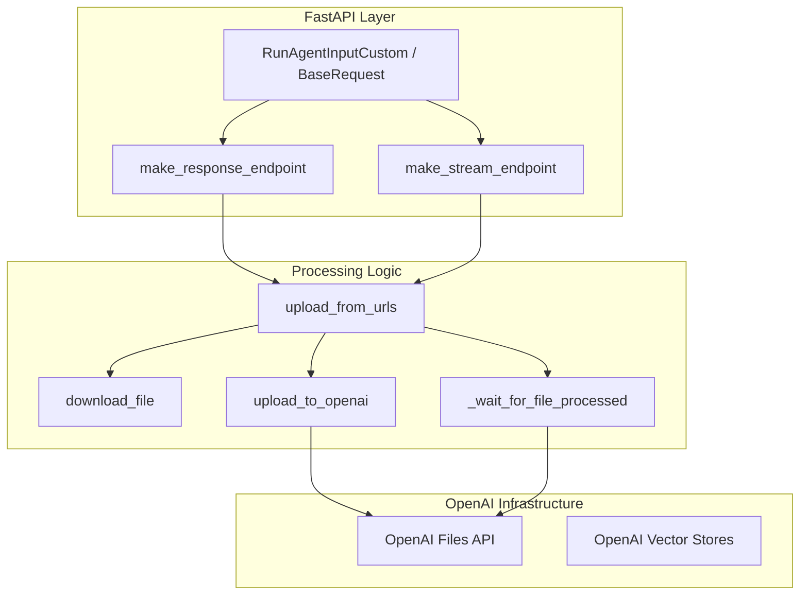
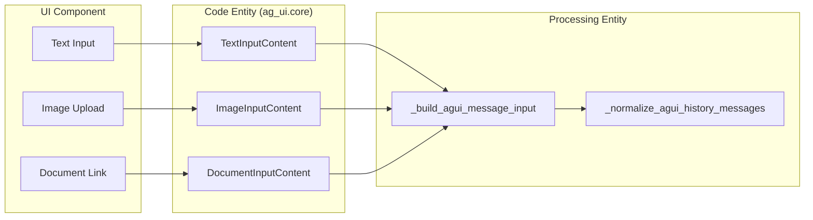

<!-- source: DeepWiki mcp.deepwiki.com · repo VRSEN/agency-swarm · page 7.3 File Handling · fetched 2026-10-26 -->

# File Handling

Relevant source files

The following files were used as context for generating this wiki page:

- [src/agency_swarm/agent/file_manager.py](src/agency_swarm/agent/file_manager.py)
- [src/agency_swarm/agent/file_sync.py](src/agency_swarm/agent/file_sync.py)
- [src/agency_swarm/integrations/fastapi_utils/file_handler.py](src/agency_swarm/integrations/fastapi_utils/file_handler.py)
- [tests/integration/fastapi/test_fastapi_file_processing.py](tests/integration/fastapi/test_fastapi_file_processing.py)
- [tests/integration/files/test_file_handling.py](tests/integration/files/test_file_handling.py)
- [tests/test_agent_modules/test_agent_file_manager.py](tests/test_agent_modules/test_agent_file_manager.py)
- [tests/test_agent_modules/test_file_sync.py](tests/test_agent_modules/test_file_sync.py)
- [tests/test_agent_modules/test_tools_utils.py](tests/test_agent_modules/test_tools_utils.py)
- [tests/test_fastapi_utils_modules/test_endpoint_handlers.py](tests/test_fastapi_utils_modules/test_endpoint_handlers.py)
- [tests/test_fastapi_utils_modules/test_endpoint_handlers_final_messages_payload.py](tests/test_fastapi_utils_modules/test_endpoint_handlers_final_messages_payload.py)
- [tests/test_fastapi_utils_modules/test_file_handler.py](tests/test_fastapi_utils_modules/test_file_handler.py)
- [tests/test_fastapi_utils_modules/test_file_handler_downloads.py](tests/test_fastapi_utils_modules/test_file_handler_downloads.py)

The agency-swarm framework provides a robust file handling pipeline designed to bridge the gap between various input sources (remote URLs, local paths, and UI-driven uploads) and the OpenAI Assistants API. This system manages file validation, secure local access, remote downloading via `httpx`, and asynchronous synchronization with OpenAI's vector stores.

## File Attachment Pipeline

The FastAPI integration uses a specialized pipeline to process file attachments before they are sent to an agent. This ensures that files are correctly uploaded to OpenAI and that the agent is aware of the file's provenance.

### Data Flow Overview

The flow typically starts at a FastAPI endpoint like `get_response` or `get_response_stream`.

1.  **Input Collection**: The endpoint receives a `file_urls` mapping (filename to URL/path) [src/agency_swarm/integrations/fastapi_utils/file_handler.py:25-34]().
2.  **Validation**: Local paths are checked against an `allowed_local_file_dirs` allowlist [src/agency_swarm/integrations/fastapi_utils/file_handler.py:42-53]().
3.  **Acquisition**: Remote files are downloaded to a temporary directory using `httpx` [src/agency_swarm/integrations/fastapi_utils/file_handler.py:112-113]().
4.  **OpenAI Upload**: Files are uploaded to OpenAI with the purpose `assistants` [src/agency_swarm/integrations/fastapi_utils/file_handler.py:151-160]().
5.  **Processing Wait**: The system polls the OpenAI File API until the status is `processed` [src/agency_swarm/integrations/fastapi_utils/file_handler.py:162-177]().
6.  **Context Injection**: A synthetic system message is prepended to the conversation, containing the JSON-escaped metadata of the attached files to provide the agent with provenance [tests/test_fastapi_utils_modules/test_endpoint_handlers.py:56-72]().

### File Handling Architecture

The following diagram illustrates the relationship between the FastAPI handlers and the underlying file management utilities.

**File Processing Entity Map**

Sources: [src/agency_swarm/integrations/fastapi_utils/file_handler.py:25-139](), [src/agency_swarm/integrations/fastapi_utils/endpoint_handlers.py:16-21](), [src/agency_swarm/integrations/fastapi_utils/request_models.py:39-40]()

## Agent File Management

The `AgentFileManager` class handles the lifecycle of files associated with a specific agent, including local synchronization and Vector Store integration.

### Core Functions

*   **`upload_file`**: Uploads a local file to OpenAI. If the file already exists (verified by ID and modification time), it skips the upload or replaces the remote version if the local one is newer [src/agency_swarm/agent/file_manager.py:56-113]().
*   **Vector Store Association**: If an agent has an `_associated_vector_store_id`, files are automatically queued for ingestion into that store [src/agency_swarm/agent/file_manager.py:149-172]().
*   **Wait for Ingestion**: The system can optionally block until the Vector Store has finished processing the file, ensuring the agent has access to the information immediately [src/agency_swarm/agent/file_sync.py:140-168]().

### File Synchronization Logic

The `FileSync` class manages the consistency between the agent's local `files_folder` and the remote OpenAI environment.

| Function | Description |
| :--- | :--- |
| `sync_with_folder` | Identifies "orphan" files on OpenAI that no longer exist in the local folder and deletes them [src/agency_swarm/agent/file_sync.py:84-121](). |
| `remove_file_from_vs_and_oai` | Deletes a file from OpenAI; the platform automatically detaches it from all associated Vector Stores [src/agency_swarm/agent/file_sync.py:122-135](). |
| `_should_skip_file` | Ignores system files starting with `.` or `__` (e.g., `.gitignore`, `__pycache__`) [src/agency_swarm/agent/file_sync.py:137-138](). |

Sources: [src/agency_swarm/agent/file_manager.py:49-172](), [src/agency_swarm/agent/file_sync.py:20-138]()

## AG-UI Content Parts

The system supports multimodal inputs via the AG-UI protocol, which are normalized into standard message formats for the agents.

### Content Types

The `_build_agui_message_input` function processes several content part types [tests/test_fastapi_utils_modules/test_endpoint_handlers.py:111-146]():

*   **`TextInputContent`**: Standard text strings.
*   **`ImageInputContent`**: Images provided via URL or base64 data.
*   **`DocumentInputContent`**: Documents (PDFs, etc.) provided via URL.
*   **`Audio/VideoInputContent`**: Media files processed as `input_file` types with base64 data URIs.

### Implementation Mapping

**Natural Language to Code Entity Space**

Sources: [tests/test_fastapi_utils_modules/test_endpoint_handlers.py:111-185]()

## Security and Validation

To prevent unauthorized access and directory traversal attacks, the file handling layer enforces several constraints:

1.  **Allowed Directories**: Local file access is only permitted if the path resides within a directory specified in the `allowed_local_file_dirs` list [src/agency_swarm/integrations/fastapi_utils/file_handler.py:246-261]().
2.  **Scheme Validation**: Only `http`, `https`, and `file` (if allowed) schemes are supported. Schemes like `s3://` or `ftp://` are rejected [src/agency_swarm/integrations/fastapi_utils/file_handler.py:40-108]().
3.  **Traversal Protection**: Filenames for remote downloads are validated to ensure they do not contain path components that could escape the temporary directory [tests/test_fastapi_utils_modules/test_file_handler_downloads.py:69-100]().
4.  **Wait Timeout**: File processing at OpenAI is subject to a 60-second timeout to prevent endpoint hanging [src/agency_swarm/integrations/fastapi_utils/file_handler.py:162-176]().

Sources: [src/agency_swarm/integrations/fastapi_utils/file_handler.py:40-261](), [tests/test_fastapi_utils_modules/test_file_handler_downloads.py:69-100]()

---

