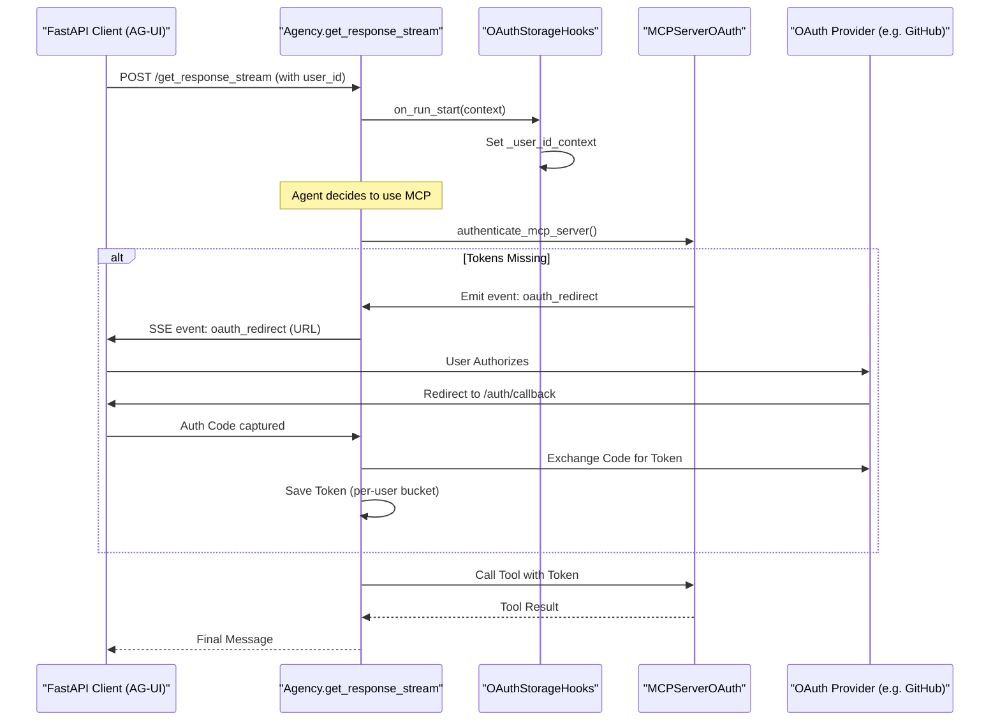
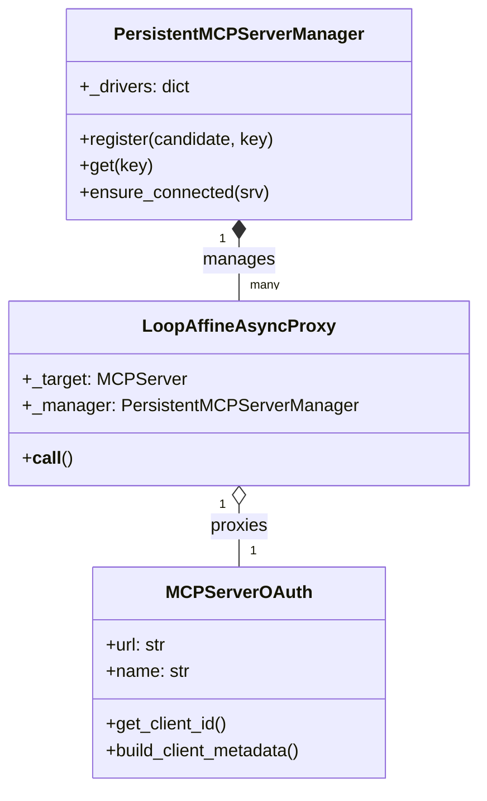

<!-- source: DeepWiki mcp.deepwiki.com · repo VRSEN/agency-swarm · page 7.4 MCP OAuth in FastAPI · fetched 2026-10-26 -->

# MCP OAuth in FastAPI

Relevant source files

The following files were used as context for generating this wiki page:

- [docs/additional-features/fastapi-integration.mdx](docs/additional-features/fastapi-integration.mdx)
- [docs/core-framework/agents/advanced-configuration.mdx](docs/core-framework/agents/advanced-configuration.mdx)
- [docs/core-framework/agents/overview.mdx](docs/core-framework/agents/overview.mdx)
- [docs/core-framework/tools/mcp-integration.mdx](docs/core-framework/tools/mcp-integration.mdx)
- [docs/core-framework/tools/mcp-oauth.mdx](docs/core-framework/tools/mcp-oauth.mdx)
- [docs/references/api.mdx](docs/references/api.mdx)
- [examples/fastapi_integration/notion_hosted_mcp_tool.py](examples/fastapi_integration/notion_hosted_mcp_tool.py)
- [examples/fastapi_integration/oauth_agency.py](examples/fastapi_integration/oauth_agency.py)
- [examples/mcp_oauth/README.md](examples/mcp_oauth/README.md)
- [src/agency_swarm/mcp/oauth.py](src/agency_swarm/mcp/oauth.py)
- [src/agency_swarm/mcp/oauth_client.py](src/agency_swarm/mcp/oauth_client.py)
- [src/agency_swarm/mcp/oauth_config.py](src/agency_swarm/mcp/oauth_config.py)
- [src/agency_swarm/mcp/oauth_provider.py](src/agency_swarm/mcp/oauth_provider.py)
- [src/agency_swarm/mcp/oauth_storage_hooks.py](src/agency_swarm/mcp/oauth_storage_hooks.py)
- [src/agency_swarm/tools/mcp_manager.py](src/agency_swarm/tools/mcp_manager.py)
- [tests/integration/mcp/test_oauth_end_to_end.py](tests/integration/mcp/test_oauth_end_to_end.py)
- [tests/test_agent_modules/test_mcp_manager.py](tests/test_agent_modules/test_mcp_manager.py)
- [tests/test_agent_modules/test_mcp_oauth.py](tests/test_agent_modules/test_mcp_oauth.py)
- [tests/test_fastapi_utils_modules/test_oauth_support.py](tests/test_fastapi_utils_modules/test_oauth_support.py)

Model Context Protocol (MCP) servers often require OAuth 2.0 authentication to access user-specific data (e.g., Google Calendar, GitHub, Notion). In a FastAPI environment, Agency Swarm implements a **deferred authentication strategy** to ensure that users only undergo the OAuth flow when the agent explicitly needs to access a protected resource.

## Deferred Authentication Strategy

Unlike standard tools that are initialized at startup, OAuth-enabled MCP servers are not immediately connected. Instead, Agency Swarm injects a special tool into the agent called `authenticate_mcp_server`.

*   **Trigger:** The OAuth flow only starts when the model explicitly calls `authenticate_mcp_server(server_name)` [docs/core-framework/tools/mcp-oauth.mdx:31-32]().
*   **Discovery:** Once invoked, the framework performs MCP schema discovery (`list_tools`). If the server uses standard FastMCP authentication, this discovery phase triggers the OAuth redirect [docs/core-framework/tools/mcp-oauth.mdx:36-37]().
*   **Tool Contract:** The `server_name` parameter for the authentication tool is automatically constrained to the list of configured OAuth servers for that specific agent [docs/core-framework/tools/mcp-oauth.mdx:32-32]().

### Natural Language to Code Entity Mapping: Auth Flow

| System Concept | Code Entity | File Reference |
| :--- | :--- | :--- |
| OAuth Config | `MCPServerOAuth` | [src/agency_swarm/mcp/oauth_config.py:28-47]() |
| Auth Tool | `authenticate_mcp_server` | [docs/core-framework/tools/mcp-oauth.mdx:31-32]() |
| Token Isolation | `_user_id_context` | [src/agency_swarm/mcp/oauth.py:47-47]() |
| Storage Hook | `OAuthStorageHooks` | [src/agency_swarm/mcp/oauth_storage_hooks.py:18-18]() |
| Provider | `ErrorCapturingOAuthClientProvider` | [src/agency_swarm/mcp/oauth_provider.py:43-43]() |

**Sources:** [docs/core-framework/tools/mcp-oauth.mdx:31-37](), [src/agency_swarm/mcp/oauth_config.py:28-47](), [src/agency_swarm/mcp/oauth_storage_hooks.py:18-18]().

---

## Data Flow and Architecture

The following diagram illustrates the lifecycle of an OAuth request within the FastAPI integration, from the initial agent prompt to the final authorized tool call.

### MCP OAuth Lifecycle Diagram

**Sources:** [docs/core-framework/tools/mcp-oauth.mdx:93-114](), [src/agency_swarm/mcp/oauth_storage_hooks.py:46-50](), [src/agency_swarm/mcp/oauth.py:47-60]().

---

## Token Isolation and Storage

To support multi-tenant applications, Agency Swarm isolates OAuth tokens using a `user_id`.

### OAuthStorageHooks
The `OAuthStorageHooks` class is automatically installed when an agent has an OAuth MCP server [src/agency_swarm/mcp/oauth_storage_hooks.py:24-25](). It extracts the `user_id` from the `MasterContext` and sets a `ContextVar` (`_user_id_context`) that is used by the storage layer [src/agency_swarm/mcp/oauth_storage_hooks.py:46-50]().

### FileTokenStorage
Tokens are persisted in a directory structure that prevents cross-user access:
*   **Path:** `oauth_token_path` / `user_id` / `server_cache_segment` / `tokens.json` [src/agency_swarm/mcp/oauth.py:161-190]().
*   **Security:** Directories and files are created with owner-only permissions (`0o700` for dirs, `0o600` for files) [src/agency_swarm/mcp/oauth.py:136-140](), [tests/test_agent_modules/test_mcp_oauth.py:58-59]().

### Configuration Parameters
When running `run_fastapi()`, the following parameters control OAuth behavior:
*   `oauth_user_id_dependency`: A FastAPI dependency that returns a stable user ID [docs/additional-features/fastapi-integration.mdx:51-51]().
*   `oauth_token_path`: The base directory for token persistence [src/agency_swarm/tools/mcp_manager.py:80-82]().
*   `oauth_registry`: An optional external registry to share callback state across multiple workers [docs/core-framework/tools/mcp-oauth.mdx:30-30]().

**Sources:** [src/agency_swarm/mcp/oauth.py:161-190](), [src/agency_swarm/mcp/oauth_storage_hooks.py:18-50](), [docs/additional-features/fastapi-integration.mdx:51-52]().

---

## FastAPI Endpoints and Streaming

OAuth in Agency Swarm **requires** the streaming endpoint (`/get_response_stream`) because authorization is an interactive process delivered via Server-Sent Events (SSE) [docs/core-framework/tools/mcp-oauth.mdx:33-33]().

### Event Sequence
After the `authenticate_mcp_server` tool is triggered, the stream follows a deterministic contract [docs/core-framework/tools/mcp-oauth.mdx:34-34]():
1.  `meta`: Contains run metadata.
2.  `oauth_redirect`: Provides the authorization URL for the user.
3.  `oauth_status` (`pending`): Indicates the system is waiting for the user.
4.  **Keepalive Comments**: The server sends SSE comments every 15 seconds to prevent connection timeouts while the user is authenticating [docs/core-framework/tools/mcp-oauth.mdx:34-34]().
5.  `oauth_status` (`authorized`, `error`, or `timeout`): Terminal status of the auth attempt.
6.  `messages`: The standard agent response.

### Auth Endpoints
The FastAPI integration mounts two specific routes for OAuth management:
*   `/auth/callback`: Receives the authorization code from the provider [docs/additional-features/fastapi-integration.mdx:52-52]().
*   `/auth/status`: (Internal) Used to track the state of a pending OAuth flow [docs/core-framework/tools/mcp-oauth.mdx:34-34]().

**Sources:** [docs/core-framework/tools/mcp-oauth.mdx:33-35](), [docs/additional-features/fastapi-integration.mdx:52-66]().

---

## Hosted MCP OAuth Activation

For remote MCP servers (like Notion), the `enable_hosted_mcp_tool_oauth` wrapper is used [docs/core-framework/tools/mcp-oauth.mdx:30-30]().

### Tool Injection Logic
The `attach_persistent_mcp_servers` function handles the replacement of standard servers with their OAuth-aware proxies [src/agency_swarm/tools/mcp_manager.py:69-75](). It ensures that:
1.  Deferred hosted tools are staged [src/agency_swarm/tools/mcp_manager.py:88-88]().
2.  Servers are registered in the `default_mcp_manager` [src/agency_swarm/tools/mcp_manager.py:104-106]().
3.  Each server is wrapped in a `LoopAffineAsyncProxy` to maintain thread/loop affinity during the async OAuth exchange [src/agency_swarm/tools/mcp_manager.py:109-116]().

### Entity Mapping: MCP Persistence

**Sources:** [src/agency_swarm/tools/mcp_manager.py:69-116](), [src/agency_swarm/tools/mcp_persistence.py:59-59](), [src/agency_swarm/mcp/oauth_config.py:28-47]().

---

