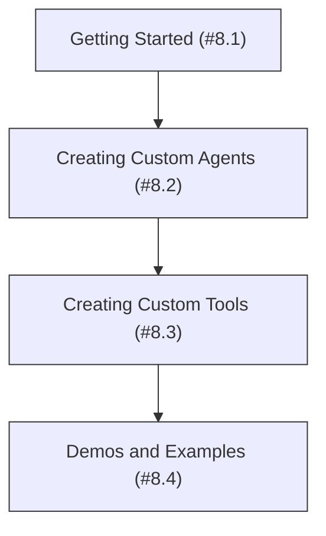
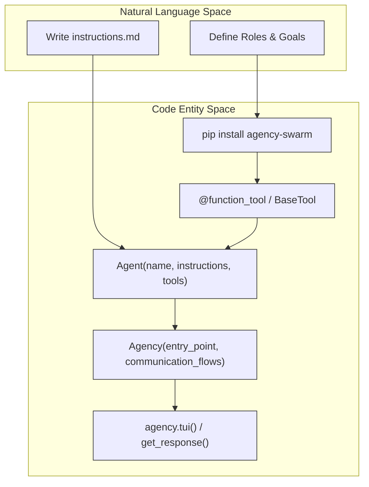
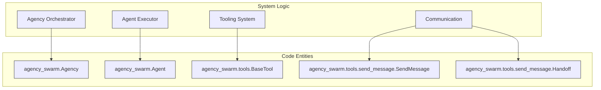

<!-- source: DeepWiki mcp.deepwiki.com · repo VRSEN/agency-swarm · page 8 Guides and Tutorials · fetched 2026-10-26 -->

# Guides and Tutorials

<details>
<summary>Relevant source files</summary>

The following files were used as context for generating this wiki page:

- [README.md](README.md)
- [docs/additional-features/azure-openai.mdx](docs/additional-features/azure-openai.mdx)
- [docs/additional-features/guardrails/input-guardrails.mdx](docs/additional-features/guardrails/input-guardrails.mdx)
- [docs/additional-features/guardrails/output-guardrails.mdx](docs/additional-features/guardrails/output-guardrails.mdx)
- [docs/additional-features/observability.mdx](docs/additional-features/observability.mdx)
- [docs/core-framework/agents/built-in-tools.mdx](docs/core-framework/agents/built-in-tools.mdx)
- [docs/core-framework/tools/custom-tools/step-by-step-guide.mdx](docs/core-framework/tools/custom-tools/step-by-step-guide.mdx)
- [docs/platform/marketplace/onboarding.mdx](docs/platform/marketplace/onboarding.mdx)
- [docs/welcome/getting-started/from-scratch.mdx](docs/welcome/getting-started/from-scratch.mdx)
- [examples/README.md](examples/README.md)
- [examples/agency_context.py](examples/agency_context.py)
- [examples/custom_persistence.py](examples/custom_persistence.py)
- [examples/fastapi_integration/client.py](examples/fastapi_integration/client.py)
- [examples/guardrails_input.py](examples/guardrails_input.py)
- [examples/handoffs.py](examples/handoffs.py)
- [examples/interactive/hybrid_communication_flows.py](examples/interactive/hybrid_communication_flows.py)
- [examples/interactive/third_party_models.py](examples/interactive/third_party_models.py)
- [examples/interactive/tui.py](examples/interactive/tui.py)
- [examples/multi_agent_workflow.py](examples/multi_agent_workflow.py)
- [examples/observability.py](examples/observability.py)
- [examples/streaming.py](examples/streaming.py)

</details>


This page provides an overview of practical guides and tutorials for implementing `agency-swarm` in your projects. The tutorials are designed to take you from basic setup to advanced implementation patterns, demonstrating how to create and orchestrate collaborative swarms of AI agents using the modern OpenAI Agents SDK foundation.

For conceptual information about the framework architecture, see [Architecture](#1.1). For details about specific components like `Agency`, `Agent`, or `BaseTool`, see [Core Framework](#2).

## Tutorial Structure and Learning Path

The tutorials are organized in a progressive manner, building upon each other to guide you through the `agency-swarm` framework:



## Tutorial Implementation Workflow

The following diagram illustrates the typical workflow when implementing an agency, bridging Natural Language requirements to Code Entities:


Sources: [README.md:58-158](), [docs/welcome/getting-started/from-scratch.mdx:11-210]()

## Key Tutorials Overview

### Getting Started
The Getting Started tutorial covers the initial setup of `agency-swarm` and the creation of your first agency. It includes:
* Installation via `pip install -U agency-swarm` [README.md:32-34]()
* Environment setup with `OPENAI_API_KEY` [README.md:52-56]()
* Creating a basic agency with an entry point agent.
* Running your first interaction using `agency.tui()` or `agency.get_response()` [README.md:150-158]()

For detailed instructions, see [Getting Started](#8.1).

### Creating Custom Agents
This tutorial explains how to create custom agents with specific capabilities using the directory-based structure:
* **Agent Folder Structure**: Using `files/`, `schemas/`, and `tools/` directories [docs/welcome/getting-started/from-scratch.mdx:29-42]()
* **Agent Class**: Instantiating the `Agent` class with `ModelSettings` and `instructions` [README.md:121-133]()
* **Genesis Agency**: Using the CLI `create-agent-template` to scaffold new agents [docs/welcome/getting-started/from-scratch.mdx:23-27]()

For detailed instructions, see [Creating Custom Agents](#8.2).

### Creating Custom Tools
This tutorial provides guidance on developing custom tools for agents to interact with external systems:
* **`@function_tool`**: The recommended modern decorator for tool creation [README.md:61-67]()
* **`BaseTool`**: Pydantic-based class for advanced validation and `async run()` methods [docs/core-framework/tools/custom-tools/step-by-step-guide.mdx:91-122]()
* **`ToolFactory`**: Creating tools from OpenAPI schemas or LangChain tools [README.md:100-113]()

For detailed instructions, see [Creating Custom Tools](#8.3).

### Demos and Examples
This section provides practical examples for common use cases found in the `examples/` directory:
* **Multi-Agent Workflow**: Collaboration and validation patterns [examples/README.md:6-6]()
* **Streaming**: Real-time text and tool event handling [examples/streaming.py:102-146]()
* **Persistence**: Saving and loading thread state via callbacks [examples/custom_persistence.py:32-81]()
* **Third-Party Models**: Using Claude, Gemini, or Grok via LiteLLM [examples/interactive/third_party_models.py:46-121]()

For detailed instructions and examples, see [Demos and Examples](#8.4).

## System Entity Mapping

The following diagram maps high-level conceptual components to their specific code entities in the `agency-swarm` package.


Sources: [README.md:146-158](), [examples/interactive/hybrid_communication_flows.py:44-46]()

## Common Implementation Patterns

### Basic Agency Setup Pattern
```python
from agency_swarm import Agency, Agent

# Define Agents
ceo = Agent(name="CEO", instructions="Coordinate tasks.")
dev = Agent(name="Developer", instructions="Write code.")

# Define Agency with directional communication
agency = Agency(
    ceo, # Entry point
    communication_flows=[
        ceo > dev, # CEO can message Developer
    ]
)

# Run in terminal
if __name__ == "__main__":
    agency.tui()
```
Sources: [README.md:146-158](), [docs/welcome/getting-started/from-scratch.mdx:203-211]()

### Custom Tool Creation Pattern (`@function_tool`)
```python
from agency_swarm import function_tool

@function_tool
def my_custom_tool(param: str) -> str:
    """Description for the agent to understand when to use this tool."""
    return f"Processed {param}"
```
Sources: [README.md:61-67](), [docs/welcome/getting-started/from-scratch.mdx:65-86]()

## Next Steps
After familiarizing yourself with these guides, you may want to explore:
1. **Observability**: Track token usage and costs using `Langfuse` or `AgentOps` [docs/additional-features/observability.mdx:43-57]()
2. **FastAPI Integration**: Expose your agency as a web service [examples/README.md:30-32]()
3. **Specialized Agents**: Use the `BrowsingAgent` for web interaction [examples/README.md:18-18]()

---

