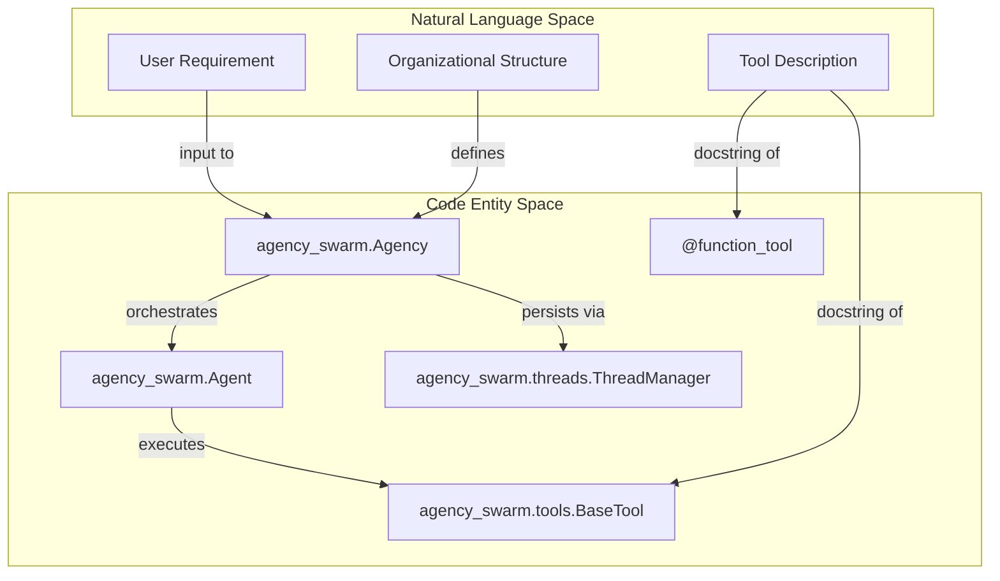
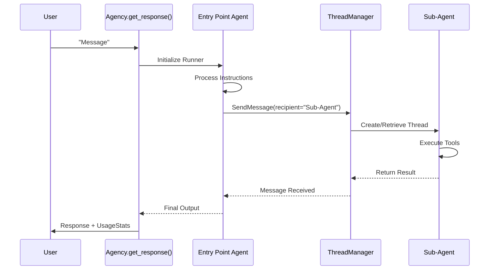

<!-- source: DeepWiki mcp.deepwiki.com · repo VRSEN/agency-swarm · page 8.1 Getting Started · fetched 2026-10-26 -->

# Getting Started

<details>
<summary>Relevant source files</summary>

The following files were used as context for generating this wiki page:

- [README.md](README.md)
- [docs/additional-features/azure-openai.mdx](docs/additional-features/azure-openai.mdx)
- [docs/additional-features/few-shot-examples.mdx](docs/additional-features/few-shot-examples.mdx)
- [docs/additional-features/observability.mdx](docs/additional-features/observability.mdx)
- [docs/additional-features/streaming.mdx](docs/additional-features/streaming.mdx)
- [docs/core-framework/agencies/overview.mdx](docs/core-framework/agencies/overview.mdx)
- [docs/core-framework/tools/custom-tools/step-by-step-guide.mdx](docs/core-framework/tools/custom-tools/step-by-step-guide.mdx)
- [docs/faq.mdx](docs/faq.mdx)
- [docs/migration/guide.mdx](docs/migration/guide.mdx)
- [docs/welcome/getting-started/from-scratch.mdx](docs/welcome/getting-started/from-scratch.mdx)
- [docs/welcome/installation.mdx](docs/welcome/installation.mdx)

</details>


This guide provides instructions for setting up and using Agency Swarm, a framework built on the OpenAI Agents SDK for creating collaborative teams of AI agents. You'll learn how to install the framework, configure your environment, create agents and tools, and run your first agency.

## Installation

Agency Swarm requires Python 3.12+ and can be installed via pip:

```bash
pip install -U agency-swarm
```

Sources: [README.md:31-34](), [README.md:39-40]()

## Environment Setup

The framework requires an OpenAI API key. You can set it in a `.env` file (which is auto-loaded) or export it in your shell:

```bash
export OPENAI_API_KEY="YOUR_API_KEY"
```

For advanced configurations, such as using Azure OpenAI, you can pass a custom `AsyncAzureOpenAI` client into the `OpenAIChatCompletionsModel` when defining an agent.

Sources: [README.md:52-56](), [docs/additional-features/azure-openai.mdx:29-60]()

## Core Framework Architecture

Agency Swarm extends the OpenAI Agents SDK, providing a structured orchestration layer.

### System Mapping: Natural Language to Code Entities

The following diagram bridges the conceptual "Agency" with the specific classes and methods implemented in the codebase.



Sources: [README.md:7-10](), [agency_swarm/util/oai.py:1-48](), [docs/core-framework/agencies/overview.mdx:7-32]()

## Creating Tools

Tools enable agents to interact with external systems. In v1.x, there are two primary ways to define tools.

### 1. Function Tool Decorator (Recommended)
Use the `@function_tool` decorator for a concise, functional approach.

```python
from agency_swarm import function_tool

@function_tool
def my_custom_tool(example_field: str) -> str:
    """A brief description of what the tool does for the agent."""
    return f"Result: {example_field}"
```

### 2. BaseTool Class
Inherit from `BaseTool` for complex tools requiring Pydantic validation or internal state.

```python
from agency_swarm.tools import BaseTool
from pydantic import Field

class MyCustomTool(BaseTool):
    """Description for the Agent's reasoning."""
    example_field: str = Field(..., description="Field purpose.")

    async def run(self):
        # Implementation logic
        return "Operation Result"
```

Sources: [README.md:58-95](), [docs/core-framework/tools/custom-tools/step-by-step-guide.mdx:9-19]()

## Defining Agents

Agents represent specialized roles (e.g., CEO, Developer). They are configured with instructions, specific models, and a list of tools.

```python
from agency_swarm import Agent, ModelSettings

developer = Agent(
    name="Developer",
    description="Responsible for executing technical tasks.",
    instructions="./instructions.md", # Path to markdown instructions
    tools=[my_custom_tool],
    model="gpt-4o",
    model_settings=ModelSettings(temperature=0.3)
)
```

Sources: [README.md:116-133](), [docs/welcome/getting-started/from-scratch.mdx:133-153]()

## Building and Running an Agency

The `Agency` class connects agents through `communication_flows`, which define which agents can talk to each other.

### Implementation Data Flow



### Example Setup
```python
from agency_swarm import Agency

agency = Agency(
    ceo, # Primary entry point
    communication_flows=[
        (ceo, developer), # CEO can message Developer
        (developer, va)   # Developer can message Virtual Assistant
    ],
    shared_instructions="./manifesto.md"
)

# Run in Terminal
agency.tui()

# Or get a programmatic response
# response = await agency.get_response("Start the project")
```

Sources: [README.md:145-165](), [docs/core-framework/agencies/overview.mdx:73-85](), [docs/welcome/getting-started/from-scratch.mdx:203-210]()

## Observability and Streaming

### Usage Tracking
Responses from `get_response` include a `usage` payload containing `input_tokens`, `output_tokens`, and `total_cost`.
Sources: [docs/additional-features/observability.mdx:9-35]()

### Streaming
Use `get_response_stream` to receive real-time updates. This is critical for long-running tool executions or multi-agent chains.

```python
async for event in agency.get_response_stream("Build a website"):
    if hasattr(event, "data") and event.data.type == "response.output_text.delta":
        print(event.data.delta, end="", flush=True)
```

Sources: [docs/additional-features/streaming.mdx:13-30]()

## Next Steps

- **Project Templates**: Use `agency-swarm create-agent-template "Name"` to scaffold new agents. [docs/welcome/getting-started/from-scratch.mdx:25-40]()
- **Persistence**: Implement `load_threads_callback` and `save_threads_callback` to save conversation history to a database. [docs/faq.mdx:32-58]()
- **Demos**: Run `python examples/copilot_demo.py` to see a pre-configured multi-agent system in action. [README.md:137-140]()

---

