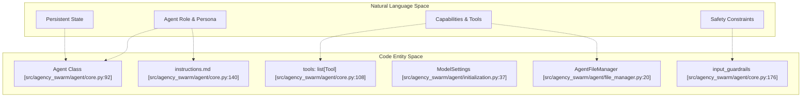
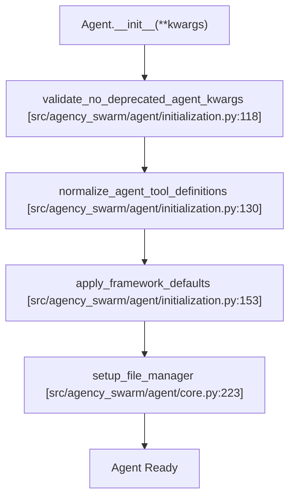

<!-- source: DeepWiki mcp.deepwiki.com · repo VRSEN/agency-swarm · page 8.2 Creating Custom Agents · fetched 2026-10-26 -->

# Creating Custom Agents

<details>
<summary>Relevant source files</summary>

The following files were used as context for generating this wiki page:

- [docs/additional-features/fastapi-integration.mdx](docs/additional-features/fastapi-integration.mdx)
- [docs/additional-features/guardrails/input-guardrails.mdx](docs/additional-features/guardrails/input-guardrails.mdx)
- [docs/additional-features/guardrails/output-guardrails.mdx](docs/additional-features/guardrails/output-guardrails.mdx)
- [docs/core-framework/agents/advanced-configuration.mdx](docs/core-framework/agents/advanced-configuration.mdx)
- [docs/core-framework/agents/built-in-tools.mdx](docs/core-framework/agents/built-in-tools.mdx)
- [docs/core-framework/agents/overview.mdx](docs/core-framework/agents/overview.mdx)
- [docs/core-framework/tools/mcp-integration.mdx](docs/core-framework/tools/mcp-integration.mdx)
- [docs/core-framework/tools/mcp-oauth.mdx](docs/core-framework/tools/mcp-oauth.mdx)
- [docs/platform/marketplace/onboarding.mdx](docs/platform/marketplace/onboarding.mdx)
- [docs/references/api.mdx](docs/references/api.mdx)
- [examples/README.md](examples/README.md)
- [examples/guardrails_input.py](examples/guardrails_input.py)
- [examples/interactive/third_party_models.py](examples/interactive/third_party_models.py)
- [examples/interactive/tui.py](examples/interactive/tui.py)
- [examples/observability.py](examples/observability.py)
- [src/agency_swarm/agent/constants.py](src/agency_swarm/agent/constants.py)
- [src/agency_swarm/agent/core.py](src/agency_swarm/agent/core.py)
- [src/agency_swarm/agent/initialization.py](src/agency_swarm/agent/initialization.py)
- [src/agency_swarm/cli/main.py](src/agency_swarm/cli/main.py)
- [src/agency_swarm/utils/create_agent_template.py](src/agency_swarm/utils/create_agent_template.py)
- [src/agency_swarm/utils/model_utils.py](src/agency_swarm/utils/model_utils.py)
- [tests/integration/cli/test_create_agent_template_integration.py](tests/integration/cli/test_create_agent_template_integration.py)
- [tests/test_agent_modules/test_agent_capabilities.py](tests/test_agent_modules/test_agent_capabilities.py)
- [tests/test_agent_modules/test_agent_initialization.py](tests/test_agent_modules/test_agent_initialization.py)
- [tests/test_utils_modules/test_create_agent_template.py](tests/test_utils_modules/test_create_agent_template.py)

</details>


This page explains how to create custom agents in the Agency Swarm framework. Custom agents allow you to extend the framework with specialized capabilities tailored to your specific requirements.

## Understanding Agents in Agency Swarm

In Agency Swarm, an `Agent` is an autonomous entity specialized for a specific role. It extends the base `agents.Agent` SDK class with capabilities for multi-agent collaboration, directory-based configuration, and framework-level defaults [src/agency_swarm/agent/core.py:92-105]().

### Agent Architecture and Code Mapping

The following diagram bridges the natural language concepts of an agent to the specific code entities used to implement them.

**Diagram: Agent Entity Mapping**

Sources: [src/agency_swarm/agent/core.py:92-121](), [src/agency_swarm/agent/initialization.py:37-38]()

## Methods for Creating Custom Agents

### 1. The Directory-Based Structure (Recommended)
Agency Swarm promotes a directory-based structure where an agent's configuration is co-located. The framework automatically discovers and loads resources from these folders.

| Component | File/Folder | Description |
|-----------|-------------|-------------|
| **Instructions** | `instructions.md` | The system prompt. Can be a string or a file path [src/agency_swarm/agent/core.py:140](). |
| **Tools** | `tools/` | Directory for automatic discovery of `BaseTool` subclasses [src/agency_swarm/agent/core.py:108](). |
| **Files** | `files/` | Local files for `FileSearch` or `CodeInterpreter`. If named `*_vs_<id>`, it maps to a specific Vector Store [src/agency_swarm/agent/core.py:142-144](). |
| **Schemas** | `schemas/` | OpenAPI JSON schemas automatically converted into tools [src/agency_swarm/agent/core.py:145-146](). |

Sources: [src/agency_swarm/agent/core.py:138-160](), [docs/core-framework/agents/overview.mdx:62-64]()

### 2. Programmatic Instantiation
You can instantiate the `Agent` class directly in Python. Agency Swarm applies framework defaults, such as `gpt-5.6-luna` as the default model [src/agency_swarm/agent/constants.py:7]() and `truncation="auto"` [src/agency_swarm/agent/initialization.py:37]().

```python
from agency_swarm import Agent, ModelSettings

agent = Agent(
    name="DataAnalyst",
    instructions="Analyze the provided CSV files.",
    tools_folder="./tools",
    model="gpt-4o",
    model_settings=ModelSettings(temperature=0.2, max_tokens=2000),
    raise_input_guardrail_error=True # Raise exception on guardrail trip
)
```
Sources: [src/agency_swarm/agent/core.py:134-185](), [tests/test_agent_modules/test_agent_initialization.py:62-77]()

### 3. CLI Template Generation
The CLI provides a utility to scaffold a new agent directory.

```bash
agency-swarm create-agent-template --name "Researcher" --description "Web research specialist" --model "gpt-5.4"
```
This invokes `create_agent_template` [src/agency_swarm/utils/create_agent_template.py:9](), which creates the folder, `__init__.py`, `instructions.md`, and subdirectories for `tools` and `files` [src/agency_swarm/utils/create_agent_template.py:63-165]().

Sources: [src/agency_swarm/utils/create_agent_template.py:9-169]()

## Advanced Configuration

### Model Settings and Reasoning
Agency Swarm handles reasoning models (like `o1` or `gpt-5`) specially. If a reasoning model is detected, the `temperature` parameter is automatically suppressed, as these models do not support it [src/agency_swarm/utils/create_agent_template.py:41-45]().

**Diagram: Initialization Flow**

Sources: [src/agency_swarm/agent/core.py:134-240](), [src/agency_swarm/agent/initialization.py:1-165]()

### System Reminders
`system_reminders` are transient prompts shown to the model at specific triggers (e.g., every N tool calls) without being saved to the permanent thread history [docs/core-framework/agents/advanced-configuration.mdx:60]().

```python
from agency_swarm import Agent, EveryNToolCalls

agent = Agent(
    name="SafeAgent",
    system_reminders=[
        "Always double-check math results.",
        EveryNToolCalls(5, "Summarize your progress so far.")
    ]
)
```
Sources: [src/agency_swarm/agent/core.py:121](), [docs/core-framework/agents/advanced-configuration.mdx:62-75]()

### Conversation Starters and Cache
`conversation_starters` are suggested prompts for UIs [docs/core-framework/agents/overview.mdx:83](). If `cache_conversation_starters` is `True`, the agent can instantly replay a saved reply for these specific prompts using a local cache fingerprint [src/agency_swarm/agent/core.py:112]().

Sources: [src/agency_swarm/agent/core.py:40-46](), [docs/core-framework/agents/advanced-configuration.mdx:103-134]()

### Guardrails
*   **Input Guardrails**: Run checks before the model is called. If `raise_input_guardrail_error` is `True`, a `GuardrailError` is raised; otherwise, the error message is returned as the response [src/agency_swarm/agent/core.py:117]().
*   **Output Guardrails**: Run after the response is generated. The `validation_attempts` parameter (default: 1) determines how many times the agent tries to self-correct if a guardrail fails [src/agency_swarm/agent/core.py:116]().

Sources: [src/agency_swarm/agent/core.py:116-117](), [docs/core-framework/agents/overview.mdx:77-78]()

## Capability Detection
The framework automatically detects agent capabilities based on its tools and folders [src/agency_swarm/utils/model_utils.py:109]().
*   `tools`: Presence of `FunctionTool` or `MCP` servers.
*   `file_search`: Presence of supported extensions in the `files/` folder [src/agency_swarm/utils/model_utils.py:194]().
*   `reasoning`: Use of `o-series` or `gpt-5` models [src/agency_swarm/utils/model_utils.py:149]().

Sources: [src/agency_swarm/utils/model_utils.py:109-195]()

---

