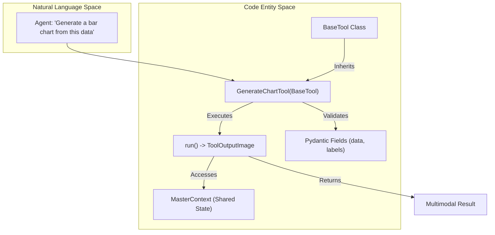

<!-- source: DeepWiki mcp.deepwiki.com · repo VRSEN/agency-swarm · page 8.3 Creating Custom Tools · fetched 2026-10-26 -->

# Creating Custom Tools

<details>
<summary>Relevant source files</summary>

The following files were used as context for generating this wiki page:

- [docs/core-framework/tools/built-in-tools.mdx](docs/core-framework/tools/built-in-tools.mdx)
- [docs/core-framework/tools/custom-tools/multimodal-outputs.mdx](docs/core-framework/tools/custom-tools/multimodal-outputs.mdx)
- [docs/core-framework/tools/overview.mdx](docs/core-framework/tools/overview.mdx)
- [examples/data/daily_revenue.png](examples/data/daily_revenue.png)
- [examples/data/daily_revenue_report.pdf](examples/data/daily_revenue_report.pdf)
- [examples/multimodal_outputs.py](examples/multimodal_outputs.py)
- [src/agency_swarm/tools/base_tool.py](src/agency_swarm/tools/base_tool.py)
- [src/agency_swarm/tools/tool_factory_utils/base_tool_adapter.py](src/agency_swarm/tools/tool_factory_utils/base_tool_adapter.py)
- [src/agency_swarm/tools/utils.py](src/agency_swarm/tools/utils.py)
- [src/agency_swarm/utils/dry_run.py](src/agency_swarm/utils/dry_run.py)
- [tests/integration/communication/test_send_message_extra_params.py](tests/integration/communication/test_send_message_extra_params.py)
- [tests/integration/fastapi/test_fastapi_dry_run.py](tests/integration/fastapi/test_fastapi_dry_run.py)
- [tests/test_agent_modules/send_message/test_deprecated_reminder_override.py](tests/test_agent_modules/send_message/test_deprecated_reminder_override.py)
- [tests/test_agent_modules/send_message/test_extra_params.py](tests/test_agent_modules/send_message/test_extra_params.py)
- [tests/test_agent_modules/test_base_tool.py](tests/test_agent_modules/test_base_tool.py)
- [tests/test_tools_modules/test_tool_system.py](tests/test_tools_modules/test_tool_system.py)
- [tests/test_tools_modules/test_utils.py](tests/test_tools_modules/test_utils.py)

</details>


This guide explains how to develop custom tools for agents within the `agency-swarm` framework. Custom tools are the primary way for agents to perform specific actions, interact with external systems, and return rich media like images and PDFs.

## Overview

In `agency-swarm`, tools are the bridge between an agent's reasoning and the execution of code. The framework supports two primary ways to define tools:
1.  **Class-based**: Extending the `BaseTool` class (recommended for complex logic).
2.  **Function-based**: Using the `@function_tool` decorator (ideal for simple utilities).

Both approaches are adapted into `FunctionTool` instances for the underlying SDK [src/agency_swarm/tools/tool_factory_utils/base_tool_adapter.py:21-24]().



Sources: [src/agency_swarm/tools/base_tool.py:1-7](), [src/agency_swarm/tools/tool_factory_utils/base_tool_adapter.py:9-12]()

---

## The BaseTool Class

The `BaseTool` class leverages Pydantic for schema generation and input validation.

### Implementation Structure
A custom tool must implement the `run()` method and define its inputs as class attributes with `Field` annotations.

```python
from agency_swarm import BaseTool
from pydantic import Field

class MyCustomTool(BaseTool):
    """
    Detailed docstring describing the tool's purpose. 
    This is used by the LLM to decide when to call the tool.
    """
    input_param: str = Field(..., description="Description for the agent.")

    class ToolConfig:
        strict = True  # Enforces OpenAI Strict Mode
        one_call_at_a_time = False # Policy for concurrency

    def run(self):
        # Logic goes here
        return f"Processed {self.input_param}"
```

### Key Components
| Component | Description |
| :--- | :--- |
| **Docstring** | Parsed to generate the tool's description in the OpenAI schema [src/agency_swarm/tools/base_tool.py:120-135](). |
| **Pydantic Fields** | Automatically converted into a JSON Schema for the agent [src/agency_swarm/tools/base_tool.py:108-118](). |
| **ToolConfig** | Configures behavior like `strict` mode (enforces `additionalProperties: false`) and `one_call_at_a_time` execution [src/agency_swarm/tools/base_tool.py:101-105](). |
| **run()** | The execution logic. Can be synchronous or asynchronous [src/agency_swarm/tools/tool_factory_utils/base_tool_adapter.py:47-49](). |

Sources: [src/agency_swarm/tools/base_tool.py:72-106](), [src/agency_swarm/tools/tool_factory_utils/base_tool_adapter.py:33-36]()

---

## Accessing Context and State

Tools often need access to the agent's environment or shared state. This is provided via `MasterContext` wrapped in a `RunContextWrapper`.

```python
class ContextAwareTool(BaseTool):
    def run(self):
        # Access the thread manager or user context
        user_id = self.context.user_context.get("user_id")
        
        # Access the unique tool call ID
        call_id = self.tool_call_id
        
        return f"Acting for user {user_id} in call {call_id}"
```

- **`self.context`**: Provides access to `MasterContext`, including `thread_manager`, `agents`, and `user_context` [src/agency_swarm/tools/base_tool.py:154-158]().
- **`self.tool_call_id`**: Retrieves the specific ID assigned by the model for the current invocation [src/agency_swarm/tools/base_tool.py:161-167]().

Sources: [src/agency_swarm/tools/base_tool.py:77-78](), [tests/test_tools_modules/test_tool_system.py:87-91]()

---

## Multimodal Outputs

Tools can return more than just strings. Using specialized classes, agents can "see" images or "read" files generated by tools.

### Supported Output Classes
1.  **`ToolOutputImage`**: For PNG/JPG images. Can use `image_url` (remote or data URL) or `file_id` [src/agency_swarm/tools/utils.py:177-211]().
2.  **`ToolOutputFileContent`**: For PDF documents. Supports embedding file data as base64 or providing a URL [src/agency_swarm/tools/utils.py:214-220]().
3.  **`ToolOutputText`**: For standard text responses within a multimodal list [docs/core-framework/tools/custom-tools/multimodal-outputs.mdx:127-142]().

### Convenience Utilities
The framework provides helper functions in `agency_swarm.tools.utils` to simplify media handling:
- `tool_output_image_from_path(path)`: Converts a local image to a base64 data URL [src/agency_swarm/tools/utils.py:177-195]().
- `tool_output_file_from_path(path)`: Embeds a local PDF as base64 [src/agency_swarm/tools/utils.py:214-230]().
- `tool_output_file_from_url(url)`: Fetches a remote PDF and decides whether to link it or embed it based on size [src/agency_swarm/tools/utils.py:233-240]().

### Example: Chart Generation
```python
class GenerateChart(BaseTool):
    def run(self) -> ToolOutputImage:
        # ... logic to generate chart ...
        return tool_output_image_from_path("chart.png")
```

Sources: [docs/core-framework/tools/custom-tools/multimodal-outputs.mdx:34-108](), [src/agency_swarm/tools/utils.py:169-175]()

---

## Function Tool Decorator

For simpler tools, the `@function_tool` decorator can be used on standard Python functions.

```python
from agency_swarm import function_tool

@function_tool
def greet(name: str) -> str:
    """Greet a person by name."""
    return f"Hello, {name}"
```

When using `@function_tool`, the framework automatically extracts the schema from the function signature and docstring [tests/integration/fastapi/test_fastapi_dry_run.py:16-19]().

Sources: [tests/integration/fastapi/test_fastapi_dry_run.py:44-47](), [docs/core-framework/tools/custom-tools/multimodal-outputs.mdx:190-196]()

---

## Advanced Configuration

### Strict Mode and Schema Validation
When `ToolConfig.strict = True` is set:
1.  The JSON schema is transformed to satisfy OpenAI's Strict Mode requirements (e.g., `additionalProperties: false`) [src/agency_swarm/tools/base_tool.py:143-150]().
2.  Input validation errors from Pydantic are formatted into readable messages for the agent to help it self-correct [src/agency_swarm/tools/tool_factory_utils/base_tool_adapter.py:50-59]().

### Custom Tool Names
By default, the tool name is the class name. You can override this using the `tool_name` attribute:
```python
class MyTool(BaseTool):
    tool_name = "custom_name_for_agent"
```
Sources: [tests/test_agent_modules/send_message/test_extra_params.py:155-160](), [src/agency_swarm/tools/tool_factory_utils/base_tool_adapter.py:32-36]()

---

## Best Practices

1.  **Informative Docstrings**: The agent's ability to use the tool depends entirely on the description. Be explicit about when the tool should be used [src/agency_swarm/tools/base_tool.py:113-114]().
2.  **Field Descriptions**: Use the `description` parameter in `Field()` to explain each argument's format and purpose [src/agency_swarm/tools/base_tool.py:122-126]().
3.  **Atomic Operations**: Tools should perform one specific task. Complicated workflows should be managed by the agent calling multiple tools [docs/core-framework/tools/overview.mdx:14-19]().
4.  **Error Handling**: Return errors as strings so the agent can understand what went wrong and potentially retry with different parameters [src/agency_swarm/tools/tool_factory_utils/base_tool_adapter.py:60-61]().

Sources: [docs/core-framework/tools/overview.mdx:21-34](), [src/agency_swarm/tools/tool_factory_utils/base_tool_adapter.py:75-84]()

---

