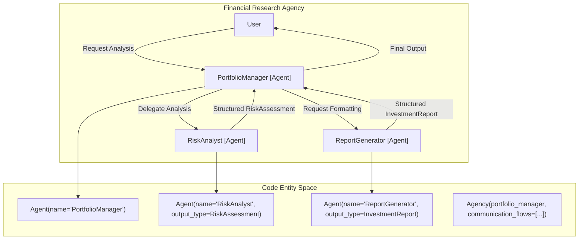
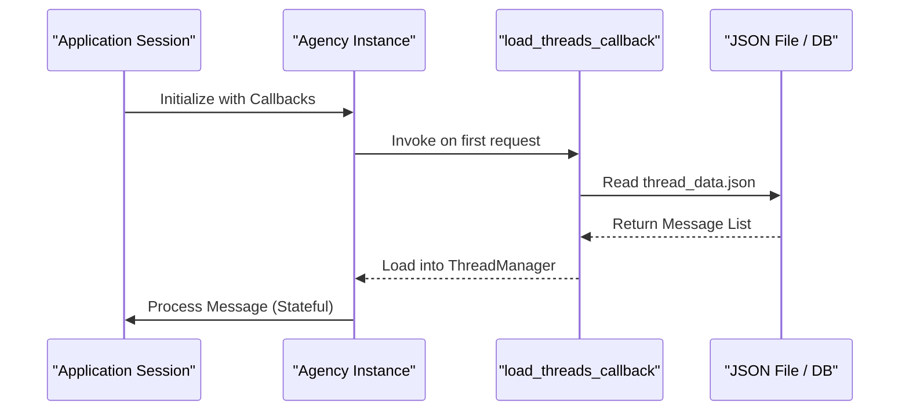

<!-- source: DeepWiki mcp.deepwiki.com · repo VRSEN/agency-swarm · page 8.4 Demos and Examples · fetched 2026-10-26 -->

# Demos and Examples

Relevant source files

The following files were used as context for generating this wiki page:

- [docs/additional-features/guardrails/input-guardrails.mdx](docs/additional-features/guardrails/input-guardrails.mdx)
- [docs/additional-features/guardrails/output-guardrails.mdx](docs/additional-features/guardrails/output-guardrails.mdx)
- [docs/core-framework/agents/built-in-tools.mdx](docs/core-framework/agents/built-in-tools.mdx)
- [docs/platform/marketplace/onboarding.mdx](docs/platform/marketplace/onboarding.mdx)
- [examples/README.md](examples/README.md)
- [examples/agency_context.py](examples/agency_context.py)
- [examples/agent_file_storage.py](examples/agent_file_storage.py)
- [examples/connectors.py](examples/connectors.py)
- [examples/custom_persistence.py](examples/custom_persistence.py)
- [examples/fastapi_integration/client.py](examples/fastapi_integration/client.py)
- [examples/fastapi_integration/server.py](examples/fastapi_integration/server.py)
- [examples/guardrails_input.py](examples/guardrails_input.py)
- [examples/handoffs.py](examples/handoffs.py)
- [examples/interactive/copilot_demo.py](examples/interactive/copilot_demo.py)
- [examples/interactive/hybrid_communication_flows.py](examples/interactive/hybrid_communication_flows.py)
- [examples/interactive/third_party_models.py](examples/interactive/third_party_models.py)
- [examples/interactive/tui.py](examples/interactive/tui.py)
- [examples/message_attachments.py](examples/message_attachments.py)
- [examples/multi_agent_workflow.py](examples/multi_agent_workflow.py)
- [examples/observability.py](examples/observability.py)
- [examples/streaming.py](examples/streaming.py)
- [examples/tools.py](examples/tools.py)
- [examples/utils.py](examples/utils.py)
- [tests/integration/files/test_file_attachment_citation_extraction.py](tests/integration/files/test_file_attachment_citation_extraction.py)
- [tests/integration/files/test_vector_store_citation_extraction.py](tests/integration/files/test_vector_store_citation_extraction.py)
- [tests/integration/fin_agency/agency_fin.py](tests/integration/fin_agency/agency_fin.py)
- [tests/integration/fin_agency/financial_research_agency/PortfolioManager/PortfolioManager.py](tests/integration/fin_agency/financial_research_agency/PortfolioManager/PortfolioManager.py)
- [tests/integration/fin_agency/financial_research_agency/PortfolioManager/__init__.py](tests/integration/fin_agency/financial_research_agency/PortfolioManager/__init__.py)
- [tests/integration/fin_agency/financial_research_agency/PortfolioManager/instructions.md](tests/integration/fin_agency/financial_research_agency/PortfolioManager/instructions.md)
- [tests/integration/fin_agency/financial_research_agency/PortfolioManager/tools/FetchMarketDataTool.py](tests/integration/fin_agency/financial_research_agency/PortfolioManager/tools/FetchMarketDataTool.py)
- [tests/integration/fin_agency/financial_research_agency/ReportGenerator/ReportGenerator.py](tests/integration/fin_agency/financial_research_agency/ReportGenerator/ReportGenerator.py)
- [tests/integration/fin_agency/financial_research_agency/ReportGenerator/__init__.py](tests/integration/fin_agency/financial_research_agency/ReportGenerator/__init__.py)
- [tests/integration/fin_agency/financial_research_agency/ReportGenerator/instructions.md](tests/integration/fin_agency/financial_research_agency/ReportGenerator/instructions.md)
- [tests/integration/fin_agency/financial_research_agency/ReportGenerator/tools/FormatProfessionalReportTool.py](tests/integration/fin_agency/financial_research_agency/ReportGenerator/tools/FormatProfessionalReportTool.py)
- [tests/integration/fin_agency/financial_research_agency/RiskAnalyst/RiskAnalyst.py](tests/integration/fin_agency/financial_research_agency/RiskAnalyst/RiskAnalyst.py)
- [tests/integration/fin_agency/financial_research_agency/RiskAnalyst/__init__.py](tests/integration/fin_agency/financial_research_agency/RiskAnalyst/__init__.py)
- [tests/integration/fin_agency/main.py](tests/integration/fin_agency/main.py)
- [tests/test_agent_modules/test_examples_handling.py](tests/test_agent_modules/test_examples_handling.py)

This page provides practical demonstrations and examples of the `agency-swarm` framework in action. The examples cover core functionality, multi-agent workflows, persistence strategies, streaming, and integration with third-party models and observability platforms.

## Examples Directory Structure

The `examples/` directory contains runnable scripts demonstrating the framework's capabilities:

| Category | Key Files |
| :--- | :--- |
| **Core** | `multi_agent_workflow.py`, `agency_context.py`, `streaming.py`, `tools.py` |
| **Persistence** | `custom_persistence.py` |
| **Guardrails** | `guardrails_input.py`, `guardrails_output.py` |
| **Integrations** | `fastapi_integration/`, `observability.py`, `mcp_servers.py` |
| **Models** | `interactive/third_party_models.py` (LiteLLM/OpenRouter) |
| **UIs** | `interactive/tui.py`, `interactive/copilot_demo.py`, `agency_visualization.py` |

Sources: [examples/README.md:1-44]()

## Multi-Agent Workflow: Financial Research

This demo showcases a collaborative workflow involving three specialized agents: a `PortfolioManager`, a `RiskAnalyst`, and a `ReportGenerator`. It highlights the use of `output_type` for structured data exchange.

### Implementation Details
- **Structured Outputs**: The `RiskAnalyst` uses a Pydantic model `RiskAssessment` as its `output_type` [examples/multi_agent_workflow.py:37-42](), ensuring the `PortfolioManager` receives validated data [examples/multi_agent_workflow.py:98-108]().
- **Communication Flow**: Defined using the `>` operator: `portfolio_manager > risk_analyst` [examples/multi_agent_workflow.py:124-131]().

Sources: [examples/multi_agent_workflow.py:1-165]()

## Thread Persistence and Isolation

This example demonstrates how to maintain conversation state across application restarts using callbacks.

### Key Functions
- `save_threads(messages)`: Serializes a flat list of all messages with `agent` and `callerAgent` metadata to a JSON file [examples/custom_persistence.py:32-51]().
- `load_threads(chat_id)`: Retrieves messages for a specific session [examples/custom_persistence.py:54-82]().
- **Callback Injection**: Callbacks are passed to the `Agency` constructor using lambdas to handle session-specific identifiers [examples/custom_persistence.py:96-101]().

Sources: [examples/custom_persistence.py:1-171]()

## Real-Time Streaming

The streaming demo illustrates how to handle the `get_response_stream` generator and filter events for frontend display.

### Data Flow
1. **Generator**: `agency.get_response_stream(message)` yields various event objects [examples/streaming.py:110-111]().
2. **Filtering**: The implementation distinguishes between `response.output_text.delta` (actual text) and `response.function_call_arguments.delta` (internal tool arguments) [examples/streaming.py:123-132]().
3. **Error Handling**: Detects and breaks on validation or runtime errors [examples/streaming.py:135-139]().

Sources: [examples/streaming.py:1-165]()

## Guardrails: Input Validation

The `guardrails_input.py` example demonstrates a "Judge Agent" pattern where a secondary agent validates user input before the primary agent receives it.

### Implementation
- **Decorator**: The `@input_guardrail` decorator marks a function for pre-processing [examples/guardrails_input.py:44-45]().
- **Delegation**: The guardrail function calls `guardrail_agent.get_response()` to determine relevance [examples/guardrails_input.py:50-51]().
- **Tripwire**: If `tripwire_triggered=True` is returned in `GuardrailFunctionOutput`, the primary agent's execution is bypassed [examples/guardrails_input.py:53-58]().

Sources: [examples/guardrails_input.py:1-87]()

## Third-Party Models (LiteLLM)

The framework supports non-OpenAI models (Claude, Gemini, Grok) via the `litellm` integration.

- **Configuration**: Set the `model` string to a LiteLLM-compatible format (e.g., `litellm/anthropic/claude-3-sonnet`) [examples/interactive/third_party_models.py:119-119]().
- **Native Tools**: Demonstrates using Gemini's native web search by passing `extra_body` parameters through `ModelSettings` [examples/interactive/third_party_models.py:92-94]().

Sources: [examples/interactive/third_party_models.py:1-133]()

## Observability and Tracing

The `observability.py` demo shows how to integrate with three major tracing platforms:

1. **OpenAI Native**: Uses the `trace` context manager [examples/observability.py:92-96]().
2. **Langfuse**: Uses the `@observe()` decorator around the response call [examples/observability.py:107-114]().
3. **AgentOps**: Uses `agentops.init()` and `start_trace()` to wrap the agency interaction [examples/observability.py:117-132]().

Sources: [examples/observability.py:1-154]()

## FastAPI Integration

The `fastapi_integration/` directory provides a production-ready server and client implementation.

- **Server**: Uses `run_fastapi()` to expose agencies via REST and SSE endpoints [examples/fastapi_integration/server.py:125-132]().
- **Client**: Demonstrates handling SSE (Server-Sent Events) and the `run_id` for stream cancellation [examples/fastapi_integration/client.py:106-179]().

Sources: [examples/fastapi_integration/server.py:1-132](), [examples/fastapi_integration/client.py:1-185]()

---

