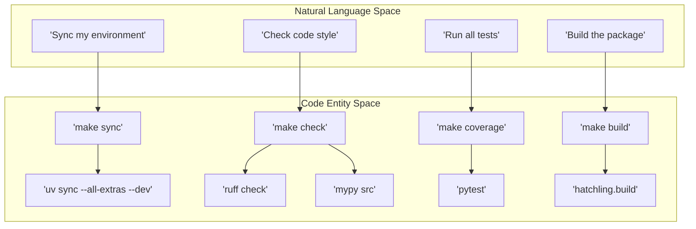
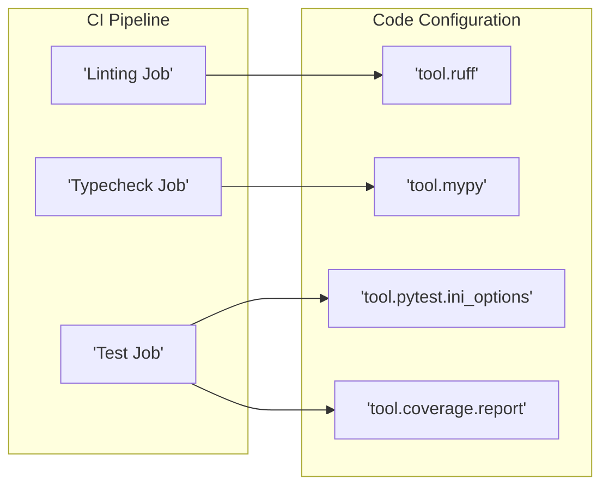

<!-- source: DeepWiki mcp.deepwiki.com · repo VRSEN/agency-swarm · page 9 Infrastructure and Development · fetched 2026-10-26 -->

# Infrastructure and Development

Relevant source files

The following files were used as context for generating this wiki page:

- [.github/ISSUE_TEMPLATE/bug_report.md](.github/ISSUE_TEMPLATE/bug_report.md)
- [.github/workflows/tests.yml](.github/workflows/tests.yml)
- [.pre-commit-config.yaml](.pre-commit-config.yaml)
- [AGENTS.md](AGENTS.md)
- [CLAUDE.md](CLAUDE.md)
- [CONTRIBUTING.md](CONTRIBUTING.md)
- [Makefile](Makefile)
- [docs/contributing/contributing.mdx](docs/contributing/contributing.mdx)
- [package.json](package.json)
- [pyproject.toml](pyproject.toml)
- [src/agency_swarm/hooks.py](src/agency_swarm/hooks.py)
- [tests/test_build_modules/test_dependency_constraints.py](tests/test_build_modules/test_dependency_constraints.py)
- [tsconfig.json](tsconfig.json)
- [uv.lock](uv.lock)

This page provides a high-level overview of the development standards, build systems, and testing infrastructure used in the `agency-swarm` framework. It serves as a guide for contributors to ensure code quality and system stability across the multi-agent ecosystem.

## Development Standards

The framework targets modern Python environments and enforces strict type safety and file discipline to maintain a maintainable codebase.

*   **Python Versions**: Development centers on Python 3.13 while maintaining compatibility with Python 3.12 [[AGENTS.md:35-35]]().
*   **Type System**: The project uses pipe-union syntax and requires explicit typing for every function [[AGENTS.md:36-36]](). The use of `Any` or duck typing is discouraged in production code [[AGENTS.md:38-38]]().
*   **File Discipline**: Files are restricted to a maximum of 500 lines [[AGENTS.md:41-41]](), with a preference for methods between 10 and 40 lines [[AGENTS.md:42-42]]().
*   **Task Runner**: A `Makefile` is provided as the primary entry point for development tasks, including environment synchronization, formatting, and testing [[Makefile:1-114]]().

### Development Workflow Mapping

The following diagram maps the natural language development stages to the specific code entities and commands used in the repository.

**Development Workflow to Code Entities**

**Sources**: [Makefile:1-114](), [pyproject.toml:1-7]().

## Build and Configuration

`agency-swarm` uses `hatchling` as its build backend and `uv` for lightning-fast dependency management [[pyproject.toml:1-3]](). The system supports several optional "extras" to keep the core installation lightweight while allowing specialized features.

*   **Core Dependencies**: Includes `openai-agents`, `pydantic`, `fastapi`, and `litellm` [[pyproject.toml:16-41]]().
*   **Optional Extras**: Features like `voice`, `viz` (graphviz), and `jupyter` are managed via `optional-dependencies` [[pyproject.toml:62-75]]().
*   **Custom Build Hooks**: A `hatch_build.py` script is used to handle dynamic build tasks, such as auto-downloading pricing data [[pyproject.toml:5-6](), [Makefile:91-92]]().

For more details on dependency pinning and package distribution, see [Build and Configuration](#9.1).

## Testing and CI/CD

The framework maintains a high bar for reliability through a rigorous CI pipeline and a "no-mock" policy for core agent interactions.

*   **Test Layout**: Unit tests are located in `tests/test_*_modules/`, while integration tests reside in `tests/integration/` [[AGENTS.md:49-49]]().
*   **Core Messaging Policy**: Validation of `Agent` communication must use real framework objects; generic mocks for `SendMessage` or `Agent` are prohibited [[AGENTS.md:53-53]]().
*   **Coverage**: The project targets a minimum test coverage of 90% [[AGENTS.md:43-43](), [Makefile:65-65]]().
*   **CI Workflows**: GitHub Actions run linting, type checking, and tests on every push to `main` and for pull requests [[.github/workflows/tests.yml:1-98]]().

### CI/CD Pipeline Structure

This diagram illustrates how the CI pipeline associates system-level checks with specific code-level configurations.

**CI Pipeline to Code Entities**

**Sources**: [.github/workflows/tests.yml:21-76](), [pyproject.toml:128-208]().

For detailed information on pytest markers and GitHub Action configurations, see [Testing and CI](#9.2).

## Contribution Guidelines

Contributors are encouraged to use the `Genesis Agency` for creating new agents and tools, ensuring they follow the standard directory structure:
*   **Agents**: `agency_swarm/agents/AgentName/` [[CONTRIBUTING.md:121-130]]().
*   **Tools**: `agency_swarm/tools/{category}/` [[CONTRIBUTING.md:70-75]]().

**Sources**:
- [AGENTS.md:33-66]() (Standards and Release Policy)
- [pyproject.toml:1-114]() (Build and Dependencies)
- [Makefile:1-114]() (Task Runner)
- [.github/workflows/tests.yml:1-98]() (CI Pipeline)
- [CONTRIBUTING.md:1-154]() (Contributor Setup)

---

