# Page: Overview

# Overview

<details>
<summary>Relevant source files</summary>

The following files were used as context for generating this wiki page:

- [README.md](README.md)
- [docs/additional-features/azure-openai.mdx](docs/additional-features/azure-openai.mdx)
- [docs/additional-features/observability.mdx](docs/additional-features/observability.mdx)
- [docs/additional-features/streaming.mdx](docs/additional-features/streaming.mdx)
- [docs/core-framework/tools/custom-tools/step-by-step-guide.mdx](docs/core-framework/tools/custom-tools/step-by-step-guide.mdx)
- [docs/docs.json](docs/docs.json)
- [docs/faq.mdx](docs/faq.mdx)
- [docs/platform/how-credits-work.mdx](docs/platform/how-credits-work.mdx)
- [docs/platform/overview.mdx](docs/platform/overview.mdx)
- [docs/platform/pricing.mdx](docs/platform/pricing.mdx)
- [docs/welcome/ai-agency-vs-other-frameworks.mdx](docs/welcome/ai-agency-vs-other-frameworks.mdx)
- [docs/welcome/getting-started/from-scratch.mdx](docs/welcome/getting-started/from-scratch.mdx)
- [docs/welcome/installation.mdx](docs/welcome/installation.mdx)
- [src/agency_swarm/__init__.py](src/agency_swarm/__init__.py)
- [src/agency_swarm/tools/__init__.py](src/agency_swarm/tools/__init__.py)
- [tests/integration/agency/test_agency_context_sharing.py](tests/integration/agency/test_agency_context_sharing.py)
- [tests/integration/persistence/test_agent_to_agent_persistence.py](tests/integration/persistence/test_agent_to_agent_persistence.py)
- [tests/test_agency_modules/test_package_exports.py](tests/test_agency_modules/test_package_exports.py)

</details>


Agency Swarm is a framework for building multi-agent applications, serving as an orchestration layer that leverages and extends the [OpenAI Agents SDK](https://github.com/openai/openai-agents-python). It simplifies the creation of AI agencies by organizing agents into real-world organizational structures with explicit communication flows, specialized roles, and production-ready persistence.

Sources: [README.md:1-9](), [src/agency_swarm/__init__.py:10-49]()

## Framework Architecture

The framework is built on a layered architecture that bridges high-level organizational concepts with the low-level primitives of the OpenAI Agents SDK.

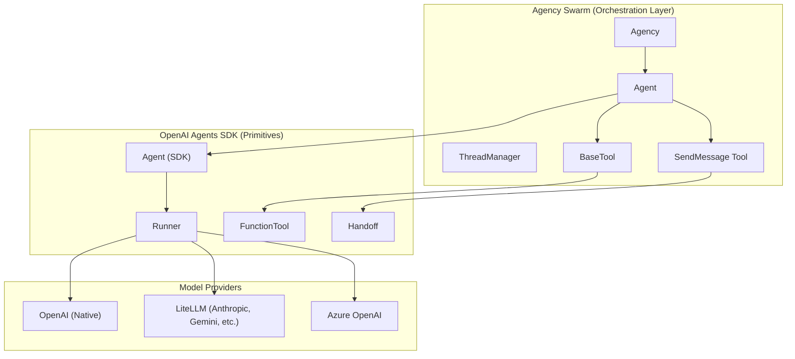

The architecture enables:
- **Organizational Structure**: Defining agencies with an entry point and allowed `communication_flows` [src/agency_swarm/agency/core.py:53-70]().
- **State Management**: Using `ThreadManager` to persist conversation history across sessions via `PersistenceHooks` [src/agency_swarm/utils/thread.py:12-25]().
- **Tooling**: Converting Pydantic-based `BaseTool` classes into SDK-compatible `FunctionTool` instances [src/agency_swarm/tools/base_tool.py:18-35]().

Sources: [src/agency_swarm/agency/core.py:18-40](), [src/agency_swarm/agent/core.py:48-110](), [src/agency_swarm/tools/base_tool.py:18-35](), [src/agency_swarm/__init__.py:10-49]()

## Communication Flow

Communication in Agency Swarm is directional and governed by the `Agency` configuration. Agents do not talk to everyone by default; they use a specialized `SendMessage` tool to initiate dialogues with permitted subordinates.

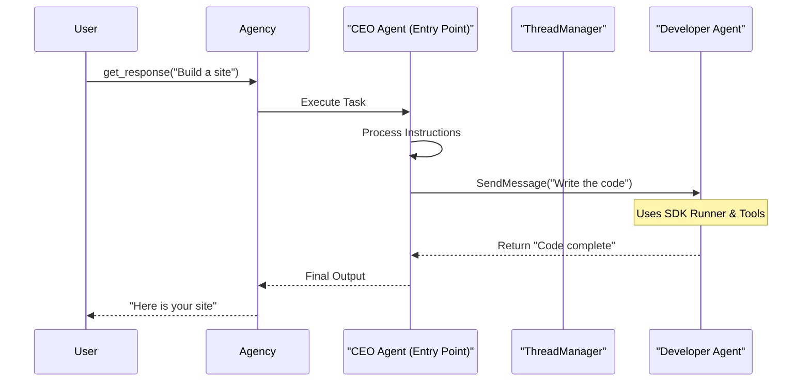

This flow ensures that agents remain focused on their specific roles while collaborating through a structured hierarchy. For details, see [Architecture](#1.1).

Sources: [src/agency_swarm/agency/core.py:192-230](), [src/agency_swarm/tools/send_message.py:15-45](), [src/agency_swarm/utils/thread.py:40-60]()

## Key Components

### Agency
The `Agency` class is the central entry point. It defines the "Agency Chart" via `communication_flows` and manages the lifecycle of runs. It supports streaming responses and integration with FastAPI for web deployments [src/agency_swarm/agency/core.py:340-360]().

### Agent
The `Agent` class extends the SDK's agent capabilities. It handles role-specific instructions, tool management from local folders (`tools_folder`), and specialized reminders like `AfterEveryUserMessage` [src/agency_swarm/agent/core.py:48-110]().

### Tool System
The framework provides a `BaseTool` for Pydantic-based tool creation and a `ToolFactory` to import tools from OpenAPI schemas, LangChain, or MCP (Model Context Protocol) servers [src/agency_swarm/tools/tool_factory.py:15-40]().

### Persistence and Threads
The `ThreadManager` coordinates with `PersistenceHooks` to ensure that even if a server restarts, the `chat_id` and thread states are preserved [src/agency_swarm/utils/thread.py:12-25]().

Sources: [src/agency_swarm/agency/core.py:18-40](), [src/agency_swarm/agent/core.py:48-110](), [src/agency_swarm/tools/base_tool.py:18-35](), [src/agency_swarm/utils/thread.py:12-25]()

## Key Features

- **Multi-Model Support**: Native support for OpenAI, and extended support for Anthropic, Gemini, and others via `LitellmModel` [src/agency_swarm/__init__.py:232-245]().
- **Observability**: Integration with Langfuse, AgentOps, and native OpenAI tracing for cost and performance tracking [docs/additional-features/observability.mdx:43-57]().
- **Realtime & Voice**: Support for WebSocket-based voice agents via `run_realtime` [src/agency_swarm/integrations/realtime.py:10-30]().
- **FastAPI Ready**: Built-in production server that handles file uploads, streaming, and OAuth for tools [src/agency_swarm/integrations/fastapi.py:15-40]().

Sources: [README.md:20-29](), [docs/additional-features/observability.mdx:7-25](), [src/agency_swarm/__init__.py:71-74]()

## Exploration Guide

For deeper technical details, refer to the following child pages:

- [Architecture](#1.1) — Detailed mapping between Agency Swarm and OpenAI Agents SDK.
- [Key Concepts](#1.2) — Deep dive into `MasterContext`, `SendMessage`, and `Guardrails`.
- [Agency Class](#2.1) — Configuration, initialization, and orchestration logic.
- [Agent Class](#2.2) — Role definition, tool folders, and model settings.
- [Thread System](#2.3) — State persistence and thread management.
- [BaseTool Class](#2.4) — Creating custom tools with Pydantic validation.
- [Tool System](#3) — Tool discovery, `ToolFactory`, and MCP integration.
- [Agent Communication](#4) — `SendMessage` protocols and communication flows.
- [FastAPI Integration](#7) — Deploying agencies as production APIs.
- [Observability](#6.1) — Tracking costs, tokens, and agent traces.

Sources: [docs/docs.json:11-158]()

---

# Page: Architecture

# Architecture

<details>
<summary>Relevant source files</summary>

The following files were used as context for generating this wiki page:

- [README.md](README.md)
- [docs/additional-features/azure-openai.mdx](docs/additional-features/azure-openai.mdx)
- [docs/additional-features/observability.mdx](docs/additional-features/observability.mdx)
- [docs/core-framework/tools/custom-tools/step-by-step-guide.mdx](docs/core-framework/tools/custom-tools/step-by-step-guide.mdx)
- [docs/welcome/getting-started/from-scratch.mdx](docs/welcome/getting-started/from-scratch.mdx)
- [src/agency_swarm/__init__.py](src/agency_swarm/__init__.py)
- [src/agency_swarm/agency/core.py](src/agency_swarm/agency/core.py)
- [src/agency_swarm/agent/conversation_starters_cache.py](src/agency_swarm/agent/conversation_starters_cache.py)
- [src/agency_swarm/agent/conversation_starters_streaming.py](src/agency_swarm/agent/conversation_starters_streaming.py)
- [src/agency_swarm/agent/execution.py](src/agency_swarm/agent/execution.py)
- [src/agency_swarm/agent/execution_helpers.py](src/agency_swarm/agent/execution_helpers.py)
- [src/agency_swarm/agent/execution_streaming.py](src/agency_swarm/agent/execution_streaming.py)
- [src/agency_swarm/context.py](src/agency_swarm/context.py)
- [src/agency_swarm/tools/__init__.py](src/agency_swarm/tools/__init__.py)
- [src/agency_swarm/tools/send_message.py](src/agency_swarm/tools/send_message.py)
- [tests/test_agency_modules/test_agency_initialization.py](tests/test_agency_modules/test_agency_initialization.py)
- [tests/test_agency_modules/test_agent_flow_integration.py](tests/test_agency_modules/test_agent_flow_integration.py)
- [tests/test_agency_modules/test_package_exports.py](tests/test_agency_modules/test_package_exports.py)
- [tests/test_agent_modules/test_conversation_starters_cache.py](tests/test_agent_modules/test_conversation_starters_cache.py)
- [tests/test_agent_modules/test_conversation_starters_streaming.py](tests/test_agent_modules/test_conversation_starters_streaming.py)

</details>


This document provides a comprehensive overview of the Agency Swarm system architecture, explaining the core components, their relationships, and how they map to the underlying OpenAI Agents SDK. Agency Swarm serves as a structured orchestration layer on top of the OpenAI Agents SDK, facilitating complex multi-agent collaborations.

## Core Framework Architecture

The system is designed as a layered architecture where high-level abstractions like `Agency` and `Agent` manage low-level SDK primitives such as `Runner`, `Model`, and `FunctionTool`.

### System Hierarchy

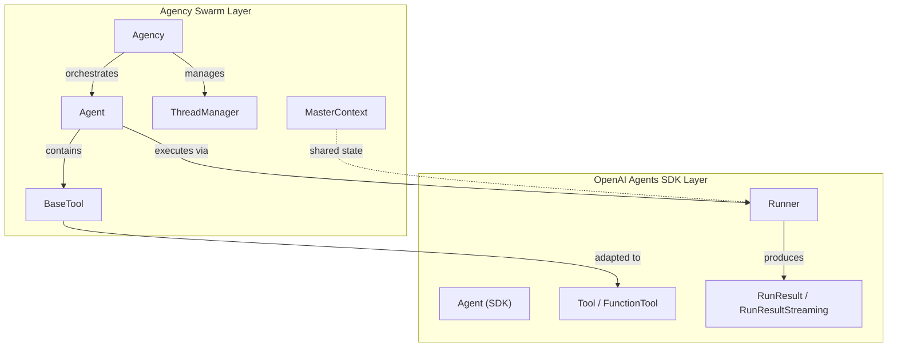

Sources:
- [src/agency_swarm/agency/core.py:70-107]()
- [src/agency_swarm/agent/core.py:100-165]()
- [src/agency_swarm/agent/execution.py:68-84]()
- [src/agency_swarm/__init__.py:10-49]()

## Component Architecture

### The Agency Class
The `Agency` class [src/agency_swarm/agency/core.py:70-87]() is the central orchestration component. It defines the "swarm" by registering agents and their allowed communication pathways.

*   **Registration**: Agents are registered during `__init__` and assigned entry point status [src/agency_swarm/agency/core.py:108-125]().
*   **Communication Flows**: It uses `communication_flows` to define which agents can talk to whom, automatically injecting the `SendMessage` tool into the appropriate agents [src/agency_swarm/agency/core.py:111-118]().
*   **Persistence**: Integrates with `ThreadManager` and `PersistenceHooks` to save and load conversation states [src/agency_swarm/agency/core.py:119-120]().

### The Agent Class
The `Agent` class [src/agency_swarm/agent/core.py:100-146]() extends the SDK's capabilities by adding framework-specific features:
*   **Initialization Pipeline**: Handles loading instructions from files, processing tool folders, and setting up MCP servers [src/agency_swarm/agent/core.py:200-250]().
*   **Execution Engine**: Uses the `Execution` class to wrap the SDK `Runner`. It manages the conversion of user messages into `TResponseInputItem` formats [src/agency_swarm/agent/execution.py:115-117]().
*   **Guardrails**: Implements `input_guardrail` and `output_guardrail` logic that can trigger retries or branch pruning in the message history [src/agency_swarm/agent/execution_helpers.py:95-110]().

### Thread & Message Management
Unlike a simple chat, Agency Swarm uses a `ThreadManager` to maintain state across complex multi-agent handoffs.

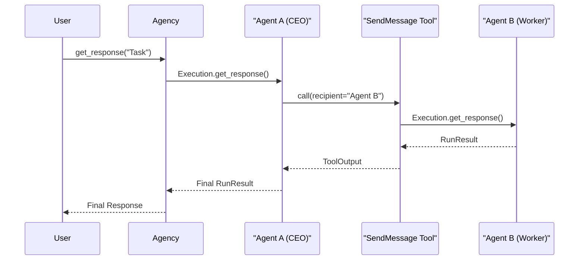

Sources:
- [src/agency_swarm/tools/send_message.py:38-49]()
- [src/agency_swarm/agent/execution.py:72-102]()
- [src/agency_swarm/utils/thread.py:10-50]()

## Execution Data Flow

When a request is made via `Agency.get_response`, the system follows a strict execution path to bridge natural language inputs to code-level tool calls.

### get_response Pipeline

| Step | Component | Action |
| :--- | :--- | :--- |
| 1 | `Agency` | Locates the entry point agent and initializes `AgencyContext`. |
| 2 | `Execution` | Calls `setup_execution` to prepare system reminders and instructions [src/agency_swarm/agent/execution.py:106-108](). |
| 3 | `MessageFormatter` | Converts message history into `TResponseInputItem` list for the SDK [src/agency_swarm/agent/execution.py:132-141](). |
| 4 | `Runner` | (SDK) Executes the model loop, handling tool calls and handoffs [src/agency_swarm/agent/execution_helpers.py:81-88](). |
| 5 | `BaseTool` | If a tool is called, the adapted `run()` method executes [src/agency_swarm/tools/base_tool.py:35-50](). |
| 6 | `Execution` | Validates output against guardrails; retries if `OutputGuardrailTripwireTriggered` [src/agency_swarm/agent/execution_helpers.py:124-135](). |

### Mapping Natural Language to Code Entities

This diagram illustrates how user-facing concepts map to specific classes and functions in the codebase.

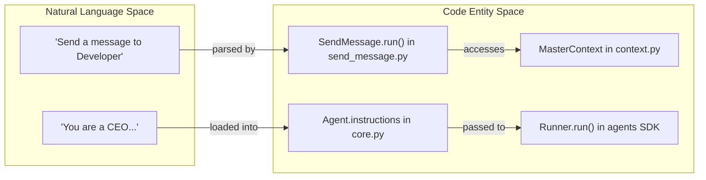

Sources:
- [src/agency_swarm/tools/send_message.py:175-200]()
- [src/agency_swarm/agent/core.py:115-125]()
- [src/agency_swarm/context.py:10-30]()

## Advanced Execution Features

### Streaming and Guardrails
The `execution_streaming.py` module handles real-time event emission. It uses a `StreamIdNormalizer` to ensure that IDs across different agent turns remain consistent for the UI [src/agency_swarm/agent/execution_streaming.py:25-26]().

If an input guardrail trips during a stream, the framework performs **history pruning** via `prune_guardrail_messages`. This removes the branch of messages that led to the violation, preserving a "clean" history for the next user attempt [src/agency_swarm/agent/execution_streaming.py:64-106]().

### Observability Integration
The framework captures usage data (tokens, costs) at the `Execution` level. It extracts model names using `get_usage_tracking_model_name` and aggregates results into the `usage` field of the response [src/agency_swarm/agent/execution.py:52](). It also supports external tracing via `OpenAIChatCompletionsModel` and SDK-level `trace` hooks [src/agency_swarm/__init__.py:48]().

Sources:
- [src/agency_swarm/agent/execution_streaming.py:145-161]()
- [src/agency_swarm/agent/execution.py:103-141]()
- [docs/additional-features/observability.mdx:9-36]()

---

# Page: Key Concepts

# Key Concepts

<details>
<summary>Relevant source files</summary>

The following files were used as context for generating this wiki page:

- [.claude/agents/agent-creator.md](.claude/agents/agent-creator.md)
- [.claude/agents/tools-creator.md](.claude/agents/tools-creator.md)
- [README.md](README.md)
- [docs/additional-features/agency-context.mdx](docs/additional-features/agency-context.mdx)
- [docs/additional-features/azure-openai.mdx](docs/additional-features/azure-openai.mdx)
- [docs/additional-features/custom-communication-flows/common-use-cases.mdx](docs/additional-features/custom-communication-flows/common-use-cases.mdx)
- [docs/additional-features/custom-communication-flows/overview.mdx](docs/additional-features/custom-communication-flows/overview.mdx)
- [docs/additional-features/fastapi-integration.mdx](docs/additional-features/fastapi-integration.mdx)
- [docs/additional-features/observability.mdx](docs/additional-features/observability.mdx)
- [docs/core-framework/agents/advanced-configuration.mdx](docs/core-framework/agents/advanced-configuration.mdx)
- [docs/core-framework/agents/overview.mdx](docs/core-framework/agents/overview.mdx)
- [docs/core-framework/tools/custom-tools/best-practices.mdx](docs/core-framework/tools/custom-tools/best-practices.mdx)
- [docs/core-framework/tools/custom-tools/configuration.mdx](docs/core-framework/tools/custom-tools/configuration.mdx)
- [docs/core-framework/tools/custom-tools/step-by-step-guide.mdx](docs/core-framework/tools/custom-tools/step-by-step-guide.mdx)
- [docs/core-framework/tools/mcp-integration.mdx](docs/core-framework/tools/mcp-integration.mdx)
- [docs/core-framework/tools/mcp-oauth.mdx](docs/core-framework/tools/mcp-oauth.mdx)
- [docs/references/api.mdx](docs/references/api.mdx)
- [docs/welcome/getting-started/from-scratch.mdx](docs/welcome/getting-started/from-scratch.mdx)
- [examples/custom_send_message.py](examples/custom_send_message.py)
- [src/agency_swarm/agent/execution.py](src/agency_swarm/agent/execution.py)
- [src/agency_swarm/agent/execution_helpers.py](src/agency_swarm/agent/execution_helpers.py)
- [src/agency_swarm/agent/execution_streaming.py](src/agency_swarm/agent/execution_streaming.py)
- [src/agency_swarm/context.py](src/agency_swarm/context.py)
- [src/agency_swarm/tools/send_message.py](src/agency_swarm/tools/send_message.py)
- [tests/integration/agency/test_agent_handoffs.py](tests/integration/agency/test_agent_handoffs.py)

</details>


This page defines the fundamental concepts and terminology used in the `agency-swarm` framework. Built on top of the OpenAI Agents SDK, the framework introduces a structured orchestration layer for multi-agent collaboration.

## Core Entities

The framework is organized around three primary code entities: the `Agency`, the `Agent`, and the `ThreadManager`.

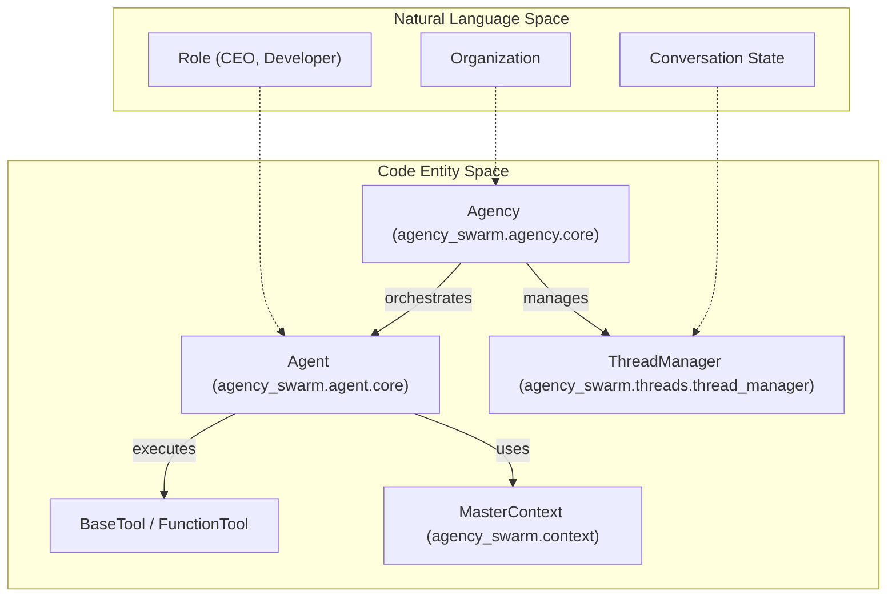
Sources: [src/agency_swarm/agency/core.py:14-31](), [src/agency_swarm/agent/core.py:51-133](), [src/agency_swarm/context.py:1-20]()

### Agency
The `Agency` class is the root orchestrator. It defines the "organizational chart" through `communication_flows` and provides the primary entry points for users via `get_response` and `get_response_stream`.
- **Entry Points**: Specific agents designated to receive initial user input [docs/references/api.mdx:36-37]().
- **Communication Flows**: Explicit directional paths (e.g., `CEO > Developer`) that determine which agents can talk to whom [src/agency_swarm/tools/send_message.py:25-30]().

### Agent
An `Agent` represents a specialized AI persona. Unlike raw LLM calls, an `Agent` in this framework encapsulates:
- **Instructions**: System prompts (often loaded from `instructions.md`) [docs/core-framework/agents/overview.mdx:58-59]().
- **Tools**: A collection of `BaseTool` or `@function_tool` capabilities [src/agency_swarm/agent/core.py:62-63]().
- **Guardrails**: Input and output validation logic [src/agency_swarm/agent/execution_guardrails.py:1-10]().
- **Model Settings**: Configuration for specific LLM backends (OpenAI, LiteLLM, etc.) [docs/core-framework/agents/overview.mdx:60-61]().

### Thread Management
Thread management is handled by the `ThreadManager`. It persists conversation history and ensures that when an agent is invoked, it has the relevant context from previous turns.
- **Persistence**: Supports `load_threads_callback` and `save_threads_callback` for DB integration [README.md:26-27]().
- **State Isolation**: Manages unique thread IDs for different agent-to-agent pairings within a single user session [src/agency_swarm/agent/execution.py:124-141]().

## Communication Concepts

### SendMessage and Handoffs
Communication between agents is facilitated by the `SendMessage` tool.
- **Synchronous Delegation**: When Agent A calls `SendMessage` to Agent B, Agent A waits for Agent B's response before continuing its own execution loop [src/agency_swarm/tools/send_message.py:40-49]().
- **Handoff**: A specialized tool for transferring control entirely to another agent [src/agency_swarm/tools/send_message.py:36-37]().

### MasterContext
The `MasterContext` is a shared data structure passed through the execution stack. It allows tools to access:
- **User Context**: Data provided at the start of the agency run [src/agency_swarm/context.py:20-25]().
- **Agency Context**: References to the running agency instance and thread manager [src/agency_swarm/agent/execution.py:145-150]().
- **Tool Access**: Tools can access this context via the `RunContextWrapper` [docs/core-framework/tools/custom-tools/step-by-step-guide.mdx:191-193]().

## Execution and Guardrails

The execution flow bridges natural language instructions with code-level validation.

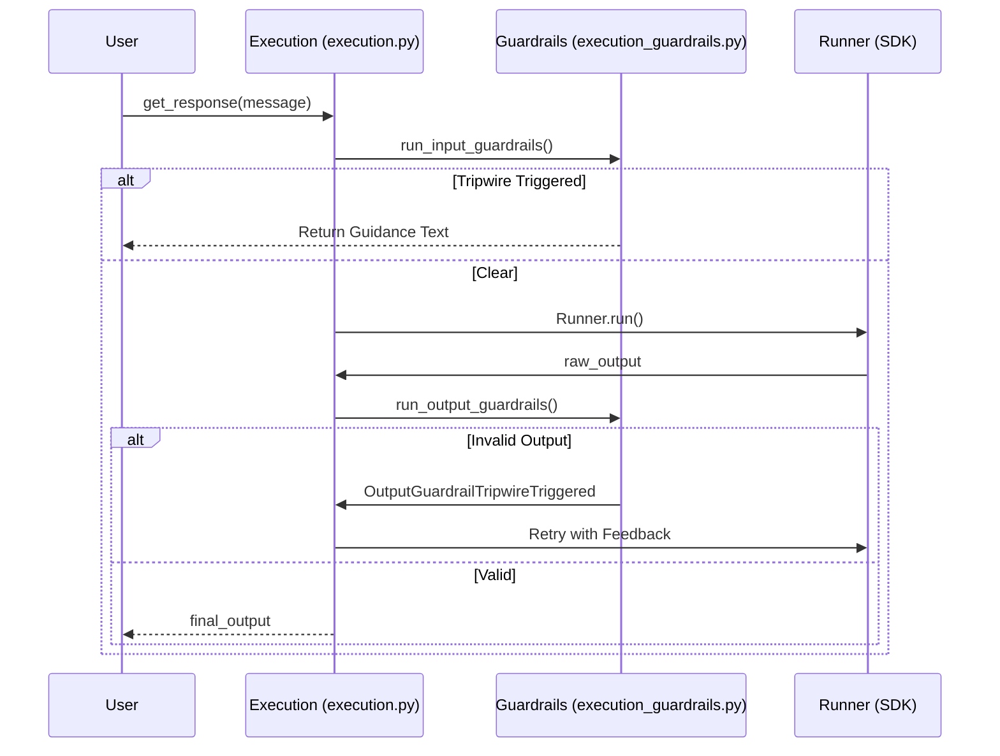
Sources: [src/agency_swarm/agent/execution.py:72-102](), [src/agency_swarm/agent/execution_helpers.py:95-123](), [src/agency_swarm/agent/execution_streaming.py:145-162]()

### Guardrails
Guardrails are safety and quality checks that run alongside the agent.
- **Input Guardrails**: Evaluated *before* the model is called to filter malicious or out-of-scope prompts [docs/core-framework/agents/overview.mdx:66-67]().
- **Output Guardrails**: Evaluated *after* the model generates a response. If a tripwire is triggered, the framework can automatically perform a "self-correction" retry by passing the error back to the model [src/agency_swarm/agent/execution_helpers.py:124-148]().

### System Reminders
`SystemReminders` are transient instructions injected into the model's prompt at specific intervals (e.g., `EveryNToolCalls`) to maintain focus during long execution chains. Unlike instructions, these are not persisted in the permanent thread history [docs/core-framework/agents/advanced-configuration.mdx:46-77]().

## Tooling Primitives

### BaseTool
The `BaseTool` class (based on Pydantic) is the primary way to define agent capabilities.
- **`run()` method**: The core logic executed by the tool [docs/core-framework/tools/custom-tools/step-by-step-guide.mdx:65-76]().
- **Schema Generation**: The class docstring and field descriptions are automatically converted into the JSON schema required by OpenAI [src/agency_swarm/tools/send_message.py:91-119]().

### Model Context Protocol (MCP)
The framework supports **MCP**, allowing agents to use tools hosted on external servers.
- **MCP Servers**: Can be attached to agents to provide dynamic tool discovery [docs/core-framework/agents/overview.mdx:65-66]().
- **MCP Manager**: Handles the lifecycle of connections to these servers during an agent's execution [src/agency_swarm/agent/execution_helpers.py:71-78]().

Sources:
- Agency & Agent Core: [src/agency_swarm/agency/core.py](), [src/agency_swarm/agent/core.py]()
- Execution Logic: [src/agency_swarm/agent/execution.py](), [src/agency_swarm/agent/execution_helpers.py](), [src/agency_swarm/agent/execution_streaming.py]()
- Communication: [src/agency_swarm/tools/send_message.py]()
- Documentation: [docs/core-framework/agents/overview.mdx](), [docs/core-framework/agents/advanced-configuration.mdx]()

---

# Page: Core Framework

# Core Framework

<details>
<summary>Relevant source files</summary>

The following files were used as context for generating this wiki page:

- [src/agency_swarm/agency/core.py](src/agency_swarm/agency/core.py)
- [src/agency_swarm/agency/helpers.py](src/agency_swarm/agency/helpers.py)
- [src/agency_swarm/agency/setup.py](src/agency_swarm/agency/setup.py)
- [src/agency_swarm/agent/constants.py](src/agency_swarm/agent/constants.py)
- [src/agency_swarm/agent/conversation_starters_cache.py](src/agency_swarm/agent/conversation_starters_cache.py)
- [src/agency_swarm/agent/conversation_starters_streaming.py](src/agency_swarm/agent/conversation_starters_streaming.py)
- [src/agency_swarm/agent/core.py](src/agency_swarm/agent/core.py)
- [src/agency_swarm/agent/initialization.py](src/agency_swarm/agent/initialization.py)
- [tests/integration/agency/test_shared_resources.py](tests/integration/agency/test_shared_resources.py)
- [tests/test_agency_modules/test_agency_helpers.py](tests/test_agency_modules/test_agency_helpers.py)
- [tests/test_agency_modules/test_agency_initialization.py](tests/test_agency_modules/test_agency_initialization.py)
- [tests/test_agency_modules/test_agent_flow_integration.py](tests/test_agency_modules/test_agent_flow_integration.py)
- [tests/test_agent_modules/test_agent_initialization.py](tests/test_agent_modules/test_agent_initialization.py)
- [tests/test_agent_modules/test_conversation_starters_cache.py](tests/test_agent_modules/test_conversation_starters_cache.py)
- [tests/test_agent_modules/test_conversation_starters_streaming.py](tests/test_agent_modules/test_conversation_starters_streaming.py)

</details>


The Core Framework provides the foundational architecture of the agency-swarm system, enabling AI agents to work together in structured workflows. It defines the key abstractions and mechanisms for creating, configuring, and orchestrating multiple AI agents that can communicate with each other and perform specialized tasks.

For details on specific components like the Agency Class, Agent Class, Thread System, or BaseTool Class, see their dedicated pages ([Agency Class](#2.1), [Agent Class](#2.2), [Thread System](#2.3), and [BaseTool Class](#2.4)). For information about the tool system that extends these core components, see [Tool System](#3).

## Architecture Overview

The agency-swarm Core Framework is built around four primary components that work together to create a flexible multi-agent system. This framework extends the underlying `agents` SDK to provide high-level orchestration.

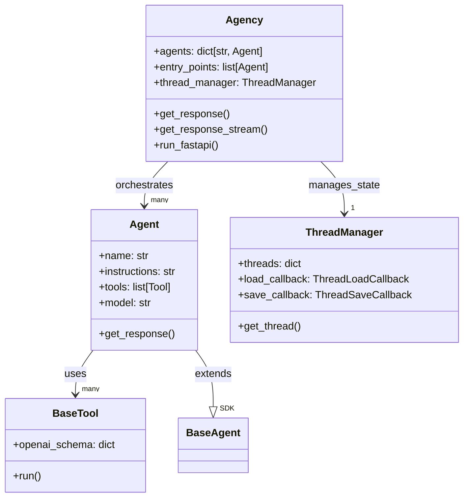

Sources: [src/agency_swarm/agency/core.py:70-106](), [src/agency_swarm/agent/core.py:92-132](), [src/agency_swarm/utils/thread.py:16-105](), [src/agency_swarm/tools/base_tool.py:18-85]()

## Natural Language to Code Mapping

The following diagrams bridge the gap between high-level concepts and the actual code entities within the framework.

### Agency Orchestration Space
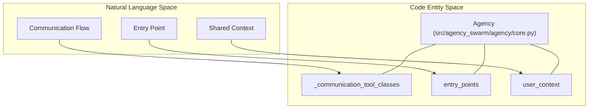
Sources: [src/agency_swarm/agency/core.py:89-106](), [src/agency_swarm/agency/setup.py:82-93]()

### Agent Capability Space
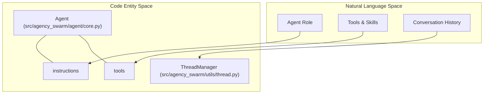
Sources: [src/agency_swarm/agent/core.py:107-122](), [src/agency_swarm/utils/thread.py:91-105]()

## Components in Detail

### Agency
The `Agency` class is the central coordinator. It manages agent registration, sets up communication pathways (flows), and provides the main entry points for external interaction via `get_response` or `run_fastapi`.

Key responsibilities:
- Orchestrating `Agent` instances based on `communication_flows` [src/agency_swarm/agency/core.py:72-76]().
- Managing conversation persistence through `ThreadManager` and `PersistenceHooks` [src/agency_swarm/agency/core.py:80-82]().
- Applying `shared_instructions` across all agents in the agency [src/agency_swarm/agency/core.py:93-93]().
- Providing a FastAPI integration layer for web deployment [src/agency_swarm/agency/helpers.py:64-75]().

For details, see [Agency Class](#2.1).

### Agent
The `Agent` class extends the base SDK `Agent` with multi-agent collaboration capabilities. It is designed to be stateless, receiving its operational context (like thread managers and subagent mappings) at runtime via `AgencyContext`.

Key features:
- Automatic tool discovery from a `tools_folder` [src/agency_swarm/agent/core.py:108-108]().
- Support for OpenAPI schemas via `schemas_folder` [src/agency_swarm/agent/core.py:145-146]().
- Conversation starters and quick replies caching for performance [src/agency_swarm/agent/core.py:110-112]().
- Guardrail support for input/output validation [src/agency_swarm/agent/core.py:117-117]().

For details, see [Agent Class](#2.2).

### Thread System
The thread system, managed by `ThreadManager`, handles conversation state between agents and users. It allows for complex multi-agent interactions where history is preserved and shared according to the agency's communication chart.

Key aspects:
- Support for custom `load_threads_callback` and `save_threads_callback` for persistence [src/agency_swarm/utils/thread.py:23-24]().
- Shared thread management across different agent pairs within an agency [src/agency_swarm/agency/core.py:108-125]().

For details, see [Thread System](#2.3).

### BaseTool
`BaseTool` is the primary class for extending agent capabilities. It uses Pydantic for schema definition, which is automatically converted into OpenAI-compatible function definitions.

Key features:
- Pydantic-based field validation for tool arguments [src/agency_swarm/tools/base_tool.py:18-25]().
- The `@function_tool` decorator for adapting simple functions into the framework [src/agency_swarm/agent/core.py:17-17]().
- Access to `MasterContext` for tools that need to interact with the broader agency state [src/agency_swarm/agent/core.py:56-56]().

For details, see [BaseTool Class](#2.4).

## Data Flow and Communication

The framework facilitates communication between agents using specialized tools like `SendMessage` and `Handoff`. When an agent needs to collaborate, it invokes these tools, which are dynamically wired by the `Agency` during initialization.

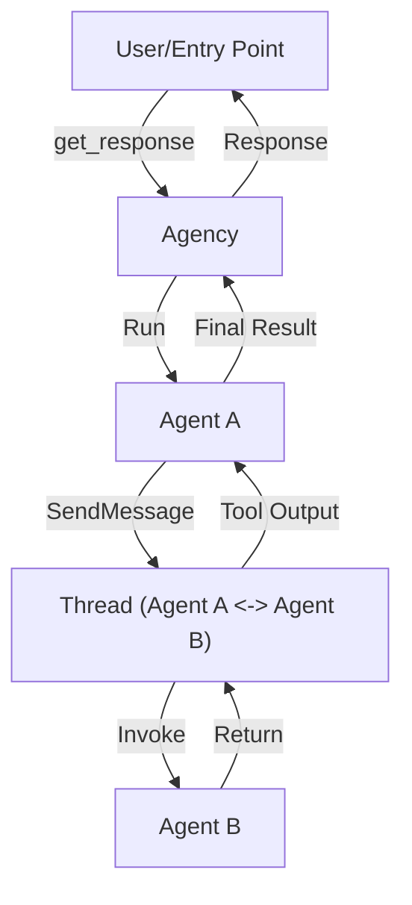
Sources: [src/agency_swarm/agency/setup.py:82-93](), [src/agency_swarm/agency/core.py:108-125]()

## Initialization Pipeline

When an `Agency` is instantiated, it performs a complex initialization sequence to wire agents together:

1.  **Agent Registration**: All agents provided in entry points and flows are registered [src/agency_swarm/agency/setup.py:38-39]().
2.  **Flow Parsing**: The `communication_flows` are parsed to identify which agents can talk to each other and what tools (e.g., `SendMessage`) they need [src/agency_swarm/agency/setup.py:82-93]().
3.  **Resource Application**: Shared instructions, tools, and files are distributed to all agents [src/agency_swarm/agency/setup.py:33-35]().
4.  **Runtime State Setup**: `AgentRuntimeState` is initialized for each agent to hold its subagent mappings and active tools [src/agency_swarm/agency/setup.py:36-36]().

Sources: [src/agency_swarm/agency/core.py:108-125](), [src/agency_swarm/agency/setup.py:1-40]()

---

# Page: Agency Class

# Agency Class

<details>
<summary>Relevant source files</summary>

The following files were used as context for generating this wiki page:

- [docs/additional-features/deployment-to-production.mdx](docs/additional-features/deployment-to-production.mdx)
- [docs/core-framework/agencies/communication-flows.mdx](docs/core-framework/agencies/communication-flows.mdx)
- [src/agency_swarm/agency/core.py](src/agency_swarm/agency/core.py)
- [src/agency_swarm/agency/helpers.py](src/agency_swarm/agency/helpers.py)
- [src/agency_swarm/agency/responses.py](src/agency_swarm/agency/responses.py)
- [src/agency_swarm/agency/setup.py](src/agency_swarm/agency/setup.py)
- [src/agency_swarm/agent/conversation_starters_cache.py](src/agency_swarm/agent/conversation_starters_cache.py)
- [src/agency_swarm/agent/conversation_starters_streaming.py](src/agency_swarm/agent/conversation_starters_streaming.py)
- [tests/integration/agency/test_shared_resources.py](tests/integration/agency/test_shared_resources.py)
- [tests/test_agency_modules/_response_test_helpers.py](tests/test_agency_modules/_response_test_helpers.py)
- [tests/test_agency_modules/test_agency_helpers.py](tests/test_agency_modules/test_agency_helpers.py)
- [tests/test_agency_modules/test_agency_initialization.py](tests/test_agency_modules/test_agency_initialization.py)
- [tests/test_agency_modules/test_agency_responses.py](tests/test_agency_modules/test_agency_responses.py)
- [tests/test_agency_modules/test_agency_responses_recipient_reminders.py](tests/test_agency_modules/test_agency_responses_recipient_reminders.py)
- [tests/test_agency_modules/test_agent_flow_integration.py](tests/test_agency_modules/test_agent_flow_integration.py)
- [tests/test_agent_modules/test_conversation_starters_cache.py](tests/test_agent_modules/test_conversation_starters_cache.py)
- [tests/test_agent_modules/test_conversation_starters_streaming.py](tests/test_agent_modules/test_conversation_starters_streaming.py)

</details>


The `Agency` class is the primary orchestration component in the `agency-swarm` framework. It serves as the central hub for managing a collection of `Agent` instances, establishing communication pathways (flows) between them, and providing methods for user interaction with the multi-agent system. It handles the initialization pipeline, including agent registration, shared resource distribution, and persistence hook configuration.

For details about individual agents, see [Agent Class](2.2). For information about the thread communication system, see [Thread System](2.3). For tools that agents can use, see [BaseTool Class](2.4).

## Architecture Overview

The `Agency` class orchestrates `Agent` instances based on a communication flow. It manages agent registration, sets up communication pathways via `SendMessage` or `Handoff` tools, and provides entries for external interaction.

### Code Entity Mapping

The following diagram associates the natural language concepts of the agency system with their corresponding code entities and attributes within the `Agency` class.

**Agency Entity Mapping**
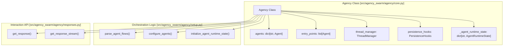

Sources:
- [src/agency_swarm/agency/core.py:70-107]()
- [src/agency_swarm/agency/setup.py:82-153]()
- [src/agency_swarm/agency/responses.py:171-182]()

## Initialization and Setup

### Constructor Parameters

The `Agency` constructor (`__init__`) accepts parameters to define the multi-agent structure and shared environment:

| Parameter | Type | Description |
|-----------|------|-------------|
| `*entry_point_agents` | `Agent` | Positional arguments identifying agents that can receive direct user messages. [src/agency_swarm/agency/core.py:135-135]() |
| `communication_flows` | `list[CommunicationFlowEntry]` | Defines allowed communication paths (e.g., `agent1 > agent2`). [src/agency_swarm/agency/core.py:136-143]() |
| `shared_instructions` | `str` | Instructions prepended to every agent's system prompt. [src/agency_swarm/agency/core.py:145-147]() |
| `shared_tools` | `list[Tool \| type[BaseTool]]` | Tools automatically added to every agent in the agency. [src/agency_swarm/agency/core.py:94-94]() |
| `shared_mcp_servers` | `list[Any]` | MCP servers accessible by all agents. [src/agency_swarm/agency/core.py:97-97]() |
| `load_threads_callback` | `ThreadLoadCallback` | Callback for loading conversation history. [src/agency_swarm/agency/core.py:119-119]() |
| `save_threads_callback` | `ThreadSaveCallback` | Callback for persisting conversation state. [src/agency_swarm/agency/core.py:120-120]() |
| `user_context` | `dict[str, Any]` | Shared data available in `MasterContext` during runs. [src/agency_swarm/agency/core.py:121-121]() |

Sources:
- [src/agency_swarm/agency/core.py:108-125]()
- [src/agency_swarm/agency/core.py:89-100]()

### Initialization Pipeline

When an `Agency` is instantiated, it executes a setup pipeline defined in `src/agency_swarm/agency/setup.py`.

**Initialization Data Flow**
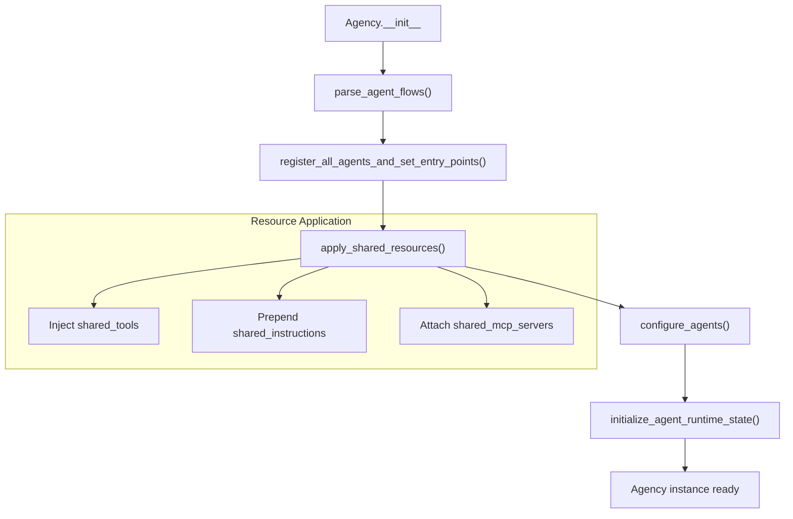

1.  **Flow Parsing**: `parse_agent_flows` processes the `communication_flows` list, resolving `AgentFlow` chains (e.g., `agent1 > agent2 > agent3`) into basic sender-receiver pairs. [src/agency_swarm/agency/setup.py:82-153]()
2.  **Resource Application**: `apply_shared_resources` distributes `shared_instructions`, `shared_tools`, and `shared_mcp_servers` to all registered agents. [src/agency_swarm/agency/setup.py:34-39]()
3.  **Agent Configuration**: `configure_agents` validates agent settings and prepares them for the specific agency context. [src/agency_swarm/agency/setup.py:35-35]()
4.  **Runtime State**: `initialize_agent_runtime_state` wires the `SendMessage` and `Handoff` tools into each agent's runtime based on the parsed flows. [src/agency_swarm/agency/setup.py:36-36]()

Sources:
- [src/agency_swarm/agency/core.py:168-185]()
- [src/agency_swarm/agency/setup.py:82-153]()

## Communication Methods

The `Agency` class provides high-level methods to initiate interactions with agents.

### get_response

```python
async def get_response(
    self,
    message: str | list[TResponseInputItem],
    recipient_agent: str | Agent | None = None,
    context_override: dict[str, Any] | None = None,
    hooks_override: RunHooks | None = None,
    **kwargs: Any,
) -> RunResult
```

This method resolves the `recipient_agent` (defaulting to the first entry point), determines the effective `RunHooks` (combining persistence hooks and any overrides), and calls the target agent's `get_response` method. [src/agency_swarm/agency/responses.py:171-210]()

### get_response_stream

```python
def get_response_stream(
    self,
    message: str | list[TResponseInputItem],
    recipient_agent: str | Agent | None = None,
    hooks_override: RunHooks | None = None,
    **kwargs: Any,
) -> StreamingRunResponse
```

Returns an async iterator (`StreamingRunResponse`) that yields events from the agent execution. It utilizes `EventStreamMerger` to handle complex multi-agent message streams. [src/agency_swarm/agency/responses.py:270-305]()

### Recipient Reminders

If a user switches the `recipient_agent` within the same thread, the agency automatically prepends a `recipient_reminder` system message. This informs the new agent that the user has switched context and provides the agent's name and role to ensure continuity. [src/agency_swarm/agency/responses.py:61-105]()

Sources:
- [src/agency_swarm/agency/responses.py:171-210]()
- [src/agency_swarm/agency/responses.py:270-305]()
- [src/agency_swarm/agency/responses.py:108-134]()

## Persistence and Hooks

The `Agency` manages conversation state through `PersistenceHooks` and the `ThreadManager`.

- **Callbacks**: If `load_threads_callback` and `save_threads_callback` are provided, the agency initializes `PersistenceHooks`. [src/agency_swarm/agency/core.py:170-176]()
- **Thread Management**: The `ThreadManager` uses these hooks to load existing history when a run starts and save the updated history (as immutable snapshots) when a run completes. [src/agency_swarm/utils/thread.py:26-26]()
- **Composite Hooks**: If a user provides `hooks_override` during a call, the agency uses `CompositeRunHooks` to ensure both internal persistence logic and user-provided logic are executed. [src/agency_swarm/agency/responses.py:159-168]()

Sources:
- [src/agency_swarm/agency/core.py:170-176]()
- [src/agency_swarm/agency/responses.py:159-168]()
- [tests/test_agency_modules/test_agency_responses.py:86-104]()

## FastAPI Integration

The `run_fastapi` method exposes the agency as a web service.

```python
def run_fastapi(
    self,
    host: str = "0.0.0.0",
    port: int = 8000,
    app_token_env: str = "APP_TOKEN",
    **kwargs: Any,
) -> None
```

This method calls the `run_fastapi` helper in `src/agency_swarm/agency/helpers.py`, which:
1.  **Normalizes Paths**: Converts relative `shared_tools_folder` or `shared_files_folder` paths to absolute paths to ensure stability across the FastAPI lifecycle. [src/agency_swarm/agency/helpers.py:112-122]()
2.  **Builds Factories**: Creates an `agency_factory` that can reconstruct the `Agency` instance (with all its flows and settings) for each incoming request. [src/agency_swarm/agency/helpers.py:124-154]()
3.  **Starts Server**: Launches the FastAPI server with endpoints like `/get_response` and `/get_response_stream`. [src/agency_swarm/agency/helpers.py:92-105]()

Sources:
- [src/agency_swarm/agency/helpers.py:64-105]()
- [src/agency_swarm/agency/helpers.py:108-154]()

## Visualization

The `visualize` method (accessible via `Agency.visualize()`) generates a visual representation of the agency's communication structure. It uses the `agency_chart` and `communication_flows` to map out relationships between agents.

Sources:
- [src/agency_swarm/agency/core.py:214-220]()
- [src/agency_swarm/agency/helpers.py:108-154]()

---

# Page: Agent Class

# Agent Class

<details>
<summary>Relevant source files</summary>

The following files were used as context for generating this wiki page:

- [src/agency_swarm/agent/__init__.py](src/agency_swarm/agent/__init__.py)
- [src/agency_swarm/agent/constants.py](src/agency_swarm/agent/constants.py)
- [src/agency_swarm/agent/core.py](src/agency_swarm/agent/core.py)
- [src/agency_swarm/agent/file_manager.py](src/agency_swarm/agent/file_manager.py)
- [src/agency_swarm/agent/file_sync.py](src/agency_swarm/agent/file_sync.py)
- [src/agency_swarm/agent/initialization.py](src/agency_swarm/agent/initialization.py)
- [src/agency_swarm/agent/subagents.py](src/agency_swarm/agent/subagents.py)
- [src/agency_swarm/agent/tools.py](src/agency_swarm/agent/tools.py)
- [src/agency_swarm/cli/main.py](src/agency_swarm/cli/main.py)
- [src/agency_swarm/utils/create_agent_template.py](src/agency_swarm/utils/create_agent_template.py)
- [src/agency_swarm/utils/model_utils.py](src/agency_swarm/utils/model_utils.py)
- [tests/integration/cli/test_create_agent_template_integration.py](tests/integration/cli/test_create_agent_template_integration.py)
- [tests/integration/files/test_file_handling.py](tests/integration/files/test_file_handling.py)
- [tests/test_agent_modules/test_agent_capabilities.py](tests/test_agent_modules/test_agent_capabilities.py)
- [tests/test_agent_modules/test_agent_file_manager.py](tests/test_agent_modules/test_agent_file_manager.py)
- [tests/test_agent_modules/test_agent_initialization.py](tests/test_agent_modules/test_agent_initialization.py)
- [tests/test_agent_modules/test_agent_tools.py](tests/test_agent_modules/test_agent_tools.py)
- [tests/test_agent_modules/test_file_sync.py](tests/test_agent_modules/test_file_sync.py)
- [tests/test_agent_modules/test_tools_utils.py](tests/test_agent_modules/test_tools_utils.py)
- [tests/test_utils_modules/test_create_agent_template.py](tests/test_utils_modules/test_create_agent_template.py)

</details>


The `Agent` class is the fundamental building block of the Agency Swarm framework. It extends the `agents.Agent` base class from the underlying SDK to provide high-level capabilities for multi-agent collaboration, automatic tool discovery, file management, and framework-specific features like guardrails and system reminders.

In Agency Swarm, Agents are designed to be **stateless** configuration entities. Runtime state, such as thread management and communication flows, is provided by the `Agency` context during execution.

## Agent Class Architecture

The `Agent` class acts as a coordinator for several specialized managers that handle files, tools, and execution logic.

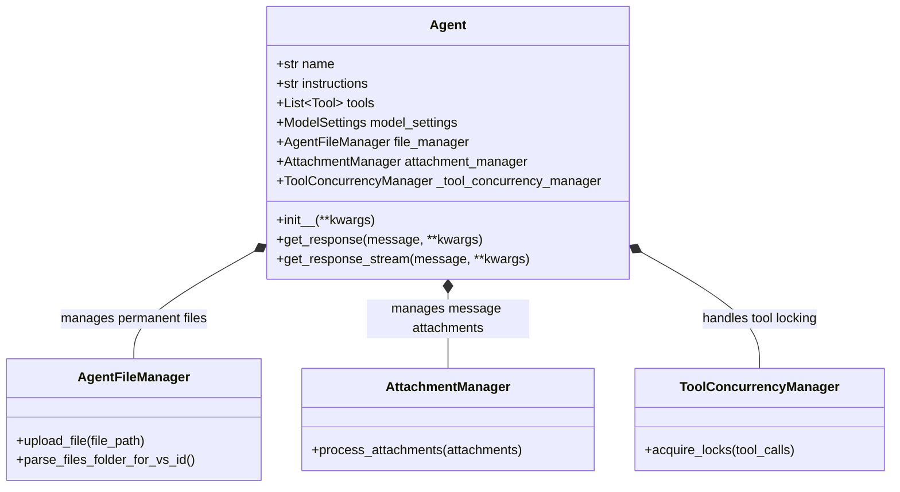

Sources: [src/agency_swarm/agent/core.py:92-133](), [src/agency_swarm/agent/file_manager.py:49-54](), [src/agency_swarm/agent/attachment_manager.py:1-10]()

## Initialization Pipeline

When an `Agent` is instantiated, it undergoes a multi-step initialization pipeline that normalizes parameters, loads local resources, and configures the underlying SDK model.

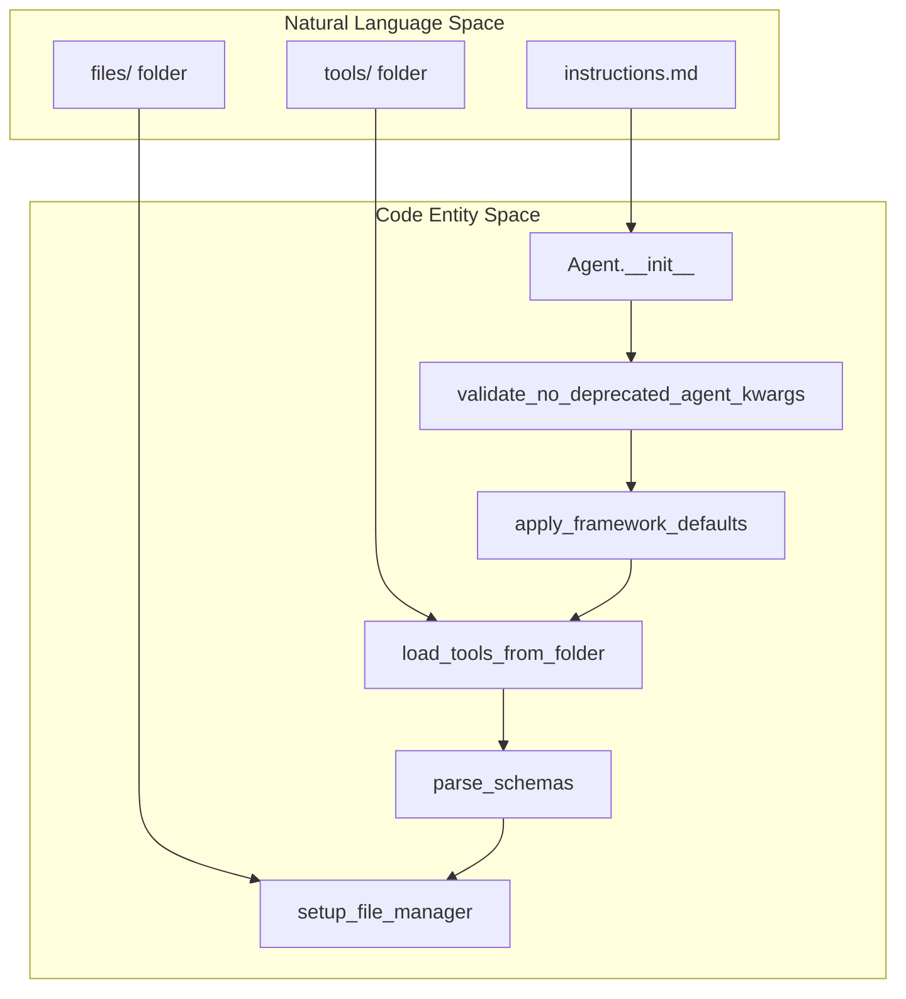

### Framework Defaults
Agency Swarm applies specific defaults to ensure stable multi-agent behavior. For example, it overrides the SDK's default model to `gpt-5.6-luna` to prevent infinite tool-call loops in complex handoff workflows.

| Setting | Default Value | Source |
| :--- | :--- | :--- |
| `model` | `gpt-5.6-luna` | [src/agency_swarm/agent/constants.py:7-7]() |
| `truncation` | `auto` | [src/agency_swarm/agent/initialization.py:37-37]() |
| `include_usage` | `True` | [src/agency_swarm/agent/initialization.py:37-37]() |

Sources: [src/agency_swarm/agent/core.py:134-210](), [src/agency_swarm/agent/initialization.py:118-127](), [src/agency_swarm/agent/initialization.py:153-166]()

## Capabilities and Configuration

### Tool Discovery
Agents can automatically load tools from a specified `tools_folder`. The framework supports `BaseTool` subclasses, `@function_tool` decorated functions, and OpenAPI schemas.

- **`tools_folder`**: Scans the directory for `.py` files and adapts classes/functions into SDK-compatible tools. [src/agency_swarm/agent/tools.py:60-105]()
- **`schemas_folder`**: Parses OpenAPI JSON/YAML files into tools using `ToolFactory.from_openapi_schema`. [src/agency_swarm/agent/tools.py:106-160]()
- **MCP Servers**: Agents can be configured with `mcp_servers`, which are converted into tools at runtime. [src/agency_swarm/agent/core.py:236-242]()

### File Management
The `AgentFileManager` handles the synchronization of local files with OpenAI's backend.
- **Vector Stores**: If a `files_folder` is named with the pattern `*_vs_<vector_store_id>`, the agent automatically associates with that Vector Store. [src/agency_swarm/agent/core.py:142-144]()
- **Auto-Detection**: The framework inspects file extensions to automatically enable `FileSearchTool` (for `.pdf`, `.md`, etc.) or `CodeInterpreterTool` (for `.py`, `.csv`, etc.). [src/agency_swarm/agent/file_manager.py:22-47]()

### Guardrails and Reminders
- **Input Guardrails**: Agents can be wrapped with input guardrails that intercept user messages before processing. The parameter `raise_input_guardrail_error` determines if violations trigger exceptions or system messages. [src/agency_swarm/agent/core.py:117-117](), [src/agency_swarm/agent/initialization.py:90-116]()
- **System Reminders**: `SystemReminder` objects can be attached to agents. These are injected into the run via hooks to provide persistent context or constraints during execution. [src/agency_swarm/agent/core.py:121-121](), [src/agency_swarm/agent/system_reminders.py:50-54]()

## Execution Data Flow

When `get_response` is called, the Agent prepares an `Execution` context and invokes the underlying SDK `Runner`.

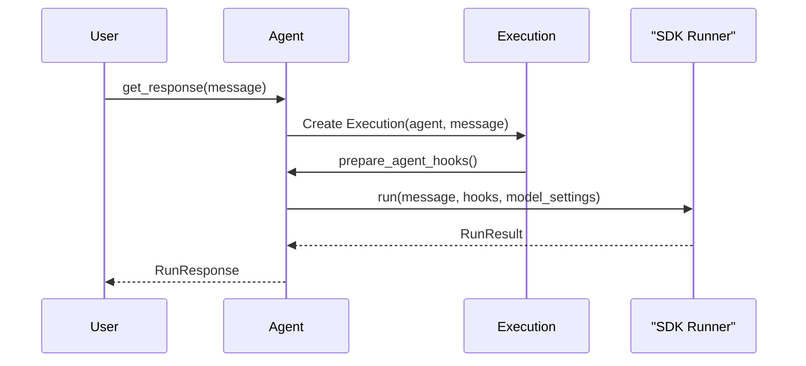

Sources: [src/agency_swarm/agent/core.py:284-332](), [src/agency_swarm/agent/execution.py:8-15]()

## Deprecated Parameters
Agency Swarm v1.x removes several parameters that were previously part of the constructor in favor of explicit SDK objects or framework-managed state.

| Deprecated Parameter | Replacement |
| :--- | :--- |
| `temperature`, `top_p` | `model_settings=ModelSettings(...)` |
| `max_prompt_tokens` | `model_settings=ModelSettings(max_tokens=...)` |
| `response_validator` | `input_guardrails` or `output_guardrails` |
| `file_ids`, `file_search` | Managed via `files_folder` and `AgentFileManager` |
| `id`, `refresh_from_id` | Use Agency persistence hooks |

Sources: [src/agency_swarm/agent/initialization.py:68-87](), [tests/test_agent_modules/test_agent_initialization.py:80-123]()

## Technical Reference: Capability Detection
The framework provides a utility `get_agent_capabilities(agent)` that inspects an agent's configuration to return a list of active features such as `"tools"`, `"reasoning"`, `"code_interpreter"`, and `"file_search"`. This is used primarily for UI visualization and metadata endpoints.

Sources: [src/agency_swarm/utils/model_utils.py:109-170]()

---

# Page: Thread System

# Thread System

<details>
<summary>Relevant source files</summary>

The following files were used as context for generating this wiki page:

- [examples/agency_context.py](examples/agency_context.py)
- [examples/custom_persistence.py](examples/custom_persistence.py)
- [examples/fastapi_integration/client.py](examples/fastapi_integration/client.py)
- [examples/handoffs.py](examples/handoffs.py)
- [examples/interactive/hybrid_communication_flows.py](examples/interactive/hybrid_communication_flows.py)
- [examples/multi_agent_workflow.py](examples/multi_agent_workflow.py)
- [examples/streaming.py](examples/streaming.py)
- [src/agency_swarm/messages/message_formatter.py](src/agency_swarm/messages/message_formatter.py)
- [src/agency_swarm/utils/thread.py](src/agency_swarm/utils/thread.py)
- [tests/integration/communication/test_streaming_order_consistency.py](tests/integration/communication/test_streaming_order_consistency.py)
- [tests/integration/litellm_integration/test_litellm_anthropic_message_ordering.py](tests/integration/litellm_integration/test_litellm_anthropic_message_ordering.py)
- [tests/integration/litellm_integration/test_litellm_anthropic_nonstreaming.py](tests/integration/litellm_integration/test_litellm_anthropic_nonstreaming.py)
- [tests/integration/litellm_integration/test_litellm_models.py](tests/integration/litellm_integration/test_litellm_models.py)
- [tests/integration/litellm_integration/test_litellm_openai_responses_history_switch.py](tests/integration/litellm_integration/test_litellm_openai_responses_history_switch.py)
- [tests/integration/litellm_integration/test_litellm_placeholder_ids_integration.py](tests/integration/litellm_integration/test_litellm_placeholder_ids_integration.py)
- [tests/integration/litellm_integration/test_litellm_visualization.py](tests/integration/litellm_integration/test_litellm_visualization.py)
- [tests/test_agent_modules/test_constants.py](tests/test_agent_modules/test_constants.py)
- [tests/test_agent_modules/test_hosted_tool_results.py](tests/test_agent_modules/test_hosted_tool_results.py)
- [tests/test_agent_modules/test_thread_manager.py](tests/test_agent_modules/test_thread_manager.py)
- [tests/test_messages_modules/test_message_formatter_history_protocol.py](tests/test_messages_modules/test_message_formatter_history_protocol.py)

</details>


The Thread System in the Agency Swarm framework manages conversation state and communication between agents. Unlike previous versions that relied on OpenAI Assistants API primitives, the current system uses a **flat message storage** architecture managed by the `ThreadManager`. This system serves as the communication backbone for multi-agent workflows, ensuring history persistence and consistency across agent interactions.

## Overview

The Thread System is centered around the `ThreadManager` and `MessageStore`. It replaces isolated thread objects with a unified repository of messages where each entry is tagged with metadata identifying the sender (`callerAgent`) and recipient (`agent`). This allows for seamless context sharing and easier persistence.

### Architecture and Data Flow

The following diagram illustrates how the Thread System bridges the gap between high-level Agency interactions and the underlying data structures.

**Thread System Entity Mapping**
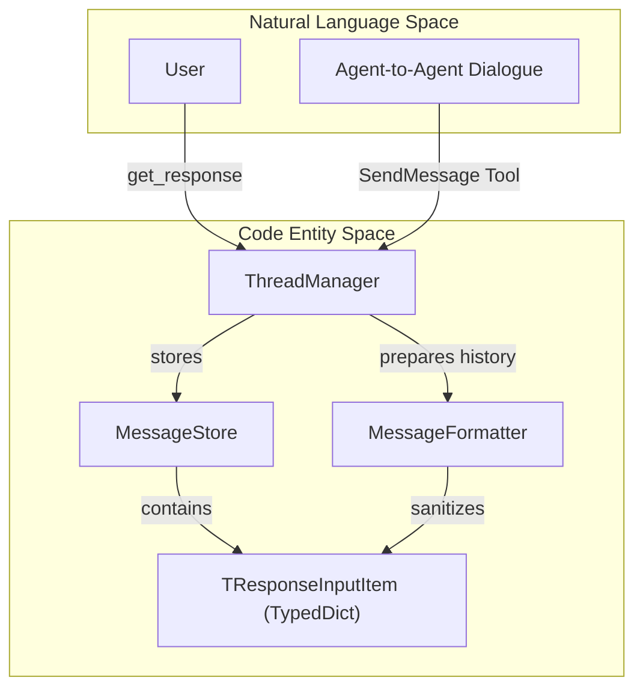
Sources: [src/agency_swarm/utils/thread.py:121-149](), [src/agency_swarm/messages/message_formatter.py:44-61]()

## Core Components

### ThreadManager
The `ThreadManager` is the primary orchestrator for conversation state. It handles the lifecycle of messages, including addition, retrieval, and persistence via callbacks.

- **Persistence Hooks**: Supports `load_threads_callback` and `save_threads_callback` to integrate with external databases or file systems [src/agency_swarm/utils/thread.py:134-148]().
- **Conversation Retrieval**: Provides `get_conversation_history(agent, caller_agent)` to extract specific interaction legs. Notably, it ensures that all entry-point agents share the same "user thread" by treating any message with `callerAgent: None` as part of the shared user context [src/agency_swarm/utils/thread.py:177-195]().

### MessageStore
A specialized container that holds a flat list of `TResponseInputItem` objects.
- **Flat Storage**: Replaces hierarchical threads with a single list [src/agency_swarm/utils/thread.py:12-21]().
- **Metadata Tagging**: Every message includes `agent` (recipient), `callerAgent` (sender), and `timestamp` [src/agency_swarm/utils/thread.py:37-40]().
- **Filtering**: Supports retrieving messages for specific pairs (e.g., `get_conversation_between("CEO", "Worker")`) [src/agency_swarm/utils/thread.py:80-100]().

### MessageFormatter
The `MessageFormatter` acts as a translation layer between the stored history and the model-specific requirements.
- **Protocol Detection**: Detects if history follows "responses" (OpenAI Agents SDK style) or "chat_completions" protocols [src/agency_swarm/messages/message_formatter.py:156-172]().
- **History Preparation**: The `prepare_history_for_runner` method filters the flat store for messages relevant to the current agent and ensures they are compatible with the agent's model [src/agency_swarm/messages/message_formatter.py:216-248]().

Sources: [src/agency_swarm/utils/thread.py:12-114](), [src/agency_swarm/messages/message_formatter.py:44-105]()

## Thread Lifecycle and Persistence

### Initialization and Loading
When an `Agency` is instantiated, the `ThreadManager` is initialized. If a `load_threads_callback` is provided, it populates the `MessageStore` from the external source [src/agency_swarm/utils/thread.py:134-149]().

### Message Addition and Saving
Whenever a new message is generated (either from a user or an agent tool call), it is passed to `ThreadManager.add_message()`. This method appends the message to the store and immediately triggers the `save_threads_callback` to ensure persistence [src/agency_swarm/utils/thread.py:151-159]().

**Persistence Sequence**
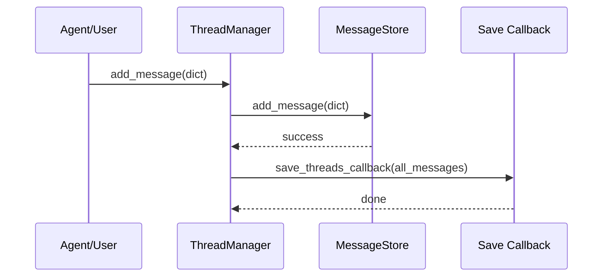
Sources: [src/agency_swarm/utils/thread.py:151-167](), [examples/custom_persistence.py:32-51]()

## History Protocols and Compatibility

The system supports multiple history protocols to allow different models (OpenAI, Anthropic via LiteLLM, etc.) to interact within the same agency.

| Protocol | Description | Usage |
|----------|-------------|-------|
| `responses` | OpenAI Agents SDK style items (tool_call_item, message_output_item) | Default for most agents [src/agency_swarm/messages/message_formatter.py:47](). |
| `chat_completions` | Standard OpenAI Chat Completion roles (user, assistant, tool) | Used for legacy integrations [src/agency_swarm/messages/message_formatter.py:48](). |
| `mixed` | A combination of both protocols in one history | Usually results in a compatibility error [src/agency_swarm/messages/message_formatter.py:185-190](). |

### Ephemeral Content
To prevent internal "thought" processes or temporary tool hints from polluting the long-term history, the system uses the `_agency_swarm_ephemeral` flag. Messages or content parts with this flag are passed to the model for the current run but are stripped before being saved to the `MessageStore` [src/agency_swarm/messages/message_formatter.py:62](), [tests/test_messages_modules/test_message_formatter_history_protocol.py:124-154]().

## Multi-Agent Interaction Handling

When an agent (e.g., `CEO`) uses the `SendMessage` tool to talk to another agent (e.g., `Worker`), the following occurs:
1. The `CEO` generates a tool call.
2. The `ThreadManager` records this tool call.
3. A new interaction leg is started where the `Worker` becomes the `agent` and `CEO` becomes the `callerAgent`.
4. `MessageFormatter` fetches only the history where `(agent=Worker, callerAgent=CEO)` or `(agent=CEO, callerAgent=Worker)` to provide context to the `Worker` [src/agency_swarm/utils/thread.py:80-100]().

This isolation ensures that agents only see the parts of the conversation relevant to them, while the `ThreadManager` maintains the global state for the entire `Agency`.

Sources: [src/agency_swarm/utils/thread.py:80-100](), [src/agency_swarm/messages/message_formatter.py:216-248](), [tests/integration/communication/test_streaming_order_consistency.py:100-109]()

---

# Page: BaseTool Class

# BaseTool Class

<details>
<summary>Relevant source files</summary>

The following files were used as context for generating this wiki page:

- [docs/core-framework/tools/built-in-tools.mdx](docs/core-framework/tools/built-in-tools.mdx)
- [docs/core-framework/tools/custom-tools/multimodal-outputs.mdx](docs/core-framework/tools/custom-tools/multimodal-outputs.mdx)
- [docs/core-framework/tools/overview.mdx](docs/core-framework/tools/overview.mdx)
- [examples/data/daily_revenue.png](examples/data/daily_revenue.png)
- [examples/data/daily_revenue_report.pdf](examples/data/daily_revenue_report.pdf)
- [examples/multimodal_outputs.py](examples/multimodal_outputs.py)
- [src/agency_swarm/tools/base_tool.py](src/agency_swarm/tools/base_tool.py)
- [src/agency_swarm/tools/tool_factory_utils/base_tool_adapter.py](src/agency_swarm/tools/tool_factory_utils/base_tool_adapter.py)
- [src/agency_swarm/tools/utils.py](src/agency_swarm/tools/utils.py)
- [src/agency_swarm/utils/dry_run.py](src/agency_swarm/utils/dry_run.py)
- [tests/integration/communication/test_send_message_extra_params.py](tests/integration/communication/test_send_message_extra_params.py)
- [tests/integration/fastapi/test_fastapi_dry_run.py](tests/integration/fastapi/test_fastapi_dry_run.py)
- [tests/test_agent_modules/send_message/test_deprecated_reminder_override.py](tests/test_agent_modules/send_message/test_deprecated_reminder_override.py)
- [tests/test_agent_modules/send_message/test_extra_params.py](tests/test_agent_modules/send_message/test_extra_params.py)
- [tests/test_agent_modules/test_base_tool.py](tests/test_agent_modules/test_base_tool.py)
- [tests/test_tools_modules/test_tool_system.py](tests/test_tools_modules/test_tool_system.py)
- [tests/test_tools_modules/test_utils.py](tests/test_tools_modules/test_utils.py)

</details>


The `BaseTool` class is the foundational abstract base for creating Pydantic-based tools within the `agency-swarm` framework. It provides a structured way to define tool parameters, validation logic, and execution routines while ensuring compatibility with the OpenAI Function Calling API and the underlying SDK.

## Overview

`BaseTool` inherits from Pydantic's `BaseModel` and Python's `ABC` (Abstract Base Class). It offers an alternative to the `@function_tool` decorator by providing explicit field definitions, model validators, and access to the `MasterContext` for shared state management [src/agency_swarm/tools/base_tool.py:1-7]().

### Core Class Structure

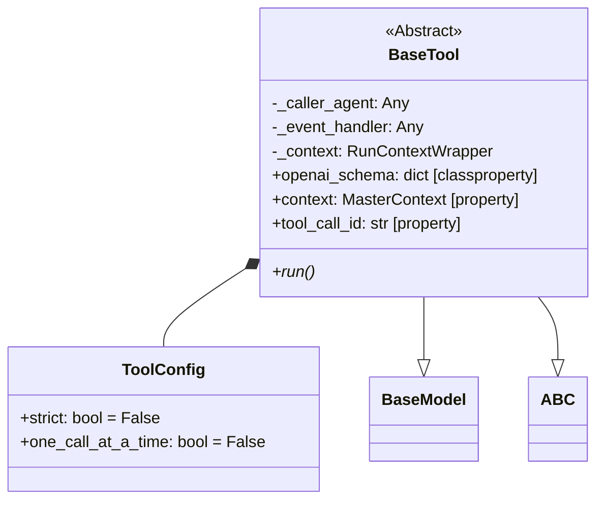

Sources: [src/agency_swarm/tools/base_tool.py:72-171]()

## Key Components

### Pydantic Field Definitions
Tools define their inputs as Pydantic fields. These fields are automatically parsed into the JSON schema sent to the LLM. Field descriptions are extracted to provide the model with context on how to use each parameter [src/agency_swarm/tools/base_tool.py:119-127]().

### The ToolConfig Class
A nested `ToolConfig` class allows developers to tune tool execution behavior:

| Option | Type | Default | Description |
| :--- | :--- | :--- | :--- |
| `strict` | `bool` | `False` | Enables OpenAI "Strict Mode," enforcing `additionalProperties: false` in the JSON schema [src/agency_swarm/tools/base_tool.py:142-151](). |
| `one_call_at_a_time` | `bool` | `False` | A concurrency policy that prevents an agent from executing this tool multiple times simultaneously [src/agency_swarm/tools/base_tool.py:105-105](). |

Sources: [src/agency_swarm/tools/base_tool.py:101-105]()

### MasterContext Access
Tools can access the `MasterContext` via the `self.context` property. This provides a clean interface to shared agent state, the `ThreadManager`, and user-specific context [src/agency_swarm/tools/base_tool.py:154-158]().

## Implementation Flow: From Code to SDK

When a `BaseTool` is provided to an `Agent`, it is adapted into a `FunctionTool` instance compatible with the SDK. This process involves converting Pydantic fields into a JSON schema and wrapping the `run()` method in an execution handler.

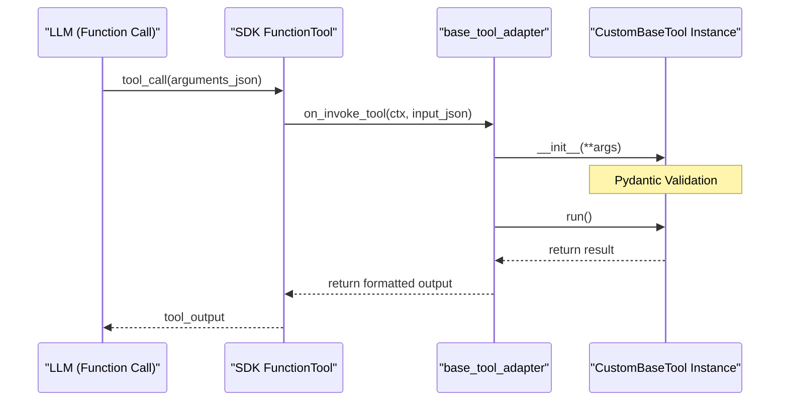

Sources: [src/agency_swarm/tools/tool_factory_utils/base_tool_adapter.py:21-72]()

### Adaptation Details
The `adapt_base_tool` function performs the following:
1.  **Schema Extraction**: Calls `model_json_schema()` and resolves references [src/agency_swarm/tools/tool_factory_utils/base_tool_adapter.py:32-35]().
2.  **Execution Wrapping**: Creates an `on_invoke_tool` closure that instantiates the tool, injects the `RunContextWrapper`, and executes `run()` [src/agency_swarm/tools/tool_factory_utils/base_tool_adapter.py:38-49]().
3.  **Threading**: If `run()` is synchronous, it is automatically executed via `asyncio.to_thread` to prevent blocking the event loop [src/agency_swarm/tools/tool_factory_utils/base_tool_adapter.py:49-49]().

## Multimodal Outputs

Tools can return rich media types instead of plain strings. This is achieved by returning specific wrapper classes from the `run()` method.

| Output Class | Purpose | Source |
| :--- | :--- | :--- |
| `ToolOutputImage` | Returns images (PNG/JPG) via URL, Data URL, or OpenAI File ID. | [docs/core-framework/tools/custom-tools/multimodal-outputs.mdx:34-40]() |
| `ToolOutputFileContent` | Returns PDF files for agent analysis or user download. | [docs/core-framework/tools/custom-tools/multimodal-outputs.mdx:76-82]() |
| `ToolOutputText` | Explicitly returns text, often used in a `list` of multiple outputs. | [docs/core-framework/tools/custom-tools/multimodal-outputs.mdx:127-142]() |

### Multimodal Utilities
The framework provides helper functions in `agency_swarm.tools.utils` to simplify multimodal returns:
*   `tool_output_image_from_path(path, detail)`: Converts a local image to a base64 data URL [src/agency_swarm/tools/utils.py:177-195]().
*   `tool_output_file_from_url(url)`: Handles remote PDF fetching with size limits and safety checks [src/agency_swarm/tools/utils.py:214-230]().

Sources: [src/agency_swarm/tools/utils.py:177-230](), [docs/core-framework/tools/custom-tools/multimodal-outputs.mdx:32-142]()

## Extending BaseTool

To create a custom tool, extend `BaseTool` and implement the `run` method.

```python
from agency_swarm import BaseTool
from pydantic import Field

class MyCustomTool(BaseTool):
    """
    Docstring serves as the tool description for the LLM.
    """
    param1: str = Field(..., description="Description for param1")

    class ToolConfig:
        strict = True

    def run(self):
        # Access context if needed
        # user_data = self.context.user_context
        return f"Processed {self.param1}"
```

Sources: [src/agency_swarm/tools/base_tool.py:72-171](), [tests/test_tools_modules/test_tool_system.py:134-143]()

## Advanced Usage: Extra Params in SendMessage
The `SendMessage` tool (a subclass of `BaseTool`) supports an `extra_params_model` or a nested `ExtraParams` class. This allows developers to inject custom metadata fields into the communication tool, which are then validated and included in the tool's JSON schema [tests/test_agent_modules/send_message/test_extra_params.py:32-58]().

Sources: [tests/test_agent_modules/send_message/test_extra_params.py:72-106](), [tests/integration/communication/test_send_message_extra_params.py:13-26]()

---

# Page: Tool System

# Tool System

<details>
<summary>Relevant source files</summary>

The following files were used as context for generating this wiki page:

- [examples/fastapi_integration/print_openapi_schema.py](examples/fastapi_integration/print_openapi_schema.py)
- [src/agency_swarm/cli/import_tool.py](src/agency_swarm/cli/import_tool.py)
- [src/agency_swarm/tools/built_in/IPythonInterpreter.py](src/agency_swarm/tools/built_in/IPythonInterpreter.py)
- [src/agency_swarm/tools/built_in/LoadFileAttachment.py](src/agency_swarm/tools/built_in/LoadFileAttachment.py)
- [src/agency_swarm/tools/built_in/PersistentShellTool.py](src/agency_swarm/tools/built_in/PersistentShellTool.py)
- [src/agency_swarm/tools/built_in/PresentFiles.py](src/agency_swarm/tools/built_in/PresentFiles.py)
- [src/agency_swarm/tools/built_in/__init__.py](src/agency_swarm/tools/built_in/__init__.py)
- [src/agency_swarm/tools/mcp_manager.py](src/agency_swarm/tools/mcp_manager.py)
- [src/agency_swarm/tools/tool_factory.py](src/agency_swarm/tools/tool_factory.py)
- [tests/integration/tools/test_present_files_tool.py](tests/integration/tools/test_present_files_tool.py)
- [tests/test_agent_modules/test_mcp_manager.py](tests/test_agent_modules/test_mcp_manager.py)
- [tests/test_agent_modules/test_mcp_oauth.py](tests/test_agent_modules/test_mcp_oauth.py)
- [tests/test_agent_modules/test_tool_factory_core.py](tests/test_agent_modules/test_tool_factory_core.py)
- [tests/test_cli_modules/test_import_tool.py](tests/test_cli_modules/test_import_tool.py)
- [tests/test_fastapi_utils_modules/test_oauth_support.py](tests/test_fastapi_utils_modules/test_oauth_support.py)
- [tests/test_tools_modules/test_tool_factory_openapi.py](tests/test_tools_modules/test_tool_factory_openapi.py)

</details>


The Tool System in Agency Swarm enables agents to perform actions and interact with external systems. This page documents the architecture, components, and orchestration of tools within the framework.

## Tool System Architecture

The Tool System bridges the gap between agent reasoning and external execution. It handles schema generation, parameter validation via Pydantic, and execution environments ranging from local shells to remote MCP servers.

```mermaid
graph TD
    subgraph "Tool Foundation"
        [BaseTool] --> [ToolConfig]
        [BaseTool] --> [ToolContext]
    end
    
    subgraph "Tool Creation"
        [ToolFactory] -->|"from_file()"| [BaseTool]
        [ToolFactory] -->|"from_langchain()"| [BaseTool]
        [ToolFactory] -->|"from_openapi_schema()"| [BaseTool]
        [ToolFactory] -->|"from_mcp()"| [BaseTool]
    end
    
    subgraph "Execution Layer"
        [Agent] -->|"manages"| [mcp_manager]
        [Agent] -->|"invokes"| [FunctionTool]
        [FunctionTool] -->|"runs"| [BaseTool]
    end
    
    subgraph "Built-in Ecosystem"
        [IPythonInterpreter]
        [PersistentShellTool]
        [PresentFiles]
        [LoadFileAttachment]
    end
```

Sources: [src/agency_swarm/tools/base_tool.py:19-106](), [src/agency_swarm/tools/tool_factory_utils.py:21-514](), [src/agency_swarm/tools/mcp_manager.py:66-121]().

## BaseTool Class

The `BaseTool` class is the primary interface for defining custom capabilities. It leverages Pydantic for robust input validation and provides a standardized `run()` method for execution.

### Key Features
1.  **Schema Generation**: Automatically generates OpenAI-compatible function schemas from class attributes and docstrings [src/agency_swarm/tools/base_tool.py:75-80]().
2.  **Context Awareness**: Tools can access the `MasterContext` (via `self.context`) to retrieve shared state or information about the calling agent [src/agency_swarm/tools/base_tool.py:40-45]().
3.  **Structured Outputs**: Supports returning complex types like `ToolOutputImage` or `ToolOutputFile` which are handled specifically by the UI and SDK [tests/test_agent_modules/test_tool_factory_core.py:185-200]().
4.  **Configuration**: The `ToolConfig` inner class controls execution behavior:
    *   `strict`: Enforces strict schema validation for OpenAI models.
    *   `one_call_at_a_time`: Synchronizes access to sensitive tools.
    *   `output_as_result`: Directly returns the tool's output to the user as the final message.

Sources: [src/agency_swarm/tools/base_tool.py:19-106]().

## ToolFactory

The `ToolFactory` acts as a universal adapter, converting various external definitions into the `BaseTool` format.

*   **OpenAPI Integration**: Dynamically creates tools from Swagger/OpenAPI specs using `from_openapi_schema`.
*   **MCP Support**: Materializes tools from Model Context Protocol servers at runtime.
*   **File Loading**: The `from_file()` method allows for dynamic loading of tools from an agent's `tools/` directory.

For detailed implementation details, see [ToolFactory](#3.1).

Sources: [src/agency_swarm/tools/tool_factory.py:1-6](), [src/agency_swarm/tools/tool_factory_utils.py:110-150]().

## Built-in Tools

The framework provides a set of pre-configured tools for common developer tasks:
*   **IPythonInterpreter**: Isolated Jupyter kernel execution for data science and visualization [src/agency_swarm/tools/built_in/IPythonInterpreter.py:41-68]().
*   **PersistentShellTool**: A shell interface that maintains the working directory across multiple turns [src/agency_swarm/tools/built_in/PersistentShellTool.py:11-20]().
*   **PresentFiles**: Moves files to a persistent `/mnt` directory for display in the Chat UI [src/agency_swarm/tools/built_in/PresentFiles.py:117-130]().
*   **LoadFileAttachment**: Handles multimodal inputs, determining if a file should be treated as an image or a document [src/agency_swarm/tools/built_in/LoadFileAttachment.py:9-19]().

For the full list and usage guides, see [Built-in Tools](#3.2).

Sources: [src/agency_swarm/tools/built_in/__init__.py:1-10]().

## MCP Integration

Model Context Protocol (MCP) support allows agents to connect to a growing ecosystem of external servers.
*   **Persistence**: The `PersistentMCPServerManager` ensures that server connections (stdio or SSE) are maintained across multiple requests [src/agency_swarm/tools/mcp_manager.py:56-60]().
*   **Security**: Includes an OAuth bridge for handling third-party authentication (e.g., Google, GitHub) within the agentic flow [src/agency_swarm/tools/mcp_manager.py:30-55]().
*   **Proxying**: Uses `LoopAffineAsyncProxy` to ensure async MCP calls remain pinned to the correct event loop, preventing threading conflicts [src/agency_swarm/tools/mcp_manager.py:29-29]().

For details on configuration and OAuth flows, see [MCP Integration](#3.3).

Sources: [src/agency_swarm/tools/mcp_manager.py:69-121](), [tests/test_agent_modules/test_mcp_manager.py:125-138]().

## Tool Execution Lifecycle

When an agent decides to use a tool, the framework orchestrates the transition from "Natural Language Space" to "Code Entity Space."

```mermaid
sequenceDiagram
    participant LLM as "LLM (OpenAI/Claude)"
    participant Agent as "Agent Class"
    participant FT as "FunctionTool (SDK)"
    participant BT as "BaseTool (Code)"
    participant Ctx as "MasterContext"

    LLM->>Agent: Tool Call (JSON)
    Agent->>FT: on_invoke_tool(context, arguments)
    FT->>BT: __init__(**arguments)
    BT->>BT: model_validate()
    FT->>BT: run()
    BT->>Ctx: get/set shared state
    BT-->>FT: Return result (str/Image/File)
    FT-->>Agent: Formatted ToolOutput
    Agent-->>LLM: Tool Result Submission
```

Sources: [src/agency_swarm/tools/base_tool.py:19-106](), [tests/test_agent_modules/test_tool_factory_core.py:128-144](), [src/agency_swarm/tools/built_in/PersistentShellTool.py:37-43]().

---

# Page: ToolFactory

# ToolFactory

<details>
<summary>Relevant source files</summary>

The following files were used as context for generating this wiki page:

- [examples/fastapi_integration/print_openapi_schema.py](examples/fastapi_integration/print_openapi_schema.py)
- [src/agency_swarm/integrations/fastapi_utils/logging_middleware.py](src/agency_swarm/integrations/fastapi_utils/logging_middleware.py)
- [src/agency_swarm/integrations/fastapi_utils/tool_endpoints.py](src/agency_swarm/integrations/fastapi_utils/tool_endpoints.py)
- [src/agency_swarm/integrations/fastapi_utils/tool_request_models.py](src/agency_swarm/integrations/fastapi_utils/tool_request_models.py)
- [src/agency_swarm/tools/function_tool_compat.py](src/agency_swarm/tools/function_tool_compat.py)
- [src/agency_swarm/tools/tool_factory.py](src/agency_swarm/tools/tool_factory.py)
- [src/agency_swarm/tools/tool_factory_utils/__init__.py](src/agency_swarm/tools/tool_factory_utils/__init__.py)
- [src/agency_swarm/tools/tool_factory_utils/factory.py](src/agency_swarm/tools/tool_factory_utils/factory.py)
- [src/agency_swarm/tools/tool_factory_utils/file_loader.py](src/agency_swarm/tools/tool_factory_utils/file_loader.py)
- [src/agency_swarm/tools/tool_factory_utils/langchain.py](src/agency_swarm/tools/tool_factory_utils/langchain.py)
- [src/agency_swarm/tools/tool_factory_utils/mcp.py](src/agency_swarm/tools/tool_factory_utils/mcp.py)
- [src/agency_swarm/tools/tool_factory_utils/openapi_exporter.py](src/agency_swarm/tools/tool_factory_utils/openapi_exporter.py)
- [src/agency_swarm/tools/tool_factory_utils/openapi_importer.py](src/agency_swarm/tools/tool_factory_utils/openapi_importer.py)
- [src/agency_swarm/tools/tool_factory_utils/schema_inspector.py](src/agency_swarm/tools/tool_factory_utils/schema_inspector.py)
- [tests/data/tools/sample_tool.py](tests/data/tools/sample_tool.py)
- [tests/integration/communication/test_communication.py](tests/integration/communication/test_communication.py)
- [tests/integration/fastapi/test_logging_middleware.py](tests/integration/fastapi/test_logging_middleware.py)
- [tests/test_agent_modules/test_tool_factory_core.py](tests/test_agent_modules/test_tool_factory_core.py)
- [tests/test_agent_modules/test_tool_factory_langchain.py](tests/test_agent_modules/test_tool_factory_langchain.py)
- [tests/test_example_modules/test_observability_example.py](tests/test_example_modules/test_observability_example.py)
- [tests/test_fastapi_utils_modules/__init__.py](tests/test_fastapi_utils_modules/__init__.py)
- [tests/test_fastapi_utils_modules/test_tool_endpoints.py](tests/test_fastapi_utils_modules/test_tool_endpoints.py)
- [tests/test_tools_modules/test_function_tool_compat.py](tests/test_tools_modules/test_function_tool_compat.py)
- [tests/test_tools_modules/test_tool_factory_openapi.py](tests/test_tools_modules/test_tool_factory_openapi.py)

</details>


## Purpose and Scope

The `ToolFactory` is a central utility class in the `agency-swarm` framework designed to bridge external tool definitions with the internal `BaseTool` and `FunctionTool` systems. It enables agents to ingest capabilities from a diverse range of sources: OpenAPI specifications, LangChain tools, Model Context Protocol (MCP) servers, and local Python files.

By standardizing these various formats into a common execution interface, `ToolFactory` ensures that agents can interact with external APIs and services without requiring manual wrapper code for every integration.

## Overview

The `ToolFactory` acts as a conversion layer. It takes structured metadata (schemas) and logic (callbacks or remote endpoints) and materializes them as Python classes or instances that the OpenAI Agents SDK can execute.

### Tool Factory Architecture

```mermaid
graph TD
    subgraph "External Tool Sources"
        OpenAPI["OpenAPI Schema (JSON/YAML)"]
        LangChain["LangChain Tools"]
        MCP["MCP Servers (Stdio/SSE)"]
        Files["Python Files (.py)"]
    end

    subgraph "ToolFactory Core"
        TF["ToolFactory Class"]
        SchemaParser["Schema Inspector / JSON Parser"]
        CodeGen["Dynamic Class Generator"]
    end

    subgraph "Internal Tool Entities"
        BT["BaseTool (Pydantic-based)"]
        FT["FunctionTool (SDK-native)"]
    end

    OpenAPI --> TF
    LangChain --> TF
    MCP --> TF
    Files --> TF

    TF --> SchemaParser
    SchemaParser --> CodeGen
    CodeGen --> BT
    BT --> FT
```

Sources: [src/agency_swarm/tools/tool_factory_utils/factory.py:1-10](), [src/agency_swarm/tools/tool_factory.py:1-6]()

## Tool Creation Methods

The `ToolFactory` provides several static methods for importing and adapting tools.

| Method | Source | Logic |
| :--- | :--- | :--- |
| `from_openapi_schema` | OpenAPI 3.0/3.1 JSON/YAML | Generates tools for each endpoint with HTTP callbacks. |
| `from_langchain_tool` | `langchain.tools.BaseTool` | Wraps LangChain tools into the `FunctionTool` interface. |
| `from_mcp` | MCP Server (Stdio/SSE) | Discovers tools via MCP protocol and creates local proxies. |
| `from_file` | Local `.py` file | Dynamically imports classes inheriting from `BaseTool`. |
| `adapt_base_tool` | `BaseTool` Class | Converts a `BaseTool` class into an SDK-compatible `FunctionTool`. |

Sources: [src/agency_swarm/tools/tool_factory_utils/factory.py:15-120](), [src/agency_swarm/tools/tool_factory_utils/openapi_importer.py:10-50]()

## Adaptation and Compatibility

A critical function of the `ToolFactory` is the `adapt_base_tool` method. This method transforms a standard `agency-swarm` `BaseTool` (which uses Pydantic for validation) into a `FunctionTool` required by the underlying Agents SDK.

### Data Flow: BaseTool to FunctionTool

```mermaid
sequenceDiagram
    participant User as Developer
    participant BT as BaseTool Class
    participant TF as ToolFactory.adapt_base_tool
    participant FT as FunctionTool Instance
    participant SDK as OpenAI Agents SDK

    User->>BT: Define class with run() and Pydantic fields
    TF->>BT: Inspect docstrings and fields
    TF->>TF: Create on_invoke_tool callback
    TF->>FT: Instantiate FunctionTool(name, description, schema, callback)
    FT->>SDK: Register for Agent usage
    SDK->>FT: on_invoke_tool(context, input_json)
    FT->>BT: Instantiate(**json.loads(input_json))
    BT->>BT: run()
    BT-->>FT: return result
    FT-->>SDK: return result
```

Sources: [tests/test_agent_modules/test_tool_factory_core.py:85-101](), [src/agency_swarm/tools/function_tool_compat.py:90-121]()

### Context Preservation
When tools are adapted, the framework ensures that `ToolContext` is preserved or rebuilt. The `normalize_function_tool` function in `function_tool_compat.py` ensures that manual tool calls (e.g., via FastAPI or direct testing) correctly bind a `ToolContext` even if one wasn't provided by the SDK's runtime.

Sources: [src/agency_swarm/tools/function_tool_compat.py:90-110](), [src/agency_swarm/tools/function_tool_compat.py:52-87]()

## Specialized Importers

### OpenAPI Integration
The `from_openapi_schema` method parses an OpenAPI specification and creates a tool for every operation found in the `paths` object.
- **Data Flow**: It creates an internal `generic_handler` that uses `httpx` to forward agent calls to the actual API endpoints.
- **Validation**: It uses the schema definitions in the OpenAPI spec to build the tool's input parameters.

Sources: [src/agency_swarm/tools/tool_factory_utils/openapi_importer.py:15-60](), [tests/test_tools_modules/test_tool_factory_openapi.py:14-43]()

### MCP Integration
The `from_mcp` method leverages the `mcp_converter` to transform tools hosted on a Model Context Protocol server into local `FunctionTool` instances.
- **Discovery**: It queries the MCP server for its tool list.
- **Proxying**: Every generated tool acts as a proxy, sending the `call_tool` request back to the MCP server over the established transport (Stdio or SSE).

Sources: [src/agency_swarm/tools/tool_factory_utils/mcp.py:1-6](), [src/agency_swarm/tools/mcp_converter.py:5-25]()

### LangChain Integration
`ToolFactory.from_langchain_tool` allows for seamless migration of existing LangChain tools.
- It extracts the `name`, `description`, and `args_schema` from the LangChain tool.
- It wraps the LangChain `_run` (or `_arun`) method into an `on_invoke_tool` callback.

Sources: [src/agency_swarm/tools/tool_factory_utils/langchain.py:10-40](), [tests/test_agent_modules/test_tool_factory_langchain.py:43-63]()

## Tool Factory Utilities

The `tool_factory_utils` sub-package contains the underlying logic for schema manipulation:
- **`SchemaInspector`**: Analyzes Python function signatures and Pydantic models to generate OpenAI-compatible JSON schemas.
- **`FileLoader`**: Handles the dynamic loading of Python modules from strings or paths, specifically looking for `BaseTool` subclasses.
- **`OpenAPIExporter`**: The inverse of the importer; it takes a list of `BaseTool` or `FunctionTool` objects and generates a valid OpenAPI 3.1.0 specification. This is used by `Agency.run_fastapi()` to expose tools via a web API.

Sources: [src/agency_swarm/tools/tool_factory_utils/openapi_exporter.py:10-80](), [src/agency_swarm/tools/tool_factory_utils/file_loader.py:5-30](), [src/agency_swarm/integrations/fastapi_utils/tool_endpoints.py:66-79]()

## Integration with FastAPI

When an Agency is served via FastAPI, the `ToolFactory` logic is used to generate endpoints. The `make_tool_endpoint` function utilizes `normalize_function_tool` to ensure that tools invoked via HTTP requests have access to a properly formed `ToolContext`.

```mermaid
graph LR
    subgraph "FastAPI Request"
        Req["HTTP POST /tool/{name}"]
    end

    subgraph "Endpoint Handler"
        ME["make_tool_endpoint"]
        Norm["normalize_function_tool"]
        Ctx["build_manual_tool_context"]
    end

    subgraph "Tool Execution"
        Tool["FunctionTool / BaseTool"]
    end

    Req --> ME
    ME --> Norm
    Norm --> Ctx
    Ctx --> Tool
```

Sources: [src/agency_swarm/integrations/fastapi_utils/tool_endpoints.py:16-47](), [src/agency_swarm/integrations/fastapi_utils/tool_endpoints.py:83-99]()

---

# Page: Built-in Tools

# Built-in Tools

<details>
<summary>Relevant source files</summary>

The following files were used as context for generating this wiki page:

- [docs/additional-features/guardrails/input-guardrails.mdx](docs/additional-features/guardrails/input-guardrails.mdx)
- [docs/additional-features/guardrails/output-guardrails.mdx](docs/additional-features/guardrails/output-guardrails.mdx)
- [docs/core-framework/agents/built-in-tools.mdx](docs/core-framework/agents/built-in-tools.mdx)
- [docs/platform/marketplace/onboarding.mdx](docs/platform/marketplace/onboarding.mdx)
- [examples/README.md](examples/README.md)
- [examples/guardrails_input.py](examples/guardrails_input.py)
- [examples/interactive/third_party_models.py](examples/interactive/third_party_models.py)
- [examples/interactive/tui.py](examples/interactive/tui.py)
- [examples/observability.py](examples/observability.py)
- [src/agency_swarm/agent/attachment_manager.py](src/agency_swarm/agent/attachment_manager.py)
- [src/agency_swarm/agent/file_manager.py](src/agency_swarm/agent/file_manager.py)
- [src/agency_swarm/agent/file_sync.py](src/agency_swarm/agent/file_sync.py)
- [src/agency_swarm/cli/import_tool.py](src/agency_swarm/cli/import_tool.py)
- [src/agency_swarm/tools/built_in/IPythonInterpreter.py](src/agency_swarm/tools/built_in/IPythonInterpreter.py)
- [src/agency_swarm/tools/built_in/LoadFileAttachment.py](src/agency_swarm/tools/built_in/LoadFileAttachment.py)
- [src/agency_swarm/tools/built_in/PersistentShellTool.py](src/agency_swarm/tools/built_in/PersistentShellTool.py)
- [src/agency_swarm/tools/built_in/PresentFiles.py](src/agency_swarm/tools/built_in/PresentFiles.py)
- [src/agency_swarm/tools/built_in/__init__.py](src/agency_swarm/tools/built_in/__init__.py)
- [src/agency_swarm/utils/hosted_tool_compat.py](src/agency_swarm/utils/hosted_tool_compat.py)
- [src/agency_swarm/utils/hosted_tool_replacements.py](src/agency_swarm/utils/hosted_tool_replacements.py)
- [tests/integration/files/test_file_handling.py](tests/integration/files/test_file_handling.py)
- [tests/integration/tools/test_present_files_tool.py](tests/integration/tools/test_present_files_tool.py)
- [tests/test_agent_modules/test_agent_file_manager.py](tests/test_agent_modules/test_agent_file_manager.py)
- [tests/test_agent_modules/test_attachment_manager.py](tests/test_agent_modules/test_attachment_manager.py)
- [tests/test_agent_modules/test_file_sync.py](tests/test_agent_modules/test_file_sync.py)
- [tests/test_agent_modules/test_tools_utils.py](tests/test_agent_modules/test_tools_utils.py)
- [tests/test_cli_modules/test_import_tool.py](tests/test_cli_modules/test_import_tool.py)
- [tests/test_fastapi_utils_modules/test_openai_hosted_tool_compat.py](tests/test_fastapi_utils_modules/test_openai_hosted_tool_compat.py)
- [tests/test_fastapi_utils_modules/test_openai_hosted_tool_local_compat.py](tests/test_fastapi_utils_modules/test_openai_hosted_tool_local_compat.py)
- [tests/test_fastapi_utils_modules/test_openrouter_client_override.py](tests/test_fastapi_utils_modules/test_openrouter_client_override.py)

</details>


The Agency Swarm framework provides a collection of pre-configured tools that enable agents to perform a wide range of actions, from local code execution to advanced file management. These tools are built upon the `BaseTool` class and integrate seamlessly with both the local execution environment and the OpenAI Assistants API.

## Core Built-in Tools

Agency Swarm provides several specialized tools for local execution and file presentation. These tools are designed to work across different operating systems and provide persistent state where necessary.

### IPythonInterpreter
The `IPythonInterpreter` provides a secure, isolated Jupyter kernel for executing Python code locally. Unlike standard code execution tools, it maintains state (variables, imports, functions) across multiple calls within the same agent session.

- **Implementation**: Uses `jupyter_client.AsyncKernelManager` to manage a dedicated `python3` kernel process [src/agency_swarm/tools/built_in/IPythonInterpreter.py:44-67]().
- **Data Flow**: Code is sent to the kernel via `AsyncKernelClient.execute`. Results, stdout, and errors are captured through `iopub` and `shell` channels [src/agency_swarm/tools/built_in/IPythonInterpreter.py:129-183]().
- **Isolation**: Each agent instance typically maintains its own `AsyncKernelSession` to prevent cross-agent state pollution.

### PersistentShellTool
The `PersistentShellTool` allows agents to run shell commands (bash, PowerShell, etc.) while maintaining a persistent working directory across tool calls.

- **Persistence Logic**: It stores the current working directory (CWD) in the `MasterContext` under the key `shell_cwds`, indexed by the agent's name [src/agency_swarm/tools/built_in/PersistentShellTool.py:37-43]().
- **Cross-Platform**: Automatically uses `powershell` on Windows and standard shell execution on Unix-like systems [src/agency_swarm/tools/built_in/PersistentShellTool.py:50-66]().
- **CD Handling**: Explicitly parses `cd` commands to update the persistent state, while warning users that chained `cd` commands (e.g., `cd dir && ls`) do not update the global session CWD [src/agency_swarm/tools/built_in/PersistentShellTool.py:70-106]().

### PresentFiles
This tool is used to "hand off" local files to a chat UI or a user. It moves files into a specific monitored directory (often a mount point) so they can be rendered as downloads or previews in the frontend.

- **MNT Directory**: Files are moved to a path defined by the `MNT_DIR` environment variable (default: `/app/mnt`) [src/agency_swarm/tools/built_in/PresentFiles.py:18-20]().
- **Metadata**: Returns a dictionary containing `name`, `mime_type`, `path`, and `size_bytes` [src/agency_swarm/tools/built_in/PresentFiles.py:188-195]().
- **Safety**: Includes overwrite safety logic using UUID-based staging files to prevent data loss during path collisions [src/agency_swarm/tools/built_in/PresentFiles.py:62-83]().

### LoadFileAttachment
Facilitates the loading of files from the local filesystem into the agent's context or remote storage.

Sources: [src/agency_swarm/tools/built_in/IPythonInterpreter.py:1-106](), [src/agency_swarm/tools/built_in/PersistentShellTool.py:1-136](), [src/agency_swarm/tools/built_in/PresentFiles.py:1-195]()

## File and Attachment Management

Agency Swarm manages files through a dual-layer system: permanent storage (for RAG/Vector Stores) and temporary attachments (for specific request context).

### AgentFileManager
The `AgentFileManager` handles permanent file operations, including uploading to OpenAI and synchronizing local `files_folder` content with remote Vector Stores [src/agency_swarm/agent/file_manager.py:49-54]().

- **Synchronization**: Uses `FileSync` to compare local file timestamps (`mtime`) with remote `created_at` timestamps to avoid redundant uploads [src/agency_swarm/agent/file_manager.py:89-92]().
- **Vector Store Association**: Automatically enqueues uploaded files into the agent's associated Vector Store if `include_in_vector_store` is enabled [src/agency_swarm/agent/file_manager.py:149-169]().

### AttachmentManager
The `AttachmentManager` handles "ephemeral" files attached to a single message or run.

- **Type Sorting**: It categorizes attachments by extension. `.pdf` and image files are added as `input_file` or `input_image` content items [src/agency_swarm/agent/attachment_manager.py:68-85]().
- **Tool Injection**: For code-related files (e.g., `.py`, `.csv`), it dynamically injects a `CodeInterpreterTool` containing the file IDs into the agent's toolset for the duration of the request [src/agency_swarm/agent/attachment_manager.py:114-117]().
- **Cleanup**: After execution, `attachments_cleanup()` removes these temporary tools and resets the agent state [src/agency_swarm/agent/attachment_manager.py:133-155]().

```mermaid
title "Attachment Processing Flow"
graph TD
    subgraph "Natural Language Space"
        Msg["User Message + File IDs"]
    end

    subgraph "Code Entity Space"
        AM["AttachmentManager"]
        AFM["AgentFileManager"]
        CIT["CodeInterpreterTool"]
        OAI["OpenAI Files API"]
    end

    Msg --> AM
    AM -->|Check Extensions| AFM
    AFM -->|Retrieve Filenames| OAI
    AM -->|If .py/.csv| CIT
    AM -->|If .pdf| MsgItem["TResponseInputItem (input_file)"]
    CIT -->|Temporary Tool| AgentTools["Agent.tools"]
```

Sources: [src/agency_swarm/agent/file_manager.py:49-172](), [src/agency_swarm/agent/attachment_manager.py:19-158]()

## Hosted Tool Compatibility

When agents are used with non-OpenAI models (via LiteLLM, OpenRouter, or OpenClaw), OpenAI-native tools like `FileSearchTool` and `WebSearchTool` are unavailable. Agency Swarm provides a compatibility layer to handle this gracefully.

### Compatibility Logic
The framework inspects the agent's `model` and `base_url`. If it detects a non-OpenAI backend, it invokes `apply_openai_hosted_tool_compatibility` [src/agency_swarm/utils/hosted_tool_compat.py:115-117]().

1.  **Stubbing**: Hosted tools are replaced with `FunctionTool` stubs that return a message indicating the tool is unavailable on the current backend [src/agency_swarm/utils/hosted_tool_compat.py:133-138]().
2.  **Replacements**: If a compatible local replacement exists (defined in `hosted_tool_replacements.py`), it is used instead of a stub [src/agency_swarm/utils/hosted_tool_compat.py:136-137]().
3.  **Settings Cleanup**: Removes OpenAI-specific settings like `tool_choice` or `response_include` fields that would cause errors on other providers [src/agency_swarm/utils/hosted_tool_compat.py:140-141]().

```mermaid
title "Hosted Tool Compatibility Architecture"
graph LR
    subgraph "Agent Configuration"
        A["Agent.model"]
        T["Agent.tools (FileSearch, WebSearch)"]
    end

    subgraph "Compatibility Layer"
        Check["_supports_openai_hosted_tools"]
        Apply["apply_openai_hosted_tool_compatibility"]
        Replace["hosted_tool_replacements"]
    end

    subgraph "Resulting State"
        Stub["FunctionTool Stubs"]
        Local["Local Tool Replacements"]
    end

    A --> Check
    Check -->|False| Apply
    Apply --> Replace
    Replace --> Stub
    Replace --> Local
```

Sources: [src/agency_swarm/utils/hosted_tool_compat.py:29-155](), [tests/test_fastapi_utils_modules/test_openai_hosted_tool_compat.py:21-59]()

## Tool Summary Table

| Tool Name | Scope | Persistence | Key Function/Class |
| :--- | :--- | :--- | :--- |
| `IPythonInterpreter` | Local | Persistent Kernel | `AsyncKernelSession.execute` |
| `PersistentShellTool` | Local | Persistent CWD | `PersistentShellTool.run` |
| `PresentFiles` | Local/UI | File System | `_move_with_overwrite_safety` |
| `FileSearchTool` | Hosted | Vector Store | OpenAI `file_search` |
| `CodeInterpreterTool` | Hosted | Sandbox | OpenAI `code_interpreter` |
| `WebSearchTool` | Hosted | OpenAI Search | OpenAI `web_search` |

Sources: [src/agency_swarm/tools/built_in/IPythonInterpreter.py:41](), [src/agency_swarm/tools/built_in/PersistentShellTool.py:11](), [src/agency_swarm/tools/built_in/PresentFiles.py:117](), [src/agency_swarm/utils/hosted_tool_compat.py:29-40]()

---

# Page: MCP Integration

# MCP Integration

<details>
<summary>Relevant source files</summary>

The following files were used as context for generating this wiki page:

- [docs/additional-features/mcp-tools-server.mdx](docs/additional-features/mcp-tools-server.mdx)
- [examples/mcp_servers.py](examples/mcp_servers.py)
- [examples/utils/sse_mcp_server.py](examples/utils/sse_mcp_server.py)
- [examples/utils/stdio_mcp_server.py](examples/utils/stdio_mcp_server.py)
- [src/agency_swarm/integrations/mcp_server.py](src/agency_swarm/integrations/mcp_server.py)
- [src/agency_swarm/mcp/oauth_flow.py](src/agency_swarm/mcp/oauth_flow.py)
- [src/agency_swarm/tools/hosted_mcp_activation.py](src/agency_swarm/tools/hosted_mcp_activation.py)
- [src/agency_swarm/tools/mcp_converter.py](src/agency_swarm/tools/mcp_converter.py)
- [src/agency_swarm/tools/mcp_loop_proxy.py](src/agency_swarm/tools/mcp_loop_proxy.py)
- [src/agency_swarm/tools/mcp_manager.py](src/agency_swarm/tools/mcp_manager.py)
- [src/agency_swarm/tools/mcp_oauth_bridge.py](src/agency_swarm/tools/mcp_oauth_bridge.py)
- [src/agency_swarm/tools/mcp_persistence.py](src/agency_swarm/tools/mcp_persistence.py)
- [tests/integration/mcp/test_mcp_server.py](tests/integration/mcp/test_mcp_server.py)
- [tests/test_agent_modules/test_from_mcp_method.py](tests/test_agent_modules/test_from_mcp_method.py)
- [tests/test_agent_modules/test_mcp_manager.py](tests/test_agent_modules/test_mcp_manager.py)
- [tests/test_agent_modules/test_mcp_oauth.py](tests/test_agent_modules/test_mcp_oauth.py)
- [tests/test_fastapi_utils_modules/test_oauth_support.py](tests/test_fastapi_utils_modules/test_oauth_support.py)
- [tests/test_tools_modules/test_mcp_config_strict_mode.py](tests/test_tools_modules/test_mcp_config_strict_mode.py)

</details>


The Model Context Protocol (MCP) integration enables Agency Swarm agents to interact with external tools and services through a standardized JSON-RPC interface. This allows for seamless connection to both local command-line utilities and remote web services without requiring manual tool wrappers for every external capability.

## Overview and Architecture

MCP integration is facilitated by the `ToolFactory` and a persistent management layer that ensures connections are maintained across agent execution cycles. The framework supports three primary transport mechanisms: `MCPServerStdio` for local processes, `MCPServerSse` for server-sent events, and `MCPServerStreamableHttp` for stateless HTTP interactions.

### Data Flow and Materialization

When an `Agent` is configured with `mcp_servers`, the framework materializes these servers into `FunctionTool` instances at runtime. This process involves connecting to the server, fetching the tool definitions via `MCPUtil.get_function_tools`, and wrapping them in error-handling logic.

```mermaid
graph TD
    subgraph "Natural Language Space"
        UserMsg["'Use the filesystem to list files'"]
    end

    subgraph "Code Entity Space"
        AgentEntity["Agent"]
        MCPConverter["mcp_converter.from_mcp"]
        MCPManager["default_mcp_manager"]
        LoopProxy["LoopAffineAsyncProxy"]
        SDKTool["FunctionTool (SDK)"]
        
        AgentEntity -- "1. ensure_mcp_tools()" --> MCPConverter
        MCPConverter -- "2. register()" --> MCPManager
        MCPManager -- "3. wrap" --> LoopProxy
        LoopProxy -- "4. list_tools" --> SDKTool
    end

    UserMsg --> AgentEntity
    SDKTool -- "5. Execution" --> External[External MCP Server]
```
Sources: [src/agency_swarm/tools/mcp_converter.py:75-92](), [src/agency_swarm/tools/mcp_manager.py:69-88]()

## Key Components

### PersistentMCPServerManager
The `PersistentMCPServerManager` (aliased as `default_mcp_manager`) acts as a singleton registry for all active MCP connections. It handles the lifecycle of "drivers"—the underlying connection objects—and ensures that multiple agents can share the same server instance if they use the same persistence key.

Key methods include:
- `register(server, key)`: Adds a server to the registry [src/agency_swarm/tools/mcp_persistence.py:65-79]().
- `ensure_connected(server)`: Lazily initializes the connection driver if it doesn't exist [src/agency_swarm/tools/mcp_persistence.py:90-112]().
- `shutdown()`: Gracefully closes all active drivers [src/agency_swarm/tools/mcp_persistence.py:166-189]().

### LoopAffineAsyncProxy
Since MCP drivers often require a persistent event loop, the `LoopAffineAsyncProxy` wraps server instances. It ensures that all asynchronous calls (like `connect`, `cleanup`, or `call_tool`) are executed on the specific background loop managed by the `PersistentMCPServerManager`, preventing "cross-loop" errors in multi-threaded environments like FastAPI.
Sources: [src/agency_swarm/tools/mcp_loop_proxy.py:25-45]() (inferred from imports in [src/agency_swarm/tools/mcp_manager.py:29-29]()).

### mcp_converter
The `from_mcp` function in `mcp_converter.py` is the primary entry point for turning `MCPServer` definitions into executable tools. It fetches tool schemas from the server and applies `_with_error_handling` to ensure that server-side exceptions are returned to the agent as strings rather than crashing the execution thread.
Sources: [src/agency_swarm/tools/mcp_converter.py:75-120](), [src/agency_swarm/tools/mcp_converter.py:32-49]()

## Server Transports

| Class | Transport | Use Case |
|-------|-----------|----------|
| `MCPServerStdio` | Stdio | Local CLI tools (e.g., `npx`, `python` scripts). |
| `MCPServerSse` | HTTP + SSE | Long-lived web connections with push updates. |
| `MCPServerStreamableHttp` | HTTP | Stateless request/response for hosted tools. |

Sources: [tests/integration/mcp/test_mcp_server.py:24-29]()

## Hosted MCP Tools

For tools hosted behind a remote endpoint, Agency Swarm provides `HostedMCPTool`. Unlike standard MCP servers that are connected at initialization, hosted tools can be "deferred." The `authenticate_mcp_server` tool allows agents to dynamically activate these tools, often triggering an OAuth flow if the server requires user authorization.

```mermaid
sequenceDiagram
    participant A as Agent
    participant H as HostedMCPTool
    participant AM as mcp_manager
    participant R as OAuthRegistry

    A->>AM: _stage_deferred_hosted_mcp_tools()
    Note over A, AM: Tools are visible but inactive
    A->>A: Invoke "authenticate_mcp_server"
    AM->>R: handle_redirect(auth_url)
    R-->>A: Return Auth URL to User
    Note over A, R: User Authorizes...
    R->>AM: restore_hosted_mcp_oauth_tools()
    AM->>H: Materialize Tools
```
Sources: [src/agency_swarm/tools/mcp_manager.py:16-24](), [src/agency_swarm/tools/hosted_mcp_activation.py:20-50]() (inferred from imports).

## Serving Tools via MCP

Agency Swarm also allows you to *act* as an MCP server using `run_mcp`. This function takes a list of `BaseTool` or `FunctionTool` classes and exposes them via `FastMCP`.

- **Transport Support**: Supports `stdio`, `sse`, and `streamable-http` [src/agency_swarm/integrations/mcp_server.py:75-77]().
- **Authentication**: Can be secured via `APP_TOKEN` environment variables using `StaticBearer` middleware [src/agency_swarm/integrations/mcp_server.py:117-135]().
- **Conversion**: Automatically adapts `BaseTool` classes into `FunctionTool` instances before serving [src/agency_swarm/integrations/mcp_server.py:153-155]().

Sources: [src/agency_swarm/integrations/mcp_server.py:68-91](), [src/agency_swarm/integrations/mcp_server.py:106-115]()

## OAuth and Persistence Keys

To support multi-user environments, MCP connections are keyed by a combination of the server configuration and the `oauth_user_id`. 
- `_build_persistence_key`: Generates a unique string identifying the connection [src/agency_swarm/tools/mcp_manager.py:100-102]().
- `FileTokenStorage`: Persists OAuth tokens in a secure directory (defaulting to `~/.agency-swarm/mcp/tokens/`) [src/agency_swarm/mcp/oauth.py:14-27]() (inferred from [tests/test_agent_modules/test_mcp_oauth.py:32-41]()).

Sources: [src/agency_swarm/tools/mcp_manager.py:83-83](), [src/agency_swarm/tools/mcp_manager.py:100-102]()

---

# Page: Agent Communication

# Agent Communication

<details>
<summary>Relevant source files</summary>

The following files were used as context for generating this wiki page:

- [.claude/agents/agent-creator.md](.claude/agents/agent-creator.md)
- [.claude/agents/tools-creator.md](.claude/agents/tools-creator.md)
- [docs/additional-features/agency-context.mdx](docs/additional-features/agency-context.mdx)
- [docs/additional-features/custom-communication-flows/common-use-cases.mdx](docs/additional-features/custom-communication-flows/common-use-cases.mdx)
- [docs/additional-features/custom-communication-flows/overview.mdx](docs/additional-features/custom-communication-flows/overview.mdx)
- [docs/core-framework/tools/custom-tools/best-practices.mdx](docs/core-framework/tools/custom-tools/best-practices.mdx)
- [docs/core-framework/tools/custom-tools/configuration.mdx](docs/core-framework/tools/custom-tools/configuration.mdx)
- [examples/custom_send_message.py](examples/custom_send_message.py)
- [src/agency_swarm/agent/execution.py](src/agency_swarm/agent/execution.py)
- [src/agency_swarm/agent/execution_helpers.py](src/agency_swarm/agent/execution_helpers.py)
- [src/agency_swarm/agent/execution_streaming.py](src/agency_swarm/agent/execution_streaming.py)
- [src/agency_swarm/context.py](src/agency_swarm/context.py)
- [src/agency_swarm/tools/send_message.py](src/agency_swarm/tools/send_message.py)
- [tests/integration/agency/test_agent_handoffs.py](tests/integration/agency/test_agent_handoffs.py)

</details>


This document provides a high-level overview of how agents communicate within the `agency-swarm` framework. It describes the mechanisms that enable multi-agent collaboration, the specialized tools used for delegation, and how shared state is maintained across these interactions.

## Communication Architecture

Communication in `agency-swarm` is built upon the `agents.Runner` and orchestrated by the `Agency` class. It bridges natural language intent with code-level execution using specialized tools and a centralized context.

```mermaid
graph TD
    subgraph "Natural Language Space"
        UserMsg["User Message"]
        AgentInst["System Instructions"]
    end

    subgraph "Code Entity Space"
        Agency["Agency Class"]
        Agent["Agent Class"]
        Exec["Execution Class"]
        MasterContext["MasterContext"]
        SendMessage["SendMessage Tool"]
        Handoff["Handoff Tool"]
        ThreadManager["ThreadManager"]
    end

    UserMsg --> Agency
    Agency --> Agent
    Agent --> Exec
    Exec -->|"prepares"| MasterContext
    Exec -->|"invokes"| SendMessage
    Exec -->|"invokes"| Handoff
    SendMessage -->|"persists to"| ThreadManager
    Handoff -->|"persists to"| ThreadManager
    MasterContext -->|"shares state with"| SendMessage
```
Sources: [src/agency_swarm/agent/execution.py:68-84](), [src/agency_swarm/context.py:25-45](), [src/agency_swarm/tools/send_message.py:38-52]()

## Core Communication Tools

Agents do not communicate through hidden internal APIs; instead, they use standard tools that are automatically injected into their runtime environment based on the `communication_flows` defined in the `Agency`.

### SendMessage Tool
The `SendMessage` tool facilitates synchronous communication. The sender agent waits for the recipient agent to complete its task before continuing its own execution.
*   **Synchronous Delegation**: The sender invokes the tool and receives a response from the recipient [src/agency_swarm/tools/send_message.py:38-49]().
*   **Dynamic Configuration**: The tool is dynamically built with a `recipient_agent` enum based on the agency's topology [src/agency_swarm/tools/send_message.py:87-99]().
*   **Customizable**: Developers can extend `SendMessage` to add extra fields like `key_moments` or `decisions` to provide better context during delegation [examples/custom_send_message.py:34-56]().

### Handoff Tool
The `Handoff` tool enables a unidirectional transfer of control.
*   **Control Transfer**: Unlike `SendMessage`, once a `Handoff` occurs, the receiving agent takes over the interaction with the user entirely [docs/additional-features/custom-communication-flows/overview.mdx:16-16]().
*   **Guidance Persistence**: It can be configured to add a "handoff reminder" system message to the recipient's context to reduce confusion [docs/additional-features/custom-communication-flows/overview.mdx:84-86]().

For detailed implementation and configuration, see [Communication Flows](#4.2).

## The Message System and Context

The communication system ensures that all interactions are tracked and that agents have access to the necessary state to perform their tasks.

### MasterContext and Shared State
The `MasterContext` is a centralized data store passed during agent runs. It allows agents and tools to share data without passing large payloads in message strings.
*   **State Access**: Tools use `ctx.context.get()` and `ctx.context.set()` to interact with the shared state [docs/additional-features/agency-context.mdx:79-81]().
*   **Execution Tracking**: It tracks `current_agent_name`, `_current_agent_run_id`, and `_parent_run_id` to maintain a clear execution trace [src/agency_swarm/context.py:36-39]().

### Message Formatting and Persistence
All interactions are formatted and persisted via the `MessageFormatter` and `ThreadManager`.
*   **History Preparation**: The `MessageFormatter` prepares the conversation history for the OpenAI SDK, ensuring that agent-to-agent messages are correctly attributed [src/agency_swarm/agent/execution.py:132-141]().
*   **Pruning**: During streaming or guardrail trips, the system can "prune" message branches to maintain a clean history [src/agency_swarm/agent/execution_streaming.py:64-70]().

For details on how messages are formatted, filtered, and persisted, see [Message System](#4.1).

## Communication Lifecycle

```mermaid
sequenceDiagram
    participant A as Agent A (Sender)
    participant T as SendMessage Tool
    participant E as Execution Manager
    participant B as Agent B (Recipient)

    A->>T: run(recipient="Agent B", message="...")
    T->>E: get_response(message, sender="Agent A")
    E->>B: Process Turn
    B-->>E: Return RunResult
    E-->>T: Return formatted response
    T-->>A: Return tool output
```
Sources: [src/agency_swarm/agent/execution.py:72-102](), [src/agency_swarm/tools/send_message.py:38-49]()

## Sub-pages
- **[Message System](#4.1)**: Deep dive into `MessageFormatter`, history protocols, `StreamIdNormalizer`, and `ThreadManager` persistence.
- **[Communication Flows](#4.2)**: Detailed guide on defining `communication_flows`, customizing `SendMessage` tools, and implementing `Handoff` patterns.

---

# Page: Message System

# Message System

<details>
<summary>Relevant source files</summary>

The following files were used as context for generating this wiki page:

- [src/agency_swarm/messages/__init__.py](src/agency_swarm/messages/__init__.py)
- [src/agency_swarm/messages/codex_input.py](src/agency_swarm/messages/codex_input.py)
- [src/agency_swarm/messages/message_formatter.py](src/agency_swarm/messages/message_formatter.py)
- [src/agency_swarm/streaming/id_normalizer.py](src/agency_swarm/streaming/id_normalizer.py)
- [tests/test_agent_modules/test_hosted_tool_results.py](tests/test_agent_modules/test_hosted_tool_results.py)
- [tests/test_agent_modules/test_stream_id_normalization.py](tests/test_agent_modules/test_stream_id_normalization.py)
- [tests/test_fastapi_utils_modules/_codex_input_role_boundary_helpers.py](tests/test_fastapi_utils_modules/_codex_input_role_boundary_helpers.py)
- [tests/test_fastapi_utils_modules/test_codex_endpoint_role_boundary.py](tests/test_fastapi_utils_modules/test_codex_endpoint_role_boundary.py)
- [tests/test_fastapi_utils_modules/test_codex_input_role_boundary.py](tests/test_fastapi_utils_modules/test_codex_input_role_boundary.py)
- [tests/test_messages_modules/test_message_formatter_history_protocol.py](tests/test_messages_modules/test_message_formatter_history_protocol.py)

</details>


The Message System in `agency-swarm` provides the technical infrastructure for exchanging information between agents and persisting conversation state. It bridges the gap between the underlying OpenAI Agents SDK (which uses "Responses" and "Chat Completions" protocols) and the high-level multi-agent orchestration provided by the Agency Swarm framework.

## Overview

The system manages the transformation of raw model outputs into structured history, handles protocol normalization across different LLM providers, and ensures that messages are correctly persisted to the `ThreadManager`.

```mermaid
graph TD
    subgraph "Natural Language Space"
        UserMsg["User Input"]
        AgentResp["Agent Response"]
    end

    subgraph "Code Entity Space: Message Processing"
        MF["MessageFormatter"]
        SN["response_input_sanitizer"]
        CI["codex_input"]
        SIN["StreamIdNormalizer"]
    end

    subgraph "Persistence & SDK"
        TM["ThreadManager"]
        SDK["OpenAI Agents SDK Runner"]
    end

    UserMsg --> MF
    MF -->|Sanitize| SN
    MF -->|Rewrite Roles| CI
    MF --> TM
    TM --> SDK
    SDK --> SIN
    SIN --> AgentResp
```
Sources: [src/agency_swarm/messages/message_formatter.py:44-61](), [src/agency_swarm/messages/codex_input.py:46-54](), [src/agency_swarm/streaming/id_normalizer.py:12-22]()

## MessageFormatter

The `MessageFormatter` class is the central utility for preparing chat history before it is sent to an agent's model and for processing outputs before they are stored.

### History Protocols
The framework supports three history protocols to maintain compatibility across various model providers:
*   **`responses`**: The default protocol used by the OpenAI Agents SDK [src/agency_swarm/messages/message_formatter.py:47]().
*   **`chat_completions`**: Used for standard Chat Completion API structures [src/agency_swarm/messages/message_formatter.py:48]().
*   **`mixed`**: A state where history contains elements of both, which triggers compatibility checks [src/agency_swarm/messages/message_formatter.py:49]().

### Key Functions
| Function | Purpose |
| :--- | :--- |
| `resolve_history_protocol` | Determines the protocol based on the `Agent.model` type (e.g., `OpenAIChatCompletionsModel`) [src/agency_swarm/messages/message_formatter.py:65-68](). |
| `prepare_history_for_runner` | The primary entry point for loading history from `ThreadManager`, stripping internal metadata, and applying filters [src/agency_swarm/messages/message_formatter.py:194-225](). |
| `extract_hosted_tool_results` | Synthesizes user messages from `FileSearch` or `WebSearch` tool calls so subsequent agents can "see" the results in their context [src/agency_swarm/messages/message_formatter.py:346-355](). |

Sources: [src/agency_swarm/messages/message_formatter.py:44-106](), [src/agency_swarm/messages/message_formatter.py:194-250]()

## Codex Input Handling

When agents use the "Codex" backend (e.g., via `https://chatgpt.com/backend-api/codex`), the message system must perform role rewriting. Codex requires that `system` messages be represented as `developer` messages to function correctly.

*   **Detection**: `agent_uses_codex_browser_auth` checks the agent's model `base_url` or environment variables to see if it matches `CODEX_BASE_URL` [src/agency_swarm/messages/codex_input.py:20-43]().
*   **Rewriting**: `rewrite_system_input_roles_for_codex` iterates through the message list and converts all items with `role: "system"` to `role: "developer"` [src/agency_swarm/messages/codex_input.py:46-54]().

Sources: [src/agency_swarm/messages/codex_input.py:11-54](), [tests/test_fastapi_utils_modules/test_codex_input_role_boundary.py:38-44]()

## Stream ID Normalization

When using non-native "Responses" models (like LiteLLM or standard Chat Completions), the Agents SDK often generates placeholder IDs (defined as `FAKE_RESPONSES_ID` or `"__fake_id__"`). This causes issues for UI clients and persistence layers that require stable, unique identifiers.

The `StreamIdNormalizer` resolves this by:
1.  **Tracking Sequences**: It maintains a sequence counter per `agent_run_id` [src/agency_swarm/streaming/id_normalizer.py:25]().
2.  **Stable Mapping**: It maps `output_index` to a generated stable ID, ensuring that multiple deltas for the same message share the same ID [src/agency_swarm/streaming/id_normalizer.py:65-73]().
3.  **Tool Correlation**: It uses the model's `call_id` as the stable ID for tool-related events, ensuring arguments and outputs are correctly linked [src/agency_swarm/streaming/id_normalizer.py:60-63]().

Sources: [src/agency_swarm/streaming/id_normalizer.py:12-82](), [tests/test_agent_modules/test_stream_id_normalization.py:19-48]()

## Data Flow and Persistence

Messages are persisted to the `ThreadManager` during the `prepare_history_for_runner` lifecycle.

```mermaid
sequenceDiagram
    participant A as Agent
    participant MF as MessageFormatter
    participant TM as ThreadManager
    participant SDK as Agents SDK Runner

    A->>MF: prepare_history_for_runner(new_msg)
    MF->>MF: resolve_history_protocol()
    MF->>MF: sanitize_store_false_responses_input()
    MF->>TM: get_all_messages(thread_id)
    MF->>TM: save_messages(filtered_new_messages)
    MF->>SDK: return processed_history
```

### Filtering and Sanitization
*   **Ephemeral Content**: Content parts marked with `_agency_swarm_ephemeral: True` are included in the immediate model prompt but are stripped before the message is saved to the `ThreadManager` [src/agency_swarm/messages/message_formatter.py:245-249]().
*   **Reasoning Content**: If `store: false` is configured in the model settings, `sanitize_store_false_responses_input` removes reasoning tokens from the history to comply with privacy or token-limit requirements [src/agency_swarm/messages/response_input_sanitizer.py:28-30]().

Sources: [src/agency_swarm/messages/message_formatter.py:230-250](), [tests/test_messages_modules/test_message_formatter_history_protocol.py:124-154](), [src/agency_swarm/messages/response_input_sanitizer.py:26-30]()

---

# Page: Communication Flows

# Communication Flows

<details>
<summary>Relevant source files</summary>

The following files were used as context for generating this wiki page:

- [.claude/agents/agent-creator.md](.claude/agents/agent-creator.md)
- [.claude/agents/tools-creator.md](.claude/agents/tools-creator.md)
- [docs/additional-features/agency-context.mdx](docs/additional-features/agency-context.mdx)
- [docs/additional-features/custom-communication-flows/common-use-cases.mdx](docs/additional-features/custom-communication-flows/common-use-cases.mdx)
- [docs/additional-features/custom-communication-flows/overview.mdx](docs/additional-features/custom-communication-flows/overview.mdx)
- [docs/additional-features/deployment-to-production.mdx](docs/additional-features/deployment-to-production.mdx)
- [docs/core-framework/agencies/communication-flows.mdx](docs/core-framework/agencies/communication-flows.mdx)
- [docs/core-framework/tools/custom-tools/best-practices.mdx](docs/core-framework/tools/custom-tools/best-practices.mdx)
- [docs/core-framework/tools/custom-tools/configuration.mdx](docs/core-framework/tools/custom-tools/configuration.mdx)
- [examples/custom_send_message.py](examples/custom_send_message.py)
- [src/agency_swarm/integrations/fastapi_utils/tool_endpoints.py](src/agency_swarm/integrations/fastapi_utils/tool_endpoints.py)
- [src/agency_swarm/tools/function_tool_compat.py](src/agency_swarm/tools/function_tool_compat.py)
- [src/agency_swarm/tools/tool_factory_utils/file_loader.py](src/agency_swarm/tools/tool_factory_utils/file_loader.py)
- [tests/integration/agency/test_agent_handoffs.py](tests/integration/agency/test_agent_handoffs.py)
- [tests/integration/agency/test_multi_agency_support.py](tests/integration/agency/test_multi_agency_support.py)
- [tests/integration/agency/test_parent_run_id_tracking.py](tests/integration/agency/test_parent_run_id_tracking.py)
- [tests/integration/communication/test_communication.py](tests/integration/communication/test_communication.py)
- [tests/integration/communication/test_send_message_blocking.py](tests/integration/communication/test_send_message_blocking.py)
- [tests/integration/files/test_multimodal_outputs.py](tests/integration/files/test_multimodal_outputs.py)
- [tests/integration/tools/test_openapi_schema_agent.py](tests/integration/tools/test_openapi_schema_agent.py)
- [tests/integration/tools/test_responses_api_tools.py](tests/integration/tools/test_responses_api_tools.py)
- [tests/test_example_modules/test_observability_example.py](tests/test_example_modules/test_observability_example.py)
- [tests/test_fastapi_utils_modules/__init__.py](tests/test_fastapi_utils_modules/__init__.py)
- [tests/test_fastapi_utils_modules/test_tool_endpoints.py](tests/test_fastapi_utils_modules/test_tool_endpoints.py)
- [tests/test_tools_modules/test_function_tool_compat.py](tests/test_tools_modules/test_function_tool_compat.py)
- [tests/test_utils_modules/test_files.py](tests/test_utils_modules/test_files.py)
- [tests/test_utils_modules/test_model_utils.py](tests/test_utils_modules/test_model_utils.py)

</details>


This page documents how to define and manage communication flows between agents in an `agency-swarm` system. Communication flows determine how agents interact with each other, enabling complex multi-agent systems to coordinate effectively. For information about the underlying message system infrastructure, see [Message System](#4.1).

## Key Concepts in Agent Communication

Communication flows in `agency-swarm` define the pathways through which agents can exchange information. The framework utilizes a specialized tool-based approach where communication capabilities are injected into agents as tools based on the `communication_flows` configuration.

```mermaid
graph TD
    subgraph "Communication Flow Architecture"
        CF["Agency(communication_flows=...)"] --> ToolInj["Tool Injection"]
        ToolInj --> SM["SendMessage Tool"]
        ToolInj --> H["Handoff Tool"]
        ToolInj --> CSM["Custom SendMessage"]
        
        SM --> B["Blocking/Synchronous"]
        H --> U["Unidirectional/Control Transfer"]
        CSM --> P["Parameter Customization"]
    end
```

Sources: [src/agency_swarm/agency/agency.py:55-85](), [docs/additional-features/custom-communication-flows/overview.mdx:7-18]()

## Defining Communication Flows

Communication flows are defined using tuples in the `communication_flows` parameter of the `Agency` constructor. These flows determine which agents can see each other as valid recipients.

### Orchestration Patterns

| Pattern | Description | Implementation |
|---------|-------------|----------------|
| **Orchestrator-Worker** | One agent assigns tasks and compiles responses. Control returns to the orchestrator. | Default `SendMessage` tool |
| **Handoff** | Control transfers completely to another agent who continues the conversation. | `Handoff` tool |

### Syntax and Configuration

The `communication_flows` parameter accepts a list of tuples. You can use the `>` operator for readability:

```python
from agency_swarm import Agency, Agent, Handoff

# Flow Definitions
agency = Agency(
    ceo, 
    communication_flows=[
        (ceo, worker),           # CEO can delegate to worker (SendMessage)
        ceo > researcher,        # CEO can delegate to researcher (SendMessage)
        (triage > specialist, Handoff) # Triage transfers user to specialist
    ]
)
```

Sources: [docs/core-framework/agencies/communication-flows.mdx:11-61](), [docs/core-framework/agencies/communication-flows.mdx:103-119]()

## The SendMessage Tool

The `SendMessage` tool is the backbone of inter-agent communication. When a flow is defined, the framework dynamically creates `SendMessage` tool instances for the sender, populated with the allowed recipients.

### Blocking and Concurrency Behavior
Inter-agent communication is synchronous by default. The `SendMessage` tool implements a "pending-recipient guard" to prevent race conditions within a single thread:
- **Same Recipient**: An agent cannot send a second message to a recipient while a previous message to that same recipient is still being processed [tests/integration/communication/test_send_message_blocking.py:17-61]().
- **Different Recipients**: An agent **can** send messages to different recipients concurrently (e.g., using a tool-call batch) [tests/integration/communication/test_send_message_blocking.py:64-131]().

### Custom SendMessage Configurations
You can extend the `SendMessage` class to add custom fields that agents must fill out when communicating. This is useful for enforcing "Chain of Thought" or passing structured metadata.

```python
from pydantic import Field
from agency_swarm import SendMessage

class SendMessageWithContext(SendMessage):
    """Custom tool for delegating with specific context."""
    key_moments: str = Field(description="Critical decision points")
    decisions: str = Field(description="Specific decisions made")

# Apply to specific flow
agency = Agency(ceo, worker, communication_flows=[(ceo > worker, SendMessageWithContext)])
```

Sources: [docs/additional-features/custom-communication-flows/overview.mdx:47-64](), [examples/custom_send_message.py:34-56]()

## The Handoff Mechanism

The `Handoff` tool enables a unidirectional transfer of control. Unlike `SendMessage`, where the caller waits for a return value to continue its own execution, a `Handoff` terminates the caller's current turn and makes the recipient the active agent for the user.

### Handoff Reminders
To reduce hallucinations after a transfer, the framework can inject a `handoff_reminder` into the recipient's context.
- **Customization**: Set `handoff_reminder` on the `Agent` instance [docs/additional-features/custom-communication-flows/overview.mdx:103-117]().
- **Disabling**: Create a custom `Handoff` subclass with `add_reminder = False` [docs/additional-features/custom-communication-flows/overview.mdx:88-101]().

Sources: [docs/additional-features/custom-communication-flows/overview.mdx:82-87](), [src/agency_swarm/tools/send_message.py:16-17]()

## Data Flow and Context Isolation

Agents can be shared across multiple agencies. The framework ensures that communication state (threads) and data state (`MasterContext`) remain isolated per agency instance.

```mermaid
graph LR
    subgraph "Agency 1"
        A1[Agency Instance] --> T1[Thread Manager 1]
        A1 --> C1[MasterContext 1]
    end
    subgraph "Agency 2"
        A2[Agency Instance] --> T2[Thread Manager 2]
        A2 --> C2[MasterContext 2]
    end
    SharedAgent((Shared Agent))
    A1 -.-> SharedAgent
    A2 -.-> SharedAgent
    
    style SharedAgent stroke-dasharray: 5 5
```

### Agency Context
The `MasterContext` allows agents to share data across tool calls without passing it through message strings. Tools access this via `self.context` (BaseTool) or `ctx.context` (FunctionTool).
- **Setting**: `self.context.set("key", value)`
- **Getting**: `self.context.get("key")`

Sources: [docs/additional-features/agency-context.mdx:7-27](), [tests/integration/agency/test_multi_agency_support.py:98-162]()

## Implementation Details

### Tool Compatibility and Normalization
The framework uses `normalize_function_tool` to ensure that tools (including communication tools) correctly receive the `MasterContext` even when invoked through different execution paths (e.g., FastAPI endpoints or direct SDK calls).

Key functions:
- `build_manual_tool_context`: Creates a `ToolContext` for manual tool invocations [src/agency_swarm/tools/function_tool_compat.py:52-87]().
- `normalize_function_tool`: Wraps `FunctionTool` instances to inject context handling [src/agency_swarm/tools/function_tool_compat.py:90-121]().

Sources: [src/agency_swarm/tools/function_tool_compat.py:1-121](), [src/agency_swarm/integrations/fastapi_utils/tool_endpoints.py:16-47]()

---

# Page: Specialized Agents

# Specialized Agents

<details>
<summary>Relevant source files</summary>

The following files were used as context for generating this wiki page:

- [.cursor/rules/writing-docs.mdc](.cursor/rules/writing-docs.mdc)
- [docs/images/platform/openclaw-persistent-storage.png](docs/images/platform/openclaw-persistent-storage.png)
- [docs/platform/integrations/openclaw-integration.mdx](docs/platform/integrations/openclaw-integration.mdx)
- [docs/platform/marketplace/openclaw.mdx](docs/platform/marketplace/openclaw.mdx)
- [src/agency_swarm/agents/openclaw.py](src/agency_swarm/agents/openclaw.py)
- [src/agency_swarm/integrations/README.md](src/agency_swarm/integrations/README.md)
- [src/agency_swarm/integrations/openclaw.py](src/agency_swarm/integrations/openclaw.py)
- [src/agency_swarm/integrations/openclaw_model.py](src/agency_swarm/integrations/openclaw_model.py)
- [tests/test_agent_modules/test_openclaw_agent.py](tests/test_agent_modules/test_openclaw_agent.py)

</details>


Specialized Agents in the `agency-swarm` framework are purpose-built agent implementations that extend the base `Agent` class with domain-specific capabilities. These agents provide ready-to-use functionality for common tasks, such as web automation or autonomous system generation, allowing developers to implement complex behaviors without building from scratch.

For information about the base `Agent` class that these specialized agents extend, see [Agent Class](#2.2).

## Overview of Specialized Agents

Specialized agents build upon the core `Agent` architecture but implement additional capabilities through specialized tools, custom configurations, and purpose-specific instructions.

```mermaid
classDiagram
    class Agent {
        +name: string
        +description: string
        +instructions: string
        +model: str | OpenAIResponsesModel
        +create_assistant()
    }
    
    Agent <|-- BrowsingAgent
    Agent <|-- OpenClawAgent
    Agent <|-- GenesisCEO
    Agent <|-- AgentCreator
    
    class BrowsingAgent {
        +selenium_config: dict
    }
    
    class OpenClawAgent {
        +supports_outbound_communication: bool = False
        +supports_framework_tool_wiring: bool = False
    }

    class GenesisCEO {
        +agency_creation_tools: list
    }
```

Sources: [src/agency_swarm/agent/core.py:12-25](), [src/agency_swarm/agents/openclaw.py:14-17]()

## BrowsingAgent

The `BrowsingAgent` is a specialized agent capable of interacting with web browsers through Selenium WebDriver. It enables agencies to perform web automation tasks, including browsing websites, clicking elements, filling forms, and extracting data.

For details, see [BrowsingAgent](#5.1).

### Capabilities
The `BrowsingAgent` includes specialized tools for:
1. **Web navigation**: Opening URLs, going back/forward.
2. **Element interaction**: Clicking, typing, selecting.
3. **Content extraction**: Reading text, scraping data.
4. **Visual Verification**: Taking screenshots for visual context.

Sources: [notebooks/web_browser_agent.ipynb:208-215](), [notebooks/web_browser_agent.ipynb:763-768]()

## Genesis Agency

The Genesis Agency is a specialized set of agents designed to generate and manage other agencies and agents. It serves as a meta-system for agent creation and configuration, often used via the CLI to bootstrap new projects.

For details, see [Genesis Agency](#5.2).

### Components
The Genesis system consists of several specialized agents:
*   **GenesisCEO**: Coordinates the creation process and management.
*   **AgentCreator**: Generates agent templates and directory structures.
*   **ToolCreator**: Creates custom tools using the `BaseTool` pattern.

Sources: [src/agency_swarm/util/create_agent_template.py:1-10]()

## OpenClaw Agent

The `OpenClawAgent` is a specialized wrapper that integrates the OpenClaw runtime into `agency-swarm`. It is designed to act as a **receive-only** worker that can handle complex browser-based tasks or computer use via the OpenClaw gateway.

For details, see [OpenClaw Agent](#5.3).

### Key Constraints
Unlike standard agents, the `OpenClawAgent` has specific architectural limitations to maintain compatibility with the OpenClaw runtime:
*   **No Outbound Communication**: It cannot initiate `SendMessage` or `Handoff` actions [src/agency_swarm/agents/openclaw.py:17-17]().
*   **No Framework Tool Wiring**: It does not accept `tools` or `tools_folder` parameters; extensions must be handled via OpenClaw plugins or MCP [src/agency_swarm/agents/openclaw.py:109-127]().
*   **Model Aliasing**: It uses the `openclaw:main` alias, which is resolved to a provider model (e.g., `openai/gpt-5.4`) by the `OpenClawRuntime` [src/agency_swarm/integrations/openclaw_model.py:13-15]().

### Integration Architecture

```mermaid
graph LR
    subgraph "Agency Swarm Space"
        Agent[Agent] -- "SendMessage" --> OC_Agent["OpenClawAgent (src/agency_swarm/agents/openclaw.py)"]
    end

    subgraph "OpenClaw Integration Space"
        OC_Agent -- "Open Responses API" --> Proxy["OpenClaw Proxy (/openclaw/v1)"]
        Proxy -- "Model Alias Resolution" --> Runtime["OpenClawRuntime (src/agency_swarm/integrations/openclaw.py)"]
        Runtime -- "Computer Use / Tools" --> OS["Operating System / Browser"]
    end
```

Sources: [src/agency_swarm/agents/openclaw.py:14-29](), [src/agency_swarm/integrations/openclaw.py:188-204](), [src/agency_swarm/integrations/openclaw_model.py:41-56]()

## Comparison of Specialized Agents

| Agent Type | Primary Purpose | Tool Integration | Communication |
| :--- | :--- | :--- | :--- |
| **BrowsingAgent** | Web Automation | Selenium-based Python Tools | Full (Bidirectional) |
| **Genesis Agents** | Meta-Programming | File/Directory Creation Tools | Full (Bidirectional) |
| **OpenClawAgent** | Computer Use Worker | OpenClaw Plugins / MCP | Receive-Only |

Sources: [src/agency_swarm/agents/openclaw.py:17-18](), [src/agency_swarm/integrations/README.md:20-41]()

---

# Page: BrowsingAgent

# BrowsingAgent

<details>
<summary>Relevant source files</summary>

The following files were used as context for generating this wiki page:

- [docs/additional-features/guardrails/input-guardrails.mdx](docs/additional-features/guardrails/input-guardrails.mdx)
- [docs/additional-features/guardrails/output-guardrails.mdx](docs/additional-features/guardrails/output-guardrails.mdx)
- [docs/core-framework/agents/built-in-tools.mdx](docs/core-framework/agents/built-in-tools.mdx)
- [docs/platform/marketplace/onboarding.mdx](docs/platform/marketplace/onboarding.mdx)
- [examples/README.md](examples/README.md)
- [examples/guardrails_input.py](examples/guardrails_input.py)
- [examples/interactive/third_party_models.py](examples/interactive/third_party_models.py)
- [examples/interactive/tui.py](examples/interactive/tui.py)
- [examples/observability.py](examples/observability.py)
- [src/agency_swarm/__init__.py](src/agency_swarm/__init__.py)
- [src/agency_swarm/tools/__init__.py](src/agency_swarm/tools/__init__.py)
- [tests/test_agency_modules/test_package_exports.py](tests/test_agency_modules/test_package_exports.py)

</details>


The `BrowsingAgent` is a specialized agent in the `agency-swarm` framework designed for web browsing and interaction. It provides automated web navigation, content extraction, and browser-based operations. In the current version of the framework, the `BrowsingAgent` capabilities are primarily surfaced through the `WebSearchTool` and `ComputerTool` integrated from the underlying SDK.

## Architecture Overview

The `BrowsingAgent` extends the core `Agent` class [src/agency_swarm/agent/core.py:61-122](). It integrates web interaction capabilities that allow it to retrieve real-time information and interact with remote content.

```mermaid
graph TD
    subgraph "Natural Language Space"
        UserReq["User Prompt: 'Search for...'"]
        AgentInst["Agent Instructions"]
    end

    subgraph "Code Entity Space"
        AgentClass["class Agent (src/agency_swarm/agent/core.py)"]
        WebTool["class WebSearchTool (src/agency_swarm/tools/__init__.py)"]
        SDKWeb["SDK WebSearchTool (agents SDK)"]
        AgencyCore["class Agency (src/agency_swarm/agency/core.py)"]
    end

    UserReq --> AgencyCore
    AgencyCore --> AgentClass
    AgentInst --> AgentClass
    AgentClass --> WebTool
    WebTool --> SDKWeb
```
Sources:
- [src/agency_swarm/agent/core.py:61-122]()
- [src/agency_swarm/tools/__init__.py:21-21]()
- [src/agency_swarm/tools/__init__.py:74-74]()

## Core Capabilities

The `BrowsingAgent` leverages built-in tools to perform the following operations:

1.  **Web Search**: Real-time information retrieval and current events processing via `WebSearchTool` [src/agency_swarm/tools/__init__.py:103-103]().
2.  **Remote Content Retrieval**: Fetching data from specific URLs to enrich agent knowledge.
3.  **Source Extraction**: Capability to include or exclude source URLs in search results using `include_web_search_sources` [docs/core-framework/agents/built-in-tools.mdx:52-52]().
4.  **UI Automation**: Performing browser-based tasks via `ComputerTool` [src/agency_swarm/tools/__init__.py:67-67]().

Sources:
- [docs/core-framework/agents/built-in-tools.mdx:14-17]()
- [src/agency_swarm/tools/__init__.py:66-74]()

## Tool Integration

The `BrowsingAgent` utilizes tools re-exported from the `agents` SDK. These tools are accessible through the `agency_swarm.tools` namespace.

| Tool Name | Implementation Role | Source |
| :--- | :--- | :--- |
| `WebSearchTool` | Performs searches and returns snippets/URLs | [src/agency_swarm/tools/__init__.py:74]() |
| `ComputerTool` | Automates computer use and UI interactions | [src/agency_swarm/tools/__init__.py:67]() |
| `FileSearchTool` | Queries vector stores for document retrieval | [src/agency_swarm/tools/__init__.py:68]() |

```mermaid
sequenceDiagram
    participant A as Agent
    participant WT as WebSearchTool
    participant SDK as Agents SDK
    participant WWW as World Wide Web

    A->>WT: run(query="latest AI trends")
    WT->>SDK: invoke_search()
    SDK->>WWW: HTTP Request
    WWW-->>SDK: Search Results
    SDK-->>WT: Structured Data
    WT-->>A: Markdown formatted results
```
Sources:
- [src/agency_swarm/tools/__init__.py:1-23]()
- [docs/core-framework/agents/built-in-tools.mdx:42-50]()

## Configuration

A `BrowsingAgent` is typically configured by instantiating the `Agent` class with the `WebSearchTool`.

```python
from agency_swarm import Agent, WebSearchTool

research_agent = Agent(
    name="ResearchAgent",
    instructions="Search the web and summarize the best sources.",
    tools=[WebSearchTool(include_web_search_sources=True)],
    model="gpt-4o"
)
```
Sources:
- [docs/core-framework/agents/built-in-tools.mdx:42-50]()
- [examples/interactive/tui.py:75-76]()

## Integration with Communication Flows

The `BrowsingAgent` functions within an `Agency` by responding to messages from other agents (like a `Manager` or `CEO`) or the user. It can be restricted to specific domains or topics via `instructions` [src/agency_swarm/agent/core.py:70-70]().

In multi-agent workflows, the `BrowsingAgent` often serves as a "worker" that provides data to a "coordinator" agent.

```python
agency = Agency(
    [ceo, [ceo, browsing_agent]],
    shared_instructions="Coordinate web research tasks."
)
```
Sources:
- [src/agency_swarm/agency/core.py:46-75]()
- [examples/interactive/tui.py:95-101]()

## Implementation Details

### Model Settings and Reasoning
When performing complex browsing or research, the agent can be configured with specific `ModelSettings` to enable reasoning capabilities, which helps in planning multi-step search strategies.

```python
from agency_swarm import ModelSettings, Reasoning

model_settings = ModelSettings(
    reasoning=Reasoning(effort="low", summary="auto")
)
```
Sources:
- [src/agency_swarm/__init__.py:25-25]()
- [examples/interactive/tui.py:77-77]()

### Handling Results
The `WebSearchTool` returns structured text. If source URLs are required for verification, `include_web_search_sources` must be set to `True` [docs/core-framework/agents/built-in-tools.mdx:52-52]().

Sources:
- [src/agency_swarm/tools/__init__.py:42-49]()
- [docs/core-framework/agents/built-in-tools.mdx:40-54]()

---

# Page: Genesis Agency

# Genesis Agency

<details>
<summary>Relevant source files</summary>

The following files were used as context for generating this wiki page:

- [.pre-commit-config.yaml](.pre-commit-config.yaml)
- [CONTRIBUTING.md](CONTRIBUTING.md)
- [docs/contributing/contributing.mdx](docs/contributing/contributing.mdx)
- [package.json](package.json)
- [src/agency_swarm/cli/__init__.py](src/agency_swarm/cli/__init__.py)
- [src/agency_swarm/cli/main.py](src/agency_swarm/cli/main.py)
- [src/agency_swarm/cli/migrate_agent.py](src/agency_swarm/cli/migrate_agent.py)
- [src/agency_swarm/cli/utils/__init__.py](src/agency_swarm/cli/utils/__init__.py)
- [src/agency_swarm/cli/utils/generate-agent-from-settings.ts](src/agency_swarm/cli/utils/generate-agent-from-settings.ts)
- [src/agency_swarm/hooks.py](src/agency_swarm/hooks.py)
- [src/agency_swarm/utils/create_agent_template.py](src/agency_swarm/utils/create_agent_template.py)
- [src/agency_swarm/utils/model_utils.py](src/agency_swarm/utils/model_utils.py)
- [tests/integration/cli/test_create_agent_template_integration.py](tests/integration/cli/test_create_agent_template_integration.py)
- [tests/test_agent_modules/test_agent_capabilities.py](tests/test_agent_modules/test_agent_capabilities.py)
- [tests/test_cli_modules/__init__.py](tests/test_cli_modules/__init__.py)
- [tests/test_cli_modules/test_migrate_agent.py](tests/test_cli_modules/test_migrate_agent.py)
- [tests/test_utils_modules/test_create_agent_template.py](tests/test_utils_modules/test_create_agent_template.py)
- [tsconfig.json](tsconfig.json)

</details>


The Genesis Agency is a specialized agency within the `agency-swarm` framework designed to bootstrap the creation of other agencies and agents. It provides a programmatic and command-line interface (CLI) for agency creation, making it easier to define new agent teams with their specific roles, tools, and communication patterns. 

## Architecture Overview

The Genesis Agency consists of several specialized agents that work together to create new agencies. In the v1.x architecture, the creation logic is also exposed via a robust CLI and utility functions.

```mermaid
graph TD
    subgraph "Natural Language Space"
        UserIntent["User Intent / Requirements"]
    end

    subgraph "Code Entity Space: Genesis CLI & Utils"
        CLI["main.py: main()"]
        TemplateUtil["create_agent_template.py: create_agent_template()"]
        ModelUtils["model_utils.py: is_reasoning_model()"]
    end

    subgraph "Code Entity Space: Genesis Agents"
        GenesisCEO["GenesisCEO Agent"]
        AgentCreator["AgentCreator Agent"]
        ToolCreator["ToolCreator Agent"]
        OpenAPICreator["OpenAPICreator Agent"]
    end

    UserIntent --> CLI
    CLI --> TemplateUtil
    TemplateUtil --> ModelUtils
    
    subgraph "Output Filesystem"
        Folder["[agent_name]/"]
        Init["__init__.py"]
        AgentPy["[agent_name].py"]
        Instr["instructions.md"]
        ToolsDir["tools/"]
        FilesDir["files/"]
    end

    TemplateUtil --> Folder
    Folder --> Init
    Folder --> AgentPy
    Folder --> Instr
    Folder --> ToolsDir
    Folder --> FilesDir
```

Sources:
- [src/agency_swarm/cli/main.py:12-118]()
- [src/agency_swarm/utils/create_agent_template.py:9-169]()
- [src/agency_swarm/utils/model_utils.py:73-106]()

## CLI Agent Creation Workflow

The `agency-swarm` CLI provides the `create-agent-template` command to generate the standard folder structure for a new agent.

### Command Execution
The `main` function in the CLI [src/agency_swarm/cli/main.py:12-118]() parses arguments and invokes the underlying utility.

| Argument | Description | Default |
| :--- | :--- | :--- |
| `name` | Name of the agent (e.g., 'Data Analyst') | Required |
| `--description` | Role and responsibilities | None |
| `--model` | OpenAI model identifier | `gpt-5.4` |
| `--reasoning` | Effort level (`low`, `medium`, `high`) | None |
| `--temperature` | Model temperature | `0.3` (non-reasoning) |
| `--path` | Output directory | `./` |

### The `create_agent_template` Utility
The core logic resides in `create_agent_template` [src/agency_swarm/utils/create_agent_template.py:9-169]().

1.  **Validation**: It validates the agent name for invalid characters [src/agency_swarm/utils/create_agent_template.py:172-181]() and checks temperature ranges [src/agency_swarm/utils/create_agent_template.py:183-189]().
2.  **Model Compatibility**: It uses `is_reasoning_model` to determine if parameters like `temperature` should be ignored (e.g., for `o1` or `gpt-5` series) [src/agency_swarm/utils/create_agent_template.py:41-55]().
3.  **Normalization**: Agent names are normalized to lowercase underscores for folder names (e.g., "Data Analyst" -> `data_analyst`) [src/agency_swarm/utils/create_agent_template.py:59-61]().
4.  **Scaffolding**: It creates a directory structure including `tools/` and `files/` folders [src/agency_swarm/utils/create_agent_template.py:154-155]().
5.  **Template Injection**: It populates `[agent_name].py` using a predefined `agent_template` string that includes `ModelSettings` [src/agency_swarm/utils/create_agent_template.py:192-204]().

Sources:
- [src/agency_swarm/utils/create_agent_template.py:9-169]()
- [src/agency_swarm/cli/main.py:22-44]()

## Agent Template Structure

When the Genesis system creates an agent, it follows a strict directory layout to ensure compatibility with the framework's auto-loading features.

```mermaid
classDiagram
    class AgentDirectory {
        +__init__.py
        +agent_name.py
        +instructions.md
    }
    class ToolsDirectory {
        +__init__.py
        +ExampleTool.py
    }
    class FilesDirectory {
        + (Uploaded Documents)
    }
    AgentDirectory *-- ToolsDirectory : tools/
    AgentDirectory *-- FilesDirectory : files/
```

- **Agent Class File**: Located at `[folder_name]/[folder_name].py`, it instantiates the `Agent` class with `ModelSettings` [src/agency_swarm/utils/create_agent_template.py:192-204]().
- **Instructions**: By default, a structured `instructions.md` is created with sections for Role, Goals, Process, Output Format, and Additional Notes [src/agency_swarm/utils/create_agent_template.py:127-151]().
- **Tools**: An `ExampleTool.py` is included by default to provide a starting point for custom tool development [src/agency_swarm/utils/create_agent_template.py:161-163]().

Sources:
- [src/agency_swarm/utils/create_agent_template.py:96-163]()
- [tests/test_utils_modules/test_create_agent_template.py:14-36]()

## Migration Utility

The Genesis system also supports migrating existing OpenAI Assistant settings into the Agency Swarm format via `migrate-agent`.

- **TypeScript Bridge**: This feature utilizes a TypeScript helper script `generate-agent-from-settings.ts` [src/agency_swarm/cli/migrate_agent.py:10-30]().
- **Dependency Check**: The Python wrapper checks for Node.js and a runner like `tsx` or `ts-node` before executing the migration [src/agency_swarm/cli/migrate_agent.py:33-56]().
- **Process Execution**: It runs the migration as a subprocess, converting `settings.json` files into the standard Agent folder structure [src/agency_swarm/cli/migrate_agent.py:59-131]().

Sources:
- [src/agency_swarm/cli/migrate_agent.py:1-131]()
- [src/agency_swarm/cli/main.py:46-60]()

## Model Capability Detection

The Genesis Agency uses `model_utils.py` to ensure that generated agents have the correct capabilities based on their configuration.

- **Reasoning Detection**: `is_reasoning_model` checks for prefixes like `gpt-5`, `o1`, `o3`, and `o4-mini` [src/agency_swarm/utils/model_utils.py:22](), [src/agency_swarm/utils/model_utils.py:73-106]().
- **Capability Mapping**: The function `get_agent_capabilities` analyzes an agent's tools and model to return a list of features such as `tools`, `reasoning`, `code_interpreter`, and `file_search` [src/agency_swarm/utils/model_utils.py:109-169]().

Sources:
- [src/agency_swarm/utils/model_utils.py:73-169]()
- [tests/test_agent_modules/test_agent_capabilities.py:31-74]()

---

# Page: OpenClaw Agent

# OpenClaw Agent

<details>
<summary>Relevant source files</summary>

The following files were used as context for generating this wiki page:

- [.cursor/rules/writing-docs.mdc](.cursor/rules/writing-docs.mdc)
- [docs/core-framework/third-party-agents/openclaw-agent.mdx](docs/core-framework/third-party-agents/openclaw-agent.mdx)
- [docs/images/platform/openclaw-persistent-storage.png](docs/images/platform/openclaw-persistent-storage.png)
- [docs/platform/integrations/openclaw-integration.mdx](docs/platform/integrations/openclaw-integration.mdx)
- [docs/platform/marketplace/openclaw.mdx](docs/platform/marketplace/openclaw.mdx)
- [src/agency_swarm/agents/__init__.py](src/agency_swarm/agents/__init__.py)
- [src/agency_swarm/agents/openclaw.py](src/agency_swarm/agents/openclaw.py)
- [src/agency_swarm/integrations/README.md](src/agency_swarm/integrations/README.md)
- [src/agency_swarm/integrations/openclaw.py](src/agency_swarm/integrations/openclaw.py)
- [src/agency_swarm/integrations/openclaw_model.py](src/agency_swarm/integrations/openclaw_model.py)
- [tests/integration/fastapi/_openclaw_test_support.py](tests/integration/fastapi/_openclaw_test_support.py)
- [tests/integration/fastapi/test_openclaw_current_app_defaults.py](tests/integration/fastapi/test_openclaw_current_app_defaults.py)
- [tests/integration/fastapi/test_openclaw_layout.py](tests/integration/fastapi/test_openclaw_layout.py)
- [tests/integration/fastapi/test_openclaw_model_auth.py](tests/integration/fastapi/test_openclaw_model_auth.py)
- [tests/integration/fastapi/test_openclaw_proxy_requests.py](tests/integration/fastapi/test_openclaw_proxy_requests.py)
- [tests/integration/fastapi/test_openclaw_proxy_streaming.py](tests/integration/fastapi/test_openclaw_proxy_streaming.py)
- [tests/integration/fastapi/test_openclaw_runtime_process.py](tests/integration/fastapi/test_openclaw_runtime_process.py)
- [tests/integration/fastapi/test_openclaw_runtime_startup.py](tests/integration/fastapi/test_openclaw_runtime_startup.py)
- [tests/integration/fastapi/test_openclaw_tool_mode.py](tests/integration/fastapi/test_openclaw_tool_mode.py)
- [tests/integration/test_package_init_lazy_openclaw.py](tests/integration/test_package_init_lazy_openclaw.py)
- [tests/test_agent_modules/test_openclaw_agent.py](tests/test_agent_modules/test_openclaw_agent.py)

</details>


The `OpenClawAgent` and its associated runtime integration provide a bridge between the Agency Swarm framework and [OpenClaw](https://openclaw.ai), a personal AI assistant. This integration allows developers to delegate specialized tasks to an OpenClaw worker within a multi-agent agency while maintaining Agency Swarm's orchestration and communication protocols.

## Architecture and Data Flow

The integration consists of three main layers: the `OpenClawAgent` class (the Agency Swarm interface), the `OpenClawRuntime` (managing the Node.js gateway process), and the `Open Responses` proxy (handling protocol translation and model aliasing).

### System Integration Map

The following diagram illustrates how natural language requests move from the Agency Swarm `Agency` through the `OpenClawAgent` to the underlying OpenClaw gateway.

"Natural Language Space to Code Entity Space"
```mermaid
graph TD
    subgraph "Agency Swarm Context"
        A["Agency"] -- "delegate" --> B["OpenClawAgent"]
        B -- "uses" --> C["OpenAIResponsesModel"]
    end

    subgraph "Integration Layer (openclaw.py)"
        C -- "POST /responses" --> D["OpenClaw Proxy Routes"]
        E["OpenClawRuntime"] -- "manages" --> F["Node.js Process"]
        F -- "runs" --> G["openclaw gateway"]
    end

    subgraph "OpenClaw Space"
        G -- "executes" --> H["OpenClaw Plugins"]
        G -- "calls" --> I["MCP Servers"]
        G -- "interacts" --> J["Workspace Files"]
    end

    style B stroke-width:4px
    style E stroke-width:4px
    style G stroke-width:4px
```
**Sources:** [src/agency_swarm/agents/openclaw.py:14-44](), [src/agency_swarm/integrations/openclaw.py:228-250](), [src/agency_swarm/integrations/README.md:9-18]()

## OpenClawAgent Class

The `OpenClawAgent` inherits from the base `Agent` class but imposes specific constraints to ensure compatibility with the OpenClaw architecture.

### Key Constraints
*   **Receive-Only:** `supports_outbound_communication` is set to `False` [src/agency_swarm/agents/openclaw.py:17](). It can receive delegated work but cannot initiate handoffs or send messages to other agents within the framework [src/agency_swarm/agents/openclaw.py:98-101]().
*   **Tooling Boundary:** It does not accept standard Agency Swarm `BaseTool` objects, `files_folder`, or `mcp_servers` via the constructor [src/agency_swarm/agents/openclaw.py:109-127](). Instead, it relies on OpenClaw's native plugin system and MCP integration [src/agency_swarm/integrations/README.md:107-117]().
*   **Model Aliasing:** It defaults to the `openclaw:main` model alias, which the proxy translates to the actual provider model [src/agency_swarm/integrations/openclaw_model.py:13-15]().

### Configuration Parameters
| Parameter | Type | Description |
| :--- | :--- | :--- |
| `base_url` | `str` | Explicit URL for the OpenClaw gateway (e.g., `http://127.0.0.1:18789/v1`) [src/agency_swarm/agents/openclaw.py:23](). |
| `host` | `str` | Host for the local proxy (default: `127.0.0.1`) [src/agency_swarm/agents/openclaw.py:24](). |
| `port` | `int` | Port for the local proxy (default: `8000` or `OPENCLAW_PROXY_PORT`) [src/agency_swarm/agents/openclaw.py:25](). |
| `api_path` | `str` | Endpoint path (default: `/openclaw/v1`) [src/agency_swarm/agents/openclaw.py:26](). |

**Sources:** [src/agency_swarm/agents/openclaw.py:14-128](), [src/agency_swarm/integrations/openclaw_model.py:13-64]()

## OpenClawRuntime and Lifecycle

The `OpenClawRuntime` class manages the lifecycle of the underlying OpenClaw gateway process. When integrated with FastAPI via `attach_openclaw_to_fastapi`, the framework handles process startup and shutdown automatically.

### Lifecycle Management
1.  **Start (`start`):** Locates a compatible Node.js binary (min version 22.12.0), ensures the workspace layout exists, generates `openclaw.json` configuration, and spawns the `openclaw gateway` process [src/agency_swarm/integrations/openclaw.py:160-184](), [src/agency_swarm/integrations/openclaw.py:228-250]().
2.  **Ensure Layout (`ensure_layout`):** Derived from `OPENCLAW_HOME`, it creates directories for `state`, `logs`, and the `workspace` [src/agency_swarm/integrations/openclaw.py:215-227]().
3.  **Stop (`stop`):** Sends `SIGTERM` to the gateway process and waits for graceful exit [src/agency_swarm/integrations/openclaw.py:313-335]().

"Process Lifecycle and File Mapping"
```mermaid
graph LR
    subgraph "Environment Config"
        H["OPENCLAW_HOME"]
    end

    subgraph "Runtime Initialization"
        RL["ensure_layout()"]
        GC["generate_config()"]
    end

    subgraph "Disk Structure"
        W["/workspace"]
        S["/state"]
        L["/logs"]
    end

    H --> RL
    RL --> W
    RL --> S
    RL --> L
    GC --> RL
```
**Sources:** [src/agency_swarm/integrations/openclaw.py:188-227](), [src/agency_swarm/integrations/openclaw.py:228-250](), [src/agency_swarm/integrations/README.md:55-68]()

## Model Aliasing and Proxy

OpenClaw does not use standard OpenAI model strings. To maintain compatibility with the `OpenAIResponsesModel` client, the integration uses a proxy and aliasing system.

*   **Alias (`openclaw:main`):** The stable model string used by Agency Swarm agents [src/agency_swarm/integrations/openclaw_model.py:13]().
*   **Provider Model:** The actual LLM (e.g., `openai/gpt-5.4`) configured via `OPENCLAW_PROVIDER_MODEL` [src/agency_swarm/integrations/openclaw_model.py:15]().
*   **Proxy Logic:** When the proxy receives a request for `openclaw:main`, it rewrites the `model` field in the JSON payload to the `provider_model` before forwarding it to the OpenClaw gateway [src/agency_swarm/integrations/README.md:43-53]().

**Sources:** [src/agency_swarm/integrations/openclaw_model.py:41-64](), [src/agency_swarm/integrations/README.md:43-53]()

## Tool Modes: Full vs. Worker

The integration supports two operational modes configured via the `OPENCLAW_TOOL_MODE` environment variable:

1.  **Full Mode (default):** Enables all OpenClaw features, including its native messaging and session tools.
2.  **Worker Mode:** Optimized for delegation. It disables OpenClaw's internal messaging endpoints (`message`, `sessions_send`, `sessions_spawn`) to prevent conflicts with Agency Swarm's own communication flows [src/agency_swarm/integrations/README.md:78-88]().

**Sources:** [src/agency_swarm/integrations/openclaw.py:204](), [src/agency_swarm/integrations/README.md:78-88]()

## Environment Configuration

| Variable | Default | Description |
| :--- | :--- | :--- |
| `OPENCLAW_HOME` | `/mnt/openclaw` | Root directory for all OpenClaw data [src/agency_swarm/integrations/openclaw.py:226](). |
| `OPENCLAW_PROVIDER_MODEL` | `openai/gpt-5.4` | The actual model OpenClaw calls [src/agency_swarm/integrations/openclaw_model.py:15](). |
| `OPENCLAW_PROXY_PORT` | `8000` | Port for the FastAPI proxy [src/agency_swarm/agents/openclaw.py:72](). |
| `OPENCLAW_NODE_BIN` | `None` | Path to specific Node.js binary [src/agency_swarm/integrations/openclaw.py:162](). |
| `OPENCLAW_TOOL_MODE` | `full` | Set to `worker` for delegated agents [src/agency_swarm/integrations/openclaw.py:204](). |

**Sources:** [src/agency_swarm/integrations/openclaw.py:188-227](), [src/agency_swarm/integrations/openclaw_model.py:13-17](), [src/agency_swarm/agents/openclaw.py:70-80]()

---

# Page: Advanced Features

# Advanced Features

<details>
<summary>Relevant source files</summary>

The following files were used as context for generating this wiki page:

- [docs/additional-features/third-party-models.mdx](docs/additional-features/third-party-models.mdx)
- [docs/core-framework/agencies/agent-swarm-cli.mdx](docs/core-framework/agencies/agent-swarm-cli.mdx)
- [docs/core-framework/agencies/running-agency.mdx](docs/core-framework/agencies/running-agency.mdx)
- [docs/images/agent-swarm-cli-preview.png](docs/images/agent-swarm-cli-preview.png)
- [src/agency_swarm/data/model_prices_and_context_window.json](src/agency_swarm/data/model_prices_and_context_window.json)
- [src/agency_swarm/ui/demos/compact.py](src/agency_swarm/ui/demos/compact.py)
- [src/agency_swarm/utils/usage_tracking.py](src/agency_swarm/utils/usage_tracking.py)
- [tests/integration/ui/test_compact_client_passthrough.py](tests/integration/ui/test_compact_client_passthrough.py)
- [tests/test_agent_modules/test_default_model_contract.py](tests/test_agent_modules/test_default_model_contract.py)
- [tests/test_utils_modules/test_usage_tracking_costs.py](tests/test_utils_modules/test_usage_tracking_costs.py)

</details>


This page provides an overview of the advanced features and capabilities of the `agency-swarm` framework. These features extend the core agent orchestration by providing deep observability, high-performance asynchronous processing, a powerful command-line interface, realtime voice capabilities, and structural visualization.

## Observability

Agency Swarm provides a comprehensive observability suite to track, analyze, and price agent behavior. It supports integration with external platforms like Langfuse and AgentOps, as well as native OpenAI tracing.

### Usage and Cost Tracking
The framework includes a sophisticated usage tracking system that maps token counts to real-world costs using model pricing data.
*   **UsageStats**: Aggregates token counts (input, output, cached, reasoning, audio) and calculates total cost [src/agency_swarm/utils/usage_tracking.py:72-84]().
*   **Pricing Data**: Managed via a centralized JSON database containing per-token costs, tiered pricing for long contexts, and provider-specific metadata [src/agency_swarm/data/model_prices_and_context_window.json:1-41]().
*   **Tiered Pricing**: The `calculate_usage_with_cost` function handles complex pricing tiers (e.g., costs changing after 272k tokens) to ensure billing accuracy [src/agency_swarm/utils/usage_tracking.py:207-250]().

For details, see [Observability](#6.1).

Sources: [src/agency_swarm/utils/usage_tracking.py:72-135](), [src/agency_swarm/data/model_prices_and_context_window.json:1-41](), [docs/core-framework/agencies/running-agency.mdx:77-88]()

---

## Asynchronous Processing

To handle high-concurrency environments and improve responsiveness, `agency-swarm` supports asynchronous execution and streaming.

*   **Streaming Responses**: The `get_response_stream` method allows for realtime output, supporting `StreamingRunResponse` and guardrail handling within the stream [docs/core-framework/agencies/running-agency.mdx:32-58]().
*   **Event Merging**: The `EventStreamMerger` (and related normalization utilities) ensures that streams from multiple sub-agents are merged into a coherent flow for the end-user.
*   **Sync/Async Bridge**: A `run_async_sync` helper facilitates calling asynchronous framework methods from synchronous environments [src/agency_swarm/util/helpers/sync_async.py:1-20]().

For details, see [Asynchronous Processing](#6.2).

Sources: [docs/core-framework/agencies/running-agency.mdx:32-58](), [src/agency_swarm/util/helpers/sync_async.py:1-20]()

---

## CLI Interface

The framework provides a Terminal User Interface (TUI) and a command-line entrypoint for rapid development and testing.

| Command | Description |
| :--- | :--- |
| `npx @vrsen/agentswarm` | The main launch path for the TUI, handling setup and agency selection [docs/core-framework/agencies/agent-swarm-cli.mdx:13-19](). |
| `/agents` | TUI command to switch between **Plan**, **Build**, and **Run** modes [docs/core-framework/agencies/agent-swarm-cli.mdx:70-81](). |
| `/compact` | Summarizes the current conversation thread to save context space [src/agency_swarm/ui/demos/compact.py:93-121](). |
| `/cost` | Displays the current session usage and cost breakdown [docs/core-framework/agencies/running-agency.mdx:77-81](). |

For details, see [CLI Interface](#6.3).

Sources: [docs/core-framework/agencies/agent-swarm-cli.mdx:1-82](), [src/agency_swarm/ui/demos/compact.py:10-41](), [docs/core-framework/agencies/running-agency.mdx:89-102]()

---

## Voice Agents and Realtime

Agency Swarm supports low-latency voice interactions through the OpenAI and xAI Realtime APIs.

*   **RealtimeAgency**: Orchestrates agents specifically for voice-to-voice or text-to-voice interactions.
*   **WebSocket Integration**: The framework provides endpoints to bridge WebSockets to the underlying Realtime API providers.
*   **Telephony**: Built-in support for Twilio allows agencies to be deployed as functional phone agents.

For details, see [Voice Agents and Realtime](#6.4).

Sources: [docs/additional-features/third-party-models.mdx:173-182]()

---

## Visualization

Understanding the communication hierarchy in complex agencies is simplified through automated visualization.

```mermaid
graph TD
    Agency["Agency.visualize()"] --> Layout["Layout Algorithms"]
    Layout --> HTML["HTML/JS Output"]
    HTML --> ReactFlow["ReactFlow compatible metadata"]
    
    subgraph "Visualization Stack"
        VizExtra["viz extra (graphviz)"]
        GetMetadata["get_metadata endpoint"]
    end
```

*   **Agency.visualize()**: Generates an interactive graph of the agency structure, showing agents as nodes and communication flows as edges.
*   **ReactFlow Metadata**: The `get_metadata` endpoint provides structural data compatible with modern frontend flow libraries.

For details, see [Visualization](#6.5).

Sources: [docs/core-framework/agencies/running-agency.mdx:87-88]()

---

## Summary of Advanced Entities

The following table bridges Natural Language concepts to specific Code Entities used in advanced features:

| Feature Concept | Code Entity | File Path |
| :--- | :--- | :--- |
| **Usage Calculation** | `calculate_usage_with_cost` | [src/agency_swarm/utils/usage_tracking.py:207]() |
| **Thread Summarization** | `compact_thread` | [src/agency_swarm/ui/demos/compact.py:93]() |
| **Pricing Database** | `PRICING_FILE_PATH` | [src/agency_swarm/utils/usage_tracking.py:18]() |
| **TUI Launcher** | `TerminalDemoLauncher` | [tests/integration/ui/test_compact_client_passthrough.py:4]() |
| **Async Bridge** | `run_async_sync` | [src/agency_swarm/util/helpers/sync_async.py:6]() |

Sources: [src/agency_swarm/utils/usage_tracking.py:1-40](), [src/agency_swarm/ui/demos/compact.py:1-121](), [src/agency_swarm/util/helpers/sync_async.py:1-20]()

---

# Page: Observability

# Observability

<details>
<summary>Relevant source files</summary>

The following files were used as context for generating this wiki page:

- [docs/additional-features/guardrails/input-guardrails.mdx](docs/additional-features/guardrails/input-guardrails.mdx)
- [docs/additional-features/guardrails/output-guardrails.mdx](docs/additional-features/guardrails/output-guardrails.mdx)
- [docs/core-framework/agents/built-in-tools.mdx](docs/core-framework/agents/built-in-tools.mdx)
- [docs/platform/marketplace/onboarding.mdx](docs/platform/marketplace/onboarding.mdx)
- [examples/README.md](examples/README.md)
- [examples/guardrails_input.py](examples/guardrails_input.py)
- [examples/interactive/third_party_models.py](examples/interactive/third_party_models.py)
- [examples/interactive/tui.py](examples/interactive/tui.py)
- [examples/observability.py](examples/observability.py)
- [examples/web_search.py](examples/web_search.py)
- [src/agency_swarm/data/model_prices_and_context_window.json](src/agency_swarm/data/model_prices_and_context_window.json)
- [src/agency_swarm/ui/demos/compact.py](src/agency_swarm/ui/demos/compact.py)
- [src/agency_swarm/utils/citation_extractor.py](src/agency_swarm/utils/citation_extractor.py)
- [src/agency_swarm/utils/usage_tracking.py](src/agency_swarm/utils/usage_tracking.py)
- [tests/integration/fastapi/test_fastapi_user_context.py](tests/integration/fastapi/test_fastapi_user_context.py)
- [tests/integration/ui/test_compact_client_passthrough.py](tests/integration/ui/test_compact_client_passthrough.py)
- [tests/integration/ui/test_persistence_helpers.py](tests/integration/ui/test_persistence_helpers.py)
- [tests/test_agent_modules/test_agent_flow.py](tests/test_agent_modules/test_agent_flow.py)
- [tests/test_agent_modules/test_agui_adapter.py](tests/test_agent_modules/test_agui_adapter.py)
- [tests/test_agent_modules/test_citation_extractor.py](tests/test_agent_modules/test_citation_extractor.py)
- [tests/test_agent_modules/test_default_model_contract.py](tests/test_agent_modules/test_default_model_contract.py)
- [tests/test_cli_modules/test_main.py](tests/test_cli_modules/test_main.py)
- [tests/test_utils_modules/test_usage_tracking.py](tests/test_utils_modules/test_usage_tracking.py)
- [tests/test_utils_modules/test_usage_tracking_costs.py](tests/test_utils_modules/test_usage_tracking_costs.py)

</details>


This document covers the Agency Swarm observability system, which enables tracking and analysis of agent behavior, token usage, costs, and performance. The system integrates with third-party monitoring tools like Langfuse and AgentOps, utilizes OpenAI's native tracing, and provides built-in utilities for usage aggregation and citation extraction.

## Usage Tracking and Cost Calculation

Agency Swarm tracks token consumption across all agent interactions, including sub-agent calls and tool executions. This data is aggregated into structured formats for reporting and analysis.

### Usage Data Structures

The framework uses several classes and TypedDicts to represent usage data:

*   **`UsageStats`**: A dataclass that aggregates request counts, token types (input, output, cached, reasoning, audio), and total cost [src/agency_swarm/utils/usage_tracking.py:71-84]().
*   **`RequestUsageStats`**: A frozen dataclass representing usage for a single API request [src/agency_swarm/utils/usage_tracking.py:62-69]().
*   **`UsageStatsDict`**: A `TypedDict` for JSON-serializable usage summaries [src/agency_swarm/utils/usage_tracking.py:34-44]().

### Pricing Engine

Costs are calculated based on a local pricing database located at `src/agency_swarm/data/model_prices_and_context_window.json` [src/agency_swarm/utils/usage_tracking.py:18-18]().

```mermaid
flowchart TD
    subgraph "Data Sources"
        RunResult["RunResult / RunResultStreaming"]
        PricingJSON["model_prices_and_context_window.json"]
    end

    subgraph "Core Logic"
        Extract["extract_usage_from_run_result()"]
        Calc["calculate_usage_with_cost()"]
        Pricing["get_model_pricing()"]
    end

    RunResult --> Extract
    Extract --> |"UsageStats (raw)"| Calc
    PricingJSON --> Pricing
    Pricing --> |"Model-specific rates"| Calc
    Calc --> |"UsageStats (with total_cost)"| Output["Final Usage Summary"]
```
**Usage and Cost Calculation Flow**

Sources: [src/agency_swarm/utils/usage_tracking.py:141-176](), [src/agency_swarm/utils/usage_tracking.py:307-356](), [src/agency_swarm/utils/usage_tracking.py:363-404]()

The engine supports:
*   **Cached Token Pricing**: Differentiates between standard input and cache hits (e.g., `cache_read_input_token_cost`) [src/agency_swarm/utils/usage_tracking.py:27-27]().
*   **Reasoning Tokens**: Specifically prices reasoning output for models like OpenAI's o1 series [src/agency_swarm/utils/usage_tracking.py:29-29]().
*   **Model Aliasing**: Automatically resolves model names and versions (e.g., stripping dates or provider prefixes) to match pricing data [src/agency_swarm/utils/usage_tracking.py:179-203]().

## Tracing Integrations

Agency Swarm provides native support for several observability backends to visualize agent execution traces.

### Native Tracing
The `trace` context manager is used to wrap execution blocks for OpenAI native tracing [examples/observability.py:92-96](). Results are visible in the OpenAI Dashboard.

### Langfuse and AgentOps
Third-party integrations are typically implemented using decorators or initialization calls:
*   **Langfuse**: Uses the `@observe()` decorator from the `langfuse` package to wrap `agency.get_response()` [examples/observability.py:99-114]().
*   **AgentOps**: Initialized via `agentops.init()` and managed through `start_trace()`/`end_trace()` blocks [examples/observability.py:117-131]().

```mermaid
sequenceDiagram
    participant App as "User Application"
    participant Agency as "Agency Instance"
    participant Trace as "trace() / @observe"
    participant Backend as "Observability Backend (OpenAI/Langfuse/AgentOps)"

    App->>Trace: Start Context
    Trace->>Backend: Initialize Trace
    App->>Agency: get_response(message)
    Agency->>Agency: Execute Agent Logic
    Agency-->>App: Return RunResult
    App->>Trace: End Context
    Trace->>Backend: Finalize & Send Trace
```
**Tracing Integration Sequence**

Sources: [examples/observability.py:92-131](), [examples/README.md:40-41]()

## Citation Extraction

When agents use tools like `FileSearch` or `WebSearch`, or refer to direct file uploads, the `citation_extractor` module parses the results into a standardized format.

### Supported Citation Types

| Method | Source Entity | Implementation Function |
| :--- | :--- | :--- |
| **Direct File** | Message Annotations (`AnnotationFileCitation`) | `extract_direct_file_annotations` [src/agency_swarm/utils/citation_extractor.py:21-59]() |
| **Vector Store** | `FileSearch` tool results (`ResponseFileSearchToolCall`) | `extract_vector_store_citations` [src/agency_swarm/utils/citation_extractor.py:62-88]() |
| **Web Search** | `WebSearch` tool sources (`ResponseFunctionWebSearch`) | `extract_web_search_sources` [src/agency_swarm/utils/citation_extractor.py:91-114]() |

### Data Flow for Citations
Citations are extracted from the `RunResult.new_items` list, which contains `MessageOutputItem` and `ToolCallItem` objects [src/agency_swarm/utils/citation_extractor.py:66-72]().

```mermaid
flowchart LR
    subgraph "Input Space"
        RI["RunResult.new_items"]
    end

    subgraph "Extraction Logic (citation_extractor.py)"
        DF["extract_direct_file_annotations"]
        VS["extract_vector_store_citations"]
        WS["extract_web_search_sources"]
    end

    RI --> DF
    RI --> VS
    RI --> WS

    DF --> Out["Standardized Citation Dicts"]
    VS --> Out
    WS --> Out
```
**Citation Extraction Pipeline**

Sources: [src/agency_swarm/utils/citation_extractor.py:21-114](), [tests/test_agent_modules/test_citation_extractor.py:27-182]()

## Thread Compaction

For long-running conversations, the `/compact` command (implemented in `compact_thread`) provides a form of observability-driven context management. It summarizes the current thread history into a concise system message to keep the context window focused while preserving essential state [src/agency_swarm/ui/demos/compact.py:93-120]().

*   **Process**: It retrieves all messages via `thread_manager.get_all_messages()`, sanitizes metadata keys (like `run_id`, `tool_call_id`), and uses an LLM to generate an objective summary [src/agency_swarm/ui/demos/compact.py:65-75]().
*   **Output**: A system message with `message_origin="thread_summary"` [src/agency_swarm/ui/demos/compact.py:116-119]().

Sources: [src/agency_swarm/ui/demos/compact.py:10-41](), [src/agency_swarm/ui/demos/compact.py:93-121]()

---

# Page: Asynchronous Processing

# Asynchronous Processing

<details>
<summary>Relevant source files</summary>

The following files were used as context for generating this wiki page:

- [examples/fastapi_integration/README.md](examples/fastapi_integration/README.md)
- [src/agency_swarm/agent/execution.py](src/agency_swarm/agent/execution.py)
- [src/agency_swarm/agent/execution_guardrails.py](src/agency_swarm/agent/execution_guardrails.py)
- [src/agency_swarm/agent/execution_helpers.py](src/agency_swarm/agent/execution_helpers.py)
- [src/agency_swarm/agent/execution_stream_persistence.py](src/agency_swarm/agent/execution_stream_persistence.py)
- [src/agency_swarm/agent/execution_stream_response.py](src/agency_swarm/agent/execution_stream_response.py)
- [src/agency_swarm/agent/execution_streaming.py](src/agency_swarm/agent/execution_streaming.py)
- [src/agency_swarm/context.py](src/agency_swarm/context.py)
- [src/agency_swarm/messages/message_filter.py](src/agency_swarm/messages/message_filter.py)
- [src/agency_swarm/streaming/__init__.py](src/agency_swarm/streaming/__init__.py)
- [src/agency_swarm/streaming/utils.py](src/agency_swarm/streaming/utils.py)
- [src/agency_swarm/tools/send_message.py](src/agency_swarm/tools/send_message.py)
- [src/agency_swarm/ui/core/agui_adapter.py](src/agency_swarm/ui/core/agui_adapter.py)
- [tests/integration/communication/test_streaming_order_consistency.py](tests/integration/communication/test_streaming_order_consistency.py)
- [tests/integration/fastapi/test_fastapi_stream_cancellation.py](tests/integration/fastapi/test_fastapi_stream_cancellation.py)
- [tests/integration/guardrails/test_guardrails_integration.py](tests/integration/guardrails/test_guardrails_integration.py)
- [tests/integration/litellm_integration/test_litellm_anthropic_message_ordering.py](tests/integration/litellm_integration/test_litellm_anthropic_message_ordering.py)
- [tests/integration/litellm_integration/test_litellm_anthropic_nonstreaming.py](tests/integration/litellm_integration/test_litellm_anthropic_nonstreaming.py)
- [tests/integration/litellm_integration/test_litellm_models.py](tests/integration/litellm_integration/test_litellm_models.py)
- [tests/integration/litellm_integration/test_litellm_openai_responses_history_switch.py](tests/integration/litellm_integration/test_litellm_openai_responses_history_switch.py)
- [tests/integration/litellm_integration/test_litellm_placeholder_ids_integration.py](tests/integration/litellm_integration/test_litellm_placeholder_ids_integration.py)
- [tests/integration/litellm_integration/test_litellm_visualization.py](tests/integration/litellm_integration/test_litellm_visualization.py)
- [tests/test_agent_modules/test_agui_adapter_fake_id.py](tests/test_agent_modules/test_agui_adapter_fake_id.py)
- [tests/test_agent_modules/test_constants.py](tests/test_agent_modules/test_constants.py)
- [tests/test_agent_modules/test_execution_stream_persistence_fake_id.py](tests/test_agent_modules/test_execution_stream_persistence_fake_id.py)
- [tests/test_agent_modules/test_execution_streaming.py](tests/test_agent_modules/test_execution_streaming.py)
- [tests/test_agent_modules/test_guardrail_validation.py](tests/test_agent_modules/test_guardrail_validation.py)
- [tests/test_agent_modules/test_message_filter_fake_id.py](tests/test_agent_modules/test_message_filter_fake_id.py)
- [tests/test_agent_modules/test_streaming_utils.py](tests/test_agent_modules/test_streaming_utils.py)
- [tests/test_fastapi_utils_modules/test_openai_client_config_streaming.py](tests/test_fastapi_utils_modules/test_openai_client_config_streaming.py)

</details>


This page documents the asynchronous processing capabilities in the `agency-swarm` framework, explaining how to leverage streaming execution, parallel tool handling, and guardrail orchestration for improved performance and responsiveness.

## Overview

Agency Swarm utilizes an asynchronous-first execution model powered by the `agents` SDK. The framework supports two primary forms of asynchronous processing:

1.  **Streaming Execution**: Real-time event emission during agent runs via `get_response_stream` and the `StreamingRunResponse` wrapper.
2.  **Asynchronous Tool & Communication Orchestration**: Handling complex multi-agent flows where guardrails and handoffs occur within an asynchronous loop.

```mermaid
flowchart TD
    subgraph "Execution Entrypoints"
        GR["Execution.get_response()"]
        GRS["Execution.get_response_stream()"]
    end

    subgraph "Core Orchestrators"
        RWG["run_with_guardrails"]
        RSWG["run_stream_with_guardrails"]
    end

    subgraph "Streaming Logic"
        SRR["StreamingRunResponse"]
        ISN["StreamIdNormalizer"]
        ESM["EventStreamMerger"]
    end

    GR --> RWG
    GRS --> RSWG
    RSWG --> SRR
    SRR --> ISN
    SRR --> ESM
```

Sources: [src/agency_swarm/agent/execution.py:72-84](), [src/agency_swarm/agent/execution.py:280-292](), [src/agency_swarm/agent/execution_streaming.py:145-161]().

## Streaming Execution

Streaming is the recommended way to interact with agents in production environments. It provides immediate feedback to users by emitting events as they occur (e.g., text deltas, tool call starts).

### StreamingRunResponse and EventStreamMerger

The `StreamingRunResponse` class acts as an asynchronous iterator that wraps the raw event stream from the underlying `Runner`. It handles:
*   **Stream ID Normalization**: Mapping internal SDK IDs to stable, user-facing IDs via `StreamIdNormalizer` [src/agency_swarm/streaming/id_normalizer.py:1-50]().
*   **Event Merging**: Consolidating fragmented events (like tool arguments) into coherent structures.
*   **Persistence**: Ensuring that even during a stream, messages are correctly saved to the `ThreadManager` [src/agency_swarm/agent/execution_stream_persistence.py:158-182]().

### Key Functions

| Function | Role |
| :--- | :--- |
| `get_response_stream` | The main entry point for starting a streamed run [src/agency_swarm/agent/execution.py:280-330](). |
| `run_stream_with_guardrails` | Orchestrates the stream, including retry logic if an output guardrail trips [src/agency_swarm/agent/execution_streaming.py:145-200](). |
| `perform_streamed_run` | The low-level primitive that calls `Runner.run_streamed` [src/agency_swarm/agent/execution_streaming.py:124-142](). |

Sources: [src/agency_swarm/agent/execution.py:280-330](), [src/agency_swarm/agent/execution_streaming.py:124-200]().

## Guardrail Handling in Streams

Guardrails introduce complexity to asynchronous streams because a "trip" might occur after some content has already been streamed to the user.

### Input Guardrails
If an input guardrail trips, the execution is halted before reaching the model. The framework persists a guidance message and may prune the history to prevent "leaking" the invalid branch into future turns [src/agency_swarm/agent/execution_streaming.py:64-106]().

### Output Guardrails
If an output guardrail trips during a stream:
1.  The current stream is terminated.
2.  Guidance feedback is appended to the history [src/agency_swarm/agent/execution_guardrails.py:74-110]().
3.  A new stream is initiated (up to `validation_attempts`) to allow the model to correct its output [src/agency_swarm/agent/execution_streaming.py:175-195]().

```mermaid
sequenceDiagram
    participant U as User
    participant E as ExecutionStream
    participant G as Guardrail
    participant M as Model

    U->>E: get_response_stream()
    E->>M: Start Stream
    M-->>E: Text Delta...
    E-->>U: Text Delta...
    M-->>E: Stream Done
    E->>G: Validate Output
    G-->>E: Tripwire Triggered (Output)
    Note over E: Retrying with guidance...
    E->>M: Start New Stream
    M-->>U: Corrected Text...
```

Sources: [src/agency_swarm/agent/execution_streaming.py:145-200](), [src/agency_swarm/agent/execution_guardrails.py:74-110]().

## Execution Stream Persistence

Because streaming is non-blocking, the framework must carefully track which items have been emitted and which need to be persisted to the `ThreadManager`.

*   **StreamMetadataStore**: Stores metadata (agent name, run ID, timestamps) for items as they appear in the stream [src/agency_swarm/agent/execution_stream_persistence.py:41-50]().
*   **Content Hashing**: Uses `_compute_content_hash` to match items when unique IDs are missing (common with certain LiteLLM providers) [src/agency_swarm/agent/execution_stream_persistence.py:53-103]().
*   **Final Sync**: After the stream completes, `_persist_streamed_items` performs a final pass to ensure the `ThreadManager` state matches the emitted content [src/agency_swarm/agent/execution_stream_persistence.py:214-250]().

Sources: [src/agency_swarm/agent/execution_stream_persistence.py:41-103](), [src/agency_swarm/agent/execution_stream_persistence.py:214-250]().

## Message Filtering and ID Normalization

During asynchronous processing, various internal "control" messages (like tool discovery or reasoning steps) may be emitted.

### MessageFilter
The `MessageFilter` class is used to strip unwanted message types (e.g., `mcp_list_tools`) and remove "orphaned" messages where a tool call lacks a corresponding output [src/agency_swarm/messages/message_filter.py:11-50]().

### StreamIdNormalizer
In multi-agent handoffs, multiple internal OpenAI `run_id`s might be generated. The `StreamIdNormalizer` ensures that the consumer sees a consistent `stream_id` for the duration of the user's request, even if the underlying agent changes [src/agency_swarm/streaming/id_normalizer.py:1-50]().

Sources: [src/agency_swarm/messages/message_filter.py:11-50](), [src/agency_swarm/streaming/id_normalizer.py:1-50]().

## Deterministic Ordering

Asynchronous execution can lead to race conditions in message ordering. The framework enforces strict ordering rules:
1.  **Tool Call Sequencing**: Tool calls are emitted as soon as the model finalizes the item, typically before the assistant's own message output [tests/integration/communication/test_streaming_order_consistency.py:93-109]().
2.  **Handoff Persistence**: When a handoff occurs, the `current_agent_run_id` is updated, and the new agent's name is injected into the event stream via `add_agent_name_to_event` [src/agency_swarm/streaming/utils.py:1-20]().

Sources: [tests/integration/communication/test_streaming_order_consistency.py:93-109](), [src/agency_swarm/streaming/utils.py:1-20]().

---

# Page: CLI Interface

# CLI Interface

<details>
<summary>Relevant source files</summary>

The following files were used as context for generating this wiki page:

- [docs/additional-features/third-party-models.mdx](docs/additional-features/third-party-models.mdx)
- [docs/core-framework/agencies/agent-swarm-cli.mdx](docs/core-framework/agencies/agent-swarm-cli.mdx)
- [docs/core-framework/agencies/running-agency.mdx](docs/core-framework/agencies/running-agency.mdx)
- [docs/images/agent-swarm-cli-preview.png](docs/images/agent-swarm-cli-preview.png)
- [src/agency_swarm/cli/__init__.py](src/agency_swarm/cli/__init__.py)
- [src/agency_swarm/cli/main.py](src/agency_swarm/cli/main.py)
- [src/agency_swarm/cli/migrate_agent.py](src/agency_swarm/cli/migrate_agent.py)
- [src/agency_swarm/cli/utils/__init__.py](src/agency_swarm/cli/utils/__init__.py)
- [src/agency_swarm/cli/utils/generate-agent-from-settings.ts](src/agency_swarm/cli/utils/generate-agent-from-settings.ts)
- [src/agency_swarm/utils/create_agent_template.py](src/agency_swarm/utils/create_agent_template.py)
- [src/agency_swarm/utils/model_utils.py](src/agency_swarm/utils/model_utils.py)
- [tests/integration/cli/test_create_agent_template_integration.py](tests/integration/cli/test_create_agent_template_integration.py)
- [tests/test_agent_modules/test_agent_capabilities.py](tests/test_agent_modules/test_agent_capabilities.py)
- [tests/test_cli_modules/__init__.py](tests/test_cli_modules/__init__.py)
- [tests/test_cli_modules/test_migrate_agent.py](tests/test_cli_modules/test_migrate_agent.py)
- [tests/test_utils_modules/test_create_agent_template.py](tests/test_utils_modules/test_create_agent_template.py)

</details>


The `agency-swarm` command-line interface (CLI) provides technical utilities for agent scaffolding, migration from OpenAI Assistant settings, and tool management. It serves as the primary entry point for developers to manage the directory-based structure required by the framework.

## Overview of CLI Commands

The CLI is implemented using `argparse` in [src/agency_swarm/cli/main.py:12-118](). It provides three primary sub-commands:

1.  `create-agent-template`: Scaffolds a new agent directory with standard v1.x boilerplate.
2.  `import-tool`: Imports built-in framework tools (like `IPythonInterpreter`) into a project's local directory.
3.  `migrate-agent`: Converts OpenAI `settings.json` files into `agency-swarm` agent folders using a TypeScript utility.

### Code to Entity Mapping: CLI Entrypoint

The following diagram maps the CLI commands to their respective implementation functions and utility modules.

```mermaid
graph LR
    subgraph "Natural Language Space"
        CLI["agency-swarm CLI"]
        Scaffold["Create Template"]
        Import["Import Built-in Tool"]
        Migrate["Migrate Assistant"]
    end

    subgraph "Code Entity Space"
        Main["main() in src/agency_swarm/cli/main.py"]
        CAT["create_agent_template()"]
        ITC["import_tool_command()"]
        MAC["migrate_agent_command()"]
        
        Main --> CAT
        Main --> ITC
        Main --> MAC
    end

    CLI -.-> Main
    Scaffold -.-> CAT
    Import -.-> ITC
    Migrate -.-> MAC
```
Sources: [src/agency_swarm/cli/main.py:12-118](), [src/agency_swarm/utils/create_agent_template.py:9-20]()

## Command Details

### create-agent-template
This command generates the standardized folder structure for a v1.x agent, including `instructions.md`, a `tools/` folder, and a `files/` folder [src/agency_swarm/utils/create_agent_template.py:63-70]().

**Key Features:**
*   **Model Intelligence**: Automatically detects if the target model is a "reasoning" model (e.g., `o1`, `gpt-5`). If so, it disables the `temperature` parameter and enables `reasoning_effort` [src/agency_swarm/utils/create_agent_template.py:41-55]().
*   **Boilerplate Generation**: Writes a Python file defining the `Agent` class and a structured `instructions.md` template [src/agency_swarm/utils/create_agent_template.py:96-151]().
*   **Naming Normalization**: Converts human-readable names (e.g., "Data Analyst") into Python-safe module names (e.g., `data_analyst`) [src/agency_swarm/utils/create_agent_template.py:59-61]().

**Usage:**
```bash
agency-swarm create-agent-template "Data Analyst" --description "Analyzes CSV files" --model "gpt-4o" --temperature 0.2
```

Sources: [src/agency_swarm/cli/main.py:22-44](), [src/agency_swarm/utils/create_agent_template.py:9-169]()

### import-tool
Allows developers to copy built-in framework tools into their local `tools/` directory for customization.

**Usage:**
```bash
agency-swarm import-tool IPythonInterpreter --directory ./my_agent/tools
```
Sources: [src/agency_swarm/cli/main.py:62-82]()

### migrate-agent
This command facilitates the transition from the legacy OpenAI Assistants API to the Agency Swarm v1.x directory structure. It acts as a Python wrapper for a TypeScript-based generation utility [src/agency_swarm/cli/migrate_agent.py:59-64]().

**Technical Requirements:**
*   **Node.js**: Required to run the generator [src/agency_swarm/cli/migrate_agent.py:41-43]().
*   **TypeScript Runner**: The command searches for `tsx` or `ts-node` to execute the underlying script [src/agency_swarm/cli/migrate_agent.py:45-56]().

**Execution Flow:**
1.  Locates `generate-agent-from-settings.ts` within the package [src/agency_swarm/cli/migrate_agent.py:10-30]().
2.  Validates the existence of the input `settings.json` [src/agency_swarm/cli/migrate_agent.py:69-72]().
3.  Spawns a subprocess to run the TypeScript generator [src/agency_swarm/cli/migrate_agent.py:102-108]().

Sources: [src/agency_swarm/cli/migrate_agent.py:1-132](), [src/agency_swarm/cli/main.py:46-60]()

## TypeScript Migration Utility
The core logic for converting OpenAI settings to Agency Swarm code resides in `generate-agent-from-settings.ts`.

**Key Transformations:**
*   **Type Mapping**: Maps JSON schema types (string, integer, etc.) to Python types (str, int) for Pydantic models [src/agency_swarm/cli/utils/generate-agent-from-settings.ts:44-54]().
*   **Pydantic Model Generation**: Dynamically constructs Python `BaseModel` classes from JSON schema tool definitions [src/agency_swarm/cli/utils/generate-agent-from-settings.ts:59-107]().
*   **Tool Configuration**: Maps OpenAI tool types (`file_search`, `code_interpreter`) to framework-specific classes like `FileSearchTool` [src/agency_swarm/cli/utils/generate-agent-from-settings.ts:209-225]().

### Data Flow: Migration Utility

```mermaid
flowchart TD
    JSON["settings.json\n(OpenAI Assistant)"] --> Parser["TS Parser\n(generate-agent-from-settings.ts)"]
    Parser --> TypeMap["mapJsonTypeToPython()"]
    Parser --> Pydantic["generatePydanticModel()"]
    
    subgraph "Output Generation"
        Pydantic --> AgentPy["[agent_name].py\n(Agent Class)"]
        Parser --> InstMD["instructions.md"]
        Parser --> ToolsDir["tools/\n(Custom Tools)"]
    end
```
Sources: [src/agency_swarm/cli/utils/generate-agent-from-settings.ts:1-203]()

## Terminal User Interface (TUI)
While the `agency-swarm` CLI provides scaffolding tools, the primary interaction mode for running agencies is the **Agent Swarm TUI**.

**Entrypoints:**
*   **Node-based**: `npx @vrsen/agentswarm` (Recommended for most users) [docs/core-framework/agencies/agent-swarm-cli.mdx:16-19]().
*   **Python-based**: `agency.tui()` called within a script [docs/core-framework/agencies/running-agency.mdx:104-108]().

**Capabilities:**
*   **Mode Switching**: Toggle between `Plan` (designing changes), `Build` (implementing files), and `Run` (live execution) [docs/core-framework/agencies/agent-swarm-cli.mdx:70-81]().
*   **Mentions**: Use `@AgentName` to route messages to specific agents [docs/core-framework/agencies/running-agency.mdx:116-117]().
*   **Observability**: Run `/cost` to view session token usage and pricing [docs/core-framework/agencies/running-agency.mdx:79-81]().

Sources: [docs/core-framework/agencies/agent-swarm-cli.mdx:7-81](), [docs/core-framework/agencies/running-agency.mdx:89-120]()

---

# Page: Voice Agents and Realtime

# Voice Agents and Realtime

<details>
<summary>Relevant source files</summary>

The following files were used as context for generating this wiki page:

- [docs/additional-features/guardrails/input-guardrails.mdx](docs/additional-features/guardrails/input-guardrails.mdx)
- [docs/additional-features/guardrails/output-guardrails.mdx](docs/additional-features/guardrails/output-guardrails.mdx)
- [docs/additional-features/voice-agents/deployment.mdx](docs/additional-features/voice-agents/deployment.mdx)
- [docs/additional-features/voice-agents/overview.mdx](docs/additional-features/voice-agents/overview.mdx)
- [docs/core-framework/agents/built-in-tools.mdx](docs/core-framework/agents/built-in-tools.mdx)
- [docs/platform/marketplace/onboarding.mdx](docs/platform/marketplace/onboarding.mdx)
- [examples/README.md](examples/README.md)
- [examples/guardrails_input.py](examples/guardrails_input.py)
- [examples/interactive/third_party_models.py](examples/interactive/third_party_models.py)
- [examples/interactive/tui.py](examples/interactive/tui.py)
- [examples/observability.py](examples/observability.py)
- [src/agency_swarm/integrations/fastapi.py](src/agency_swarm/integrations/fastapi.py)
- [src/agency_swarm/integrations/fastapi_utils/endpoint_handlers.py](src/agency_swarm/integrations/fastapi_utils/endpoint_handlers.py)
- [src/agency_swarm/integrations/fastapi_utils/request_models.py](src/agency_swarm/integrations/fastapi_utils/request_models.py)
- [tests/integration/fastapi/test_fastapi_client_config.py](tests/integration/fastapi/test_fastapi_client_config.py)
- [tests/test_fastapi_utils_modules/test_openai_client_config_models.py](tests/test_fastapi_utils_modules/test_openai_client_config_models.py)
- [tests/test_fastapi_utils_modules/test_openai_client_config_request_state.py](tests/test_fastapi_utils_modules/test_openai_client_config_request_state.py)

</details>


The `agency-swarm` framework provides a high-performance realtime voice and data orchestration layer, enabling low-latency, multimodal interactions between users and agents. This system leverages WebSockets and the OpenAI Realtime API (or compatible providers like xAI) to facilitate fluid voice conversations, tool execution, and state management in a single session.

## Realtime Architecture

The realtime system is built on a session-based architecture where a `RealtimeAgent` acts as the multimodal interface within a `RealtimeAgency`. The integration bridges standard WebSocket events to the underlying provider's realtime protocols.

### Data Flow and Lifecycle

The following diagram illustrates the lifecycle of a voice session, from the initial WebSocket connection to tool execution and audio response.

**Realtime Session Data Flow**
```mermaid
sequenceDiagram
    participant Client as "WebSocket Client (Browser/Twilio)"
    participant FastAPIServer as "run_fastapi (FastAPI)"
    participant RTFactory as "RealtimeSessionFactory"
    participant RTProvider as "Realtime Provider (OpenAI/xAI)"
    participant Agent as "RealtimeAgent"

    Client->>FastAPIServer: WebSocket Connection (ws://.../realtime)
    FastAPIServer->>RTFactory: create_session()
    RTFactory->>RTProvider: Initialize Realtime Session
    RTProvider-->>RTFactory: Session Created
    
    loop Conversation
        Client->>RTFactory: Audio/Text Delta
        RTFactory->>RTProvider: Forward Payload
        RTProvider-->>RTFactory: response.audio.delta
        RTFactory->>Client: Forward Audio
        
        opt Tool Call
            RTProvider->>RTFactory: response.function_call
            RTFactory->>Agent: Execute Tool
            Agent-->>RTFactory: Tool Result
            RTFactory->>RTProvider: conversation.item.create (result)
            RTProvider->>RTProvider: Generate Response
        end
    end
```
Sources: [src/agency_swarm/integrations/fastapi.py:14-19](), [src/agency_swarm/integrations/fastapi.py:73-76](), [src/agency_swarm/integrations/fastapi.py:101-115]()

## Key Classes and Entities

The realtime capabilities are encapsulated in specialized classes that extend the core framework's functionality into the streaming and multimodal space.

### RealtimeAgency and RealtimeAgent
While a standard `Agency` manages threads and communication flows between text-based agents, the realtime integration utilizes a `RealtimeAgent` which is specifically configured for voice-first interactions.

| Entity | Role |
| :--- | :--- |
| `RealtimeAgent` | A specialized `Agent` variant configured with voice settings (e.g., `alloy`, `shimmer`), modalities (`text`, `audio`), and specific instructions for low-latency response. |
| `RealtimeAgency` | The orchestrator that wraps one or more `RealtimeAgent` instances, providing the context and toolsets required for the session. |
| `RealtimeSessionFactory` | Responsible for creating and managing the lifecycle of individual provider sessions (OpenAI/xAI). |

Sources: [src/agency_swarm/integrations/fastapi.py:14-19](), [src/agency_swarm/integrations/fastapi.py:40-41]()

### Code Entity Mapping
This diagram maps the natural language concepts of a "Voice Session" to the specific code entities in the `agency-swarm` integration layer.

**Voice Session Entity Mapping**
```mermaid
graph TD
    subgraph "Natural Language Space"
        UserVoice["User Voice Input"]
        AgentVoice["Agent Voice Response"]
        Tools["Tool Capabilities"]
    end

    subgraph "Code Entity Space"
        WS_Endpoint["/realtime WebSocket"]
        RT_Agent["RealtimeAgent Class"]
        RT_Factory["RealtimeSessionFactory"]
        ModelSettings["ModelSettings (voice, modality)"]
        FunctionTool["FunctionTool (from Agent.tools)"]
    end

    UserVoice --> WS_Endpoint
    WS_Endpoint --> RT_Factory
    RT_Factory --> RT_Agent
    RT_Agent --> ModelSettings
    RT_Agent --> FunctionTool
    ModelSettings --> AgentVoice
```
Sources: [src/agency_swarm/integrations/fastapi.py:14-19](), [src/agency_swarm/integrations/fastapi.py:105-115](), [src/agency_swarm/integrations/fastapi_utils/endpoint_handlers.py:38-41]()

## Configuration and Deployment

Realtime agents are typically deployed via the `run_fastapi` entry point, which automatically handles the WebSocket routing and session state.

### WebSocket Endpoint Configuration
To enable realtime capabilities, the `enable_realtime` flag must be set to `True` in the `run_fastapi` function.

*   **Endpoint**: The server exposes a WebSocket endpoint at `ws://<host>:<port>/<agency_name>/realtime`.
*   **Provider Support**: Supports OpenAI Realtime API and xAI. The provider is determined by the `model` string or explicit `realtime_options`.
*   **Voice Settings**: Configurable via `realtime_options` or the `Agent`'s `ModelSettings`.

Sources: [src/agency_swarm/integrations/fastapi.py:40-41](), [src/agency_swarm/integrations/fastapi.py:73-76](), [src/agency_swarm/integrations/fastapi.py:152-155]()

### Twilio Integration
The framework supports telephony integration via Twilio. This allows users to call a phone number and interact with an agency via voice.
1.  **Media Streams**: Twilio connects to the `agency-swarm` WebSocket via `<Stream>` instructions in TwiML.
2.  **Audio Format**: The system handles the `g711` (mulaw) audio encoding common in telephony and converts it for the Realtime Provider.

Sources: [src/agency_swarm/integrations/fastapi.py:40-45](), [src/agency_swarm/integrations/fastapi_utils/endpoint_handlers.py:18-27]()

## Implementation Details

### Session Management
The `RealtimeSessionFactory` handles the underlying `AsyncOpenAI` or provider client. It manages:
*   **Event Forwarding**: `_forward_session_events` routes provider events (like `audio_delta` or `function_call`) back to the client.
*   **Payload Handling**: `_handle_client_payload` processes incoming client events (like `user_audio_append` or `interrupt`).
*   **Tool Execution**: When a `function_call` event is received from the provider, the factory resolves the tool from the `RealtimeAgent`'s toolset and executes it within the `RunContextWrapper`.

Sources: [src/agency_swarm/integrations/fastapi.py:14-19](), [src/agency_swarm/integrations/fastapi_utils/endpoint_handlers.py:67-69]()

### Request Scoped Overrides
Just like standard text requests, realtime sessions support `ClientConfig` overrides. This allows a client to request a specific voice or model at the start of the WebSocket handshake.

| Parameter | Description |
| :--- | :--- |
| `model` | Overrides the agent's default model for the session. |
| `voice` | Selects the output voice (e.g., `alloy`, `echo`, `shimmer`). |
| `instructions` | Appends or overrides system instructions for the realtime session. |

Sources: [src/agency_swarm/integrations/fastapi_utils/request_models.py:41-80](), [src/agency_swarm/integrations/fastapi_utils/endpoint_handlers.py:87]()

---

# Page: Visualization

# Visualization

<details>
<summary>Relevant source files</summary>

The following files were used as context for generating this wiki page:

- [docs/core-framework/agencies/visualization.mdx](docs/core-framework/agencies/visualization.mdx)
- [src/agency_swarm/agency/visualization.py](src/agency_swarm/agency/visualization.py)
- [src/agency_swarm/ui/core/layout_algorithms.py](src/agency_swarm/ui/core/layout_algorithms.py)
- [src/agency_swarm/ui/demos/copilot.py](src/agency_swarm/ui/demos/copilot.py)
- [src/agency_swarm/ui/demos/copilot/app/api/copilotkit/route.ts](src/agency_swarm/ui/demos/copilot/app/api/copilotkit/route.ts)
- [src/agency_swarm/ui/demos/copilot/package.json](src/agency_swarm/ui/demos/copilot/package.json)
- [src/agency_swarm/ui/generators/html_generator.py](src/agency_swarm/ui/generators/html_generator.py)
- [src/agency_swarm/ui/templates/html/visualization.js](src/agency_swarm/ui/templates/html/visualization.js)
- [src/agency_swarm/utils/serialization.py](src/agency_swarm/utils/serialization.py)
- [tests/test_agency_modules/test_ui.py](tests/test_agency_modules/test_ui.py)

</details>


The `agency-swarm` framework provides a robust visualization suite for inspecting the architecture of an `Agency`. This system allows developers to visualize agent hierarchies, communication flows, and tool assignments through interactive HTML exports or ReactFlow-compatible metadata.

## Overview of Visualization Methods

Visualization is primarily handled through the `Agency` class and the `agency_swarm.ui` package. There are two main programmatic entry points for visualization:

1.  **`visualize()`**: Generates a self-contained, interactive HTML file using SVG and embedded JavaScript [src/agency_swarm/agency/visualization.py:148-170]().
2.  **`get_agency_graph()`**: Returns a raw JSON structure containing nodes and edges, optimized for frontend libraries like ReactFlow [src/agency_swarm/agency/visualization.py:21-128]().

### Data Flow for Agency Visualization

The following diagram illustrates how the Python `Agency` instance is transformed into a visual graph.

**Graph Generation Pipeline**
```mermaid
graph TD
    Agency["Agency Instance"] --> GetGraph["get_agency_graph()"]
    
    subgraph "Data Extraction"
        GetGraph --> Agents["Extract Agents (Nodes)"]
        GetGraph --> Flows["Extract derived_communication_flows (Edges)"]
        GetGraph --> Tools["Extract Agent.tools (Nodes & Edges)"]
    end
    
    subgraph "Layout Processing"
        Agents & Flows & Tools --> LayoutAlg["LayoutAlgorithms.apply_layout()"]
        LayoutAlg --> Hierarchical["hierarchical_layout()"]
    end
    
    Hierarchical --> JSON["ReactFlow JSON Output"]
    
    subgraph "Output Generation"
        JSON --> HTMLGen["HTMLVisualizationGenerator"]
        HTMLGen --> HTML["agency_visualization.html"]
        JSON --> API["FastAPI /get_metadata"]
    end
```
Sources: [src/agency_swarm/agency/visualization.py:21-128](), [src/agency_swarm/ui/generators/html_generator.py:159-187]()

---

## Layout Algorithms

The framework uses a specialized `LayoutAlgorithms` class to calculate coordinates for nodes. This ensures that the visualization is readable regardless of the number of agents [src/agency_swarm/ui/core/layout_algorithms.py:8-11]().

### Hierarchical Layout
The `hierarchical_layout` method positions nodes based on their roles and communication directions [src/agency_swarm/ui/core/layout_algorithms.py:14-20]():

*   **Entry Points**: Agents defined in `agency.entry_points` are placed at the top (Layer 0) [src/agency_swarm/ui/core/layout_algorithms.py:49-51]().
*   **BFS Layering**: A Breadth-First Search (BFS) traverses the communication flows to assign subsequent layers [src/agency_swarm/ui/core/layout_algorithms.py:54-71]().
*   **Agent Positioning**: Agents within the same layer are spread horizontally to prevent overlap [src/agency_swarm/ui/core/layout_algorithms.py:108-111]().
*   **Smart Tool Positioning**: Tools are positioned relative to their parent agents. 
    *   **Managers**: Tools are placed to the right if the agent has children [src/agency_swarm/ui/core/layout_algorithms.py:155-166]().
    *   **Leaf Agents**: Tools are placed below the agent [src/agency_swarm/ui/core/layout_algorithms.py:168]().

Sources: [src/agency_swarm/ui/core/layout_algorithms.py:14-168](), [tests/test_agency_modules/test_ui.py:61-94]()

---

## Interactive HTML Generator

The `HTMLVisualizationGenerator` creates standalone files by embedding CSS and JS directly into the HTML template [src/agency_swarm/ui/generators/html_generator.py:14-18]().

### Implementation Details
*   **Template Path**: Templates are stored in `agency_swarm/ui/templates/html/` [src/agency_swarm/ui/generators/html_generator.py:21]().
*   **Placeholders**: The generator replaces `{AGENCY_DATA_PLACEHOLDER}` with the JSON string from `get_agency_graph()` [src/agency_swarm/ui/generators/html_generator.py:60]().
*   **SVG Rendering**: The client-side script (`visualization.js`) uses the SVG DOM API to draw curved paths (`path` elements with quadratic Bézier curves) for edges and `rect` elements for nodes [src/agency_swarm/ui/templates/html/visualization.js:138-157]().

### Browser Interaction
When `visualize()` is called with `open_browser=True`, the framework uses the standard `webbrowser` library to open the file locally using the `file://` protocol [src/agency_swarm/ui/generators/html_generator.py:150-156]().

Sources: [src/agency_swarm/ui/generators/html_generator.py:23-79](), [src/agency_swarm/ui/templates/html/visualization.js:66-136]()

---

## Metadata and ReactFlow Integration

For custom frontends (like the `ag-ui` protocol), the framework provides `get_metadata()`, which combines the graph data with summary statistics [src/agency_swarm/agency/visualization.py:131-135]().

### Node and Edge Schema
The output follows a strict schema compatible with ReactFlow:

| Entity | Type | Metadata Fields |
| :--- | :--- | :--- |
| **Agent Node** | `agent` | `label`, `isEntryPoint`, `instructions`, `model`, `capabilities` |
| **Tool Node** | `tool` | `label`, `description`, `parentAgent`, `type` |
| **Communication Edge** | `communication` | `source` (Sender), `target` (Receiver), `bidirectional` |
| **Ownership Edge** | `owns` | `source` (Agent), `target` (Tool) |

Sources: [src/agency_swarm/agency/visualization.py:40-123](), [docs/core-framework/agencies/visualization.mdx:85-118]()

---

## Technical Architecture Diagram

This diagram maps the high-level visualization concepts to the specific code entities responsible for their execution.

**Visualization Code Mapping**
```mermaid
graph LR
    subgraph "Natural Language / UI Space"
        UserCmd["'Visualize my agency'"]
        BrowserView["Interactive Browser Tab"]
    end

    subgraph "Code Entity Space"
        UserCmd --> Agency_Vis["Agency.visualize()<br/>(agency/visualization.py)"]
        Agency_Vis --> HTMLGen["HTMLVisualizationGenerator<br/>(ui/generators/html_generator.py)"]
        HTMLGen --> Layout["LayoutAlgorithms.apply_layout()<br/>(ui/core/layout_algorithms.py)"]
        
        Layout --> Positions["nodePositions (Map)<br/>(visualization.js)"]
        Positions --> BrowserView
        
        Agency_Vis --> GraphData["get_agency_graph()<br/>(agency/visualization.py)"]
        GraphData --> DerivedFlows["agency._derived_communication_flows"]
    end
```
Sources: [src/agency_swarm/agency/visualization.py:148-170](), [src/agency_swarm/ui/generators/html_generator.py:159-187](), [src/agency_swarm/ui/templates/html/visualization.js:52-62]()

---

## Specialized Visualizers

### Terminal UI (TUI)
The `tui()` method (aliased as `terminal_demo`) launches a terminal-based interface for interacting with the agency, which includes its own live execution visualization [src/agency_swarm/agency/visualization.py:173-189]().

### Copilot Demo
The `copilot_demo()` method utilizes the `CopilotDemoLauncher` to spin up a Next.js frontend (located in `src/agency_swarm/ui/demos/copilot`) that communicates with a FastAPI backend via the `AG-UI` protocol [src/agency_swarm/ui/demos/copilot.py:11-20](). This demo requires `npm` to be installed and handles dependency installation automatically [src/agency_swarm/ui/demos/copilot.py:23-44]().

Sources: [src/agency_swarm/agency/visualization.py:173-207](), [src/agency_swarm/ui/demos/copilot.py:11-70]()

---

# Page: FastAPI Integration

# FastAPI Integration

<details>
<summary>Relevant source files</summary>

The following files were used as context for generating this wiki page:

- [docs/additional-features/fastapi-integration.mdx](docs/additional-features/fastapi-integration.mdx)
- [docs/core-framework/agents/advanced-configuration.mdx](docs/core-framework/agents/advanced-configuration.mdx)
- [docs/core-framework/agents/overview.mdx](docs/core-framework/agents/overview.mdx)
- [docs/core-framework/tools/mcp-integration.mdx](docs/core-framework/tools/mcp-integration.mdx)
- [docs/core-framework/tools/mcp-oauth.mdx](docs/core-framework/tools/mcp-oauth.mdx)
- [docs/references/api.mdx](docs/references/api.mdx)
- [src/agency_swarm/integrations/fastapi.py](src/agency_swarm/integrations/fastapi.py)
- [src/agency_swarm/integrations/fastapi_utils/endpoint_handlers.py](src/agency_swarm/integrations/fastapi_utils/endpoint_handlers.py)
- [src/agency_swarm/integrations/fastapi_utils/request_models.py](src/agency_swarm/integrations/fastapi_utils/request_models.py)
- [tests/integration/fastapi/test_fastapi_client_config.py](tests/integration/fastapi/test_fastapi_client_config.py)
- [tests/test_fastapi_utils_modules/test_openai_client_config_models.py](tests/test_fastapi_utils_modules/test_openai_client_config_models.py)
- [tests/test_fastapi_utils_modules/test_openai_client_config_request_state.py](tests/test_fastapi_utils_modules/test_openai_client_config_request_state.py)

</details>


The FastAPI integration layer in `agency-swarm` allows you to expose your agencies and tools as production-ready HTTP services. This layer bridges the gap between the core framework's natural language capabilities and the web, providing standard REST endpoints, streaming Server-Sent Events (SSE), and WebSocket support for realtime interactions.

## Architecture Overview

The integration is built on top of FastAPI and leverages the `ag-ui-protocol` for structured message exchange. It handles complex orchestration tasks such as per-request client configuration overrides, thread persistence, and multi-agent streaming synchronization.

### Natural Language to Code Entity Mapping

The following diagram illustrates how web-space requests are mapped to framework-space code entities.

**Request Routing and Entity Mapping**
```mermaid
graph TD
    subgraph "Web Space (HTTP/WS)"
        "POST /:agency/get_response"["POST /:agency/get_response"]
        "POST /:agency/get_response_stream"["POST /:agency/get_response_stream"]
        "WS /:agency/realtime"["WS /:agency/realtime"]
    end

    subgraph "Integration Layer (FastAPI)"
        "run_fastapi()"["run_fastapi()"]
        "make_response_endpoint()"["make_response_endpoint()"]
        "make_stream_endpoint()"["make_stream_endpoint()"]
        "RealtimeSessionFactory"["RealtimeSessionFactory"]
    end

    subgraph "Core Framework (Code Space)"
        "Agency"["Agency Class"]
        "Agent"["Agent Class"]
        "ThreadManager"["ThreadManager"]
    end

    "POST /:agency/get_response" --> "make_response_endpoint()"
    "POST /:agency/get_response_stream" --> "make_stream_endpoint()"
    "WS /:agency/realtime" --> "RealtimeSessionFactory"
    
    "make_response_endpoint()" --> "Agency"
    "make_stream_endpoint()" --> "Agency"
    "Agency" --> "Agent"
    "Agency" --> "ThreadManager"
```
Sources: [src/agency_swarm/integrations/fastapi.py:27-45](), [src/agency_swarm/integrations/fastapi_utils/endpoint_handlers.py:105-115]()

## Core Components

### 7.1 Server Setup and Endpoints
The primary entry point for deploying an agency is the `run_fastapi()` function. This function dynamically generates a FastAPI application (or modifies an existing one) to include routes for your agencies. It handles:
*   **Authentication**: Bearer token validation via `app_token_env`.
*   **CORS**: Configurable cross-origin resource sharing.
*   **Metadata**: Exposing agency structure (agents, tools, communication flows) via `/get_metadata` for UI visualization.
*   **Logging**: Middleware for tracking request lifecycles and performance.

For details, see [Server Setup and Endpoints](#7.1).
Sources: [src/agency_swarm/integrations/fastapi.py:27-92](), [docs/additional-features/fastapi-integration.mdx:17-68]()

### 7.2 Request Lifecycle and Client Config
Every request to a FastAPI endpoint can include a `ClientConfig` object. This allows the client to override agent settings for a single run, such as:
*   **Model Swapping**: Temporarily switching from the default model to a specific one (e.g., `gpt-4o` or a LiteLLM-supported provider).
*   **API Keys**: Providing user-specific API keys for OpenAI or other providers.
*   **Concurrency**: Managing state via the `AgencyRequestLease` and `RequestOverrideSession` to ensure that per-request overrides do not leak into other concurrent executions.

For details, see [Request Lifecycle and Client Config](#7.2).
Sources: [src/agency_swarm/integrations/fastapi_utils/request_models.py:41-81](), [src/agency_swarm/integrations/fastapi_utils/endpoint_handlers.py:197-220]()

### 7.3 File Handling
The FastAPI integration provides a robust pipeline for handling file attachments. It supports:
*   **Remote Downloads**: Fetching files from URLs provided in the request.
*   **Local Access**: Accessing local files via an `allowed_local_file_dirs` allowlist for security.
*   **OpenAI Integration**: Automatic upload and processing of files to the OpenAI platform for use with `FileSearch` or `CodeInterpreter`.

For details, see [File Handling](#7.3).
Sources: [src/agency_swarm/integrations/fastapi_utils/request_models.py:119-127](), [docs/additional-features/fastapi-integration.mdx:48-48]()

### 7.4 MCP OAuth in FastAPI
For agencies utilizing Model Context Protocol (MCP) servers, the FastAPI layer supports complex OAuth flows. It implements a deferred authentication strategy where the user is only prompted to authorize a service (like Gmail or GitHub) when an agent explicitly attempts to use a tool from that server.

For details, see [MCP OAuth in FastAPI](#7.4).
Sources: [src/agency_swarm/integrations/fastapi_utils/oauth_support.py:1-20](), [docs/core-framework/tools/mcp-oauth.mdx:23-39]()

## Request Flow Diagram

The following diagram demonstrates the internal processing of a streaming request with configuration overrides.

**Streaming Request Lifecycle**
```mermaid
sequenceDiagram
    participant Client
    participant FastAPI as "Endpoint Handler"
    participant Session as "RequestOverrideSession"
    participant Agency as "Agency Instance"
    participant Registry as "ActiveRunRegistry"

    Client->>FastAPI: POST /get_response_stream (with ClientConfig)
    FastAPI->>Session: acquire()
    Session->>Agency: apply_openai_client_config()
    FastAPI->>Registry: register_run(run_id)
    FastAPI->>Agency: get_response_stream()
    Agency-->>FastAPI: StreamingRunResponse
    FastAPI-->>Client: SSE Events (delta, meta, messages)
    FastAPI->>Session: release() (restores original config)
    FastAPI->>Registry: unregister_run(run_id)
```
Sources: [src/agency_swarm/integrations/fastapi_utils/endpoint_handlers.py:197-230](), [src/agency_swarm/integrations/fastapi_utils/endpoint_handlers.py:410-450]()

---

# Page: Server Setup and Endpoints

# Server Setup and Endpoints

<details>
<summary>Relevant source files</summary>

The following files were used as context for generating this wiki page:

- [docs/additional-features/fastapi-integration.mdx](docs/additional-features/fastapi-integration.mdx)
- [docs/core-framework/agents/advanced-configuration.mdx](docs/core-framework/agents/advanced-configuration.mdx)
- [docs/core-framework/agents/overview.mdx](docs/core-framework/agents/overview.mdx)
- [docs/core-framework/tools/mcp-integration.mdx](docs/core-framework/tools/mcp-integration.mdx)
- [docs/core-framework/tools/mcp-oauth.mdx](docs/core-framework/tools/mcp-oauth.mdx)
- [docs/references/api.mdx](docs/references/api.mdx)
- [src/agency_swarm/integrations/fastapi.py](src/agency_swarm/integrations/fastapi.py)
- [src/agency_swarm/integrations/fastapi_utils/endpoint_handlers.py](src/agency_swarm/integrations/fastapi_utils/endpoint_handlers.py)
- [src/agency_swarm/integrations/fastapi_utils/logging_middleware.py](src/agency_swarm/integrations/fastapi_utils/logging_middleware.py)
- [src/agency_swarm/integrations/fastapi_utils/override_policy.py](src/agency_swarm/integrations/fastapi_utils/override_policy.py)
- [src/agency_swarm/integrations/fastapi_utils/request_models.py](src/agency_swarm/integrations/fastapi_utils/request_models.py)
- [src/agency_swarm/ui/demos/agentswarm_cli.py](src/agency_swarm/ui/demos/agentswarm_cli.py)
- [tests/data/tools/sample_tool.py](tests/data/tools/sample_tool.py)
- [tests/integration/fastapi/test_fastapi_client_config.py](tests/integration/fastapi/test_fastapi_client_config.py)
- [tests/integration/fastapi/test_fastapi_metadata.py](tests/integration/fastapi/test_fastapi_metadata.py)
- [tests/integration/fastapi/test_logging_middleware.py](tests/integration/fastapi/test_logging_middleware.py)
- [tests/test_agency_modules/test_agentswarm_cli_tui.py](tests/test_agency_modules/test_agentswarm_cli_tui.py)
- [tests/test_agent_modules/test_tool_factory_langchain.py](tests/test_agent_modules/test_tool_factory_langchain.py)
- [tests/test_fastapi_utils_modules/test_cors_config.py](tests/test_fastapi_utils_modules/test_cors_config.py)
- [tests/test_fastapi_utils_modules/test_openai_client_config_models.py](tests/test_fastapi_utils_modules/test_openai_client_config_models.py)
- [tests/test_fastapi_utils_modules/test_openai_client_config_request_state.py](tests/test_fastapi_utils_modules/test_openai_client_config_request_state.py)
- [tests/test_fastapi_utils_modules/test_override_policy.py](tests/test_fastapi_utils_modules/test_override_policy.py)

</details>


The `agency-swarm` framework provides a high-level integration with **FastAPI** to expose multi-agent agencies and individual tools as production-ready HTTP APIs. This layer handles complex orchestration tasks such as per-request model overrides, thread persistence, file attachment processing, and streaming response normalization.

## Core Server Initialization

The primary entry point for deploying a server is the `run_fastapi()` function. It automates the registration of REST and WebSocket endpoints for one or more agencies.

### The `run_fastapi()` Function
`run_fastapi()` accepts a mapping of agency factories. This factory-based approach ensures that each request can receive a fresh `Agency` instance with conversation history preloaded via `load_threads_callback` [src/agency_swarm/integrations/fastapi.py:27-45]().

| Parameter | Description |
| :--- | :--- |
| `agencies` | Mapping of URL slugs to `Agency` factory functions [src/agency_swarm/integrations/fastapi.py:50-54](). |
| `tools` | List of `FunctionTool` classes to expose under `/tool/` [src/agency_swarm/integrations/fastapi.py:55-56](). |
| `app_token_env` | Env var for Bearer Token auth (default: `APP_TOKEN`) [src/agency_swarm/integrations/fastapi.py:138-141](). |
| `enable_realtime` | Mounts WebSocket routes for Voice/Realtime interaction [src/agency_swarm/integrations/fastapi.py:73-74](). |
| `enable_logging` | Enables the `RequestTracker` middleware and `/get_logs` endpoint [src/agency_swarm/integrations/fastapi.py:157-159](). |

Sources: [src/agency_swarm/integrations/fastapi.py:27-92](), [docs/additional-features/fastapi-integration.mdx:36-53]()

## Generated Endpoints

For every agency registered in the `agencies` mapping, the following endpoints are generated:

### 1. Response Endpoints
*   **`POST /{agency_name}/get_response`**: A standard blocking endpoint that returns the final `RunResult` [docs/additional-features/fastapi-integration.mdx:59]().
*   **`POST /{agency_name}/get_response_stream`**: A Server-Sent Events (SSE) endpoint. It utilizes `StreamingRunResponse` to yield deltas, metadata, and a final `messages` snapshot [docs/additional-features/fastapi-integration.mdx:60](), [src/agency_swarm/agent/execution_stream_response.py:1-10]().
*   **`POST /{agency_name}/cancel_response_stream`**: Allows interrupting an active run. It uses the `ActiveRunRegistry` to locate the specific execution thread/task [src/agency_swarm/integrations/fastapi.py:110]().

### 2. Metadata and Realtime
*   **`GET /{agency_name}/get_metadata`**: Returns a JSON representation of the agency's structure, including agent capabilities (e.g., `file_search`, `code_interpreter`), communication edges, and tool schemas [tests/integration/fastapi/test_fastapi_metadata.py:76-159]().
*   **`WS /{agency_name}/realtime`**: If `enable_realtime=True`, this mounts a WebSocket for the `RealtimeAgency` protocol [src/agency_swarm/integrations/fastapi.py:40-41]().

### 3. Tool and Auth Endpoints
*   **`POST /tool/{tool_name}`**: Direct execution of a specific tool [src/agency_swarm/integrations/fastapi.py:133]().
*   **`/auth/callback`**: Handles OAuth redirects for MCP (Model Context Protocol) servers that require user authorization [src/agency_swarm/integrations/fastapi_utils/endpoint_handlers.py:74-80]().

Sources: [docs/additional-features/fastapi-integration.mdx:56-68](), [src/agency_swarm/integrations/fastapi.py:105-133]()

## System Architecture: Natural Language to Code Bridge

The following diagrams illustrate how the FastAPI layer bridges high-level agency concepts to specific code entities.

### Request Flow and Entity Mapping
This diagram shows how an incoming HTTP request is transformed into an orchestrated agent execution.

```mermaid
graph TD
    User["User/Client"] -- "POST /get_response_stream" --> Router["FastAPI Router"]
    Router -- "Invokes" --> Handler["make_stream_endpoint"]
    
    subgraph "Execution Space"
        Handler -- "Instantiates" --> Agency["Agency Class"]
        Agency -- "Loads" --> ThreadMgr["ThreadManager"]
        Agency -- "Spawns" --> Stream["StreamingRunResponse"]
    end
    
    subgraph "Logic Space"
        Stream -- "Executes" --> Agent["Agent Class"]
        Agent -- "Calls" --> Tool["BaseTool / FunctionTool"]
    end
    
    Stream -- "SSE Events" --> User
```
Sources: [src/agency_swarm/integrations/fastapi.py:114](), [src/agency_swarm/integrations/fastapi_utils/endpoint_handlers.py:109-115](), [src/agency_swarm/agent/execution_stream_response.py:1-10]()

### Server Component Relationships
This diagram maps server configuration parameters to the underlying implementation classes.

```mermaid
graph LR
    subgraph "run_fastapi() Parameters"
        LOG["enable_logging"]
        CORS["cors_origins"]
        OAUTH["oauth_user_id_dependency"]
        RT["enable_realtime"]
    end

    subgraph "Code Entities"
        RT_FAC["RealtimeSessionFactory"]
        RT_PROC["_rt_forward_session_events"]
        TRACKER["RequestTracker Middleware"]
        CORS_MID["CORSMiddleware"]
        OAUTH_REG["OAuthStateRegistry"]
    end

    LOG --> TRACKER
    CORS --> CORS_MID
    OAUTH --> OAUTH_REG
    RT --> RT_FAC
    RT --> RT_PROC
```
Sources: [src/agency_swarm/integrations/fastapi.py:14-19](), [src/agency_swarm/integrations/fastapi.py:157-160](), [src/agency_swarm/integrations/fastapi.py:183-195]()

## Middleware and Security

### CORS Configuration
The server implements `CORSMiddleware`. A critical security detail: if `cors_origins` is set to `["*"]`, `allow_credentials` is automatically set to `False` to prevent CSRF vulnerabilities and comply with browser standards [src/agency_swarm/integrations/fastapi.py:167-172]().

### Logging Middleware
When `enable_logging=True` is passed to `run_fastapi()`:
1.  The `setup_enhanced_logging` function is called to initialize file-based logging in the `logs_dir` [src/agency_swarm/integrations/fastapi.py:157-158]().
2.  `RequestTracker` middleware is added to the FastAPI app. This middleware tracks the lifecycle of every request and supports conditional logging based on the `x-agency-log-id` header [src/agency_swarm/integrations/fastapi.py:159](), [src/agency_swarm/integrations/fastapi_utils/logging_middleware.py:116-120]().

### ag-ui Protocol Bridge
The server supports the `ag-ui` protocol for seamless integration with specialized AI frontends.
*   **`AguiAdapter`**: This class adapts standard OpenAI-style messages into the `ag-ui` protocol format [src/agency_swarm/integrations/fastapi_utils/endpoint_handlers.py:104]().
*   **TUI Bridge**: When running via `agency.tui()`, the server sets `app.state.agency_swarm_tui_bridge = True`. This flag triggers special handling for `ClientConfig`, such as stripping local bridge base URLs from model settings to prevent circular routing [src/agency_swarm/ui/demos/agentswarm_cli.py:181](), [tests/test_fastapi_utils_modules/test_openai_client_config_models.py:103-121]().

Sources: [src/agency_swarm/integrations/fastapi.py:157-172](), [src/agency_swarm/ui/demos/agentswarm_cli.py:169-182](), [src/agency_swarm/integrations/fastapi_utils/logging_middleware.py:1-20]()

---

# Page: Request Lifecycle and Client Config

# Request Lifecycle and Client Config

<details>
<summary>Relevant source files</summary>

The following files were used as context for generating this wiki page:

- [src/agency_swarm/integrations/fastapi.py](src/agency_swarm/integrations/fastapi.py)
- [src/agency_swarm/integrations/fastapi_utils/endpoint_handlers.py](src/agency_swarm/integrations/fastapi_utils/endpoint_handlers.py)
- [src/agency_swarm/integrations/fastapi_utils/override_policy.py](src/agency_swarm/integrations/fastapi_utils/override_policy.py)
- [src/agency_swarm/integrations/fastapi_utils/request_models.py](src/agency_swarm/integrations/fastapi_utils/request_models.py)
- [src/agency_swarm/ui/demos/agentswarm_cli.py](src/agency_swarm/ui/demos/agentswarm_cli.py)
- [tests/integration/fastapi/test_fastapi_client_config.py](tests/integration/fastapi/test_fastapi_client_config.py)
- [tests/integration/fastapi/test_fastapi_metadata.py](tests/integration/fastapi/test_fastapi_metadata.py)
- [tests/test_agency_modules/test_agentswarm_cli_tui.py](tests/test_agency_modules/test_agentswarm_cli_tui.py)
- [tests/test_fastapi_utils_modules/test_openai_client_config_models.py](tests/test_fastapi_utils_modules/test_openai_client_config_models.py)
- [tests/test_fastapi_utils_modules/test_openai_client_config_request_state.py](tests/test_fastapi_utils_modules/test_openai_client_config_request_state.py)
- [tests/test_fastapi_utils_modules/test_openai_client_config_response_overrides.py](tests/test_fastapi_utils_modules/test_openai_client_config_response_overrides.py)
- [tests/test_fastapi_utils_modules/test_override_policy.py](tests/test_fastapi_utils_modules/test_override_policy.py)

</details>


The `agency-swarm` FastAPI integration manages a sophisticated per-request lifecycle that allows for dynamic client configuration, multi-agent coordination, and safe execution state management. This system ensures that request-scoped overrides (like custom API keys or models) do not leak between concurrent requests while maintaining a robust locking strategy for shared agency resources.

## Overview of the Request Lifecycle

Every request to an `agency-swarm` FastAPI endpoint (such as `get_response` or `get_response_stream`) follows a structured pipeline:
1.  **Validation**: Incoming payloads are validated against Pydantic models (e.g., `BaseRequest`, `RunAgentInputCustom`).
2.  **Agency Instantiation**: The agency factory is invoked to provide a fresh or pooled `Agency` instance [src/agency_swarm/integrations/fastapi.py:50-54]().
3.  **Lease Acquisition**: The system acquires an `AgencyRequestLease` to coordinate access to the agency's state [src/agency_swarm/integrations/fastapi_utils/endpoint_handlers.py:209-212]().
4.  **Override Application**: If `ClientConfig` is provided, the agents' underlying OpenAI clients and model settings are temporarily modified [src/agency_swarm/integrations/fastapi_utils/endpoint_handlers.py:215-218]().
5.  **Execution**: The agency processes the message (including file uploads and tool materialization).
6.  **Cleanup**: The `RequestOverrideSession` restores the original agent states and releases the lease [src/agency_swarm/integrations/fastapi_utils/endpoint_handlers.py:231-235]().

### Request Entity Mapping
The following diagram bridges the natural language concepts of a request to the specific code entities that handle them.

**Diagram: Request to Code Entity Mapping**
```mermaid
graph TD
    subgraph "Natural Language Space"
        UserRequest["User Message & Config"]
        Execution["Agent Processing"]
        Cleanup["State Restoration"]
    end

    subgraph "Code Entity Space"
        ClientConfig["request_models.ClientConfig"]
        BaseRequest["request_models.BaseRequest"]
        Handler["endpoint_handlers.make_response_endpoint"]
        OverrideSession["endpoint_handlers._RequestOverrideSession"]
        Lease["endpoint_handlers._AgencyRequestLease"]
        Agency["agency.Agency"]
    end

    UserRequest --> BaseRequest
    BaseRequest --> ClientConfig
    BaseRequest --> Handler
    Handler --> OverrideSession
    OverrideSession --> Lease
    Lease --> Agency
    Execution --> Agency
    Cleanup --> OverrideSession
```
Sources: [src/agency_swarm/integrations/fastapi_utils/endpoint_handlers.py:197-207](), [src/agency_swarm/integrations/fastapi_utils/request_models.py:41-81](), [src/agency_swarm/integrations/fastapi.py:105-115]()

---

## ClientConfig Overrides

The `ClientConfig` class allows users to override the behavior of an entire agency for a single request [src/agency_swarm/integrations/fastapi_utils/request_models.py:41-42]().

| Field | Description | Implementation Detail |
| :--- | :--- | :--- |
| `base_url` | OpenAI-compatible API base URL | Injected into `AsyncOpenAI` and `OpenAI` clients [src/agency_swarm/integrations/fastapi_utils/endpoint_handlers.py:343-345](). |
| `api_key` | OpenAI API key | Overrides default environment variables for the request duration [src/agency_swarm/integrations/fastapi_utils/endpoint_handlers.py:341-342](). |
| `model` | Global model swap | If set, every agent in the agency uses this model for the run [src/agency_swarm/integrations/fastapi_utils/request_models.py:68-74](). |
| `litellm_keys` | Provider API keys | Routing for Anthropic, Gemini, etc., via LiteLLM [src/agency_swarm/integrations/fastapi_utils/request_models.py:59-67](). |
| `default_headers` | Custom HTTP headers | Merged with existing client headers; request-level values win [tests/integration/fastapi/test_fastapi_client_config.py:137-138](). |

### Model Swap Logic
The framework handles three primary model categories during a swap:
1.  **OpenAI**: Standard models (e.g., `gpt-4o`) use the `OpenAIChatCompletionsModel` or `OpenAIResponsesModel`.
2.  **OpenRouter**: Models prefixed with `openrouter/` are routed through the OpenRouter base URL [src/agency_swarm/integrations/fastapi_utils/endpoint_handlers.py:107-113]().
3.  **LiteLLM**: If the `[litellm]` extra is installed, models prefixed with `litellm/` enable multi-provider support [src/agency_swarm/integrations/fastapi_utils/endpoint_handlers.py:49-55]().

Sources: [src/agency_swarm/integrations/fastapi_utils/request_models.py:41-81](), [src/agency_swarm/integrations/fastapi_utils/endpoint_handlers.py:321-338]()

---

## Request Coordination and Locking

To prevent race conditions when multiple requests target the same `Agency` instance (especially when overrides are active), `agency-swarm` implements a Reader-Writer locking strategy via `_AgencyRequestState` [src/agency_swarm/integrations/fastapi_utils/endpoint_handlers.py:177-189]().

### Locking Strategy
-   **Regular Requests (Readers)**: Multiple concurrent requests can proceed if they do not have overrides.
-   **Override Requests (Writers)**: If a request contains a `ClientConfig`, it requires exclusive access to the agency to prevent its temporary state from affecting other requests.
-   **Lease Mechanism**: The `_AgencyRequestLease` manages the acquisition and release of these states [src/agency_swarm/integrations/fastapi_utils/endpoint_handlers.py:191-194]().

**Diagram: Request Coordination Flow**
```mermaid
sequenceDiagram
    participant H as endpoint_handlers
    participant S as _AgencyRequestState
    participant L as _AgencyRequestLease

    H->>L: _acquire_agency_request_lease(is_override=True)
    L->>S: acquire state_lock
    alt No active requests
        S-->>L: Grant Lease
    else Active regular requests
        S-->>L: Wait on state_changed condition
    end
    L-->>H: Lease Acquired
    Note over H: Execute Agent Run with Overrides
    H->>L: _release_agency_request_lease()
    L->>S: Decrement counters & notify state_changed
    S-->>L: Release state_lock
```
Sources: [src/agency_swarm/integrations/fastapi_utils/endpoint_handlers.py:177-189](), [src/agency_swarm/integrations/fastapi_utils/endpoint_handlers.py:209-212](), [src/agency_swarm/integrations/fastapi_utils/endpoint_handlers.py:270-280]()

---

## ActiveRunRegistry and Stream Cancellation

For long-running streaming responses, the `ActiveRunRegistry` tracks every ongoing `StreamingRunResponse` [src/agency_swarm/agent/execution_stream_response.py:70](). This registry is essential for the `/cancel` endpoint functionality.

1.  **Registration**: When `get_response_stream` is called, the resulting stream is registered in the `ActiveRunRegistry` using a unique `run_id` [src/agency_swarm/integrations/fastapi.py:106]().
2.  **Cancellation**: The `make_cancel_endpoint` handler looks up the stream by `run_id` and invokes `.cancel()` [src/agency_swarm/integrations/fastapi.py:110]().
3.  **Cleanup**: Once a stream finishes or is cancelled, it is automatically removed from the registry to prevent memory leaks.

Sources: [src/agency_swarm/integrations/fastapi.py:106-115](), [src/agency_swarm/agent/execution_stream_response.py:70-75]()

---

## Data Flow: Client Override Implementation

When a `ClientConfig` is detected, the `_RequestOverrideSession` performs the following steps to mutate and restore the agency state:

1.  **Snapshotting**: Before applying changes, it takes a `_AgencyStateSnapshot` of all agents, including their current models and OpenAI clients [src/agency_swarm/integrations/fastapi_utils/endpoint_handlers.py:136]().
2.  **Applying Config**: It iterates through `agency.agents` and updates:
    -   `agent.model` (if a global model swap is requested) [src/agency_swarm/integrations/fastapi_utils/endpoint_handlers.py:321-325]().
    -   `agent.model.openai_client` (applying `base_url`, `api_key`, and `default_headers`) [src/agency_swarm/integrations/fastapi_utils/endpoint_handlers.py:340-350]().
3.  **Restoration**: In the `finally` block of the request handler, the snapshot is used to revert every agent to its original state [src/agency_swarm/integrations/fastapi_utils/endpoint_handlers.py:231-235]().

Sources: [src/agency_swarm/integrations/fastapi_utils/endpoint_handlers.py:197-207](), [src/agency_swarm/integrations/fastapi_utils/endpoint_handlers.py:321-360](), [tests/integration/fastapi/test_fastapi_client_config.py:193-195]()

---

# Page: File Handling

# File Handling

<details>
<summary>Relevant source files</summary>

The following files were used as context for generating this wiki page:

- [src/agency_swarm/agent/file_manager.py](src/agency_swarm/agent/file_manager.py)
- [src/agency_swarm/agent/file_sync.py](src/agency_swarm/agent/file_sync.py)
- [src/agency_swarm/integrations/fastapi_utils/file_handler.py](src/agency_swarm/integrations/fastapi_utils/file_handler.py)
- [tests/integration/fastapi/test_fastapi_file_processing.py](tests/integration/fastapi/test_fastapi_file_processing.py)
- [tests/integration/files/test_file_handling.py](tests/integration/files/test_file_handling.py)
- [tests/test_agent_modules/test_agent_file_manager.py](tests/test_agent_modules/test_agent_file_manager.py)
- [tests/test_agent_modules/test_file_sync.py](tests/test_agent_modules/test_file_sync.py)
- [tests/test_agent_modules/test_tools_utils.py](tests/test_agent_modules/test_tools_utils.py)
- [tests/test_fastapi_utils_modules/test_endpoint_handlers.py](tests/test_fastapi_utils_modules/test_endpoint_handlers.py)
- [tests/test_fastapi_utils_modules/test_endpoint_handlers_final_messages_payload.py](tests/test_fastapi_utils_modules/test_endpoint_handlers_final_messages_payload.py)
- [tests/test_fastapi_utils_modules/test_file_handler.py](tests/test_fastapi_utils_modules/test_file_handler.py)
- [tests/test_fastapi_utils_modules/test_file_handler_downloads.py](tests/test_fastapi_utils_modules/test_file_handler_downloads.py)

</details>


The agency-swarm framework provides a robust file handling pipeline designed to bridge the gap between various input sources (remote URLs, local paths, and UI-driven uploads) and the OpenAI Assistants API. This system manages file validation, secure local access, remote downloading via `httpx`, and asynchronous synchronization with OpenAI's vector stores.

## File Attachment Pipeline

The FastAPI integration uses a specialized pipeline to process file attachments before they are sent to an agent. This ensures that files are correctly uploaded to OpenAI and that the agent is aware of the file's provenance.

### Data Flow Overview

The flow typically starts at a FastAPI endpoint like `get_response` or `get_response_stream`.

1.  **Input Collection**: The endpoint receives a `file_urls` mapping (filename to URL/path) [src/agency_swarm/integrations/fastapi_utils/file_handler.py:25-34]().
2.  **Validation**: Local paths are checked against an `allowed_local_file_dirs` allowlist [src/agency_swarm/integrations/fastapi_utils/file_handler.py:42-53]().
3.  **Acquisition**: Remote files are downloaded to a temporary directory using `httpx` [src/agency_swarm/integrations/fastapi_utils/file_handler.py:112-113]().
4.  **OpenAI Upload**: Files are uploaded to OpenAI with the purpose `assistants` [src/agency_swarm/integrations/fastapi_utils/file_handler.py:151-160]().
5.  **Processing Wait**: The system polls the OpenAI File API until the status is `processed` [src/agency_swarm/integrations/fastapi_utils/file_handler.py:162-177]().
6.  **Context Injection**: A synthetic system message is prepended to the conversation, containing the JSON-escaped metadata of the attached files to provide the agent with provenance [tests/test_fastapi_utils_modules/test_endpoint_handlers.py:56-72]().

### File Handling Architecture

The following diagram illustrates the relationship between the FastAPI handlers and the underlying file management utilities.

**File Processing Entity Map**

```mermaid
graph TD
    subgraph "FastAPI Layer"
        RE["make_response_endpoint"]
        SE["make_stream_endpoint"]
        RM["RunAgentInputCustom / BaseRequest"]
    end

    subgraph "Processing Logic"
        UF["upload_from_urls"]
        DF["download_file"]
        UT["upload_to_openai"]
        WF["_wait_for_file_processed"]
    end

    subgraph "OpenAI Infrastructure"
        OAI_F["OpenAI Files API"]
        OAI_VS["OpenAI Vector Stores"]
    end

    RM --> RE
    RM --> SE
    RE --> UF
    SE --> UF
    UF --> DF
    UF --> UT
    UT --> OAI_F
    UF --> WF
    WF --> OAI_F
```
Sources: [src/agency_swarm/integrations/fastapi_utils/file_handler.py:25-139](), [src/agency_swarm/integrations/fastapi_utils/endpoint_handlers.py:16-21](), [src/agency_swarm/integrations/fastapi_utils/request_models.py:39-40]()

## Agent File Management

The `AgentFileManager` class handles the lifecycle of files associated with a specific agent, including local synchronization and Vector Store integration.

### Core Functions

*   **`upload_file`**: Uploads a local file to OpenAI. If the file already exists (verified by ID and modification time), it skips the upload or replaces the remote version if the local one is newer [src/agency_swarm/agent/file_manager.py:56-113]().
*   **Vector Store Association**: If an agent has an `_associated_vector_store_id`, files are automatically queued for ingestion into that store [src/agency_swarm/agent/file_manager.py:149-172]().
*   **Wait for Ingestion**: The system can optionally block until the Vector Store has finished processing the file, ensuring the agent has access to the information immediately [src/agency_swarm/agent/file_sync.py:140-168]().

### File Synchronization Logic

The `FileSync` class manages the consistency between the agent's local `files_folder` and the remote OpenAI environment.

| Function | Description |
| :--- | :--- |
| `sync_with_folder` | Identifies "orphan" files on OpenAI that no longer exist in the local folder and deletes them [src/agency_swarm/agent/file_sync.py:84-121](). |
| `remove_file_from_vs_and_oai` | Deletes a file from OpenAI; the platform automatically detaches it from all associated Vector Stores [src/agency_swarm/agent/file_sync.py:122-135](). |
| `_should_skip_file` | Ignores system files starting with `.` or `__` (e.g., `.gitignore`, `__pycache__`) [src/agency_swarm/agent/file_sync.py:137-138](). |

Sources: [src/agency_swarm/agent/file_manager.py:49-172](), [src/agency_swarm/agent/file_sync.py:20-138]()

## AG-UI Content Parts

The system supports multimodal inputs via the AG-UI protocol, which are normalized into standard message formats for the agents.

### Content Types

The `_build_agui_message_input` function processes several content part types [tests/test_fastapi_utils_modules/test_endpoint_handlers.py:111-146]():

*   **`TextInputContent`**: Standard text strings.
*   **`ImageInputContent`**: Images provided via URL or base64 data.
*   **`DocumentInputContent`**: Documents (PDFs, etc.) provided via URL.
*   **`Audio/VideoInputContent`**: Media files processed as `input_file` types with base64 data URIs.

### Implementation Mapping

**Natural Language to Code Entity Space**

```mermaid
graph LR
    subgraph "UI Component"
        UI_TEXT["Text Input"]
        UI_IMG["Image Upload"]
        UI_DOC["Document Link"]
    end

    subgraph "Code Entity (ag_ui.core)"
        TIC["TextInputContent"]
        IIC["ImageInputContent"]
        DIC["DocumentInputContent"]
    end

    subgraph "Processing Entity"
        BAMI["_build_agui_message_input"]
        NAHM["_normalize_agui_history_messages"]
    end

    UI_TEXT --> TIC
    UI_IMG --> IIC
    UI_DOC --> DIC

    TIC --> BAMI
    IIC --> BAMI
    DIC --> BAMI

    BAMI --> NAHM
```
Sources: [tests/test_fastapi_utils_modules/test_endpoint_handlers.py:111-185]()

## Security and Validation

To prevent unauthorized access and directory traversal attacks, the file handling layer enforces several constraints:

1.  **Allowed Directories**: Local file access is only permitted if the path resides within a directory specified in the `allowed_local_file_dirs` list [src/agency_swarm/integrations/fastapi_utils/file_handler.py:246-261]().
2.  **Scheme Validation**: Only `http`, `https`, and `file` (if allowed) schemes are supported. Schemes like `s3://` or `ftp://` are rejected [src/agency_swarm/integrations/fastapi_utils/file_handler.py:40-108]().
3.  **Traversal Protection**: Filenames for remote downloads are validated to ensure they do not contain path components that could escape the temporary directory [tests/test_fastapi_utils_modules/test_file_handler_downloads.py:69-100]().
4.  **Wait Timeout**: File processing at OpenAI is subject to a 60-second timeout to prevent endpoint hanging [src/agency_swarm/integrations/fastapi_utils/file_handler.py:162-176]().

Sources: [src/agency_swarm/integrations/fastapi_utils/file_handler.py:40-261](), [tests/test_fastapi_utils_modules/test_file_handler_downloads.py:69-100]()

---

# Page: MCP OAuth in FastAPI

# MCP OAuth in FastAPI

<details>
<summary>Relevant source files</summary>

The following files were used as context for generating this wiki page:

- [docs/additional-features/fastapi-integration.mdx](docs/additional-features/fastapi-integration.mdx)
- [docs/core-framework/agents/advanced-configuration.mdx](docs/core-framework/agents/advanced-configuration.mdx)
- [docs/core-framework/agents/overview.mdx](docs/core-framework/agents/overview.mdx)
- [docs/core-framework/tools/mcp-integration.mdx](docs/core-framework/tools/mcp-integration.mdx)
- [docs/core-framework/tools/mcp-oauth.mdx](docs/core-framework/tools/mcp-oauth.mdx)
- [docs/references/api.mdx](docs/references/api.mdx)
- [examples/fastapi_integration/notion_hosted_mcp_tool.py](examples/fastapi_integration/notion_hosted_mcp_tool.py)
- [examples/fastapi_integration/oauth_agency.py](examples/fastapi_integration/oauth_agency.py)
- [examples/mcp_oauth/README.md](examples/mcp_oauth/README.md)
- [src/agency_swarm/mcp/oauth.py](src/agency_swarm/mcp/oauth.py)
- [src/agency_swarm/mcp/oauth_client.py](src/agency_swarm/mcp/oauth_client.py)
- [src/agency_swarm/mcp/oauth_config.py](src/agency_swarm/mcp/oauth_config.py)
- [src/agency_swarm/mcp/oauth_provider.py](src/agency_swarm/mcp/oauth_provider.py)
- [src/agency_swarm/mcp/oauth_storage_hooks.py](src/agency_swarm/mcp/oauth_storage_hooks.py)
- [src/agency_swarm/tools/mcp_manager.py](src/agency_swarm/tools/mcp_manager.py)
- [tests/integration/mcp/test_oauth_end_to_end.py](tests/integration/mcp/test_oauth_end_to_end.py)
- [tests/test_agent_modules/test_mcp_manager.py](tests/test_agent_modules/test_mcp_manager.py)
- [tests/test_agent_modules/test_mcp_oauth.py](tests/test_agent_modules/test_mcp_oauth.py)
- [tests/test_fastapi_utils_modules/test_oauth_support.py](tests/test_fastapi_utils_modules/test_oauth_support.py)

</details>


Model Context Protocol (MCP) servers often require OAuth 2.0 authentication to access user-specific data (e.g., Google Calendar, GitHub, Notion). In a FastAPI environment, Agency Swarm implements a **deferred authentication strategy** to ensure that users only undergo the OAuth flow when the agent explicitly needs to access a protected resource.

## Deferred Authentication Strategy

Unlike standard tools that are initialized at startup, OAuth-enabled MCP servers are not immediately connected. Instead, Agency Swarm injects a special tool into the agent called `authenticate_mcp_server`.

*   **Trigger:** The OAuth flow only starts when the model explicitly calls `authenticate_mcp_server(server_name)` [docs/core-framework/tools/mcp-oauth.mdx:31-32]().
*   **Discovery:** Once invoked, the framework performs MCP schema discovery (`list_tools`). If the server uses standard FastMCP authentication, this discovery phase triggers the OAuth redirect [docs/core-framework/tools/mcp-oauth.mdx:36-37]().
*   **Tool Contract:** The `server_name` parameter for the authentication tool is automatically constrained to the list of configured OAuth servers for that specific agent [docs/core-framework/tools/mcp-oauth.mdx:32-32]().

### Natural Language to Code Entity Mapping: Auth Flow

| System Concept | Code Entity | File Reference |
| :--- | :--- | :--- |
| OAuth Config | `MCPServerOAuth` | [src/agency_swarm/mcp/oauth_config.py:28-47]() |
| Auth Tool | `authenticate_mcp_server` | [docs/core-framework/tools/mcp-oauth.mdx:31-32]() |
| Token Isolation | `_user_id_context` | [src/agency_swarm/mcp/oauth.py:47-47]() |
| Storage Hook | `OAuthStorageHooks` | [src/agency_swarm/mcp/oauth_storage_hooks.py:18-18]() |
| Provider | `ErrorCapturingOAuthClientProvider` | [src/agency_swarm/mcp/oauth_provider.py:43-43]() |

**Sources:** [docs/core-framework/tools/mcp-oauth.mdx:31-37](), [src/agency_swarm/mcp/oauth_config.py:28-47](), [src/agency_swarm/mcp/oauth_storage_hooks.py:18-18]().

---

## Data Flow and Architecture

The following diagram illustrates the lifecycle of an OAuth request within the FastAPI integration, from the initial agent prompt to the final authorized tool call.

### MCP OAuth Lifecycle Diagram

```mermaid
sequenceDiagram
    participant Client as "FastAPI Client (AG-UI)"
    participant Agency as "Agency.get_response_stream"
    participant Hook as "OAuthStorageHooks"
    participant MCP as "MCPServerOAuth"
    participant Provider as "OAuth Provider (e.g. GitHub)"

    Client->>Agency: POST /get_response_stream (with user_id)
    Agency->>Hook: on_run_start(context)
    Hook->>Hook: Set _user_id_context
    
    Note over Agency: Agent decides to use MCP
    Agency->>MCP: authenticate_mcp_server()
    
    alt Tokens Missing
        MCP->>Agency: Emit event: oauth_redirect
        Agency->>Client: SSE event: oauth_redirect (URL)
        Client->>Provider: User Authorizes
        Provider->>Client: Redirect to /auth/callback
        Client->>Agency: Auth Code captured
        Agency->>Provider: Exchange Code for Token
        Agency->>Agency: Save Token (per-user bucket)
    end

    Agency->>MCP: Call Tool with Token
    MCP-->>Agency: Tool Result
    Agency-->>Client: Final Message
```

**Sources:** [docs/core-framework/tools/mcp-oauth.mdx:93-114](), [src/agency_swarm/mcp/oauth_storage_hooks.py:46-50](), [src/agency_swarm/mcp/oauth.py:47-60]().

---

## Token Isolation and Storage

To support multi-tenant applications, Agency Swarm isolates OAuth tokens using a `user_id`.

### OAuthStorageHooks
The `OAuthStorageHooks` class is automatically installed when an agent has an OAuth MCP server [src/agency_swarm/mcp/oauth_storage_hooks.py:24-25](). It extracts the `user_id` from the `MasterContext` and sets a `ContextVar` (`_user_id_context`) that is used by the storage layer [src/agency_swarm/mcp/oauth_storage_hooks.py:46-50]().

### FileTokenStorage
Tokens are persisted in a directory structure that prevents cross-user access:
*   **Path:** `oauth_token_path` / `user_id` / `server_cache_segment` / `tokens.json` [src/agency_swarm/mcp/oauth.py:161-190]().
*   **Security:** Directories and files are created with owner-only permissions (`0o700` for dirs, `0o600` for files) [src/agency_swarm/mcp/oauth.py:136-140](), [tests/test_agent_modules/test_mcp_oauth.py:58-59]().

### Configuration Parameters
When running `run_fastapi()`, the following parameters control OAuth behavior:
*   `oauth_user_id_dependency`: A FastAPI dependency that returns a stable user ID [docs/additional-features/fastapi-integration.mdx:51-51]().
*   `oauth_token_path`: The base directory for token persistence [src/agency_swarm/tools/mcp_manager.py:80-82]().
*   `oauth_registry`: An optional external registry to share callback state across multiple workers [docs/core-framework/tools/mcp-oauth.mdx:30-30]().

**Sources:** [src/agency_swarm/mcp/oauth.py:161-190](), [src/agency_swarm/mcp/oauth_storage_hooks.py:18-50](), [docs/additional-features/fastapi-integration.mdx:51-52]().

---

## FastAPI Endpoints and Streaming

OAuth in Agency Swarm **requires** the streaming endpoint (`/get_response_stream`) because authorization is an interactive process delivered via Server-Sent Events (SSE) [docs/core-framework/tools/mcp-oauth.mdx:33-33]().

### Event Sequence
After the `authenticate_mcp_server` tool is triggered, the stream follows a deterministic contract [docs/core-framework/tools/mcp-oauth.mdx:34-34]():
1.  `meta`: Contains run metadata.
2.  `oauth_redirect`: Provides the authorization URL for the user.
3.  `oauth_status` (`pending`): Indicates the system is waiting for the user.
4.  **Keepalive Comments**: The server sends SSE comments every 15 seconds to prevent connection timeouts while the user is authenticating [docs/core-framework/tools/mcp-oauth.mdx:34-34]().
5.  `oauth_status` (`authorized`, `error`, or `timeout`): Terminal status of the auth attempt.
6.  `messages`: The standard agent response.

### Auth Endpoints
The FastAPI integration mounts two specific routes for OAuth management:
*   `/auth/callback`: Receives the authorization code from the provider [docs/additional-features/fastapi-integration.mdx:52-52]().
*   `/auth/status`: (Internal) Used to track the state of a pending OAuth flow [docs/core-framework/tools/mcp-oauth.mdx:34-34]().

**Sources:** [docs/core-framework/tools/mcp-oauth.mdx:33-35](), [docs/additional-features/fastapi-integration.mdx:52-66]().

---

## Hosted MCP OAuth Activation

For remote MCP servers (like Notion), the `enable_hosted_mcp_tool_oauth` wrapper is used [docs/core-framework/tools/mcp-oauth.mdx:30-30]().

### Tool Injection Logic
The `attach_persistent_mcp_servers` function handles the replacement of standard servers with their OAuth-aware proxies [src/agency_swarm/tools/mcp_manager.py:69-75](). It ensures that:
1.  Deferred hosted tools are staged [src/agency_swarm/tools/mcp_manager.py:88-88]().
2.  Servers are registered in the `default_mcp_manager` [src/agency_swarm/tools/mcp_manager.py:104-106]().
3.  Each server is wrapped in a `LoopAffineAsyncProxy` to maintain thread/loop affinity during the async OAuth exchange [src/agency_swarm/tools/mcp_manager.py:109-116]().

### Entity Mapping: MCP Persistence

```mermaid
classDiagram
    class PersistentMCPServerManager {
        +_drivers: dict
        +register(candidate, key)
        +get(key)
        +ensure_connected(srv)
    }
    class LoopAffineAsyncProxy {
        +_target: MCPServer
        +_manager: PersistentMCPServerManager
        +__call__()
    }
    class MCPServerOAuth {
        +url: str
        +name: str
        +get_client_id()
        +build_client_metadata()
    }

    PersistentMCPServerManager "1" *-- "many" LoopAffineAsyncProxy : manages
    LoopAffineAsyncProxy "1" o-- "1" MCPServerOAuth : proxies
```

**Sources:** [src/agency_swarm/tools/mcp_manager.py:69-116](), [src/agency_swarm/tools/mcp_persistence.py:59-59](), [src/agency_swarm/mcp/oauth_config.py:28-47]().

---

# Page: Guides and Tutorials

# Guides and Tutorials

<details>
<summary>Relevant source files</summary>

The following files were used as context for generating this wiki page:

- [README.md](README.md)
- [docs/additional-features/azure-openai.mdx](docs/additional-features/azure-openai.mdx)
- [docs/additional-features/guardrails/input-guardrails.mdx](docs/additional-features/guardrails/input-guardrails.mdx)
- [docs/additional-features/guardrails/output-guardrails.mdx](docs/additional-features/guardrails/output-guardrails.mdx)
- [docs/additional-features/observability.mdx](docs/additional-features/observability.mdx)
- [docs/core-framework/agents/built-in-tools.mdx](docs/core-framework/agents/built-in-tools.mdx)
- [docs/core-framework/tools/custom-tools/step-by-step-guide.mdx](docs/core-framework/tools/custom-tools/step-by-step-guide.mdx)
- [docs/platform/marketplace/onboarding.mdx](docs/platform/marketplace/onboarding.mdx)
- [docs/welcome/getting-started/from-scratch.mdx](docs/welcome/getting-started/from-scratch.mdx)
- [examples/README.md](examples/README.md)
- [examples/agency_context.py](examples/agency_context.py)
- [examples/custom_persistence.py](examples/custom_persistence.py)
- [examples/fastapi_integration/client.py](examples/fastapi_integration/client.py)
- [examples/guardrails_input.py](examples/guardrails_input.py)
- [examples/handoffs.py](examples/handoffs.py)
- [examples/interactive/hybrid_communication_flows.py](examples/interactive/hybrid_communication_flows.py)
- [examples/interactive/third_party_models.py](examples/interactive/third_party_models.py)
- [examples/interactive/tui.py](examples/interactive/tui.py)
- [examples/multi_agent_workflow.py](examples/multi_agent_workflow.py)
- [examples/observability.py](examples/observability.py)
- [examples/streaming.py](examples/streaming.py)

</details>


This page provides an overview of practical guides and tutorials for implementing `agency-swarm` in your projects. The tutorials are designed to take you from basic setup to advanced implementation patterns, demonstrating how to create and orchestrate collaborative swarms of AI agents using the modern OpenAI Agents SDK foundation.

For conceptual information about the framework architecture, see [Architecture](#1.1). For details about specific components like `Agency`, `Agent`, or `BaseTool`, see [Core Framework](#2).

## Tutorial Structure and Learning Path

The tutorials are organized in a progressive manner, building upon each other to guide you through the `agency-swarm` framework:

```mermaid
graph TD
    A["Getting Started (#8.1)"] --> B["Creating Custom Agents (#8.2)"]
    B --> C["Creating Custom Tools (#8.3)"]
    C --> D["Demos and Examples (#8.4)"]
    
    style A stroke:#333
    style B stroke:#333
    style C stroke:#333
    style D stroke:#333
```

## Tutorial Implementation Workflow

The following diagram illustrates the typical workflow when implementing an agency, bridging Natural Language requirements to Code Entities:

```mermaid
flowchart TD
    subgraph "Natural Language Space"
        Req["Define Roles & Goals"]
        Doc["Write instructions.md"]
    end

    subgraph "Code Entity Space"
        Install["pip install agency-swarm"]
        Tool["@function_tool / BaseTool"]
        Agt["Agent(name, instructions, tools)"]
        Agn["Agency(entry_point, communication_flows)"]
        Run["agency.tui() / get_response()"]
    end

    Req --> Install
    Doc --> Agt
    Install --> Tool
    Tool --> Agt
    Agt --> Agn
    Agn --> Run
    
    style Req stroke:#333
    style Doc stroke:#333
    style Install stroke:#333
    style Tool stroke:#333
    style Agt stroke:#333
    style Agn stroke:#333
    style Run stroke:#333
```
Sources: [README.md:58-158](), [docs/welcome/getting-started/from-scratch.mdx:11-210]()

## Key Tutorials Overview

### Getting Started
The Getting Started tutorial covers the initial setup of `agency-swarm` and the creation of your first agency. It includes:
* Installation via `pip install -U agency-swarm` [README.md:32-34]()
* Environment setup with `OPENAI_API_KEY` [README.md:52-56]()
* Creating a basic agency with an entry point agent.
* Running your first interaction using `agency.tui()` or `agency.get_response()` [README.md:150-158]()

For detailed instructions, see [Getting Started](#8.1).

### Creating Custom Agents
This tutorial explains how to create custom agents with specific capabilities using the directory-based structure:
* **Agent Folder Structure**: Using `files/`, `schemas/`, and `tools/` directories [docs/welcome/getting-started/from-scratch.mdx:29-42]()
* **Agent Class**: Instantiating the `Agent` class with `ModelSettings` and `instructions` [README.md:121-133]()
* **Genesis Agency**: Using the CLI `create-agent-template` to scaffold new agents [docs/welcome/getting-started/from-scratch.mdx:23-27]()

For detailed instructions, see [Creating Custom Agents](#8.2).

### Creating Custom Tools
This tutorial provides guidance on developing custom tools for agents to interact with external systems:
* **`@function_tool`**: The recommended modern decorator for tool creation [README.md:61-67]()
* **`BaseTool`**: Pydantic-based class for advanced validation and `async run()` methods [docs/core-framework/tools/custom-tools/step-by-step-guide.mdx:91-122]()
* **`ToolFactory`**: Creating tools from OpenAPI schemas or LangChain tools [README.md:100-113]()

For detailed instructions, see [Creating Custom Tools](#8.3).

### Demos and Examples
This section provides practical examples for common use cases found in the `examples/` directory:
* **Multi-Agent Workflow**: Collaboration and validation patterns [examples/README.md:6-6]()
* **Streaming**: Real-time text and tool event handling [examples/streaming.py:102-146]()
* **Persistence**: Saving and loading thread state via callbacks [examples/custom_persistence.py:32-81]()
* **Third-Party Models**: Using Claude, Gemini, or Grok via LiteLLM [examples/interactive/third_party_models.py:46-121]()

For detailed instructions and examples, see [Demos and Examples](#8.4).

## System Entity Mapping

The following diagram maps high-level conceptual components to their specific code entities in the `agency-swarm` package.

```mermaid
graph TD
    subgraph "System Logic"
        AgencyConcept["Agency Orchestrator"]
        AgentConcept["Agent Executor"]
        ToolConcept["Tooling System"]
        CommConcept["Communication"]
    end
    
    subgraph "Code Entities"
        I1["agency_swarm.Agency"]
        I2["agency_swarm.Agent"]
        I3["agency_swarm.tools.BaseTool"]
        I4["agency_swarm.tools.send_message.SendMessage"]
        I5["agency_swarm.tools.send_message.Handoff"]
    end
    
    AgencyConcept --> I1
    AgentConcept --> I2
    ToolConcept --> I3
    CommConcept --> I4
    CommConcept --> I5
    
    style AgencyConcept stroke:#333
    style AgentConcept stroke:#333
    style ToolConcept stroke:#333
    style CommConcept stroke:#333
    style I1 stroke:#333
    style I2 stroke:#333
    style I3 stroke:#333
    style I4 stroke:#333
    style I5 stroke:#333
```
Sources: [README.md:146-158](), [examples/interactive/hybrid_communication_flows.py:44-46]()

## Common Implementation Patterns

### Basic Agency Setup Pattern
```python
from agency_swarm import Agency, Agent

# Define Agents
ceo = Agent(name="CEO", instructions="Coordinate tasks.")
dev = Agent(name="Developer", instructions="Write code.")

# Define Agency with directional communication
agency = Agency(
    ceo, # Entry point
    communication_flows=[
        ceo > dev, # CEO can message Developer
    ]
)

# Run in terminal
if __name__ == "__main__":
    agency.tui()
```
Sources: [README.md:146-158](), [docs/welcome/getting-started/from-scratch.mdx:203-211]()

### Custom Tool Creation Pattern (`@function_tool`)
```python
from agency_swarm import function_tool

@function_tool
def my_custom_tool(param: str) -> str:
    """Description for the agent to understand when to use this tool."""
    return f"Processed {param}"
```
Sources: [README.md:61-67](), [docs/welcome/getting-started/from-scratch.mdx:65-86]()

## Next Steps
After familiarizing yourself with these guides, you may want to explore:
1. **Observability**: Track token usage and costs using `Langfuse` or `AgentOps` [docs/additional-features/observability.mdx:43-57]()
2. **FastAPI Integration**: Expose your agency as a web service [examples/README.md:30-32]()
3. **Specialized Agents**: Use the `BrowsingAgent` for web interaction [examples/README.md:18-18]()

---

# Page: Getting Started

# Getting Started

<details>
<summary>Relevant source files</summary>

The following files were used as context for generating this wiki page:

- [README.md](README.md)
- [docs/additional-features/azure-openai.mdx](docs/additional-features/azure-openai.mdx)
- [docs/additional-features/few-shot-examples.mdx](docs/additional-features/few-shot-examples.mdx)
- [docs/additional-features/observability.mdx](docs/additional-features/observability.mdx)
- [docs/additional-features/streaming.mdx](docs/additional-features/streaming.mdx)
- [docs/core-framework/agencies/overview.mdx](docs/core-framework/agencies/overview.mdx)
- [docs/core-framework/tools/custom-tools/step-by-step-guide.mdx](docs/core-framework/tools/custom-tools/step-by-step-guide.mdx)
- [docs/faq.mdx](docs/faq.mdx)
- [docs/migration/guide.mdx](docs/migration/guide.mdx)
- [docs/welcome/getting-started/from-scratch.mdx](docs/welcome/getting-started/from-scratch.mdx)
- [docs/welcome/installation.mdx](docs/welcome/installation.mdx)

</details>


This guide provides instructions for setting up and using Agency Swarm, a framework built on the OpenAI Agents SDK for creating collaborative teams of AI agents. You'll learn how to install the framework, configure your environment, create agents and tools, and run your first agency.

## Installation

Agency Swarm requires Python 3.12+ and can be installed via pip:

```bash
pip install -U agency-swarm
```

Sources: [README.md:31-34](), [README.md:39-40]()

## Environment Setup

The framework requires an OpenAI API key. You can set it in a `.env` file (which is auto-loaded) or export it in your shell:

```bash
export OPENAI_API_KEY="YOUR_API_KEY"
```

For advanced configurations, such as using Azure OpenAI, you can pass a custom `AsyncAzureOpenAI` client into the `OpenAIChatCompletionsModel` when defining an agent.

Sources: [README.md:52-56](), [docs/additional-features/azure-openai.mdx:29-60]()

## Core Framework Architecture

Agency Swarm extends the OpenAI Agents SDK, providing a structured orchestration layer.

### System Mapping: Natural Language to Code Entities

The following diagram bridges the conceptual "Agency" with the specific classes and methods implemented in the codebase.

```mermaid
graph TD
    subgraph "Natural Language Space"
        UserReq["User Requirement"]
        OrgStructure["Organizational Structure"]
        ToolDesc["Tool Description"]
    end

    subgraph "Code Entity Space"
        AgencyEntity["agency_swarm.Agency"]
        AgentEntity["agency_swarm.Agent"]
        BaseToolEntity["agency_swarm.tools.BaseTool"]
        FuncTool["@function_tool"]
        ThreadMgr["agency_swarm.threads.ThreadManager"]
    end

    UserReq -->|input to| AgencyEntity
    OrgStructure -->|defines| AgencyEntity
    AgencyEntity -->|orchestrates| AgentEntity
    AgentEntity -->|executes| BaseToolEntity
    ToolDesc -->|docstring of| BaseToolEntity
    ToolDesc -->|docstring of| FuncTool
    AgencyEntity -->|persists via| ThreadMgr
```

Sources: [README.md:7-10](), [agency_swarm/util/oai.py:1-48](), [docs/core-framework/agencies/overview.mdx:7-32]()

## Creating Tools

Tools enable agents to interact with external systems. In v1.x, there are two primary ways to define tools.

### 1. Function Tool Decorator (Recommended)
Use the `@function_tool` decorator for a concise, functional approach.

```python
from agency_swarm import function_tool

@function_tool
def my_custom_tool(example_field: str) -> str:
    """A brief description of what the tool does for the agent."""
    return f"Result: {example_field}"
```

### 2. BaseTool Class
Inherit from `BaseTool` for complex tools requiring Pydantic validation or internal state.

```python
from agency_swarm.tools import BaseTool
from pydantic import Field

class MyCustomTool(BaseTool):
    """Description for the Agent's reasoning."""
    example_field: str = Field(..., description="Field purpose.")

    async def run(self):
        # Implementation logic
        return "Operation Result"
```

Sources: [README.md:58-95](), [docs/core-framework/tools/custom-tools/step-by-step-guide.mdx:9-19]()

## Defining Agents

Agents represent specialized roles (e.g., CEO, Developer). They are configured with instructions, specific models, and a list of tools.

```python
from agency_swarm import Agent, ModelSettings

developer = Agent(
    name="Developer",
    description="Responsible for executing technical tasks.",
    instructions="./instructions.md", # Path to markdown instructions
    tools=[my_custom_tool],
    model="gpt-4o",
    model_settings=ModelSettings(temperature=0.3)
)
```

Sources: [README.md:116-133](), [docs/welcome/getting-started/from-scratch.mdx:133-153]()

## Building and Running an Agency

The `Agency` class connects agents through `communication_flows`, which define which agents can talk to each other.

### Implementation Data Flow

```mermaid
sequenceDiagram
    participant U as User
    participant A as Agency.get_response()
    participant E as Entry Point Agent
    participant T as ThreadManager
    participant S as Sub-Agent

    U->>A: "Message"
    A->>E: Initialize Runner
    E->>E: Process Instructions
    E->>T: SendMessage(recipient="Sub-Agent")
    T->>S: Create/Retrieve Thread
    S->>S: Execute Tools
    S-->>T: Return Result
    T-->>E: Message Received
    E-->>A: Final Output
    A->>U: Response + UsageStats
```

### Example Setup
```python
from agency_swarm import Agency

agency = Agency(
    ceo, # Primary entry point
    communication_flows=[
        (ceo, developer), # CEO can message Developer
        (developer, va)   # Developer can message Virtual Assistant
    ],
    shared_instructions="./manifesto.md"
)

# Run in Terminal
agency.tui()

# Or get a programmatic response
# response = await agency.get_response("Start the project")
```

Sources: [README.md:145-165](), [docs/core-framework/agencies/overview.mdx:73-85](), [docs/welcome/getting-started/from-scratch.mdx:203-210]()

## Observability and Streaming

### Usage Tracking
Responses from `get_response` include a `usage` payload containing `input_tokens`, `output_tokens`, and `total_cost`.
Sources: [docs/additional-features/observability.mdx:9-35]()

### Streaming
Use `get_response_stream` to receive real-time updates. This is critical for long-running tool executions or multi-agent chains.

```python
async for event in agency.get_response_stream("Build a website"):
    if hasattr(event, "data") and event.data.type == "response.output_text.delta":
        print(event.data.delta, end="", flush=True)
```

Sources: [docs/additional-features/streaming.mdx:13-30]()

## Next Steps

- **Project Templates**: Use `agency-swarm create-agent-template "Name"` to scaffold new agents. [docs/welcome/getting-started/from-scratch.mdx:25-40]()
- **Persistence**: Implement `load_threads_callback` and `save_threads_callback` to save conversation history to a database. [docs/faq.mdx:32-58]()
- **Demos**: Run `python examples/copilot_demo.py` to see a pre-configured multi-agent system in action. [README.md:137-140]()

---

# Page: Creating Custom Agents

# Creating Custom Agents

<details>
<summary>Relevant source files</summary>

The following files were used as context for generating this wiki page:

- [docs/additional-features/fastapi-integration.mdx](docs/additional-features/fastapi-integration.mdx)
- [docs/additional-features/guardrails/input-guardrails.mdx](docs/additional-features/guardrails/input-guardrails.mdx)
- [docs/additional-features/guardrails/output-guardrails.mdx](docs/additional-features/guardrails/output-guardrails.mdx)
- [docs/core-framework/agents/advanced-configuration.mdx](docs/core-framework/agents/advanced-configuration.mdx)
- [docs/core-framework/agents/built-in-tools.mdx](docs/core-framework/agents/built-in-tools.mdx)
- [docs/core-framework/agents/overview.mdx](docs/core-framework/agents/overview.mdx)
- [docs/core-framework/tools/mcp-integration.mdx](docs/core-framework/tools/mcp-integration.mdx)
- [docs/core-framework/tools/mcp-oauth.mdx](docs/core-framework/tools/mcp-oauth.mdx)
- [docs/platform/marketplace/onboarding.mdx](docs/platform/marketplace/onboarding.mdx)
- [docs/references/api.mdx](docs/references/api.mdx)
- [examples/README.md](examples/README.md)
- [examples/guardrails_input.py](examples/guardrails_input.py)
- [examples/interactive/third_party_models.py](examples/interactive/third_party_models.py)
- [examples/interactive/tui.py](examples/interactive/tui.py)
- [examples/observability.py](examples/observability.py)
- [src/agency_swarm/agent/constants.py](src/agency_swarm/agent/constants.py)
- [src/agency_swarm/agent/core.py](src/agency_swarm/agent/core.py)
- [src/agency_swarm/agent/initialization.py](src/agency_swarm/agent/initialization.py)
- [src/agency_swarm/cli/main.py](src/agency_swarm/cli/main.py)
- [src/agency_swarm/utils/create_agent_template.py](src/agency_swarm/utils/create_agent_template.py)
- [src/agency_swarm/utils/model_utils.py](src/agency_swarm/utils/model_utils.py)
- [tests/integration/cli/test_create_agent_template_integration.py](tests/integration/cli/test_create_agent_template_integration.py)
- [tests/test_agent_modules/test_agent_capabilities.py](tests/test_agent_modules/test_agent_capabilities.py)
- [tests/test_agent_modules/test_agent_initialization.py](tests/test_agent_modules/test_agent_initialization.py)
- [tests/test_utils_modules/test_create_agent_template.py](tests/test_utils_modules/test_create_agent_template.py)

</details>


This page explains how to create custom agents in the Agency Swarm framework. Custom agents allow you to extend the framework with specialized capabilities tailored to your specific requirements.

## Understanding Agents in Agency Swarm

In Agency Swarm, an `Agent` is an autonomous entity specialized for a specific role. It extends the base `agents.Agent` SDK class with capabilities for multi-agent collaboration, directory-based configuration, and framework-level defaults [src/agency_swarm/agent/core.py:92-105]().

### Agent Architecture and Code Mapping

The following diagram bridges the natural language concepts of an agent to the specific code entities used to implement them.

**Diagram: Agent Entity Mapping**
```mermaid
graph TD
    subgraph "Natural Language Space"
        Role["Agent Role & Persona"]
        Capabilities["Capabilities & Tools"]
        Memory["Persistent State"]
        Guardrails["Safety Constraints"]
    end

    subgraph "Code Entity Space"
        AgentClass["Agent Class [src/agency_swarm/agent/core.py:92]"]
        Instructions["instructions.md [src/agency_swarm/agent/core.py:140]"]
        ToolsList["tools: list[Tool] [src/agency_swarm/agent/core.py:108]"]
        ModelSettings["ModelSettings [src/agency_swarm/agent/initialization.py:37]"]
        FileManager["AgentFileManager [src/agency_swarm/agent/file_manager.py:20]"]
        InputGuardrails["input_guardrails [src/agency_swarm/agent/core.py:176]"]
    end

    Role -.-> Instructions
    Role -.-> AgentClass
    Capabilities -.-> ToolsList
    Capabilities -.-> FileManager
    Guardrails -.-> InputGuardrails
    Memory -.-> AgentClass
```
Sources: [src/agency_swarm/agent/core.py:92-121](), [src/agency_swarm/agent/initialization.py:37-38]()

## Methods for Creating Custom Agents

### 1. The Directory-Based Structure (Recommended)
Agency Swarm promotes a directory-based structure where an agent's configuration is co-located. The framework automatically discovers and loads resources from these folders.

| Component | File/Folder | Description |
|-----------|-------------|-------------|
| **Instructions** | `instructions.md` | The system prompt. Can be a string or a file path [src/agency_swarm/agent/core.py:140](). |
| **Tools** | `tools/` | Directory for automatic discovery of `BaseTool` subclasses [src/agency_swarm/agent/core.py:108](). |
| **Files** | `files/` | Local files for `FileSearch` or `CodeInterpreter`. If named `*_vs_<id>`, it maps to a specific Vector Store [src/agency_swarm/agent/core.py:142-144](). |
| **Schemas** | `schemas/` | OpenAPI JSON schemas automatically converted into tools [src/agency_swarm/agent/core.py:145-146](). |

Sources: [src/agency_swarm/agent/core.py:138-160](), [docs/core-framework/agents/overview.mdx:62-64]()

### 2. Programmatic Instantiation
You can instantiate the `Agent` class directly in Python. Agency Swarm applies framework defaults, such as `gpt-5.6-luna` as the default model [src/agency_swarm/agent/constants.py:7]() and `truncation="auto"` [src/agency_swarm/agent/initialization.py:37]().

```python
from agency_swarm import Agent, ModelSettings

agent = Agent(
    name="DataAnalyst",
    instructions="Analyze the provided CSV files.",
    tools_folder="./tools",
    model="gpt-4o",
    model_settings=ModelSettings(temperature=0.2, max_tokens=2000),
    raise_input_guardrail_error=True # Raise exception on guardrail trip
)
```
Sources: [src/agency_swarm/agent/core.py:134-185](), [tests/test_agent_modules/test_agent_initialization.py:62-77]()

### 3. CLI Template Generation
The CLI provides a utility to scaffold a new agent directory.

```bash
agency-swarm create-agent-template --name "Researcher" --description "Web research specialist" --model "gpt-5.4"
```
This invokes `create_agent_template` [src/agency_swarm/utils/create_agent_template.py:9](), which creates the folder, `__init__.py`, `instructions.md`, and subdirectories for `tools` and `files` [src/agency_swarm/utils/create_agent_template.py:63-165]().

Sources: [src/agency_swarm/utils/create_agent_template.py:9-169]()

## Advanced Configuration

### Model Settings and Reasoning
Agency Swarm handles reasoning models (like `o1` or `gpt-5`) specially. If a reasoning model is detected, the `temperature` parameter is automatically suppressed, as these models do not support it [src/agency_swarm/utils/create_agent_template.py:41-45]().

**Diagram: Initialization Flow**
```mermaid
flowchart TD
    Start["Agent.__init__(**kwargs)"] --> Validate["validate_no_deprecated_agent_kwargs [src/agency_swarm/agent/initialization.py:118]"]
    Validate --> NormTools["normalize_agent_tool_definitions [src/agency_swarm/agent/initialization.py:130]"]
    NormTools --> ApplyDefaults["apply_framework_defaults [src/agency_swarm/agent/initialization.py:153]"]
    ApplyDefaults --> SetupFiles["setup_file_manager [src/agency_swarm/agent/core.py:223]"]
    SetupFiles --> Ready["Agent Ready"]
```
Sources: [src/agency_swarm/agent/core.py:134-240](), [src/agency_swarm/agent/initialization.py:1-165]()

### System Reminders
`system_reminders` are transient prompts shown to the model at specific triggers (e.g., every N tool calls) without being saved to the permanent thread history [docs/core-framework/agents/advanced-configuration.mdx:60]().

```python
from agency_swarm import Agent, EveryNToolCalls

agent = Agent(
    name="SafeAgent",
    system_reminders=[
        "Always double-check math results.",
        EveryNToolCalls(5, "Summarize your progress so far.")
    ]
)
```
Sources: [src/agency_swarm/agent/core.py:121](), [docs/core-framework/agents/advanced-configuration.mdx:62-75]()

### Conversation Starters and Cache
`conversation_starters` are suggested prompts for UIs [docs/core-framework/agents/overview.mdx:83](). If `cache_conversation_starters` is `True`, the agent can instantly replay a saved reply for these specific prompts using a local cache fingerprint [src/agency_swarm/agent/core.py:112]().

Sources: [src/agency_swarm/agent/core.py:40-46](), [docs/core-framework/agents/advanced-configuration.mdx:103-134]()

### Guardrails
*   **Input Guardrails**: Run checks before the model is called. If `raise_input_guardrail_error` is `True`, a `GuardrailError` is raised; otherwise, the error message is returned as the response [src/agency_swarm/agent/core.py:117]().
*   **Output Guardrails**: Run after the response is generated. The `validation_attempts` parameter (default: 1) determines how many times the agent tries to self-correct if a guardrail fails [src/agency_swarm/agent/core.py:116]().

Sources: [src/agency_swarm/agent/core.py:116-117](), [docs/core-framework/agents/overview.mdx:77-78]()

## Capability Detection
The framework automatically detects agent capabilities based on its tools and folders [src/agency_swarm/utils/model_utils.py:109]().
*   `tools`: Presence of `FunctionTool` or `MCP` servers.
*   `file_search`: Presence of supported extensions in the `files/` folder [src/agency_swarm/utils/model_utils.py:194]().
*   `reasoning`: Use of `o-series` or `gpt-5` models [src/agency_swarm/utils/model_utils.py:149]().

Sources: [src/agency_swarm/utils/model_utils.py:109-195]()

---

# Page: Creating Custom Tools

# Creating Custom Tools

<details>
<summary>Relevant source files</summary>

The following files were used as context for generating this wiki page:

- [docs/core-framework/tools/built-in-tools.mdx](docs/core-framework/tools/built-in-tools.mdx)
- [docs/core-framework/tools/custom-tools/multimodal-outputs.mdx](docs/core-framework/tools/custom-tools/multimodal-outputs.mdx)
- [docs/core-framework/tools/overview.mdx](docs/core-framework/tools/overview.mdx)
- [examples/data/daily_revenue.png](examples/data/daily_revenue.png)
- [examples/data/daily_revenue_report.pdf](examples/data/daily_revenue_report.pdf)
- [examples/multimodal_outputs.py](examples/multimodal_outputs.py)
- [src/agency_swarm/tools/base_tool.py](src/agency_swarm/tools/base_tool.py)
- [src/agency_swarm/tools/tool_factory_utils/base_tool_adapter.py](src/agency_swarm/tools/tool_factory_utils/base_tool_adapter.py)
- [src/agency_swarm/tools/utils.py](src/agency_swarm/tools/utils.py)
- [src/agency_swarm/utils/dry_run.py](src/agency_swarm/utils/dry_run.py)
- [tests/integration/communication/test_send_message_extra_params.py](tests/integration/communication/test_send_message_extra_params.py)
- [tests/integration/fastapi/test_fastapi_dry_run.py](tests/integration/fastapi/test_fastapi_dry_run.py)
- [tests/test_agent_modules/send_message/test_deprecated_reminder_override.py](tests/test_agent_modules/send_message/test_deprecated_reminder_override.py)
- [tests/test_agent_modules/send_message/test_extra_params.py](tests/test_agent_modules/send_message/test_extra_params.py)
- [tests/test_agent_modules/test_base_tool.py](tests/test_agent_modules/test_base_tool.py)
- [tests/test_tools_modules/test_tool_system.py](tests/test_tools_modules/test_tool_system.py)
- [tests/test_tools_modules/test_utils.py](tests/test_tools_modules/test_utils.py)

</details>


This guide explains how to develop custom tools for agents within the `agency-swarm` framework. Custom tools are the primary way for agents to perform specific actions, interact with external systems, and return rich media like images and PDFs.

## Overview

In `agency-swarm`, tools are the bridge between an agent's reasoning and the execution of code. The framework supports two primary ways to define tools:
1.  **Class-based**: Extending the `BaseTool` class (recommended for complex logic).
2.  **Function-based**: Using the `@function_tool` decorator (ideal for simple utilities).

Both approaches are adapted into `FunctionTool` instances for the underlying SDK [src/agency_swarm/tools/tool_factory_utils/base_tool_adapter.py:21-24]().

```mermaid
graph TD
    subgraph "Natural Language Space"
        AgentRequest["Agent: 'Generate a bar chart from this data'"]
    end
    
    subgraph "Code Entity Space"
        BaseTool["BaseTool Class"]
        CustomTool["GenerateChartTool(BaseTool)"]
        RunMethod["run() -> ToolOutputImage"]
        PydanticFields["Pydantic Fields (data, labels)"]
        Context["MasterContext (Shared State)"]
    end
    
    AgentRequest --> CustomTool
    BaseTool -->|"Inherits"| CustomTool
    CustomTool -->|"Validates"| PydanticFields
    CustomTool -->|"Executes"| RunMethod
    RunMethod -->|"Accesses"| Context
    RunMethod -->|"Returns"| Result["Multimodal Result"]
```

Sources: [src/agency_swarm/tools/base_tool.py:1-7](), [src/agency_swarm/tools/tool_factory_utils/base_tool_adapter.py:9-12]()

---

## The BaseTool Class

The `BaseTool` class leverages Pydantic for schema generation and input validation.

### Implementation Structure
A custom tool must implement the `run()` method and define its inputs as class attributes with `Field` annotations.

```python
from agency_swarm import BaseTool
from pydantic import Field

class MyCustomTool(BaseTool):
    """
    Detailed docstring describing the tool's purpose. 
    This is used by the LLM to decide when to call the tool.
    """
    input_param: str = Field(..., description="Description for the agent.")

    class ToolConfig:
        strict = True  # Enforces OpenAI Strict Mode
        one_call_at_a_time = False # Policy for concurrency

    def run(self):
        # Logic goes here
        return f"Processed {self.input_param}"
```

### Key Components
| Component | Description |
| :--- | :--- |
| **Docstring** | Parsed to generate the tool's description in the OpenAI schema [src/agency_swarm/tools/base_tool.py:120-135](). |
| **Pydantic Fields** | Automatically converted into a JSON Schema for the agent [src/agency_swarm/tools/base_tool.py:108-118](). |
| **ToolConfig** | Configures behavior like `strict` mode (enforces `additionalProperties: false`) and `one_call_at_a_time` execution [src/agency_swarm/tools/base_tool.py:101-105](). |
| **run()** | The execution logic. Can be synchronous or asynchronous [src/agency_swarm/tools/tool_factory_utils/base_tool_adapter.py:47-49](). |

Sources: [src/agency_swarm/tools/base_tool.py:72-106](), [src/agency_swarm/tools/tool_factory_utils/base_tool_adapter.py:33-36]()

---

## Accessing Context and State

Tools often need access to the agent's environment or shared state. This is provided via `MasterContext` wrapped in a `RunContextWrapper`.

```python
class ContextAwareTool(BaseTool):
    def run(self):
        # Access the thread manager or user context
        user_id = self.context.user_context.get("user_id")
        
        # Access the unique tool call ID
        call_id = self.tool_call_id
        
        return f"Acting for user {user_id} in call {call_id}"
```

- **`self.context`**: Provides access to `MasterContext`, including `thread_manager`, `agents`, and `user_context` [src/agency_swarm/tools/base_tool.py:154-158]().
- **`self.tool_call_id`**: Retrieves the specific ID assigned by the model for the current invocation [src/agency_swarm/tools/base_tool.py:161-167]().

Sources: [src/agency_swarm/tools/base_tool.py:77-78](), [tests/test_tools_modules/test_tool_system.py:87-91]()

---

## Multimodal Outputs

Tools can return more than just strings. Using specialized classes, agents can "see" images or "read" files generated by tools.

### Supported Output Classes
1.  **`ToolOutputImage`**: For PNG/JPG images. Can use `image_url` (remote or data URL) or `file_id` [src/agency_swarm/tools/utils.py:177-211]().
2.  **`ToolOutputFileContent`**: For PDF documents. Supports embedding file data as base64 or providing a URL [src/agency_swarm/tools/utils.py:214-220]().
3.  **`ToolOutputText`**: For standard text responses within a multimodal list [docs/core-framework/tools/custom-tools/multimodal-outputs.mdx:127-142]().

### Convenience Utilities
The framework provides helper functions in `agency_swarm.tools.utils` to simplify media handling:
- `tool_output_image_from_path(path)`: Converts a local image to a base64 data URL [src/agency_swarm/tools/utils.py:177-195]().
- `tool_output_file_from_path(path)`: Embeds a local PDF as base64 [src/agency_swarm/tools/utils.py:214-230]().
- `tool_output_file_from_url(url)`: Fetches a remote PDF and decides whether to link it or embed it based on size [src/agency_swarm/tools/utils.py:233-240]().

### Example: Chart Generation
```python
class GenerateChart(BaseTool):
    def run(self) -> ToolOutputImage:
        # ... logic to generate chart ...
        return tool_output_image_from_path("chart.png")
```

Sources: [docs/core-framework/tools/custom-tools/multimodal-outputs.mdx:34-108](), [src/agency_swarm/tools/utils.py:169-175]()

---

## Function Tool Decorator

For simpler tools, the `@function_tool` decorator can be used on standard Python functions.

```python
from agency_swarm import function_tool

@function_tool
def greet(name: str) -> str:
    """Greet a person by name."""
    return f"Hello, {name}"
```

When using `@function_tool`, the framework automatically extracts the schema from the function signature and docstring [tests/integration/fastapi/test_fastapi_dry_run.py:16-19]().

Sources: [tests/integration/fastapi/test_fastapi_dry_run.py:44-47](), [docs/core-framework/tools/custom-tools/multimodal-outputs.mdx:190-196]()

---

## Advanced Configuration

### Strict Mode and Schema Validation
When `ToolConfig.strict = True` is set:
1.  The JSON schema is transformed to satisfy OpenAI's Strict Mode requirements (e.g., `additionalProperties: false`) [src/agency_swarm/tools/base_tool.py:143-150]().
2.  Input validation errors from Pydantic are formatted into readable messages for the agent to help it self-correct [src/agency_swarm/tools/tool_factory_utils/base_tool_adapter.py:50-59]().

### Custom Tool Names
By default, the tool name is the class name. You can override this using the `tool_name` attribute:
```python
class MyTool(BaseTool):
    tool_name = "custom_name_for_agent"
```
Sources: [tests/test_agent_modules/send_message/test_extra_params.py:155-160](), [src/agency_swarm/tools/tool_factory_utils/base_tool_adapter.py:32-36]()

---

## Best Practices

1.  **Informative Docstrings**: The agent's ability to use the tool depends entirely on the description. Be explicit about when the tool should be used [src/agency_swarm/tools/base_tool.py:113-114]().
2.  **Field Descriptions**: Use the `description` parameter in `Field()` to explain each argument's format and purpose [src/agency_swarm/tools/base_tool.py:122-126]().
3.  **Atomic Operations**: Tools should perform one specific task. Complicated workflows should be managed by the agent calling multiple tools [docs/core-framework/tools/overview.mdx:14-19]().
4.  **Error Handling**: Return errors as strings so the agent can understand what went wrong and potentially retry with different parameters [src/agency_swarm/tools/tool_factory_utils/base_tool_adapter.py:60-61]().

Sources: [docs/core-framework/tools/overview.mdx:21-34](), [src/agency_swarm/tools/tool_factory_utils/base_tool_adapter.py:75-84]()

---

# Page: Demos and Examples

# Demos and Examples

<details>
<summary>Relevant source files</summary>

The following files were used as context for generating this wiki page:

- [docs/additional-features/guardrails/input-guardrails.mdx](docs/additional-features/guardrails/input-guardrails.mdx)
- [docs/additional-features/guardrails/output-guardrails.mdx](docs/additional-features/guardrails/output-guardrails.mdx)
- [docs/core-framework/agents/built-in-tools.mdx](docs/core-framework/agents/built-in-tools.mdx)
- [docs/platform/marketplace/onboarding.mdx](docs/platform/marketplace/onboarding.mdx)
- [examples/README.md](examples/README.md)
- [examples/agency_context.py](examples/agency_context.py)
- [examples/agent_file_storage.py](examples/agent_file_storage.py)
- [examples/connectors.py](examples/connectors.py)
- [examples/custom_persistence.py](examples/custom_persistence.py)
- [examples/fastapi_integration/client.py](examples/fastapi_integration/client.py)
- [examples/fastapi_integration/server.py](examples/fastapi_integration/server.py)
- [examples/guardrails_input.py](examples/guardrails_input.py)
- [examples/handoffs.py](examples/handoffs.py)
- [examples/interactive/copilot_demo.py](examples/interactive/copilot_demo.py)
- [examples/interactive/hybrid_communication_flows.py](examples/interactive/hybrid_communication_flows.py)
- [examples/interactive/third_party_models.py](examples/interactive/third_party_models.py)
- [examples/interactive/tui.py](examples/interactive/tui.py)
- [examples/message_attachments.py](examples/message_attachments.py)
- [examples/multi_agent_workflow.py](examples/multi_agent_workflow.py)
- [examples/observability.py](examples/observability.py)
- [examples/streaming.py](examples/streaming.py)
- [examples/tools.py](examples/tools.py)
- [examples/utils.py](examples/utils.py)
- [tests/integration/files/test_file_attachment_citation_extraction.py](tests/integration/files/test_file_attachment_citation_extraction.py)
- [tests/integration/files/test_vector_store_citation_extraction.py](tests/integration/files/test_vector_store_citation_extraction.py)
- [tests/integration/fin_agency/agency_fin.py](tests/integration/fin_agency/agency_fin.py)
- [tests/integration/fin_agency/financial_research_agency/PortfolioManager/PortfolioManager.py](tests/integration/fin_agency/financial_research_agency/PortfolioManager/PortfolioManager.py)
- [tests/integration/fin_agency/financial_research_agency/PortfolioManager/__init__.py](tests/integration/fin_agency/financial_research_agency/PortfolioManager/__init__.py)
- [tests/integration/fin_agency/financial_research_agency/PortfolioManager/instructions.md](tests/integration/fin_agency/financial_research_agency/PortfolioManager/instructions.md)
- [tests/integration/fin_agency/financial_research_agency/PortfolioManager/tools/FetchMarketDataTool.py](tests/integration/fin_agency/financial_research_agency/PortfolioManager/tools/FetchMarketDataTool.py)
- [tests/integration/fin_agency/financial_research_agency/ReportGenerator/ReportGenerator.py](tests/integration/fin_agency/financial_research_agency/ReportGenerator/ReportGenerator.py)
- [tests/integration/fin_agency/financial_research_agency/ReportGenerator/__init__.py](tests/integration/fin_agency/financial_research_agency/ReportGenerator/__init__.py)
- [tests/integration/fin_agency/financial_research_agency/ReportGenerator/instructions.md](tests/integration/fin_agency/financial_research_agency/ReportGenerator/instructions.md)
- [tests/integration/fin_agency/financial_research_agency/ReportGenerator/tools/FormatProfessionalReportTool.py](tests/integration/fin_agency/financial_research_agency/ReportGenerator/tools/FormatProfessionalReportTool.py)
- [tests/integration/fin_agency/financial_research_agency/RiskAnalyst/RiskAnalyst.py](tests/integration/fin_agency/financial_research_agency/RiskAnalyst/RiskAnalyst.py)
- [tests/integration/fin_agency/financial_research_agency/RiskAnalyst/__init__.py](tests/integration/fin_agency/financial_research_agency/RiskAnalyst/__init__.py)
- [tests/integration/fin_agency/main.py](tests/integration/fin_agency/main.py)
- [tests/test_agent_modules/test_examples_handling.py](tests/test_agent_modules/test_examples_handling.py)

</details>


This page provides practical demonstrations and examples of the `agency-swarm` framework in action. The examples cover core functionality, multi-agent workflows, persistence strategies, streaming, and integration with third-party models and observability platforms.

## Examples Directory Structure

The `examples/` directory contains runnable scripts demonstrating the framework's capabilities:

| Category | Key Files |
| :--- | :--- |
| **Core** | `multi_agent_workflow.py`, `agency_context.py`, `streaming.py`, `tools.py` |
| **Persistence** | `custom_persistence.py` |
| **Guardrails** | `guardrails_input.py`, `guardrails_output.py` |
| **Integrations** | `fastapi_integration/`, `observability.py`, `mcp_servers.py` |
| **Models** | `interactive/third_party_models.py` (LiteLLM/OpenRouter) |
| **UIs** | `interactive/tui.py`, `interactive/copilot_demo.py`, `agency_visualization.py` |

Sources: [examples/README.md:1-44]()

## Multi-Agent Workflow: Financial Research

This demo showcases a collaborative workflow involving three specialized agents: a `PortfolioManager`, a `RiskAnalyst`, and a `ReportGenerator`. It highlights the use of `output_type` for structured data exchange.

```mermaid
graph TD
    subgraph "Financial Research Agency"
        User["User"] -- "Request Analysis" --> PM["PortfolioManager [Agent]"]
        PM -- "Delegate Analysis" --> RA["RiskAnalyst [Agent]"]
        PM -- "Request Formatting" --> RG["ReportGenerator [Agent]"]
        
        RA -- "Structured RiskAssessment" --> PM
        RG -- "Structured InvestmentReport" --> PM
        PM -- "Final Output" --> User
    end

    subgraph "Code Entity Space"
        PM_Class["Agent(name='PortfolioManager')"]
        RA_Class["Agent(name='RiskAnalyst', output_type=RiskAssessment)"]
        RG_Class["Agent(name='ReportGenerator', output_type=InvestmentReport)"]
        Agency_Obj["Agency(portfolio_manager, communication_flows=[...])"]
    end

    PM --> PM_Class
    RA --> RA_Class
    RG --> RG_Class
```

### Implementation Details
- **Structured Outputs**: The `RiskAnalyst` uses a Pydantic model `RiskAssessment` as its `output_type` [examples/multi_agent_workflow.py:37-42](), ensuring the `PortfolioManager` receives validated data [examples/multi_agent_workflow.py:98-108]().
- **Communication Flow**: Defined using the `>` operator: `portfolio_manager > risk_analyst` [examples/multi_agent_workflow.py:124-131]().

Sources: [examples/multi_agent_workflow.py:1-165]()

## Thread Persistence and Isolation

This example demonstrates how to maintain conversation state across application restarts using callbacks.

```mermaid
sequenceDiagram
    participant App as "Application Session"
    participant Agency as "Agency Instance"
    participant Callback as "load_threads_callback"
    participant Storage as "JSON File / DB"

    App->>Agency: Initialize with Callbacks
    Agency->>Callback: Invoke on first request
    Callback->>Storage: Read thread_data.json
    Storage-->>Callback: Return Message List
    Callback-->>Agency: Load into ThreadManager
    Agency->>App: Process Message (Stateful)
```

### Key Functions
- `save_threads(messages)`: Serializes a flat list of all messages with `agent` and `callerAgent` metadata to a JSON file [examples/custom_persistence.py:32-51]().
- `load_threads(chat_id)`: Retrieves messages for a specific session [examples/custom_persistence.py:54-82]().
- **Callback Injection**: Callbacks are passed to the `Agency` constructor using lambdas to handle session-specific identifiers [examples/custom_persistence.py:96-101]().

Sources: [examples/custom_persistence.py:1-171]()

## Real-Time Streaming

The streaming demo illustrates how to handle the `get_response_stream` generator and filter events for frontend display.

### Data Flow
1. **Generator**: `agency.get_response_stream(message)` yields various event objects [examples/streaming.py:110-111]().
2. **Filtering**: The implementation distinguishes between `response.output_text.delta` (actual text) and `response.function_call_arguments.delta` (internal tool arguments) [examples/streaming.py:123-132]().
3. **Error Handling**: Detects and breaks on validation or runtime errors [examples/streaming.py:135-139]().

Sources: [examples/streaming.py:1-165]()

## Guardrails: Input Validation

The `guardrails_input.py` example demonstrates a "Judge Agent" pattern where a secondary agent validates user input before the primary agent receives it.

### Implementation
- **Decorator**: The `@input_guardrail` decorator marks a function for pre-processing [examples/guardrails_input.py:44-45]().
- **Delegation**: The guardrail function calls `guardrail_agent.get_response()` to determine relevance [examples/guardrails_input.py:50-51]().
- **Tripwire**: If `tripwire_triggered=True` is returned in `GuardrailFunctionOutput`, the primary agent's execution is bypassed [examples/guardrails_input.py:53-58]().

Sources: [examples/guardrails_input.py:1-87]()

## Third-Party Models (LiteLLM)

The framework supports non-OpenAI models (Claude, Gemini, Grok) via the `litellm` integration.

- **Configuration**: Set the `model` string to a LiteLLM-compatible format (e.g., `litellm/anthropic/claude-3-sonnet`) [examples/interactive/third_party_models.py:119-119]().
- **Native Tools**: Demonstrates using Gemini's native web search by passing `extra_body` parameters through `ModelSettings` [examples/interactive/third_party_models.py:92-94]().

Sources: [examples/interactive/third_party_models.py:1-133]()

## Observability and Tracing

The `observability.py` demo shows how to integrate with three major tracing platforms:

1. **OpenAI Native**: Uses the `trace` context manager [examples/observability.py:92-96]().
2. **Langfuse**: Uses the `@observe()` decorator around the response call [examples/observability.py:107-114]().
3. **AgentOps**: Uses `agentops.init()` and `start_trace()` to wrap the agency interaction [examples/observability.py:117-132]().

Sources: [examples/observability.py:1-154]()

## FastAPI Integration

The `fastapi_integration/` directory provides a production-ready server and client implementation.

- **Server**: Uses `run_fastapi()` to expose agencies via REST and SSE endpoints [examples/fastapi_integration/server.py:125-132]().
- **Client**: Demonstrates handling SSE (Server-Sent Events) and the `run_id` for stream cancellation [examples/fastapi_integration/client.py:106-179]().

Sources: [examples/fastapi_integration/server.py:1-132](), [examples/fastapi_integration/client.py:1-185]()

---

# Page: Infrastructure and Development

# Infrastructure and Development

<details>
<summary>Relevant source files</summary>

The following files were used as context for generating this wiki page:

- [.github/ISSUE_TEMPLATE/bug_report.md](.github/ISSUE_TEMPLATE/bug_report.md)
- [.github/workflows/tests.yml](.github/workflows/tests.yml)
- [.pre-commit-config.yaml](.pre-commit-config.yaml)
- [AGENTS.md](AGENTS.md)
- [CLAUDE.md](CLAUDE.md)
- [CONTRIBUTING.md](CONTRIBUTING.md)
- [Makefile](Makefile)
- [docs/contributing/contributing.mdx](docs/contributing/contributing.mdx)
- [package.json](package.json)
- [pyproject.toml](pyproject.toml)
- [src/agency_swarm/hooks.py](src/agency_swarm/hooks.py)
- [tests/test_build_modules/test_dependency_constraints.py](tests/test_build_modules/test_dependency_constraints.py)
- [tsconfig.json](tsconfig.json)
- [uv.lock](uv.lock)

</details>


This page provides a high-level overview of the development standards, build systems, and testing infrastructure used in the `agency-swarm` framework. It serves as a guide for contributors to ensure code quality and system stability across the multi-agent ecosystem.

## Development Standards

The framework targets modern Python environments and enforces strict type safety and file discipline to maintain a maintainable codebase.

*   **Python Versions**: Development centers on Python 3.13 while maintaining compatibility with Python 3.12 [[AGENTS.md:35-35]]().
*   **Type System**: The project uses pipe-union syntax and requires explicit typing for every function [[AGENTS.md:36-36]](). The use of `Any` or duck typing is discouraged in production code [[AGENTS.md:38-38]]().
*   **File Discipline**: Files are restricted to a maximum of 500 lines [[AGENTS.md:41-41]](), with a preference for methods between 10 and 40 lines [[AGENTS.md:42-42]]().
*   **Task Runner**: A `Makefile` is provided as the primary entry point for development tasks, including environment synchronization, formatting, and testing [[Makefile:1-114]]().

### Development Workflow Mapping

The following diagram maps the natural language development stages to the specific code entities and commands used in the repository.

**Development Workflow to Code Entities**
```mermaid
graph TD
    subgraph "Natural Language Space"
        A["'Sync my environment'"]
        B["'Check code style'"]
        C["'Run all tests'"]
        D["'Build the package'"]
    end

    subgraph "Code Entity Space"
        A1["'make sync'"]
        A2["'uv sync --all-extras --dev'"]
        B1["'make check'"]
        B2["'ruff check'"]
        B3["'mypy src'"]
        C1["'make coverage'"]
        C2["'pytest'"]
        D1["'make build'"]
        D2["'hatchling.build'"]
    end

    A --> A1
    A1 --> A2
    B --> B1
    B1 --> B2
    B1 --> B3
    C --> C1
    C1 --> C2
    D --> D1
    D1 --> D2
```
**Sources**: [Makefile:1-114](), [pyproject.toml:1-7]().

## Build and Configuration

`agency-swarm` uses `hatchling` as its build backend and `uv` for lightning-fast dependency management [[pyproject.toml:1-3]](). The system supports several optional "extras" to keep the core installation lightweight while allowing specialized features.

*   **Core Dependencies**: Includes `openai-agents`, `pydantic`, `fastapi`, and `litellm` [[pyproject.toml:16-41]]().
*   **Optional Extras**: Features like `voice`, `viz` (graphviz), and `jupyter` are managed via `optional-dependencies` [[pyproject.toml:62-75]]().
*   **Custom Build Hooks**: A `hatch_build.py` script is used to handle dynamic build tasks, such as auto-downloading pricing data [[pyproject.toml:5-6](), [Makefile:91-92]]().

For more details on dependency pinning and package distribution, see [Build and Configuration](#9.1).

## Testing and CI/CD

The framework maintains a high bar for reliability through a rigorous CI pipeline and a "no-mock" policy for core agent interactions.

*   **Test Layout**: Unit tests are located in `tests/test_*_modules/`, while integration tests reside in `tests/integration/` [[AGENTS.md:49-49]]().
*   **Core Messaging Policy**: Validation of `Agent` communication must use real framework objects; generic mocks for `SendMessage` or `Agent` are prohibited [[AGENTS.md:53-53]]().
*   **Coverage**: The project targets a minimum test coverage of 90% [[AGENTS.md:43-43](), [Makefile:65-65]]().
*   **CI Workflows**: GitHub Actions run linting, type checking, and tests on every push to `main` and for pull requests [[.github/workflows/tests.yml:1-98]]().

### CI/CD Pipeline Structure

This diagram illustrates how the CI pipeline associates system-level checks with specific code-level configurations.

**CI Pipeline to Code Entities**
```mermaid
graph LR
    subgraph "CI Pipeline"
        Lint["'Linting Job'"]
        Type["'Typecheck Job'"]
        Test["'Test Job'"]
    end

    subgraph "Code Configuration"
        Ruff["'tool.ruff'"]
        Mypy["'tool.mypy'"]
        Pytest["'tool.pytest.ini_options'"]
        Cov["'tool.coverage.report'"]
    end

    Lint --> Ruff
    Type --> Mypy
    Test --> Pytest
    Test --> Cov
```
**Sources**: [.github/workflows/tests.yml:21-76](), [pyproject.toml:128-208]().

For detailed information on pytest markers and GitHub Action configurations, see [Testing and CI](#9.2).

## Contribution Guidelines

Contributors are encouraged to use the `Genesis Agency` for creating new agents and tools, ensuring they follow the standard directory structure:
*   **Agents**: `agency_swarm/agents/AgentName/` [[CONTRIBUTING.md:121-130]]().
*   **Tools**: `agency_swarm/tools/{category}/` [[CONTRIBUTING.md:70-75]]().

**Sources**:
- [AGENTS.md:33-66]() (Standards and Release Policy)
- [pyproject.toml:1-114]() (Build and Dependencies)
- [Makefile:1-114]() (Task Runner)
- [.github/workflows/tests.yml:1-98]() (CI Pipeline)
- [CONTRIBUTING.md:1-154]() (Contributor Setup)

---

# Page: Build and Configuration

# Build and Configuration

<details>
<summary>Relevant source files</summary>

The following files were used as context for generating this wiki page:

- [.github/workflows/publish.yml](.github/workflows/publish.yml)
- [hatch_build.py](hatch_build.py)
- [pyproject.toml](pyproject.toml)
- [tests/test_build_modules/test_dependency_constraints.py](tests/test_build_modules/test_dependency_constraints.py)
- [tests/test_build_modules/test_hatch_build.py](tests/test_build_modules/test_hatch_build.py)
- [uv.lock](uv.lock)

</details>


The `agency-swarm` framework utilizes a modern Python build stack centered around `hatchling` as the build backend and `uv` for dependency orchestration. The system is designed to be modular, allowing users to install only the components they need (e.g., FastAPI integration, Voice support, or Visualization) while maintaining strict version constraints on core dependencies like the OpenAI Agents SDK.

## Build System Architecture

The project follows the [PEP 517](https://peps.python.org/pep-0517/) standard. Configuration is centralized in `pyproject.toml`, which defines the build environment, package metadata, and distribution artifacts.

### Key Build Components

| Component | Role | File Reference |
| :--- | :--- | :--- |
| **Hatchling** | The build backend used to generate `.whl` and `.tar.gz` distributions. | [pyproject.toml:1-3]() |
| **uv** | Used for high-performance dependency resolution and locking. | [uv.lock:1-22]() |
| **Custom Build Hook** | A specialized script (`hatch_build.py`) that executes during the build process. | [pyproject.toml:5-6]() |
| **Project Scripts** | Defines the `agency-swarm` CLI entry point. | [pyproject.toml:59-60]() |

### Data Flow: Build Initialization
The following diagram illustrates how the build system prepares the environment and handles custom hooks before generating the final package.

```mermaid
graph TD
    A["uv build"] --> B["Hatchling Backend"]
    B --> C["hatch_build.py (Custom Hook)"]
    C --> D{"Branch Check"}
    D -- "main / HEAD" --> E["Download LiteLLM Pricing"]
    D -- "other" --> F["Validate Local Pricing File"]
    E --> G["Apply PRICE_OVERRIDES"]
    G --> H["Write model_prices_and_context_window.json"]
    F --> I["Package Artifacts"]
    H --> I
    I --> J["Wheel (.whl) / SDist (.tar.gz)"]
```
**Sources:** [hatch_build.py:1-11](), [pyproject.toml:5-6](), [pyproject.toml:99-127]()

## Custom Build Hook (`hatch_build.py`)

The `CustomBuildHook` class, extending `BuildHookInterface`, ensures that the framework always ships with up-to-date token pricing data for cost calculation and observability [hatch_build.py:13-22]().

1.  **Pricing Download**: On `main` or detached `HEAD` (releases), it downloads the latest pricing schema from LiteLLM's repository [hatch_build.py:33-35, 122-132]().
2.  **Price Overrides**: If LiteLLM is stale, the hook applies manual corrections defined in `PRICE_OVERRIDES` for specific models like `gpt-5.6-luna` [hatch_build.py:42-83, 134-160]().
3.  **Validation**: It ensures the pricing data is valid JSON and contains the required `sample_spec` key before allowing the build to proceed [hatch_build.py:101-114]().

**Sources:** [hatch_build.py:1-160](), [tests/test_build_modules/test_hatch_build.py:87-108]()

## Dependency Management

Dependencies are split into core requirements and optional extras to minimize the footprint of basic installations.

### Core Dependencies
Core dependencies are strictly pinned to ensure compatibility with the underlying OpenAI Agents SDK [pyproject.toml:16-41]().

*   **`openai-agents==0.18.1`**: Strictly pinned to prevent breaking changes in the agent orchestration layer [pyproject.toml:18](), [tests/test_build_modules/test_dependency_constraints.py:20]().
*   **`openai>=2.2,<2.45`**: Constrained to ensure compatibility with the Agents SDK [pyproject.toml:17]().
*   **`pydantic>=2.11,<3`**: Used for tool schemas and data validation [pyproject.toml:25]().

### Optional Extras
Users can install specialized features using the `[extra]` syntax [pyproject.toml:62-75]().

| Extra | Purpose | Key Packages |
| :--- | :--- | :--- |
| `fastapi` | Web server integration | `fastapi`, `uvicorn`, `ag-ui-protocol` |
| `voice` | Realtime voice capabilities | `numpy`, `websockets` |
| `viz` | Agency structure visualization | `graphviz` |
| `litellm` | Support for non-OpenAI models | `litellm` |
| `jupyter` | Notebook integration | `ipykernel`, `nest_asyncio` |

**Sources:** [pyproject.toml:62-75](), [uv.lock:101-141](), [tests/test_build_modules/test_dependency_constraints.py:9-25]()

## Package Distribution Structure

The build system is configured to include non-python artifacts necessary for the UI and CLI tools.

### Artifact Mapping

```mermaid
graph LR
    subgraph "Source (src/agency_swarm)"
        PY["*.py (Code)"]
        TS["*.ts (CLI Utils)"]
        DATA["data/*.json (Pricing)"]
    end

    subgraph "UI Templates (ui/)"
        COPILOT["demos/copilot/ (Next.js)"]
    end

    PY --> WHEEL["Wheel Artifact"]
    TS --> WHEEL
    DATA --> WHEEL
    COPILOT --> WHEEL
```

*   **Wheel Inclusion**: The wheel includes the `src/agency_swarm` package and excludes development directories like `node_modules` [pyproject.toml:99-101]().
*   **Force Include**: The TypeScript utility `generate-agent-from-settings.ts` is explicitly included to support the CLI [pyproject.toml:115-116]().
*   **UI Demos**: Copilot frontend files (`.ts`, `.tsx`, `.json`) are bundled to allow users to run the web UI out of the box [pyproject.toml:102-113]().

**Sources:** [pyproject.toml:99-127](), [.github/workflows/publish.yml:31-32]()

## Version Pinning Constraints
The framework enforces strict compatibility checks during build and test phases. `tests/test_build_modules/test_dependency_constraints.py` verifies that the `pyproject.toml` does not allow incompatible versions of upstream dependencies [tests/test_build_modules/test_dependency_constraints.py:9-25]().

*   **OpenAI**: Must be below `2.45.0` [tests/test_build_modules/test_dependency_constraints.py:19]().
*   **LiteLLM**: Must be below `1.92.0` [tests/test_build_modules/test_dependency_constraints.py:23]().
*   **Python**: Requires `>=3.12` [pyproject.toml:13]().

**Sources:** [pyproject.toml:13-18](), [tests/test_build_modules/test_dependency_constraints.py:1-25]()

---

# Page: Testing and CI

# Testing and CI

<details>
<summary>Relevant source files</summary>

The following files were used as context for generating this wiki page:

- [.github/ISSUE_TEMPLATE/bug_report.md](.github/ISSUE_TEMPLATE/bug_report.md)
- [.github/workflows/tests.yml](.github/workflows/tests.yml)
- [AGENTS.md](AGENTS.md)
- [CLAUDE.md](CLAUDE.md)
- [Makefile](Makefile)
- [pyproject.toml](pyproject.toml)
- [tests/conftest.py](tests/conftest.py)
- [tests/integration/conftest.py](tests/integration/conftest.py)
- [tests/test_build_modules/test_dependency_constraints.py](tests/test_build_modules/test_dependency_constraints.py)
- [uv.lock](uv.lock)

</details>


The `agency-swarm` framework maintains a rigorous testing infrastructure designed to ensure reliability across multi-agent interactions, tool executions, and FastAPI integrations. The system emphasizes high coverage, real-object validation for core messaging, and a multi-stage CI pipeline.

## 1. Testing Infrastructure

The testing suite is powered by `pytest` and organized into distinct directories to separate unit logic from complex integrations.

### 1.1 Directory Layout
Testing modules are organized to mirror the `src/agency_swarm` source layout:
*   **Unit Tests (`tests/test_*_modules/`)**: Focus on individual components, utility functions, and build constraints [AGENTS.md:49-49]().
*   **Integration Tests (`tests/integration/`)**: Focus on end-to-end flows, OpenAI API interactions, and multi-agent communication [AGENTS.md:49-49]().
*   **Conftest (`tests/conftest.py`)**: Provides shared fixtures, including mocked `ThreadManager` and `Agent` instances for unit testing [tests/conftest.py:12-124]().

### 1.2 Test Execution Flow
The `Makefile` serves as the primary task runner for local development and CI environments.

| Command | Purpose |
| :--- | :--- |
| `make tests` | Syncs the environment and runs the full `pytest` suite [Makefile:50-51](). |
| `make tests-fast` | Runs tests with fail-fast (`-x`) and last-failed (`--ff`) flags [Makefile:53-55](). |
| `make coverage` | Runs tests and enforces a 90% coverage floor [Makefile:61-65](). |
| `make check` | Combines `ruff` linting and `mypy` type checking [Makefile:79-80](). |
| `make ci` | Executes the full pipeline: `sync`, `check`, and `coverage` [Makefile:82-83](). |

**Sources:** [AGENTS.md:49-49](), [Makefile:50-83](), [tests/conftest.py:1-124]().

---

## 2. Testing Policies and Patterns

The framework enforces specific patterns to maintain test quality and prevent "mock-rot" in critical communication paths.

### 2.1 The No-Mock Policy for Core Messaging
A critical requirement of the `agency-swarm` testing strategy is the validation of **Core Agent Messaging** through real framework objects.
*   **Rule**: Developers must not simulate `Agent` or `SendMessage` with generic mocks or monkeypatched responses [AGENTS.md:53-53]().
*   **Rationale**: Multi-agent orchestration relies on complex state transitions in the `ThreadManager` and `AgencyContext`. Mocking these prevents the detection of side effects in communication flows.

### 2.2 Coverage and Constraints
*   **Coverage Floor**: The project targets a minimum test coverage of **90%** [AGENTS.md:43-43](). The `make coverage` command will fail if this threshold is not met [Makefile:65-65]().
*   **Test Length**: Individual tests should ideally be kept under 100 lines to ensure maintainability [AGENTS.md:50-50]().
*   **OpenClaw Validation**: High-level `OpenClaw` runtime behavior must be covered by integration or end-to-end tests rather than mock-heavy unit tests [AGENTS.md:51-54]().

### 2.3 Pytest Markers
The framework utilizes custom markers defined in `pyproject.toml` to categorize tests:
*   `asyncio`: Marks tests as asynchronous, utilizing `pytest-asyncio` with `auto` mode [pyproject.toml:194-198]().
*   `allow_call_model_methods`: Explicitly marks tests permitted to call real model implementations (LLM APIs) [pyproject.toml:195-195]().
*   `fastapi`: Categorizes tests requiring FastAPI dependencies and server mocks [pyproject.toml:196-196]().

**Sources:** [AGENTS.md:43-54](), [pyproject.toml:192-198](), [Makefile:65-65]().

---

## 3. CI/CD Pipeline

The GitHub Actions workflow (`.github/workflows/tests.yml`) automates validation for every push to `main` and all Pull Requests.

### 3.1 Workflow Architecture
The CI pipeline is split into parallel jobs to optimize feedback loops.

**CI Job Flow**
```mermaid
graph TD
    "Push/PR Event" --> L["Job: lint"]
    "Push/PR Event" --> T["Job: typecheck"]
    "Push/PR Event" --> UT["Job: tests (Unit + Integration)"]
    
    L -->|"make lint"| L_RES["Ruff Check"]
    T -->|"make mypy"| T_RES["Mypy Check"]
    
    UT -->|"PR from Fork"| UT_UNIT["Unit Tests Only (No Secrets)"]
    UT -->|"Internal Push/PR"| UT_FULL["Full Coverage (With API Keys)"]
    
    UT_FULL -->|"make coverage"| COV_REP["Coverage Report (90% Floor)"]
```

### 3.2 Security and Secret Handling
*   **Integration Tests**: Require `OPENAI_API_KEY` and `ANTHROPIC_API_KEY`. These are provided via GitHub Secrets for internal runs [.github/workflows/tests.yml:68-71]().
*   **External PRs**: To prevent secret leakage, Pull Requests from forks or Dependabot only execute unit tests under `tests/test_*_modules` and do not receive API keys [.github/workflows/tests.yml:73-75]().
*   **Python Versions**: Primary CI runs on Python 3.13 [.github/workflows/tests.yml:30](). Main branch pushes trigger an additional compatibility check on Python 3.12 [.github/workflows/tests.yml:77-88]().

**Sources:** [.github/workflows/tests.yml:1-98](), [AGENTS.md:35-35]().

---

## 4. Mocking and Fixtures

For unit testing components outside of core messaging, `tests/conftest.py` provides standardized mocks.

### 4.1 ThreadManager Mocking
The `mock_thread_manager` fixture simulates the persistence layer with a flat list, providing side effects for history retrieval and message insertion.

**Mocked Entity Mapping**
```mermaid
classDiagram
    class "ThreadManager (Mock)" {
        +messages: list
        +add_message(msg)
        +get_conversation_history(agent, caller)
        +replace_messages(new_msgs)
    }
    class "Agent (Mock)" {
        +name: str
        +get_response() AsyncMock
        +get_response_stream() AsyncGenerator
    }
    class "Agency (Mock)" {
        +agents: dict
        +thread_manager: ThreadManager
    }
    
    "Agency (Mock)" --> "ThreadManager (Mock)" : uses
    "Agent (Mock)" ..> "ThreadManager (Mock)" : interacts via AgencyContext
```

### 4.2 Dependency Constraint Testing
The suite includes specialized tests to ensure `pyproject.toml` version pins remain within supported ranges, specifically preventing incompatible updates to `openai`, `openai-agents`, and `litellm` [tests/test_build_modules/test_dependency_constraints.py:9-24]().

**Sources:** [tests/conftest.py:12-124](), [tests/test_build_modules/test_dependency_constraints.py:1-25](), [pyproject.toml:17-23]().

---

# Page: Glossary

# Glossary

<details>
<summary>Relevant source files</summary>

The following files were used as context for generating this wiki page:

- [.cursor/rules/writing-docs.mdc](.cursor/rules/writing-docs.mdc)
- [README.md](README.md)
- [docs/additional-features/azure-openai.mdx](docs/additional-features/azure-openai.mdx)
- [docs/additional-features/observability.mdx](docs/additional-features/observability.mdx)
- [docs/core-framework/tools/custom-tools/step-by-step-guide.mdx](docs/core-framework/tools/custom-tools/step-by-step-guide.mdx)
- [docs/images/platform/openclaw-persistent-storage.png](docs/images/platform/openclaw-persistent-storage.png)
- [docs/platform/integrations/openclaw-integration.mdx](docs/platform/integrations/openclaw-integration.mdx)
- [docs/platform/marketplace/openclaw.mdx](docs/platform/marketplace/openclaw.mdx)
- [docs/welcome/getting-started/from-scratch.mdx](docs/welcome/getting-started/from-scratch.mdx)
- [src/agency_swarm/agency/core.py](src/agency_swarm/agency/core.py)
- [src/agency_swarm/agent/conversation_starters_cache.py](src/agency_swarm/agent/conversation_starters_cache.py)
- [src/agency_swarm/agent/conversation_starters_streaming.py](src/agency_swarm/agent/conversation_starters_streaming.py)
- [src/agency_swarm/agent/execution.py](src/agency_swarm/agent/execution.py)
- [src/agency_swarm/agent/execution_helpers.py](src/agency_swarm/agent/execution_helpers.py)
- [src/agency_swarm/agent/execution_streaming.py](src/agency_swarm/agent/execution_streaming.py)
- [src/agency_swarm/agents/openclaw.py](src/agency_swarm/agents/openclaw.py)
- [src/agency_swarm/context.py](src/agency_swarm/context.py)
- [src/agency_swarm/data/model_prices_and_context_window.json](src/agency_swarm/data/model_prices_and_context_window.json)
- [src/agency_swarm/integrations/README.md](src/agency_swarm/integrations/README.md)
- [src/agency_swarm/integrations/fastapi.py](src/agency_swarm/integrations/fastapi.py)
- [src/agency_swarm/integrations/fastapi_utils/endpoint_handlers.py](src/agency_swarm/integrations/fastapi_utils/endpoint_handlers.py)
- [src/agency_swarm/integrations/fastapi_utils/request_models.py](src/agency_swarm/integrations/fastapi_utils/request_models.py)
- [src/agency_swarm/integrations/openclaw.py](src/agency_swarm/integrations/openclaw.py)
- [src/agency_swarm/integrations/openclaw_model.py](src/agency_swarm/integrations/openclaw_model.py)
- [src/agency_swarm/tools/mcp_manager.py](src/agency_swarm/tools/mcp_manager.py)
- [src/agency_swarm/tools/send_message.py](src/agency_swarm/tools/send_message.py)
- [src/agency_swarm/ui/demos/compact.py](src/agency_swarm/ui/demos/compact.py)
- [src/agency_swarm/utils/usage_tracking.py](src/agency_swarm/utils/usage_tracking.py)
- [tests/integration/fastapi/test_fastapi_client_config.py](tests/integration/fastapi/test_fastapi_client_config.py)
- [tests/integration/ui/test_compact_client_passthrough.py](tests/integration/ui/test_compact_client_passthrough.py)
- [tests/test_agency_modules/test_agency_initialization.py](tests/test_agency_modules/test_agency_initialization.py)
- [tests/test_agency_modules/test_agent_flow_integration.py](tests/test_agency_modules/test_agent_flow_integration.py)
- [tests/test_agent_modules/test_conversation_starters_cache.py](tests/test_agent_modules/test_conversation_starters_cache.py)
- [tests/test_agent_modules/test_conversation_starters_streaming.py](tests/test_agent_modules/test_conversation_starters_streaming.py)
- [tests/test_agent_modules/test_default_model_contract.py](tests/test_agent_modules/test_default_model_contract.py)
- [tests/test_agent_modules/test_mcp_manager.py](tests/test_agent_modules/test_mcp_manager.py)
- [tests/test_agent_modules/test_mcp_oauth.py](tests/test_agent_modules/test_mcp_oauth.py)
- [tests/test_agent_modules/test_openclaw_agent.py](tests/test_agent_modules/test_openclaw_agent.py)
- [tests/test_fastapi_utils_modules/test_oauth_support.py](tests/test_fastapi_utils_modules/test_oauth_support.py)
- [tests/test_fastapi_utils_modules/test_openai_client_config_models.py](tests/test_fastapi_utils_modules/test_openai_client_config_models.py)
- [tests/test_fastapi_utils_modules/test_openai_client_config_request_state.py](tests/test_fastapi_utils_modules/test_openai_client_config_request_state.py)
- [tests/test_utils_modules/test_usage_tracking_costs.py](tests/test_utils_modules/test_usage_tracking_costs.py)

</details>


This glossary provides definitions for codebase-specific terms, jargon, and domain concepts used within the `agency-swarm` framework. It serves as a technical reference for engineers to understand how conceptual terms map to specific implementation entities.

## Core Concepts

### Agency
The high-level orchestrator that manages a collection of `Agent` instances and their communication pathways. It acts as the primary entry point for external interactions.
*   **Implementation**: Defined in the `Agency` class [src/agency_swarm/agency/core.py:70-106]().
*   **Data Flow**: It initializes the `ThreadManager` [src/agency_swarm/agency/core.py:130-132]() and configures `communication_flows` [src/agency_swarm/agency/core.py:136-143]() to determine how agents interact.

### Agent
A specialized AI entity with a specific role, instructions, and set of tools. Agents in `agency-swarm` extend the capabilities of the underlying OpenAI Agents SDK.
*   **Implementation**: Defined in the `Agent` class [src/agency_swarm/agent/core.py:15-15]().
*   **Capabilities**: Includes support for `MCP` servers, custom `BaseTool` instances, and model settings [src/agency_swarm/agency/core.py:121-132]().

### Communication Flow
A directed graph defining which agents are allowed to communicate with each other. This prevents arbitrary "hallucinated" delegations and ensures structured multi-agent workflows.
*   **Implementation**: Processed via `parse_agent_flows` and `register_all_agents_and_set_entry_points` during Agency initialization [src/agency_swarm/agency/core.py:37-39]().
*   **Mechanism**: Facilitated by the `SendMessage` tool [src/agency_swarm/tools/send_message.py:38-56]().

---

## Technical Terminology

### MasterContext
A shared context object passed through the execution chain, allowing agents and tools to access agency-level state, user context, and thread information.
*   **Implementation**: Defined in `MasterContext` [src/agency_swarm/context.py:1-1]().
*   **Usage**: Prepared during execution setup [src/agency_swarm/agent/execution_helpers.py:40-40]() and wrapped for tool access via `RunContextWrapper` [src/agency_swarm/agent/execution_helpers.py:165-165]().

### SendMessage & Handoff
Specialized tools that enable agent-to-agent interaction. `SendMessage` is for synchronous requests where the sender waits for a response, while `Handoff` transfers control.
*   **SendMessage**: [src/agency_swarm/tools/send_message.py:38-56]()
*   **Handoff**: [src/agency_swarm/tools/send_message.py:36-36]()

### Guardrail (Input/Output)
Safety and validation mechanisms that intercept messages before they are processed (Input) or after they are generated (Output).
*   **Tripwire**: An exception like `OutputGuardrailTripwireTriggered` [src/agency_swarm/agent/execution_helpers.py:124-124]() is raised when a guardrail is violated.
*   **Retry Logic**: The system can perform multiple `validation_attempts` to correct outputs based on guardrail feedback [src/agency_swarm/agent/execution_helpers.py:112-148]().

### MCP (Model Context Protocol)
A protocol used to integrate external tools and services. The `MCPManager` handles the lifecycle of these connections.
*   **Manager**: `default_mcp_manager` [src/agency_swarm/tools/mcp_manager.py:35-35]().
*   **Lifecycle**: Handled via `AsyncExitStack` in the execution primitive [src/agency_swarm/agent/execution_helpers.py:71-79]().

### OpenClaw
An integration layer that allows `agency-swarm` to run with specialized runtimes and proxy settings, often used for browser-based or local tool execution.
*   **Integration**: Managed via `OpenClawIntegrationConfig` [src/agency_swarm/integrations/openclaw.py:187-204]().
*   **Model**: Refers to `openclaw:main` as a default model alias [src/agency_swarm/integrations/openclaw_model.py:13-13]().

---

## Diagrams

### Execution Data Flow: Natural Language to Code Entities
This diagram illustrates how a user's natural language request moves through the system's code entities.

```mermaid
graph TD
    User["User Message (Text)"] -->|"/get_response"| FastAPI["run_fastapi (endpoint_handlers.py)"]
    FastAPI -->|RequestOverrideSession| Agency["Agency.get_response (core.py)"]
    Agency -->|Execution.get_response| Exec["Execution (execution.py)"]
    Exec -->|run_with_guardrails| Helpers["execution_helpers.py"]
    Helpers -->|Runner.run| SDK["OpenAI Agents SDK"]
    SDK -->|Tool Call| SendMsg["SendMessage (send_message.py)"]
    SendMsg -->|New Turn| Agency
```
**Sources**: [src/agency_swarm/integrations/fastapi.py:27-45](), [src/agency_swarm/agency/core.py:70-106](), [src/agency_swarm/agent/execution.py:72-102](), [src/agency_swarm/agent/execution_helpers.py:95-110](), [src/agency_swarm/tools/send_message.py:38-56]().

### Agent Initialization & Components
Mapping of agent configuration concepts to the underlying code classes.

```mermaid
graph LR
    subgraph "Natural Language Space"
        Role["Agent Role / Instructions"]
        Tools["Capabilities / Tools"]
        Resources["Files / Schemas"]
    end

    subgraph "Code Entity Space"
        AgentClass["Agent (agent/core.py)"]
        BaseTool["BaseTool (tools/base.py)"]
        MCP["MCPServer (tools/mcp_manager.py)"]
        ThreadM["ThreadManager (utils/thread.py)"]
    end

    Role --> AgentClass
    Tools --> BaseTool
    Tools --> MCP
    Resources --> AgentClass
    AgentClass --> ThreadM
```
**Sources**: [src/agency_swarm/agent/core.py:15-15](), [src/agency_swarm/agency/core.py:89-106](), [src/agency_swarm/tools/mcp_manager.py:20-24](), [src/agency_swarm/utils/thread.py:26-26]().

---

## Technical Abbreviations

| Abbreviation | Full Term | Context in Code |
| :--- | :--- | :--- |
| **AG-UI** | Agency Swarm UI | The protocol bridge for frontend communication [src/agency_swarm/integrations/fastapi_utils/endpoint_handlers.py:18-35](). |
| **MCP** | Model Context Protocol | Used in `shared_mcp_servers` and `MCPServerOAuth` [src/agency_swarm/agency/core.py:97-98](). |
| **SSE** | Server-Sent Events | Used for streaming responses in FastAPI [src/agency_swarm/integrations/fastapi_utils/endpoint_handlers.py:154-155](). |
| **TUI** | Terminal User Interface | Used in `agency_swarm_tui_bridge` for local testing [tests/test_fastapi_utils_modules/test_openai_client_config_models.py:90-92](). |

**Sources**: [src/agency_swarm/integrations/fastapi_utils/endpoint_handlers.py:18-35](), [src/agency_swarm/agency/core.py:97-98](), [tests/test_fastapi_utils_modules/test_openai_client_config_models.py:90-92]().