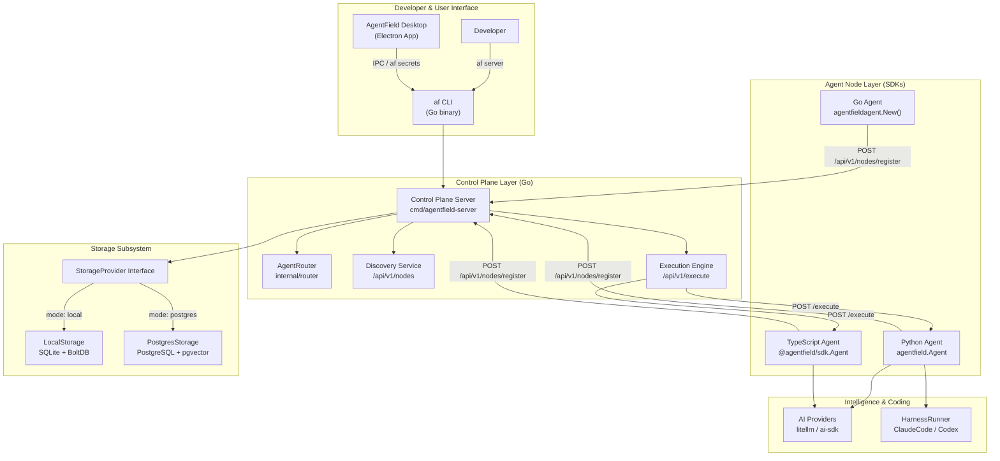
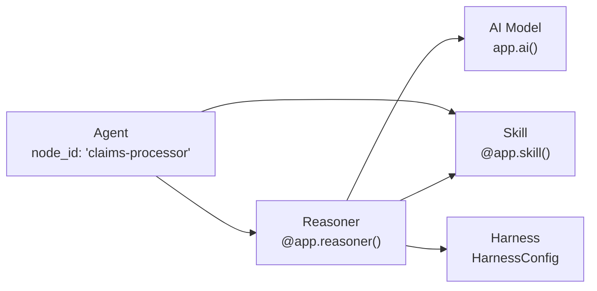

<!-- source: DeepWiki mcp.deepwiki.com · repo Agent-Field/agentfield · page 1 Overview · fetched 2026-10-26 -->

# Overview

<details>
<summary>Relevant source files</summary>

The following files were used as context for generating this wiki page:

- [.github/workflows/update-download-stats.yml](.github/workflows/update-download-stats.yml)
- [CHANGELOG.md](CHANGELOG.md)
- [README.md](README.md)
- [VERSION](VERSION)
- [assets/UI.png](assets/UI.png)
- [assets/arch.png](assets/arch.png)
- [assets/examples/ai-security-auditor.png](assets/examples/ai-security-auditor.png)
- [assets/examples/autonomous-engineering-team.png](assets/examples/autonomous-engineering-team.png)
- [assets/examples/deep-research-engine.png](assets/examples/deep-research-engine.png)
- [assets/examples/reactive-database-layer.png](assets/examples/reactive-database-layer.png)
- [assets/features-strip.png](assets/features-strip.png)
- [assets/github hero.png](assets/github hero.png)
- [control-plane/internal/templates/go/go.mod.tmpl](control-plane/internal/templates/go/go.mod.tmpl)
- [examples/python_agent_nodes/agentic_rag/requirements.txt](examples/python_agent_nodes/agentic_rag/requirements.txt)
- [examples/python_agent_nodes/documentation_chatbot/requirements.txt](examples/python_agent_nodes/documentation_chatbot/requirements.txt)
- [examples/python_agent_nodes/hello_world_rag/requirements.txt](examples/python_agent_nodes/hello_world_rag/requirements.txt)
- [sdk/python/CHANGELOG.md](sdk/python/CHANGELOG.md)
- [sdk/python/agentfield/__init__.py](sdk/python/agentfield/__init__.py)
- [sdk/python/pyproject.toml](sdk/python/pyproject.toml)
- [sdk/python/tests/test_execution_logger.py](sdk/python/tests/test_execution_logger.py)
- [sdk/typescript/package.json](sdk/typescript/package.json)

</details>


This document provides a high-level introduction to **AgentField**, an open-source control plane for autonomous AI agents, often described as "Kubernetes for AI Agents." AgentField treats AI agents as first-class backend services, providing infrastructure for routing, orchestration, state management, and cryptographic identity.

**Scope:** This page introduces the core architecture, key concepts, and fundamental components. For detailed implementation guides, see the SDK documentation ([Python SDK](#3), [TypeScript SDK](#4), [Go SDK](#5)). For deployment and production considerations, see [Deployment](#13).

---

## What is AgentField?

AgentField is backend infrastructure for autonomous AI systems. It provides a **control plane** (stateless Go service) that orchestrates **agent nodes** (Python/TypeScript/Go processes) across distributed environments. Unlike agent frameworks that bundle everything into monolithic scripts, AgentField treats agents as microservices with standard REST APIs.

**Key characteristics:**
- **Agent-as-Service model**: Each agent exposes HTTP endpoints for its capabilities.
- **Multi-language native**: Python, TypeScript, and Go SDKs with identical semantics.
- **Harness Orchestration**: Native support for delegating tasks to autonomous coding agents like Claude Code, Codex, and OpenCode [[README.md:21-25](), [sdk/python/pyproject.toml:53-72]()].
- **Built-in state**: Hierarchical memory with vector search, no external databases required.
- **Cryptographic identity**: W3C DIDs and Verifiable Credentials for trust and audit trails [[sdk/python/agentfield/did_auth.py:1-52]()].
- **Desktop Dashboard**: A Docker-Desktop-style companion app for managing nodes and local health [[CHANGELOG.md:14-34]()].

**Version**: 0.1.109-rc.6 [[VERSION:1]()]

Sources: [README.md:1-60](), [VERSION:1](), [CHANGELOG.md:9-14]()

---

## High-Level Architecture



**Core components:**

| Component | Implementation | Source Pointer | Purpose |
|-----------|---------------|----------------|---------|
| **Control Plane** | Go service | `cmd/agentfield-server` | Stateless orchestration hub |
| **CLI** | `af` binary | `cmd/af` | Project scaffolding and secret management |
| **Desktop App** | Electron/React | `desktop/` | GUI for health and agent monitoring |
| **Python SDK** | `agentfield` | [sdk/python/agentfield/agent.py:1]() | Agent runtime and Pydantic integration |
| **TypeScript SDK** | `@agentfield/sdk` | [sdk/typescript/package.json:1]() | Agent runtime with AI SDK support |
| **Harness** | `HarnessRunner` | [sdk/python/agentfield/harness.py:1]() | Abstraction for autonomous coding agents |

Sources: [README.md:26-60](), [sdk/python/pyproject.toml:1-40](), [sdk/typescript/package.json:1-49](), [CHANGELOG.md:14-34]()

---

## Core Concepts

### Agents, Reasoners, and Skills

AgentField distinguishes between non-deterministic AI logic and deterministic tools:



**Definitions:**

- **Agent**: A logical microservice grouping, identified by `node_id`. Defined via the `Agent` class [[sdk/python/agentfield/agent.py:1]()].
- **Reasoner**: AI-powered logic that uses LLMs to make decisions. Defined via `@app.reasoner()` [[sdk/python/agentfield/decorators.py:81]()].
- **Skills**: Deterministic functions for tools (API calls, DB writes). Defined via `@app.skill()` [[sdk/python/agentfield/agent.py:1]()].
- **Harness**: A specialized execution environment for high-autonomy coding agents like Claude Code [[sdk/python/agentfield/harness.py:1]()].

**Example in Python:**

```python
from agentfield import Agent, AIConfig

app = Agent(node_id="researcher", ai_config=AIConfig(model="anthropic/claude-3-5-sonnet"))

@app.skill()
def fetch_data(query: str):
    return {"data": "..."}

@app.reasoner()
async def research(topic: str):
    context = fetch_data(topic)
    return await app.ai(user=f"Analyze: {topic}", context=context)

app.run()
```

Sources: [README.md:58-99](), [sdk/python/agentfield/__init__.py:1-90]()

---

## System Architecture

AgentField follows a Hub-and-Spoke model where the Control Plane acts as the central router.

### Agent Lifecycle & Communication
1. **Registration**: Agents register their `ReasonerDefinition` and `SkillDefinition` with the control plane [[sdk/python/agentfield/types.py:11-12]()].
2. **Execution**: The control plane receives a request at `/api/v1/execute/{node}.{capability}` and proxies it to the agent node's callback URL.
3. **Identity**: Agents can use `DIDAuthenticator` to sign requests, ensuring only authorized callers can invoke capabilities [[sdk/python/agentfield/did_auth.py:45-52]()].

For details, see [System Architecture](#1.2).

### Storage & Memory
AgentField provides a `MemoryInterface` that abstracts away the storage layer [[sdk/python/agentfield/memory.py:1]()].
- **Local Mode**: Uses SQLite for workflows and BoltDB for key-value state.
- **Postgres Mode**: Uses PostgreSQL with `pgvector` for scalable RAG and unified storage.
- **Memory Scopes**: State is automatically partitioned into `workflow`, `session`, `actor`, and `global` scopes [[sdk/python/agentfield/types.py:10]()].

For details, see [Memory System](#7).

---

## Multi-Agent Coordination

Coordination is handled via `app.call()`, which routes requests through the control plane rather than direct peer-to-peer calls. This enables:
- **Distributed Fan-out**: One reasoner can call thousands of other agents in parallel using `asyncio.gather` [[README.md:85-93]()].
- **Workflow Tracing**: The control plane assigns `X-Workflow-ID` and `X-Execution-ID` headers to every call, allowing for full DAG visualization in the Dashboard UI.
- **Discovery**: Agents can use the `discover()` method to find other agents by tags or capabilities [[sdk/python/agentfield/client.py:1]()].

For details, see [Multi-Agent Coordination](#9).

---

## Getting Started

To begin building with AgentField:
1. **Install the CLI**: `curl -fsSL https://agentfield.ai/install.sh | bash` [[README.md:42]()].
2. **Initialize a Project**: `af init my-agent` [[README.md:48-52]()].
3. **Start the Server**: `af server` to launch the control plane and dashboard [[CHANGELOG.md:108-114]()].

For a full tutorial, see [Getting Started](#2).

Sources: [README.md:1-102](), [CHANGELOG.md:9-100]()

---

