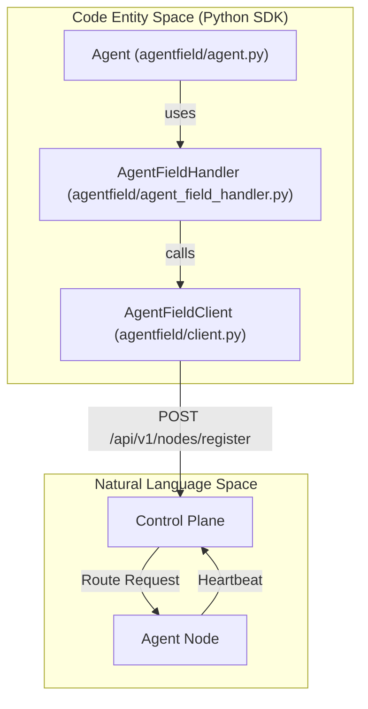
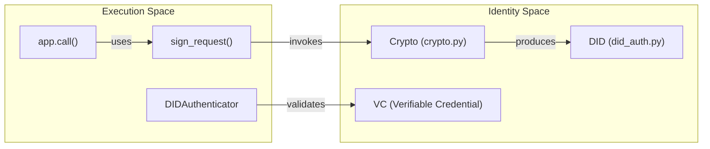

<!-- source: DeepWiki mcp.deepwiki.com · repo Agent-Field/agentfield · page 1.1 Core Concepts · fetched 2026-10-26 -->

# Core Concepts

Relevant source files

The following files were used as context for generating this wiki page:

- [.github/workflows/update-download-stats.yml](.github/workflows/update-download-stats.yml)
- [CHANGELOG.md](CHANGELOG.md)
- [README.md](README.md)
- [VERSION](VERSION)
- [assets/UI.png](assets/UI.png)
- [assets/arch.png](assets/arch.png)
- [assets/examples/ai-security-auditor.png](assets/examples/ai-security-auditor.png)
- [assets/examples/autonomous-engineering-team.png](assets/examples/autonomous-engineering-team.png)
- [assets/examples/deep-research-engine.png](assets/examples/deep-research-engine.png)
- [assets/examples/reactive-database-layer.png](assets/examples/reactive-database-layer.png)
- [assets/features-strip.png](assets/features-strip.png)
- [assets/github hero.png](assets/github hero.png)
- [control-plane/internal/templates/go/go.mod.tmpl](control-plane/internal/templates/go/go.mod.tmpl)
- [examples/python_agent_nodes/agentic_rag/requirements.txt](examples/python_agent_nodes/agentic_rag/requirements.txt)
- [examples/python_agent_nodes/documentation_chatbot/requirements.txt](examples/python_agent_nodes/documentation_chatbot/requirements.txt)
- [examples/python_agent_nodes/hello_world_rag/requirements.txt](examples/python_agent_nodes/hello_world_rag/requirements.txt)
- [sdk/python/CHANGELOG.md](sdk/python/CHANGELOG.md)
- [sdk/python/agentfield/__init__.py](sdk/python/agentfield/__init__.py)
- [sdk/python/pyproject.toml](sdk/python/pyproject.toml)
- [sdk/python/tests/test_execution_logger.py](sdk/python/tests/test_execution_logger.py)
- [sdk/typescript/package.json](sdk/typescript/package.json)

This page defines the fundamental building blocks of the AgentField system. Understanding these concepts is essential before deploying agents or integrating with the control plane.

**Scope:** This document covers the core terminology and architectural patterns used throughout AgentField. For detailed system architecture diagrams, see **1.2 System Architecture**. For specific SDK implementation details, see the Python SDK (**3.0**), TypeScript SDK (**4.0**), or Go SDK (**5.0**) sections.

---

## Control Plane

The **Control Plane** is the central orchestration hub for all agents in an AgentField deployment. It is a stateless service that acts as the "Kubernetes for AI Agents"—it does not execute agent logic itself but routes requests, tracks executions, manages registration, and provides observability.

**Key responsibilities:**
- **Agent Registration and Discovery:** Maintaining a registry of active nodes and their capabilities.
- **Request Routing:** Proxying execution calls to the correct agent node via HTTP.
- **Workflow Tracking:** Generating DAGs and tracking parent-child relationships between agent calls.
- **Memory Management:** Providing a centralized storage layer for cross-agent state.
- **Identity & Trust:** Issuing DIDs and verifying execution chains via Verifiable Credentials.

**Sources:** [README.md:27-52](), [CHANGELOG.md:18-29]()

---

## Agent Nodes

An **Agent Node** is an independent service (typically a container or serverless function) that hosts one or more capabilities. Each node is defined by an `Agent` class instance in the SDK.

**Lifecycle of an Agent Node:**
1. **Initialization:** The agent is instantiated with a unique `node_id` and version [sdk/python/agentfield/agent.py:107-120]().
2. **Registration:** On startup, the agent sends its manifest (reasoners, skills, and callback URL) to the Control Plane [sdk/python/agentfield/agent_field_handler.py:41-100]().
3. **Heartbeat:** The node maintains a background thread to send periodic liveness signals [sdk/python/agentfield/agent_field_handler.py:170-190]().
4. **Execution:** The node listens for incoming HTTP POST requests at `/execute` and routes them to the local function [sdk/python/agentfield/agent.py:311-355]().

**Sources:** [sdk/python/agentfield/agent.py:107-120](), [sdk/python/agentfield/agent_field_handler.py:41-100]()

---

## Reasoners vs. Skills

AgentField enforces a clean separation between non-deterministic AI logic and deterministic code.

### Reasoners
**Reasoners** are functions powered by LLMs. They handle high-level planning, synthesis, and decision-making.
- **Decorator:** `@app.reasoner()` [sdk/python/agentfield/decorators.py:81-81]()
- **Capability:** Access to `app.ai()` for LLM generation and structured output [README.md:72-93]().
- **Traceability:** Automatically logged as reasoning steps in the Control Plane dashboard.

### Skills
**Skills** are deterministic tools. They perform specific, repeatable actions like database queries, API calls, or file manipulations.
- **Decorator:** `@app.skill()` [sdk/python/agentfield/__init__.py:100-100]()
- **Constraint:** Should not contain LLM logic; used for execution of "decisions" made by reasoners.

**Sources:** [sdk/python/agentfield/types.py:11-12](), [README.md:58-99]()

---

## Memory Scopes

Memory in AgentField is hierarchical and scoped to the execution context. This allows agents to share state without manual key management.

| Scope | Implementation | Lifetime |
| :--- | :--- | :--- |
| **Workflow** | `workflow_id` | Persists for a single execution chain (DAG) |
| **Session** | `session_id` | Persists across multiple turns of a conversation |
| **Actor** | `actor_id` | Persists for a specific user or external entity |
| **Global** | `global` | Shared across all agents and all users |

**Data Flow:** When an agent calls `app.memory.get("key")`, the system performs a hierarchical lookup: **Workflow → Session → Actor → Global** [sdk/python/agentfield/agent.py:809-850]().

**Sources:** [sdk/python/agentfield/agent.py:809-904](), [sdk/python/agentfield/__init__.py:73-73]()

---

## Identity & Trust (DIDs & VCs)

AgentField uses cryptographic identities to ensure that every action in a multi-agent system is verifiable.

### Decentralized Identifiers (DIDs)
Every Agent Node and the Control Plane itself has a **DID** (e.g., `did:agentfield:node:researcher`). These are used to sign requests and verify the identity of the caller [sdk/python/agentfield/did_auth.py:45-52]().

### Verifiable Credentials (VCs)
When an agent completes a task, it can generate a **Verifiable Credential (VC)**. This is a signed statement containing the input hash, output hash, and the DIDs involved [sdk/python/agentfield/__init__.py:134-147]().
- **Purpose:** Audit trails and non-repudiation.
- **Verification:** The Control Plane verifies these signatures to ensure the execution chain hasn't been tampered with.

**Sources:** [sdk/python/agentfield/did_auth.py:45-52](), [sdk/python/agentfield/crypto.py:53-61]()

---

## Execution Context

The `ExecutionContext` is a transient object that carries metadata through the call stack. It is populated from incoming HTTP headers like `X-Workflow-ID`, `X-Session-ID`, and `X-Caller-DID` [sdk/python/agentfield/agent.py:683-708]().

**Key Functions:**
- `get_current_context()`: Retrieves the context for the current async task [sdk/python/agentfield/agent.py:683-708]().
- **Propagation:** When an agent calls `app.call()`, the SDK automatically attaches the current context headers to the outgoing request so the next agent in the chain remains part of the same workflow.

**Sources:** [sdk/python/agentfield/agent.py:683-708](), [sdk/python/agentfield/session_transport.py:74-80]()

---

