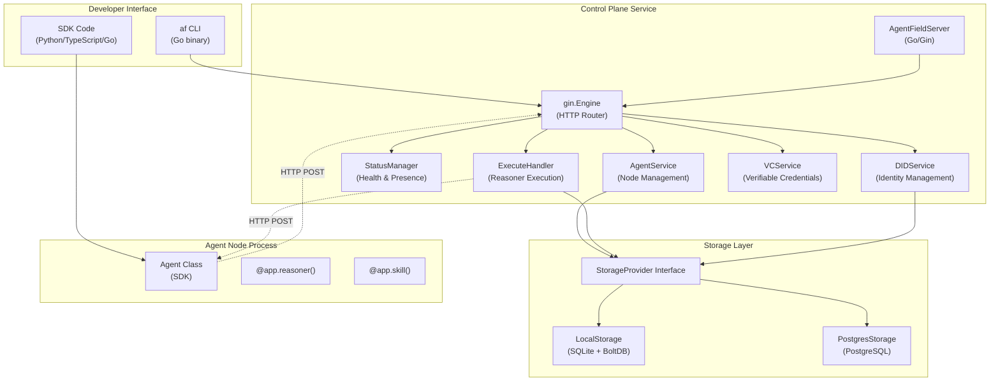
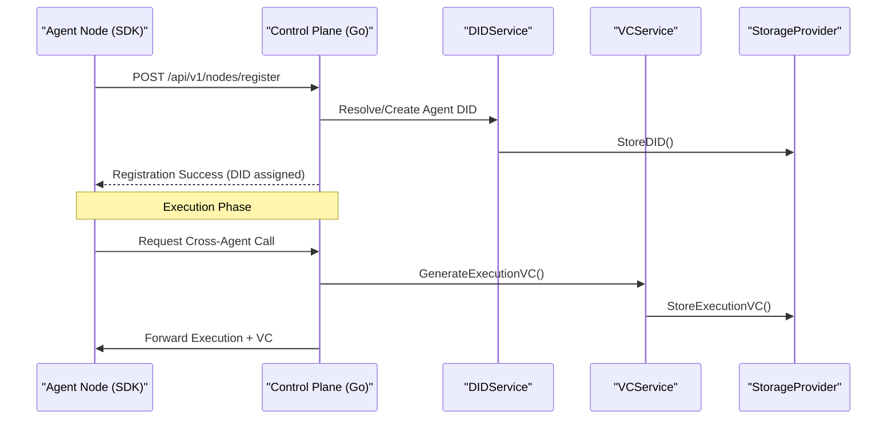

<!-- source: DeepWiki mcp.deepwiki.com · repo Agent-Field/agentfield · page 1.2 System Architecture · fetched 2026-10-26 -->

# System Architecture

Relevant source files

The following files were used as context for generating this wiki page:

- [.github/workflows/update-download-stats.yml](.github/workflows/update-download-stats.yml)
- [README.md](README.md)
- [assets/UI.png](assets/UI.png)
- [assets/arch.png](assets/arch.png)
- [assets/examples/ai-security-auditor.png](assets/examples/ai-security-auditor.png)
- [assets/examples/autonomous-engineering-team.png](assets/examples/autonomous-engineering-team.png)
- [assets/examples/deep-research-engine.png](assets/examples/deep-research-engine.png)
- [assets/examples/reactive-database-layer.png](assets/examples/reactive-database-layer.png)
- [assets/features-strip.png](assets/features-strip.png)
- [assets/github hero.png](assets/github hero.png)
- [control-plane/cmd/af/main.go](control-plane/cmd/af/main.go)
- [control-plane/cmd/agentfield-server/main.go](control-plane/cmd/agentfield-server/main.go)
- [control-plane/config/agentfield.yaml](control-plane/config/agentfield.yaml)
- [control-plane/internal/config/config.go](control-plane/internal/config/config.go)
- [control-plane/internal/config/config_additional_test.go](control-plane/internal/config/config_additional_test.go)
- [control-plane/internal/server/middleware/auth.go](control-plane/internal/server/middleware/auth.go)
- [control-plane/internal/server/middleware/auth_admin_additional_test.go](control-plane/internal/server/middleware/auth_admin_additional_test.go)
- [control-plane/internal/server/middleware/auth_test.go](control-plane/internal/server/middleware/auth_test.go)
- [control-plane/internal/server/routes_admin.go](control-plane/internal/server/routes_admin.go)
- [control-plane/internal/server/routes_middleware.go](control-plane/internal/server/routes_middleware.go)
- [control-plane/internal/server/server.go](control-plane/internal/server/server.go)
- [control-plane/internal/server/server_additional_test.go](control-plane/internal/server/server_additional_test.go)
- [control-plane/internal/server/server_coverage_additional_test.go](control-plane/internal/server/server_coverage_additional_test.go)
- [deployments/helm/agentfield/templates/control-plane-deployment.yaml](deployments/helm/agentfield/templates/control-plane-deployment.yaml)
- [docs/ENVIRONMENT_VARIABLES.md](docs/ENVIRONMENT_VARIABLES.md)
- [tests/functional/docker/agentfield-test.yaml](tests/functional/docker/agentfield-test.yaml)

## Purpose and Scope

This document describes the technical architecture of AgentField's core infrastructure components: the Control Plane orchestration service, Agent Node runtime model, storage subsystems, and communication protocols. It explains how these components interact to provide a distributed, production-ready execution environment for AI agents.

AgentField follows a "Control Plane + Agent Node" model where the control plane handles orchestration, memory, and identity, while agent nodes (implemented via SDKs) handle reasoning and skill execution.

---

## High-Level Architecture

AgentField uses a **Control Plane + Agent Node** architecture where a central orchestration service coordinates multiple independent agent processes. This mirrors Kubernetes' control plane pattern but is optimized for AI agent workloads.

### System Components Diagram

**Sources:** [control-plane/internal/server/server.go:47-104](), [control-plane/internal/server/server.go:107-175](), [README.md:27-52]()

---

## Control Plane Architecture

The Control Plane is a Go service built with the Gin framework. It acts as the central orchestrator for agent discovery, execution routing, and state management.

### Control Plane Components

| Component | Implementation | Purpose |
|-----------|---------------|---------|
| **HTTP Router** | `gin.Engine` | Routes API requests to handlers [control-plane/internal/server/server.go:139]() |
| **Agent Service** | `coreservices.AgentService` | Manages agent node lifecycle and registration [control-plane/internal/server/server.go:155]() |
| **Status Manager** | `services.StatusManager` | Tracks agent heartbeats and health transitions [control-plane/internal/server/server.go:169]() |
| **DID Service** | `services.DIDService` | Manages Decentralized Identifiers for agents [control-plane/internal/server/server.go:64]() |
| **VC Service** | `services.VCService` | Generates Verifiable Credentials for execution audits [control-plane/internal/server/server.go:65]() |
| **Agent Client** | `communication.HTTPAgentClient` | Communicates with remote agent nodes [control-plane/internal/server/server.go:145]() |
| **Storage Provider** | `storage.StorageProvider` | Interface for persistence (SQLite or Postgres) [control-plane/internal/server/server.go:49]() |

### Global Middleware Stack

The Control Plane applies a global middleware stack to all routes via `applyGlobalMiddleware()`:
1.  **CORS**: Configurable via `API.CORS` settings [control-plane/internal/server/routes_middleware.go:19-38]().
2.  **Request Logging**: Standard Gin logger [control-plane/internal/server/routes_middleware.go:40-52]().
3.  **Timeout**: 1-hour timeout for long-running agent executions [control-plane/internal/server/routes_middleware.go:54-62]().
4.  **API Key Auth**: Enforced via `middleware.APIKeyAuth` [control-plane/internal/server/routes_middleware.go:79-84]().
5.  **DID Auth**: Optional cryptographic identity verification [control-plane/internal/server/routes_middleware.go:89-102]().

**Sources:** [control-plane/internal/server/routes_middleware.go:18-110](), [control-plane/internal/server/middleware/auth.go:19-146]()

---

## Storage Layer

AgentField supports a dual-backend storage model defined in the `StorageConfig` [control-plane/internal/config/config.go:20]().

### Local Mode (Development)
- **Database**: SQLite for relational data (agents, executions, DIDs) [control-plane/config/agentfield.yaml:71]().
- **KV Store**: BoltDB for memory and state [control-plane/config/agentfield.yaml:72]().
- **Vector**: Local vector storage (enabled by default) [control-plane/config/agentfield.yaml:81]().

### Postgres Mode (Production)
- **Engine**: PostgreSQL with support for SSL and connection pooling [control-plane/config/agentfield.yaml:73-79]().
- **DSN**: Configurable via `AGENTFIELD_POSTGRES_URL` [control-plane/cmd/agentfield-server/main.go:111-124]().

**Sources:** [control-plane/config/agentfield.yaml:68-83](), [control-plane/cmd/agentfield-server/main.go:97-154]()

---

## Identity and Trust Model

AgentField bridges the gap between natural language agent definitions and cryptographic security using DIDs and VCs.

### Identity Flow Diagram

### Security Enforcement
- **API Key**: Required for all REST operations unless explicitly skipped [control-plane/internal/server/middleware/auth.go:121-135]().
- **Admin Token**: Required for sensitive operations via `X-Admin-Token` [control-plane/internal/server/middleware/auth.go:166-185]().
- **VC Requirements**: Can be configured to require VCs for registration, execution, and cross-agent calls [control-plane/config/agentfield.yaml:91-94]().

**Sources:** [control-plane/internal/server/middleware/auth.go:19-185](), [control-plane/config/agentfield.yaml:85-112]()

---

## Execution and Communication Patterns

### Request Context Propagation
The Control Plane propagates execution context using custom HTTP headers. Downstream SDKs and handlers use these to maintain workflow state:
- `X-Caller-Agent-ID`: Identifies the calling agent [control-plane/internal/server/middleware/auth.go:139]().
- `X-Agent-Node-ID`: Identifies the target node [control-plane/internal/server/middleware/auth.go:141]().

### Agent Heartbeats
Agent nodes must send periodic heartbeats. The `StatusManager` reconciles these heartbeats to determine node health [control-plane/internal/server/server.go:158-164](). If heartbeats exceed the `HeartbeatStaleThreshold`, the node is marked as unhealthy.

### Streaming and Events
AgentField supports real-time events via WebSockets and SSE for:
- Memory updates (`/api/v1/memory/events/ws`) [control-plane/internal/server/routes_middleware.go:132]().
- Execution logs (`/api/ui/v1/executions/:execution_id/logs/stream`) [control-plane/internal/server/routes_middleware.go:128]().
- Workflow events [control-plane/internal/server/routes_middleware.go:127]().

**Sources:** [control-plane/internal/server/server.go:157-175](), [control-plane/internal/server/routes_middleware.go:124-136](), [control-plane/internal/server/middleware/auth.go:139-143]()

---

