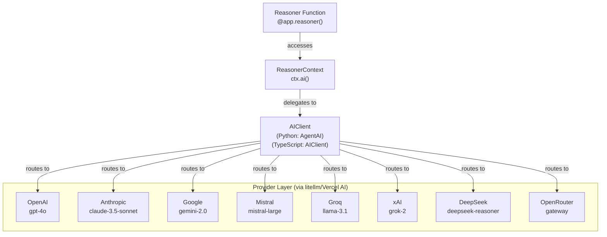
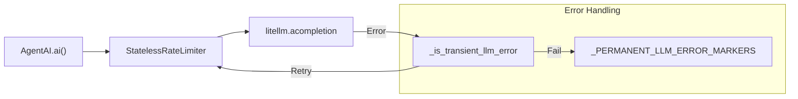

<!-- source: DeepWiki mcp.deepwiki.com · repo Agent-Field/agentfield · page 10 AI Integration · fetched 2026-10-26 -->

# AI Integration

Relevant source files

The following files were used as context for generating this wiki page:

- [control-plane/web/client/package-lock.json](control-plane/web/client/package-lock.json)
- [control-plane/web/client/package.json](control-plane/web/client/package.json)
- [control-plane/web/client/pnpm-lock.yaml](control-plane/web/client/pnpm-lock.yaml)
- [control-plane/web/client/src/components/ui/icon-bridge.tsx](control-plane/web/client/src/components/ui/icon-bridge.tsx)
- [control-plane/web/client/src/components/ui/icon.tsx](control-plane/web/client/src/components/ui/icon.tsx)
- [examples/benchmarks/100k-scale/mastra-bench/package-lock.json](examples/benchmarks/100k-scale/mastra-bench/package-lock.json)
- [examples/benchmarks/100k-scale/mastra-bench/package.json](examples/benchmarks/100k-scale/mastra-bench/package.json)
- [examples/python_agent_nodes/rag_evaluation/ui/package-lock.json](examples/python_agent_nodes/rag_evaluation/ui/package-lock.json)
- [examples/python_agent_nodes/rag_evaluation/ui/package.json](examples/python_agent_nodes/rag_evaluation/ui/package.json)
- [sdk/python/agentfield/agent_ai.py](sdk/python/agentfield/agent_ai.py)
- [sdk/python/agentfield/media_router.py](sdk/python/agentfield/media_router.py)
- [sdk/python/agentfield/vision.py](sdk/python/agentfield/vision.py)
- [sdk/python/tests/test_agent_ai.py](sdk/python/tests/test_agent_ai.py)
- [sdk/python/tests/test_image_config.py](sdk/python/tests/test_image_config.py)
- [sdk/python/tests/test_media_router.py](sdk/python/tests/test_media_router.py)
- [sdk/python/tests/test_strict_openai_schema.py](sdk/python/tests/test_strict_openai_schema.py)
- [sdk/python/tests/test_types.py](sdk/python/tests/test_types.py)
- [sdk/python/uv.lock](sdk/python/uv.lock)
- [sdk/typescript/package-lock.json](sdk/typescript/package-lock.json)

This page describes how agents connect to Large Language Model (LLM) providers and configure AI-powered operations. AI integration in AgentField enables reasoners to perform text generation, streaming responses, structured output, and embedding generation across multiple providers.

For information about defining reasoners that use AI capabilities, see [Defining Reasoners](#3.2) (Python) and [Reasoners and Skills](#4.2) (TypeScript). For memory-based vector operations that use embeddings, see [Vector Storage](#7.3).

---

## Overview

AgentField provides unified AI integration through two SDK implementations:

- **Python SDK**: Uses `litellm` as the underlying provider abstraction [sdk/python/agentfield/agent_ai.py:30-45]().
- **TypeScript SDK**: Uses Vercel AI SDK (`ai` package) with provider-specific adapters [sdk/typescript/package-lock.json:12-20]().

Both SDKs expose a consistent interface for AI operations while supporting 10+ LLM providers. Configuration is handled through the `AIConfig` type, and AI clients are automatically injected into reasoner execution contexts.

**Architecture Flow:**

**Sources:** [sdk/python/agentfield/agent_ai.py:10-16](), [sdk/typescript/package-lock.json:12-20]()

---

## Supported Providers

AgentField supports a wide range of AI providers. Provider support varies slightly between Python (via `litellm`) and TypeScript (via Vercel AI SDK).

### Provider Comparison Table

| Provider | TypeScript SDK | Python SDK | Text Generation | Embeddings | Notes |
|----------|----------------|------------|-----------------|------------|-------|
| **OpenAI** | ✓ | ✓ | ✓ | ✓ | Default provider [sdk/python/tests/test_agent_ai.py:16]() |
| **Anthropic** | ✓ | ✓ | ✓ | ✗ | Claude models [sdk/typescript/package-lock.json:54]() |
| **Google** | ✓ | ✓ | ✓ | ✓ | Gemini models [sdk/typescript/package-lock.json:148]() |
| **Mistral** | ✓ | ✓ | ✓ | ✓ | [sdk/typescript/package-lock.json:180]() |
| **Groq** | ✓ | ✓ | ✓ | ✗ | [sdk/typescript/package-lock.json:164]() |
| **xAI** | ✓ | ✓ | ✓ | ✗ | Grok models [sdk/typescript/package-lock.json:19]() |
| **DeepSeek** | ✓ | ✓ | ✓ | ✗ | [sdk/typescript/package-lock.json:86]() |
| **Cohere** | ✓ | ✓ | ✓ | ✓ | [sdk/typescript/package-lock.json:70]() |
| **OpenRouter** | ✓ | ✓ | ✓ | ✓ | Gateway [sdk/python/agentfield/vision.py:99]() |
| **Ollama** | ✓ | ✓ | ✓ | ✓ | Local models |

### Provider Logic Mapping

The Python SDK utilizes `AgentAI` to wrap `litellm` calls, providing a safety net for transient errors and timeouts [sdk/python/agentfield/agent_ai.py:169-212]().

**Sources:** [sdk/python/agentfield/agent_ai.py:185-212](), [sdk/python/agentfield/agent_ai.py:16-18]()

---

## AI Configuration

AI integration is configured through the `AIConfig` object, which controls model selection, authentication, and generation parameters.

### AIConfig Parameters

| Field | Description | Default (Python) |
|-------|-------------|-----------------|
| `model` | The LLM model string (e.g., `openai/gpt-4o`) | `openai/gpt-4` [sdk/python/tests/test_agent_ai.py:16]() |
| `temperature` | Controls randomness (0.0 to 1.0) | `0.1` [sdk/python/tests/test_agent_ai.py:17]() |
| `max_tokens` | Maximum output tokens | `100` [sdk/python/tests/test_agent_ai.py:18]() |
| `fallback_models` | List of models to try if the primary fails | `[]` [sdk/python/tests/test_agent_ai.py:22]() |
| `enable_rate_limit_retry` | Whether to auto-retry on 429 errors | `True` [sdk/python/tests/test_agent_ai.py:24]() |

### Media Models
Configuration also includes specific models for non-text modalities:
- **Audio**: `audio_model` (e.g., `tts-1`) [sdk/python/tests/test_agent_ai.py:33]()
- **Vision**: `vision_model` (e.g., `dall-e-3`) [sdk/python/tests/test_agent_ai.py:34]()
- **Video**: `video_model` (e.g., `fal-ai/minimax-video`) [sdk/python/tests/test_agent_ai.py:35]()

**Sources:** [sdk/python/tests/test_agent_ai.py:14-36]()

---

## Text Generation

Text generation is the core AI capability, supporting both unstructured text and structured data.

### Text vs. Structured Output
AgentField handles structured output by validating against schemas. In Python, this often uses Pydantic models. The SDK detects if a response is empty even after reasoning content is provided [sdk/python/agentfield/agent_ai.py:92-100]().

### Vision and Image Generation
The `vision.py` module handles image generation via `generate_image_litellm` and `generate_image_openrouter` [sdk/python/agentfield/vision.py:29-108](). OpenRouter integration specifically handles "modalities" to enable image generation through standard chat endpoints [sdk/python/agentfield/vision.py:162-172]().

**Sources:** [sdk/python/agentfield/agent_ai.py:48-64](), [sdk/python/agentfield/vision.py:139-177]()

---

## Embeddings

Embeddings are used for semantic search and memory retrieval.

### Generation
The SDK provides methods to generate embeddings for single strings or batches of text. These are used internally by the memory system to populate vector databases.

### Provider Support
Embedding support is generally limited to providers like OpenAI, Google, and Cohere. The SDK will throw errors if embedding generation is attempted on a text-only provider like Anthropic.

**Sources:** [sdk/python/uv.lock:15](), [sdk/typescript/package-lock.json:13]()

---

## Rate Limiting & Retries

AgentField implements a robust retry mechanism to handle the inherent instability of LLM APIs.

### StatelessRateLimiter
The `StatelessRateLimiter` handles exponential backoff and jitter [sdk/python/agentfield/agent_ai.py:16](). It is used by `AgentAI` to wrap all LLM calls [sdk/python/tests/test_agent_ai.py:106-111]().

### Safety Features
- **Timeout Safety Net**: Retries LLM calls that hit wall-clock timeouts, as these are often stalled connections [sdk/python/agentfield/agent_ai.py:169-182]().
- **HTTP Client Reset**: After a timeout, the SDK resets `litellm` HTTP clients to clear deadlocked connection pools [sdk/python/agentfield/agent_ai.py:103-164]().
- **Error Classification**: Distinguishes between transient errors (retriable) and permanent errors (fail fast) [sdk/python/agentfield/agent_ai.py:185-212]().

**Sources:** [sdk/python/agentfield/agent_ai.py:103-164](), [sdk/python/agentfield/agent_ai.py:185-212](), [sdk/python/tests/test_agent_ai.py:134-139]()

---

