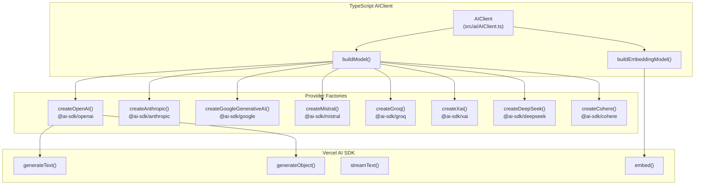
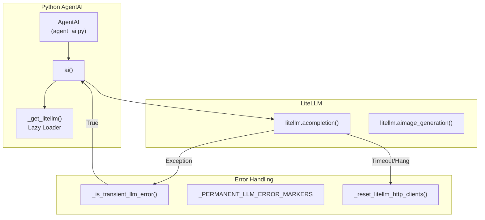
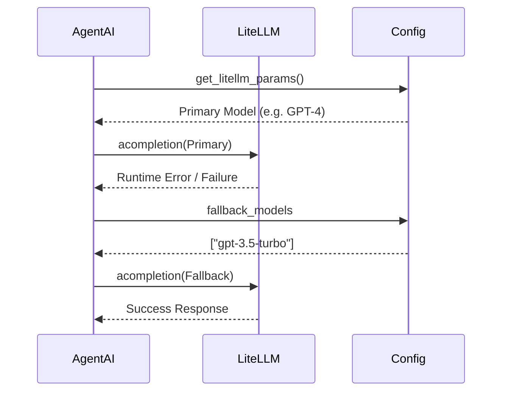

<!-- source: DeepWiki mcp.deepwiki.com · repo Agent-Field/agentfield · page 10.1 Supported Providers · fetched 2026-10-26 -->

# Supported Providers

Relevant source files

The following files were used as context for generating this wiki page:

- [control-plane/web/client/package-lock.json](control-plane/web/client/package-lock.json)
- [control-plane/web/client/package.json](control-plane/web/client/package.json)
- [control-plane/web/client/pnpm-lock.yaml](control-plane/web/client/pnpm-lock.yaml)
- [control-plane/web/client/src/components/ui/icon-bridge.tsx](control-plane/web/client/src/components/ui/icon-bridge.tsx)
- [control-plane/web/client/src/components/ui/icon.tsx](control-plane/web/client/src/components/ui/icon.tsx)
- [examples/benchmarks/100k-scale/mastra-bench/package-lock.json](examples/benchmarks/100k-scale/mastra-bench/package-lock.json)
- [examples/benchmarks/100k-scale/mastra-bench/package.json](examples/benchmarks/100k-scale/mastra-bench/package.json)
- [examples/python_agent_nodes/rag_evaluation/ui/package-lock.json](examples/python_agent_nodes/rag_evaluation/ui/package-lock.json)
- [examples/python_agent_nodes/rag_evaluation/ui/package.json](examples/python_agent_nodes/rag_evaluation/ui/package.json)
- [sdk/python/agentfield/agent_ai.py](sdk/python/agentfield/agent_ai.py)
- [sdk/python/agentfield/media_router.py](sdk/python/agentfield/media_router.py)
- [sdk/python/agentfield/vision.py](sdk/python/agentfield/vision.py)
- [sdk/python/tests/test_agent_ai.py](sdk/python/tests/test_agent_ai.py)
- [sdk/python/tests/test_image_config.py](sdk/python/tests/test_image_config.py)
- [sdk/python/tests/test_media_router.py](sdk/python/tests/test_media_router.py)
- [sdk/python/tests/test_strict_openai_schema.py](sdk/python/tests/test_strict_openai_schema.py)
- [sdk/python/tests/test_types.py](sdk/python/tests/test_types.py)
- [sdk/python/uv.lock](sdk/python/uv.lock)
- [sdk/typescript/package-lock.json](sdk/typescript/package-lock.json)

This page documents the AI/LLM providers that AgentField SDKs support for text generation, embeddings, and multimodal outputs. AgentField provides a unified interface for interacting with multiple providers across its Python and TypeScript SDKs, enabling agents to switch between providers without code changes.

For information about configuring AI models and API keys, see [AI Configuration](#10.2). For text generation patterns, see [Text Generation](#10.3). For embedding generation, see [Embeddings](#10.4).

---

## Provider Support Matrix

AgentField supports 10+ AI providers through a unified interface. The TypeScript SDK uses the Vercel AI SDK ecosystem, while the Python SDK leverages LiteLLM for broad coverage and specialized image generation logic.

| Provider | TypeScript SDK | Python SDK | Text Generation | Embeddings | Image Generation |
|----------|----------------|------------|-----------------|------------|------------------|
| **OpenAI** | ✅ | ✅ | ✅ | ✅ | ✅ (DALL-E) |
| **Anthropic** | ✅ | ✅ | ✅ | ❌ | ❌ |
| **Google (Gemini)** | ✅ | ✅ | ✅ | ✅ | ✅ (via OpenRouter) |
| **Mistral** | ✅ | ✅ | ✅ | ✅ | ❌ |
| **Groq** | ✅ | ✅ | ✅ | ❌ | ❌ |
| **xAI (Grok)** | ✅ | ✅ | ✅ | ❌ | ✅ (Grok-Imagine) |
| **DeepSeek** | ✅ | ✅ | ✅ | ❌ | ❌ |
| **Cohere** | ✅ | ✅ | ✅ | ✅ | ❌ |
| **OpenRouter** | ✅ | ✅ | ✅ | ✅ | ✅ |
| **Ollama** | ✅ | ✅ | ✅ | ✅ | ❌ |

✅ = Fully supported  
❌ = Not supported by provider

**Sources:** [sdk/typescript/package-lock.json:12-20](), [sdk/python/uv.lock:15](), [sdk/python/agentfield/vision.py:7-10]()

---

## TypeScript SDK Provider Architecture

The TypeScript SDK uses the Vercel AI SDK (`ai` package) and provider-specific adapters from the `@ai-sdk/*` ecosystem. Each provider is instantiated through factory functions that return model objects.

### Provider Factory Pattern

**Sources:** [sdk/typescript/package-lock.json:12-20](), [sdk/typescript/package-lock.json:54-211]()

---

## Python SDK Provider Architecture

The Python SDK uses `litellm` as its primary abstraction layer. It includes a sophisticated retry mechanism and lazy loading to keep the memory footprint small.

### LiteLLM Integration & Retries

The Python SDK implements a `StatelessRateLimiter` that wraps `litellm` calls. It specifically handles transient provider glitches (5xx, timeouts) vs permanent client errors (auth, model-not-found).

**Sources:** [sdk/python/agentfield/agent_ai.py:30-45](), [sdk/python/agentfield/agent_ai.py:103-165](), [sdk/python/agentfield/agent_ai.py:185-212]()

---

## Image Generation Providers

AgentField supports specialized image generation through `generate_image_litellm` and `generate_image_openrouter`.

### Supported Vision Providers
- **LiteLLM Path**: Supports OpenAI DALL-E (2/3), Azure DALL-E, and AWS Bedrock Stable Diffusion [sdk/python/agentfield/vision.py:29-54]().
- **OpenRouter Path**: Supports models like `google/gemini-3.1-flash-image-preview` and `x-ai/grok-imagine` by using the chat completions endpoint with `modalities: ["image"]` [sdk/python/agentfield/vision.py:99-172]().

### Implementation Details
The OpenRouter implementation includes a specific retry loop for the `No endpoints found` marker, which is a transient error under high load [sdk/python/agentfield/vision.py:18-25]().

**Sources:** [sdk/python/agentfield/vision.py:29-172](), [sdk/python/agentfield/agent_ai.py:218-220]()

---

## Provider Configuration Details

### OpenAI (Default)
The default provider for both SDKs. In Python, it defaults to `openai/gpt-4` in test stubs [sdk/python/tests/test_agent_ai.py:16](). In production, it supports structured output via Pydantic models [sdk/python/agentfield/agent_ai.py:92-101]().

### Anthropic
Supported for text generation. The Python SDK handles reasoning content metadata specifically for Claude-style models [sdk/python/agentfield/agent_ai.py:48-64]().

### OpenRouter & Ollama
Both are treated as OpenAI-compatible providers.
- **OpenRouter**: Used extensively for multimodal tasks. It requires a specific message format for image+text inputs [sdk/python/agentfield/vision.py:148-159]().
- **Ollama**: Supported via the standard OpenAI-compatible local endpoint (`http://localhost:11434/v1`).

---

## Fallback & Scale Handling

The Python SDK implements a robust fallback system where secondary models can be attempted if the primary model fails.

**Sources:** [sdk/python/tests/test_agent_ai.py:153-192](), [sdk/python/agentfield/agent_ai.py:83-90]()

---

## Provider Selection Summary

| Feature | Logic Location | Code Entity |
|----------|----------------|-------------|
| **Lazy Loading** | Python SDK | `agentfield.agent_ai._get_litellm` |
| **Image Generation** | Python SDK | `agentfield.vision.generate_image_litellm` |
| **Reasoning Metadata** | Python SDK | `agentfield.agent_ai._get_message_reasoning_content` |
| **Provider Adapters** | TypeScript SDK | `@ai-sdk/*` dependencies in `package-lock.json` |

**Sources:** [sdk/python/agentfield/agent_ai.py:30-35](), [sdk/python/agentfield/vision.py:29-37](), [sdk/typescript/package-lock.json:12-20]()

---

