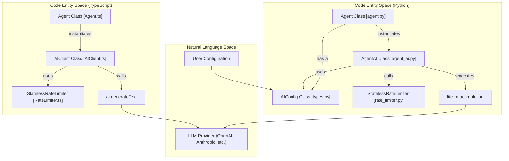
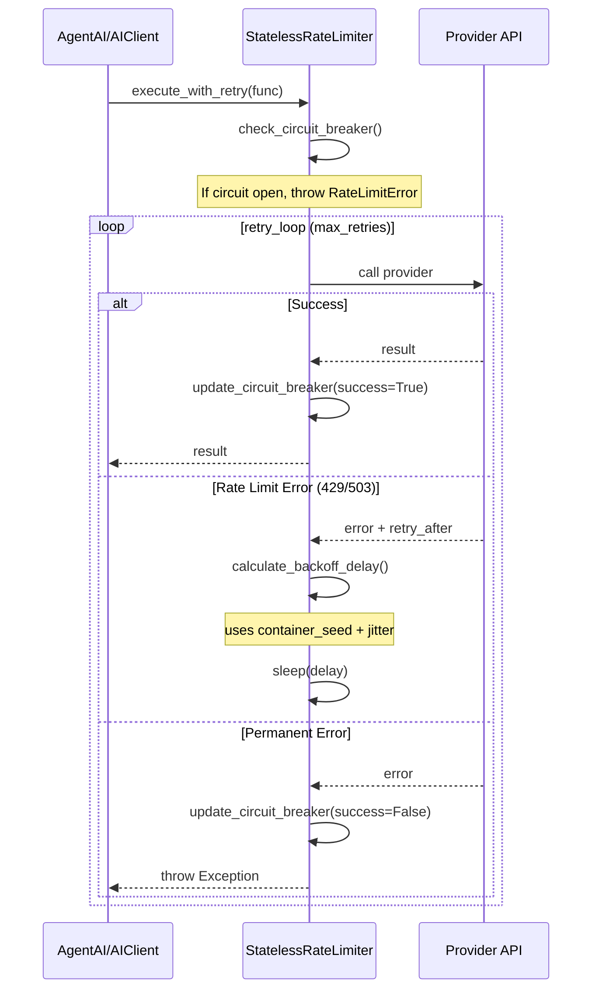

<!-- source: DeepWiki mcp.deepwiki.com · repo Agent-Field/agentfield · page 10.2 AI Configuration · fetched 2026-10-26 -->

# AI Configuration

<details>
<summary>Relevant source files</summary>

The following files were used as context for generating this wiki page:

- [sdk/python/agentfield/agent_ai.py](sdk/python/agentfield/agent_ai.py)
- [sdk/python/agentfield/media_router.py](sdk/python/agentfield/media_router.py)
- [sdk/python/agentfield/rate_limiter.py](sdk/python/agentfield/rate_limiter.py)
- [sdk/python/agentfield/vision.py](sdk/python/agentfield/vision.py)
- [sdk/python/tests/test_agent_ai.py](sdk/python/tests/test_agent_ai.py)
- [sdk/python/tests/test_ai_config.py](sdk/python/tests/test_ai_config.py)
- [sdk/python/tests/test_image_config.py](sdk/python/tests/test_image_config.py)
- [sdk/python/tests/test_media_router.py](sdk/python/tests/test_media_router.py)
- [sdk/python/tests/test_strict_openai_schema.py](sdk/python/tests/test_strict_openai_schema.py)
- [sdk/python/tests/test_types.py](sdk/python/tests/test_types.py)
- [sdk/python/uv.lock](sdk/python/uv.lock)
- [sdk/typescript/src/ai/RateLimiter.ts](sdk/typescript/src/ai/RateLimiter.ts)
- [sdk/typescript/src/ai/ToolCalling.ts](sdk/typescript/src/ai/ToolCalling.ts)

</details>


This page documents how to configure AI/LLM provider access in AgentField agents. AI configuration controls which language models your reasoners can access, authentication credentials, and provider-specific options.

For information about the full list of supported providers and their capabilities, see [Supported Providers](10.1). For details on using the configured AI to generate text, see [Text Generation](10.3). For embedding generation, see [Embeddings](10.4).

---

## Overview

AgentField agents use the `AIConfig` class to specify LLM provider credentials and settings. Configuration can be provided through:

- Constructor parameters when creating an `Agent` instance [sdk/python/agentfield/agent.py:356-442]()
- Environment variables (automatic fallback) [sdk/python/agentfield/agent.py:494-502]()
- Runtime updates to the agent's `ai_config` attribute [sdk/python/agentfield/agent_ai.py:106-111]()

The Python SDK uses **litellm** for unified multi-provider access [sdk/python/agentfield/agent_ai.py:30-45](), while the TypeScript SDK uses the **Vercel AI SDK** with provider-specific packages.

**Sources:** [sdk/python/agentfield/agent.py:356-442](), [sdk/python/agentfield/agent_ai.py:1-45](), [sdk/python/uv.lock:5-22]()

---

## Configuration Architecture

### Data Flow and Entity Mapping
The following diagram bridges the high-level configuration concepts to the specific code entities responsible for handling them.



**Sources:** [sdk/python/agentfield/agent.py:356-442](), [sdk/python/agentfield/agent_ai.py:106-161](), [sdk/python/agentfield/rate_limiter.py:18-48](), [sdk/typescript/src/ai/RateLimiter.ts:51-72]()

---

## AIConfig Class Structure

### Python SDK

The Python SDK's `AIConfig` is a Pydantic model defined in `agentfield/types.py`. It includes extensive support for fallback models and rate limiting parameters.

| Field | Type | Description |
|-------|------|-------------|
| `model` | `str` | Primary model identifier (default: `"gpt-4o"`) [sdk/python/tests/test_ai_config.py:37]() |
| `fallback_models` | `List[str]` | Models to try if the primary fails [sdk/python/agentfield/agent_ai.py:382-388]() |
| `temperature` | `float` | Sampling temperature (default: `0.7`) |
| `max_tokens` | `Optional[int]` | Maximum tokens to generate |
| `rate_limit_max_retries` | `int` | Max retries for 429 errors (default: `5`) [sdk/python/tests/test_ai_config.py:19]() |
| `circuit_breaker_threshold` | `int` | Consecutive failures before opening circuit (default: `5`) [sdk/python/tests/test_ai_config.py:23]() |

The `AIConfig` class provides a `get_litellm_params()` method to prepare arguments for the underlying provider call [sdk/python/tests/test_ai_config.py:50-57]().

**Sources:** [sdk/python/agentfield/types.py:11-32](), [sdk/python/agentfield/agent_ai.py:106-161](), [sdk/python/tests/test_ai_config.py:1-40]()

---

## Resilience and Rate Limiting

AgentField implements a `StatelessRateLimiter` designed for distributed environments.



**Sources:** [sdk/python/agentfield/rate_limiter.py:18-210](), [sdk/typescript/src/ai/RateLimiter.ts:51-230]()

### Key Resilience Features
1.  **Adaptive Backoff**: Uses exponential backoff with jitter based on a `_container_seed` (derived from hostname and PID) to prevent "thundering herd" problems [sdk/python/agentfield/rate_limiter.py:49-53]().
2.  **Circuit Breaker**: Automatically stops requests to a provider if the failure threshold is reached, protecting both the agent and the provider [sdk/python/agentfield/rate_limiter.py:163-206]().
3.  **Fallback Chains**: The Python SDK automatically cycles through `fallback_models` if the primary model returns a transient error [sdk/python/agentfield/agent_ai.py:382-388]().
4.  **LiteLLM Reset**: Defensive cleanup of cached HTTP clients after timeouts to prevent deadlocks [sdk/python/agentfield/agent_ai.py:103-161]().

---

## Multi-Modal Configuration

### Vision and Image Generation
Image generation is routed through `MediaRouter` which dispatches to specific providers based on model prefixes [sdk/python/agentfield/media_router.py:1-20]().

- **LiteLLM Path**: Supports DALL-E, Azure, and Bedrock via `generate_image_litellm` [sdk/python/agentfield/vision.py:29-62]().
- **OpenRouter Path**: Uses chat completions with `modalities=["image"]` to support models like Gemini 3.1 Flash Image [sdk/python/agentfield/vision.py:99-172]().
- **Special Handling**: Includes retries for OpenRouter's "No endpoints found" 404 error [sdk/python/agentfield/vision.py:181-200]().

**Sources:** [sdk/python/agentfield/vision.py:1-172](), [sdk/python/agentfield/media_router.py:1-20]()

### Tool Calling Configuration
The TypeScript SDK provides a `ToolCallConfig` for fine-grained control over how capabilities are presented to the LLM.

| Field | Default | Description |
|-------|---------|-------------|
| `maxTurns` | `10` | Max LLM turns in a tool-call loop [sdk/typescript/src/ai/ToolCalling.ts:45]() |
| `maxToolCalls` | `25` | Max total tool calls allowed [sdk/typescript/src/ai/ToolCalling.ts:46]() |
| `schemaHydration` | `"eager"` | `"eager"` (full schemas) or `"lazy"` (metadata first) [sdk/typescript/src/ai/ToolCalling.ts:34]() |

**Sources:** [sdk/typescript/src/ai/ToolCalling.ts:24-48]()

---

## Configuration Patterns

### OpenRouter Attribution
When using OpenRouter models, the SDK automatically injects attribution headers to identify the application.

```python
# Automatic attribution for OpenRouter
params = AIConfig(model="openrouter/openai/gpt-4o").get_litellm_params()
# Results in headers:
# "HTTP-Referer": "https://agentfield.ai"
# "X-OpenRouter-Title": "AgentField AI"
```

**Sources:** [sdk/python/tests/test_ai_config.py:59-72]()

### Strict Schema Enforcement
For OpenAI models, the SDK provides `_strictify_openai_schema` to ensure Pydantic models are converted to OpenAI's "Strict Mode" requirements (e.g., `additionalProperties: false` and all fields in `required`) [sdk/python/tests/test_strict_openai_schema.py:1-10]().

**Sources:** [sdk/python/agentfield/agent_ai.py:15-18](), [sdk/python/tests/test_strict_openai_schema.py:1-60]()

---

