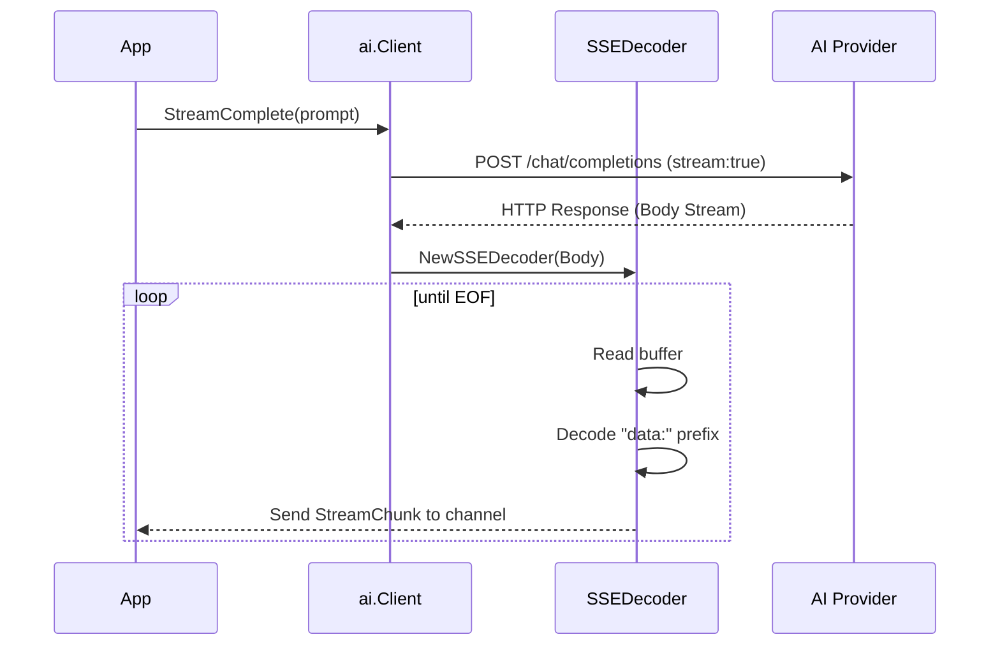

<!-- source: DeepWiki mcp.deepwiki.com · repo Agent-Field/agentfield · page 10.3 Text Generation · fetched 2026-10-26 -->

# Text Generation

<details>
<summary>Relevant source files</summary>

The following files were used as context for generating this wiki page:

- [sdk/go/ai/README.md](sdk/go/ai/README.md)
- [sdk/go/ai/client.go](sdk/go/ai/client.go)
- [sdk/go/ai/client_test.go](sdk/go/ai/client_test.go)
- [sdk/go/ai/config.go](sdk/go/ai/config.go)
- [sdk/go/ai/model_params.go](sdk/go/ai/model_params.go)
- [sdk/go/ai/model_params_test.go](sdk/go/ai/model_params_test.go)
- [sdk/go/ai/multimodal.go](sdk/go/ai/multimodal.go)
- [sdk/go/ai/multimodal_test.go](sdk/go/ai/multimodal_test.go)
- [sdk/go/ai/request.go](sdk/go/ai/request.go)
- [sdk/go/ai/request_test.go](sdk/go/ai/request_test.go)
- [sdk/go/ai/response.go](sdk/go/ai/response.go)
- [sdk/go/ai/response_test.go](sdk/go/ai/response_test.go)
- [sdk/python/agentfield/agent_ai.py](sdk/python/agentfield/agent_ai.py)
- [sdk/python/agentfield/agent_utils.py](sdk/python/agentfield/agent_utils.py)
- [sdk/python/agentfield/media_router.py](sdk/python/agentfield/media_router.py)
- [sdk/python/agentfield/multimodal.py](sdk/python/agentfield/multimodal.py)
- [sdk/python/agentfield/vision.py](sdk/python/agentfield/vision.py)
- [sdk/python/tests/test_agent_ai.py](sdk/python/tests/test_agent_ai.py)
- [sdk/python/tests/test_image_config.py](sdk/python/tests/test_image_config.py)
- [sdk/python/tests/test_media_router.py](sdk/python/tests/test_media_router.py)
- [sdk/python/tests/test_strict_openai_schema.py](sdk/python/tests/test_strict_openai_schema.py)
- [sdk/python/tests/test_types.py](sdk/python/tests/test_types.py)
- [sdk/python/uv.lock](sdk/python/uv.lock)

</details>


## Purpose and Scope

This document covers text generation capabilities in AgentField agents using Large Language Models (LLMs). Text generation enables reasoners to produce natural language responses, structured data, and multimodal outputs (audio/video/image) by interfacing with various AI providers.

For configuration of AI providers and API keys, see [AI Configuration](10.2). For generating embeddings instead of text, see [Embeddings](10.4). For the full list of supported providers, see [Supported Providers](10.1).

**Sources:** [sdk/python/agentfield/agent_ai.py:1-25](), [sdk/go/ai/client.go:1-13]()

---

## Architecture Overview

```mermaid
graph TB
    subgraph "Agent Runtime"
        Reasoner["@app.reasoner() or agent.reasoner()"]
        Context["ReasonerContext (TS) / ExecutionContext (Python)"]
    end
    
    subgraph "AI Layer"
        AIClient_TS["AIClient (TypeScript)"]
        AgentAI_Py["AgentAI Handler (Python)"]
        AIClient_Go["ai.Client (Go)"]
    end
    
    subgraph "Provider Abstraction"
        AI_SDK["ai-sdk (TypeScript)"]
        LiteLLM["litellm (Python)"]
        Internal_Go["Internal SSE/HTTP (Go)"]
    end
    
    subgraph "AI Providers"
        OpenAI["OpenAI"]
        Anthropic["Anthropic"]
        OpenRouter["OpenRouter"]
        Others["Google, Mistral, Groq, xAI, etc."]
    end
    
    Reasoner -->|ctx.ai() or app.ai()| Context
    Context -->|TypeScript| AIClient_TS
    Context -->|Python| AgentAI_Py
    Context -->|Go| AIClient_Go
    
    AIClient_TS --> AI_SDK
    AgentAI_Py --> LiteLLM
    AIClient_Go --> Internal_Go
    
    AI_SDK --> OpenAI
    LiteLLM --> OpenAI
    Internal_Go --> OpenAI
```

**Title:** Text Generation Architecture in AgentField

AgentField provides unified text generation across Python, TypeScript, and Go SDKs. The Python SDK uses `litellm` [sdk/python/agentfield/agent_ai.py:30-45](), while the Go SDK implements a native HTTP client with Server-Sent Events (SSE) support for streaming [sdk/go/ai/client.go:14-17]().

**Sources:** [sdk/python/agentfield/agent_ai.py:30-45](), [sdk/go/ai/client.go:14-35](), [sdk/go/ai/client.go:248-261]()

---

## Basic Text Generation

### Python Implementation
Python reasoners access AI through the `AgentAI` class, which handles model selection, retries, and multimodal detection.

```python
# Simple text generation
@app.reasoner()
async def summarize(text: str) -> dict:
    result = await app.ai(
        prompt=f"Summarize this: {text}",
        system="You are a helpful assistant"
    )
    return {"summary": result.text}
```

The `AgentAI.ai()` method wraps the underlying provider calls with a `StatelessRateLimiter` [sdk/python/agentfield/agent_ai.py:100-111]().

**Sources:** [sdk/python/agentfield/agent_ai.py:131-150](), [sdk/python/agentfield/agent_ai.py:97-111]()

### Go Implementation
The Go SDK provides a `Client` that supports both standard and streaming completions.

```go
// Go completion example
client, _ := ai.NewClient(nil)
resp, err := client.Complete(ctx, "Summarize this document", ai.WithModel("gpt-4o"))
fmt.Println(resp.Text())
```

The Go `Client.Complete` method builds a `Request` and executes it via `doRequest` [sdk/go/ai/client.go:38-63]().

**Sources:** [sdk/go/ai/client.go:38-63](), [sdk/go/ai/request.go:15-43]()

---

## Structured Output and Schemas

### Pydantic (Python)
Python uses Pydantic models for structured output. The SDK includes a `_strictify_openai_schema` utility to ensure compatibility with OpenAI's strict mode by setting `additionalProperties: false` and requiring all fields [sdk/python/agentfield/agent_ai.py:26-27]().

```python
from pydantic import BaseModel

class Analysis(BaseModel):
    sentiment: str
    score: float

result = await app.ai("Analyze this", response_model=Analysis)
```

**Sources:** [sdk/python/tests/test_strict_openai_schema.py:1-9](), [sdk/python/agentfield/agent_ai.py:92-101]()

### Go Request Rewriting
The Go SDK automatically rewrites `max_tokens` to `max_completion_tokens` for newer OpenAI models (gpt-4o, o1 series) when targeting "vouched" endpoints like `api.openai.com` or `openrouter.ai` [sdk/go/ai/model_params.go:9-17]().

**Sources:** [sdk/go/ai/model_params.go:49-56](), [sdk/go/ai/model_params.go:88-102]()

---

## Multimodal Generation

AgentField supports images, audio, and video as part of the text generation flow.

### Image Generation (Python)
The `vision.py` module handles image generation via `litellm` (DALL-E) or `OpenRouter` (Gemini/Grok) [sdk/python/agentfield/vision.py:1-10]().

| Provider | Method | Supported Modalities |
|----------|--------|----------------------|
| LiteLLM | `aimage_generation` | Image (DALL-E 3, etc.) |
| OpenRouter | `acompletion` | Image via chat modalities |

**Sources:** [sdk/python/agentfield/vision.py:29-37](), [sdk/python/agentfield/vision.py:99-108]()

### Multimodal Inputs (Go)
The Go SDK uses functional options to attach media to requests:

```go
// Attaching audio in Go
req, _ := ai.Complete(ctx, "What is in this audio?", 
    ai.WithAudioFile("path/to/audio.mp3", "mp3"))
```

**Sources:** [sdk/go/ai/multimodal.go:39-65](), [sdk/go/ai/multimodal.go:125-151]()

---

## Streaming Responses

### Go SSE Decoder
The Go SDK implements a custom `SSEDecoder` to handle `text/event-stream` responses [sdk/go/ai/client.go:249-261](). It splits the stream on double-newlines and parses the `data:` chunks into `StreamChunk` objects.



**Title:** Go SDK Streaming Flow

**Sources:** [sdk/go/ai/client.go:146-184](), [sdk/go/ai/client.go:264-280]()

---

## Rate Limiting and Safety

### Python Rate Limiter
The Python SDK utilizes a `StatelessRateLimiter` to handle `429 Too Many Requests` errors with exponential backoff and jitter [sdk/python/agentfield/agent_ai.py:16-18]().

**Sources:** [sdk/python/agentfield/agent_ai.py:16-18](), [sdk/python/tests/test_agent_ai.py:97-111]()

### Go Timeout and Retries
The Go `Client` is initialized with a configurable `http.Client` timeout [sdk/go/ai/client.go:31-34](). It checks for transient errors and returns them via an error channel in streaming mode or a standard error in blocking mode [sdk/go/ai/client.go:127-133]().

**Sources:** [sdk/go/ai/client.go:31-34](), [sdk/go/ai/client.go:127-133]()

---

## Model Selection Logic

AgentField uses a "deny-list" approach for model parameters to avoid going stale. For example, in Go, `needsMaxCompletionTokens` returns true for any model that is NOT in the legacy `gpt-3.5` or `gpt-4` (original) families [sdk/go/ai/model_params.go:20-32]().

**Sources:** [sdk/go/ai/model_params.go:20-47](), [sdk/go/ai/model_params_test.go:13-74]()

---

